# AWS Practical Laboratory Report: Lab 04 - Amazon ECS and Deploying the USMS Enrolment Service

**Course:** DSO303 - Cloud Infrastructure & Services  
**Project Context:** University Student Management System (USMS)  
**Location:** `./labs/lab-04-ecs/Report.md`  

---

## 1. Aim / Objective

To containerise the USMS enrolment service onto Amazon ECS on Fargate, inside the private subnets built in
Lab 02, using the AWS CLI against the Floci emulator. The lab builds the four ECS objects (cluster, task
definition, task and service). It also builds the two IAM roles a task needs, a security group sourced from the
web tier's group, and a log group. Then it records every name and ARN for Lab 05 (load balancer) and Lab 06
(auto scaling).

As in earlier labs, the aim is not only to create the resources but to **prove** each property that matters:

* the execution role and the task role are two *different* roles with two different jobs,
* the task role reuses Lab 01's `USMSStudentDataReadWrite` policy unchanged,
* the service spans **two** private subnets, with no public IP,
* the only inbound rule references a **security group**, not a CIDR block,
* `desiredCount` is the one number that controls capacity, shown by changing it by hand.

---

## 2. Introduction

Amazon Elastic Container Service (ECS) runs containers without the operator managing a scheduler. It is built
from four objects, and keeping them apart is the main idea of this lab:

| Object | What it is | Lab 03 analogy |
|---|---|---|
| **Cluster** | A namespace. On Fargate it holds no servers and costs nothing | - |
| **Task definition** | A versioned, **immutable** blueprint (`usms-enrolment:1`, `:2`, ...) | The golden AMI |
| **Task** | One running copy of a task definition; when it exits it is gone | A running instance |
| **Service** | A controller that keeps `runningCount` equal to `desiredCount` | Nothing; this is new |

**Fargate** removes the EC2 instances. Each task states its own CPU and memory, and you pay per task-second.
It does **not** remove networking. A task in `awsvpc` mode gets its own elastic network interface in your
subnet, carries your security group, and follows your route tables, exactly like an EC2 instance.

A task uses two IAM roles:

| | Task execution role | Task role |
|---|---|---|
| Used by | The ECS/Fargate agent, **before** the container starts | The application, **inside** the container |
| Used for | Pulling the image, writing log streams | S3 and other AWS API calls |
| Symptom if wrong | Task never starts; `stoppedReason` names the image or logs | Task starts, but the app gets `AccessDenied` |

---

## 3. Use Case

USMS enrolment week puts thousands of module registrations into the first twenty minutes of a Monday
morning, then almost nothing for six days. The single fixed-size EC2 instance from Lab 03 cannot react to
that. This lab moves the enrolment API onto an ECS service that:

* runs **two** tasks, one per Availability Zone, so one AZ failure does not take the service down,
* lives in the **private** subnets, reachable only from the web tier (`usms-app-sg`),
* pulls its image through Lab 02's NAT gateway, since the private subnets have no internet gateway route,
* writes its logs to a dedicated log group with a retention limit,
* holds the same S3 permission as the EC2 web server, through a task role instead of an instance profile.

Capacity stays fixed at `desiredCount = 2` in this lab. Lab 06 hands that one number to Application Auto Scaling.

---

## 4. Architecture

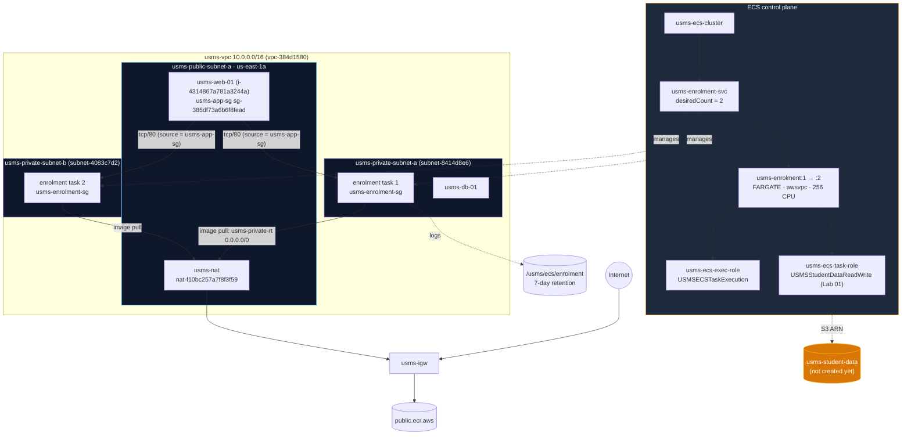

### Resources created

| Resource | ID / ARN | Notes |
|---|---|---|
| `usms-ecs-cluster` | `arn:aws:ecs:us-east-1:000000000000:cluster/usms-ecs-cluster` | containerInsights `enabled` |
| `/usms/ecs/enrolment` | log group | retention 7 days |
| `usms-ecs-exec-role` | `arn:aws:iam::000000000000:role/usms-ecs-exec-role` | carries `USMSECSTaskExecution` |
| `USMSECSTaskExecution` | customer managed policy | ECR pull + logs to **one** log group |
| `usms-ecs-task-role` | `arn:aws:iam::000000000000:role/usms-ecs-task-role` | carries Lab 01's `USMSStudentDataReadWrite` |
| `usms-enrolment-sg` | `sg-9773754b5fdc6a643` | tcp/80 from `usms-app-sg` only |
| `usms-enrolment` family | revisions `:1` (512 MiB) and `:2` (1024 MiB) | FARGATE, awsvpc, 256 CPU |
| `usms-enrolment-svc` | `arn:aws:ecs:us-east-1:000000000000:service/usms-ecs-cluster/usms-enrolment-svc` | desired 2, both private subnets |
| `usms-results-svc` | (Exercise 1) | created, then deleted in Exercise 4 |

### Files created

| File | Purpose |
|---|---|
| `policies/trust-ecs-tasks.json` | Trust policy shared by both ECS roles |
| `policies/usms-ecs-task-execution-policy.json` | Least-privilege execution permissions |
| `policies/usms-enrolment-sg-ingress.json` | Group-referenced ingress rule |
| `templates/lab-04-taskdef.json`, `-v1.json`, `-v2.json` | Task definition request bodies (revision 1 and 2) |
| `configs/lab-04.env` | 17 exports for Lab 05 and Lab 06 |
| `scripts/utilities/verify-lab-04.sh` | 38-check verification |
| `scripts/cleanup/lab-04-cleanup.sh` | End-of-course teardown (syntax-checked, **not run**) |
| `scripts/utilities/lab-04-ecs-inventory.sh` | Exercise 3 drift report |

---

## 5. Implementation Procedure

1. **Environment (Steps 1-2):** started Floci, sourced `course.env` and `lab-01.env` to `lab-03.env`, confirmed the identity, and re-ran the Lab 02 and Lab 03 verification scripts.
2. **Support probe (Step 3):** checked which ECS, Application Auto Scaling, CloudWatch and Logs operations this Floci build answers, and recorded the support path.
3. **Cluster (Step 4):** assumed `usms-developer-role`, created `usms-ecs-cluster` with Container Insights, then unset the role credentials.
4. **Log group (Step 5):** created `/usms/ecs/enrolment` and set a 7-day retention policy.
5. **Execution role (Step 6):** wrote the trust policy and a least-privilege execution policy, then created and attached them.
6. **Task role (Step 7):** created `usms-ecs-task-role` and attached Lab 01's existing `USMSStudentDataReadWrite`.
7. **Security group (Step 8):** created `usms-enrolment-sg` with one inbound rule sourced from `usms-app-sg`.
8. **Task definition (Step 9):** wrote `templates/lab-04-taskdef.json` with an unquoted heredoc, validated it, and registered `usms-enrolment:1`.
9. **Service (Steps 10-11):** created `usms-enrolment-svc` (desired 2) in both private subnets, read back its four counts, and scaled it to 3 and back to 2 by hand.
10. **Record and commit (Steps 12-13):** wrote `configs/lab-04.env` by API lookup and committed with explicit paths.
11. **Verification and cleanup scripts (Section 9):** built and ran `verify-lab-04.sh` and syntax-checked `lab-04-cleanup.sh`.
12. **Exercises 1-5 (Section 13).**

---

## 6. Results and Evidence

All commands were run from the repository root after:

```bash
source configs/course.env; source configs/lab-01.env; source configs/lab-02.env; source configs/lab-03.env
export AWS_PAGER=""
```

### 6.1 Main Lab Steps

---

#### 6.1.1 Load the environment and confirm the identity (Step 1)

**Task:** Start Floci, load the earlier labs' env files, and confirm the CLI is talking to Floci, not real AWS.

**Why it matters:** `whoami.sh` exits with an error if the account is not `000000000000`. That guard stops
a course command from reaching a real AWS account.

**Command:** `./scripts/utilities/whoami.sh`, then a `printf` of the eight values this lab reads.

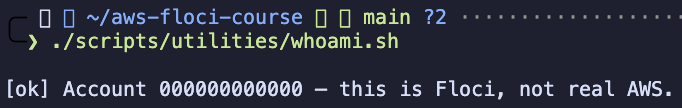

**Observation:** `[ok] Account 000000000000 — this is Floci, not real AWS.` All eight values were populated:
private subnets `subnet-8414d8e6` and `subnet-4083c7d2`, app SG `sg-385df73a6b6f8fead`, VPC `vpc-384d1580`,
NAT `nat-f10bc257a7f8f3f59` and web instance `i-4314867a781a3244a`. Subnet b exists, so the service can span
two Availability Zones.

---

#### 6.1.2 Confirm Labs 02 and 03 are intact (Step 2)

**Task:** Re-run both earlier verification scripts before building on top of them.

**Why it matters:** This lab depends on nine resources from Labs 02 and 03. Two of them fail silently if broken:
the private route table must have no internet gateway route, and `usms-web-01` must still carry `usms-app-sg`.

**Command:** `./scripts/utilities/verify-lab-02.sh; ./scripts/utilities/verify-lab-03.sh`

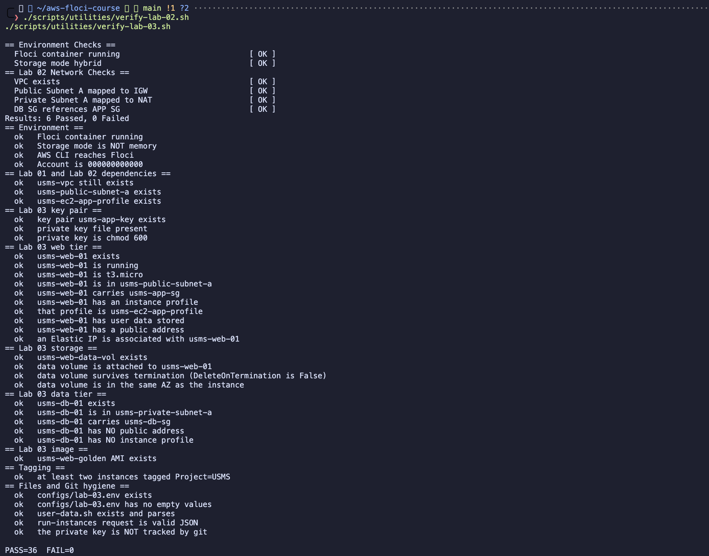

**Observation:** Lab 02: `6 Passed, 0 Failed`. Lab 03: `PASS=36 FAIL=0`. On the first run Lab 03 reported
`PASS=34 FAIL=2`. That was fixed before continuing, as described in Section 7.

---

#### 6.1.3 Probe what this Floci build supports (Step 3)

**Task:** Find out which ECS, Application Auto Scaling, CloudWatch and Logs operations this build answers.

**Why it matters:** Lab 06 depends on Application Auto Scaling. It is better to find a limitation now than to
lose an hour to it later.

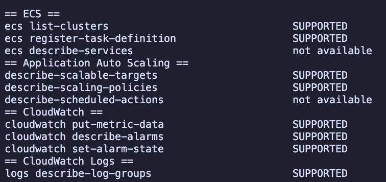

**Observation:** Two lines printed `not available`. Running each command without hiding its error showed
that they mean different things:

| Probe | Real error | Meaning |
|---|---|---|
| `ecs describe-services` | `ClusterNotFoundException: Cluster not found: probe` | **False negative.** ECS answered; the probe deliberately names a cluster that does not exist |
| `describe-scheduled-actions` | `UnsupportedOperation: Operation DescribeScheduledActions is not supported` | **Real limitation.** Scheduled scaling is not implemented |

**Support path recorded: A.** ECS and Application Auto Scaling (scalable targets and scaling policies) are
both supported. The only gap is scheduled actions, which affects Lab 06's scheduled scaling but nothing in
this lab.

---

#### 6.1.4 Create the cluster as the developer role (Step 4)

**Task:** Assume `usms-developer-role`, create `usms-ecs-cluster` with Container Insights enabled, then
unset the role credentials.

**Why it matters:**
* Doing a lab's first build action as the least-privileged identity is the habit the course wants.
* Container Insights produces the per-service CPU metric that Lab 06's target tracking policy reads.

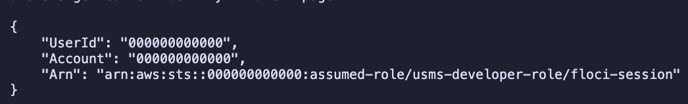

**Observation (identity):** the ARN is `arn:aws:sts::000000000000:assumed-role/usms-developer-role/floci-session`.
The role was assumed. Floci ignored the requested session name `lab04-ecs-build` and used `floci-session`
instead. Real AWS would show the requested name. Recorded as a Floci limitation.

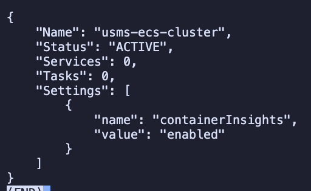

**Observation (cluster):** `usms-ecs-cluster` is `ACTIVE` with 0 services, 0 tasks and
`containerInsights = enabled`. The role credentials were unset afterwards, and `whoami.sh` again showed the
root identity (`arn:aws:iam::000000000000:root`).

---

#### 6.1.5 Create the log group with retention (Step 5)

**Task:** Create `/usms/ecs/enrolment` and set a 7-day retention.

**Why it matters:**
* The `awslogs` driver does not create the log group. A task whose log group is missing fails to start with an error about the log driver.
* `create-log-group` has no retention parameter. A log group without a retention policy keeps (and bills for) data forever.

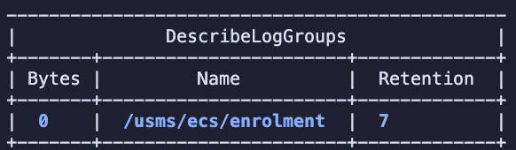

**Observation:** one log group, `/usms/ecs/enrolment`, `Retention 7`, `Bytes 0`. Nothing has logged yet.

---

#### 6.1.6 Create the task execution role (Step 6)

**Task:** Write the trust policy and a least-privilege execution policy, then create `usms-ecs-exec-role`
and attach `USMSECSTaskExecution`.

**Why it matters:**
* The policy allows the four ECR pull actions on `"*"`, because `ecr:GetAuthorizationToken` is an account-level call with no resource.
* Log writes are limited to **one** log group (`arn:aws:logs:us-east-1:000000000000:log-group:/usms/ecs/enrolment:*`). AWS's managed `AmazonECSTaskExecutionRolePolicy` allows writing to every log group in the account.

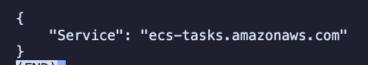


**Observation:** the trust principal is `{"Service": "ecs-tasks.amazonaws.com"}`, not the commonly mistyped
`ecs.amazonaws.com`. The attached policy is `USMSECSTaskExecution`.

---

#### 6.1.7 Create the task role and reuse Lab 01's policy (Step 7)

**Task:** Create `usms-ecs-task-role` with the same trust policy and attach Lab 01's existing
`USMSStudentDataReadWrite`. Do not create a copy.

**Why it matters:** this is the third lab to use the same policy. Lab 01 wrote it for a bucket that does not
exist yet. Lab 03 delivered it to an EC2 instance through an instance profile. Here it is delivered to a
container through a task role.

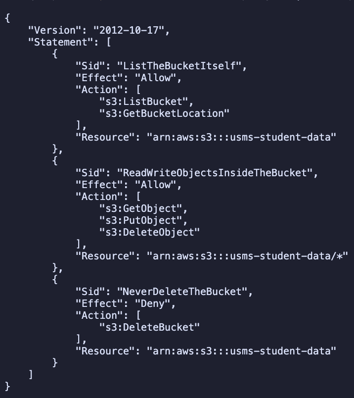

**Observation:** the attached policy is Lab 01's `USMSStudentDataReadWrite`, unchanged:

| Sid | Effect | Actions | Resource |
|---|---|---|---|
| `ListTheBucketItself` | Allow | `s3:ListBucket`, `s3:GetBucketLocation` | `arn:aws:s3:::usms-student-data` |
| `ReadWriteObjectsInsideTheBucket` | Allow | `s3:GetObject`, `s3:PutObject`, `s3:DeleteObject` | `arn:aws:s3:::usms-student-data/*` |
| `NeverDeleteTheBucket` | **Deny** | `s3:DeleteBucket` | `arn:aws:s3:::usms-student-data` |

Two different kinds of compute now hold the same permission through two different delivery mechanisms,
and neither has a key on disk:

```
Lab 03  usms-web-01 -- instance profile -- usms-ec2-app-role  --+
                                                                 +-- USMSStudentDataReadWrite --> arn:aws:s3:::usms-student-data
Lab 04  task        -- taskRoleArn      -- usms-ecs-task-role --+                                  (does not exist yet)
```

---

#### 6.1.8 Checkpoint 2

**Task:** Show the cluster, the log group and both roles together.

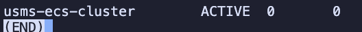


**Observation:**

```
usms-ecs-cluster      ACTIVE  0  0
/usms/ecs/enrolment   7
usms-ecs-exec-role   trusts=ecs-tasks.amazonaws.com    policies=USMSECSTaskExecution
usms-ecs-task-role   trusts=ecs-tasks.amazonaws.com    policies=USMSStudentDataReadWrite
```

The checkpoint is split across two screenshots because the AWS CLI pager (`(END)`) showed each command's
output separately. The two role lines were captured in the terminal output above. Both roles have the same
trust policy but different permissions.

---

#### 6.1.9 Create the enrolment security group (Step 8)

**Task:** Create `usms-enrolment-sg` with one inbound rule: tcp/80 from the `usms-app-sg` group.

**Why it matters:**
* Fargate tasks have no stable IP addresses. Every replacement or scaling event creates a new network interface.
* A rule that names a group is the only form that stays correct as tasks come and go. A CIDR rule would have to be rewritten each time.
* The rule was written with an **unquoted** heredoc, so `$USMS_APP_SG` became a real group ID in the file.

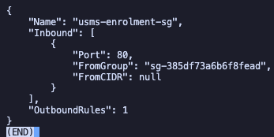

**Observation:** one inbound rule on port `80`. `FromGroup` is `sg-385df73a6b6f8fead` (usms-app-sg) and
`FromCIDR` is `null`. There is one outbound rule: the default allow-all egress, which tasks use to reach
the NAT gateway.

---

#### 6.1.10 Write and register the task definition: Checkpoint 3 (Step 9)

**Task:** Write `templates/lab-04-taskdef.json` with the two role ARNs, the log group and the region
substituted. Validate it, then register `usms-enrolment:1`.

**Why it matters:**
* `cpu` and `memory` must be **strings** and a valid Fargate pair (256 CPU allows 512, 1024 or 2048 MiB).
* `grep -c '\$'` must print `0`. Any remaining `$` means an empty variable or a quoted heredoc.

**Pre-registration check:** `valid JSON`, `0` unexpanded variables, and both role ARNs and the log group populated.

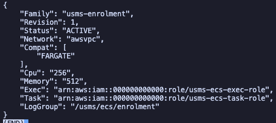

**Observation:** `usms-enrolment` revision `1`, `ACTIVE`, network `awsvpc`, compatibility `FARGATE`, CPU
`"256"`, memory `"512"`, log group `/usms/ecs/enrolment`. `Exec` is `usms-ecs-exec-role` and `Task` is
`usms-ecs-task-role`: **two different roles**. If they were the same, the task would start, but the
application would get `AccessDenied` on S3 at runtime.

---

#### 6.1.11 Create the service in the private subnets: Checkpoint 4 (Steps 10-11)

**Task:** Create `usms-enrolment-svc` with `desiredCount 2` on FARGATE, in both private subnets, with
`usms-enrolment-sg` and `assignPublicIp=DISABLED`. Then read back the four counts.

**Why it matters:** the tasks are in subnets with no internet gateway route, yet they must pull an image from
`public.ecr.aws`. The only path is Lab 02's network: task network interface → `usms-private-rt` (`0.0.0.0/0 → usms-nat`) →
NAT in the public subnet → `usms-igw` → registry. Some image layers come from S3 through `usms-s3-endpoint`.
This is the first lab where Lab 02's NAT gateway is load-bearing.

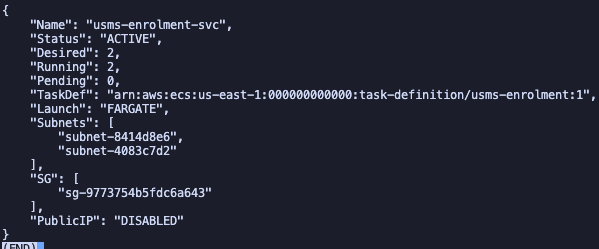

**Observation:** `usms-enrolment-svc` is `ACTIVE`, `Desired 2`, `Running 2`, `Pending 0`, task definition
`usms-enrolment:1`, launch type `FARGATE`. Subnets are `subnet-8414d8e6` and `subnet-4083c7d2` (both private),
the security group is `sg-9773754b5fdc6a643`, and the public IP is `DISABLED`. This Floci build actually started
containers, so `runningCount` reached 2 rather than staying at 0.

---

#### 6.1.12 Change capacity by hand (Step 11, "Your turn")

**Task:** Set `desiredCount` to 3, wait, set it back to 2, then read the service's events.

**Why it matters:** this is exactly what Lab 06's scaling policy will do automatically. Auto scaling changes
`desiredCount` and nothing else; the service starts or stops tasks to match.


**Observation:**

| Action | Output |
|---|---|
| `update-service --desired-count 3` | `3` |
| desired / running / pending | `3  3  0`: the service started a third task |
| `update-service --desired-count 2` | `2` |
| `events[0:5]` | `None` |

`runningCount` followed `desiredCount` up and back down. The service's `events` list was empty (`None`):
**Floci does not record service events**, where real AWS would show messages such as "has started 1 tasks".
The scale-down is instead shown by the task list: 2 tasks `RUNNING` and the removed task `STOPPED`.
The service ended at `desired 2 / running 2`, which Step 12 records as Lab 06's baseline.

---

#### 6.1.13 Write `configs/lab-04.env` (Step 12)

**Task:** Record every name and ARN by **looking it up from the API**, not by copying shell variables.

**Why it matters:**
* A populated value proves the resource exists.
* An unquoted heredoc runs every `$(...)` at write time.
* `USMS_ECS_DESIRED_BASELINE` is read from the service, so Lab 06 inherits the true floor, not the intended one.

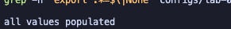
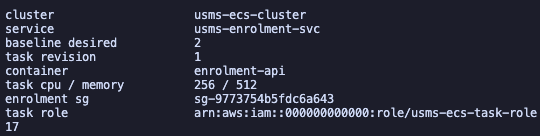

**Observation:** `all values populated`. Cluster `usms-ecs-cluster`, service `usms-enrolment-svc`, baseline
desired `2`, task revision `1`, container `enrolment-api`, CPU/memory `256 / 512`, enrolment SG
`sg-9773754b5fdc6a643`, and the task role ARN. The file has `17` exports.

---

#### 6.1.14 Commit with explicit paths (Step 13)

**Task:** Look before adding, prove the assumed-role credentials file is ignored, then commit with named
paths (never `git add -A`).

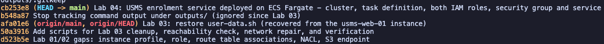

**Observation:** `git check-ignore -v` prints `.gitignore:6:outputs/*  outputs/lab-04-assumed-role.json`, and
`git ls-files outputs/` lists only `outputs/.gitkeep`. Commit `cb253e8` "Lab 04: USMS enrolment service
deployed on ECS Fargate ..." holds 9 files. It sits above `b548a87`, which stopped tracking nine Lab 02
files under `outputs/` (see Section 7).

---

#### 6.1.15 Run the Lab 04 verification script (Section 9.2)

**Task:** Build `scripts/utilities/verify-lab-04.sh` and run it.

**Why it matters:** four of its checks catch faults that a "does it exist" check would miss:
* the exec role and task role are **different**,
* the service spans **two** subnets,
* the security group is sourced from a **group**, not a CIDR,
* the log group **has** a retention policy.

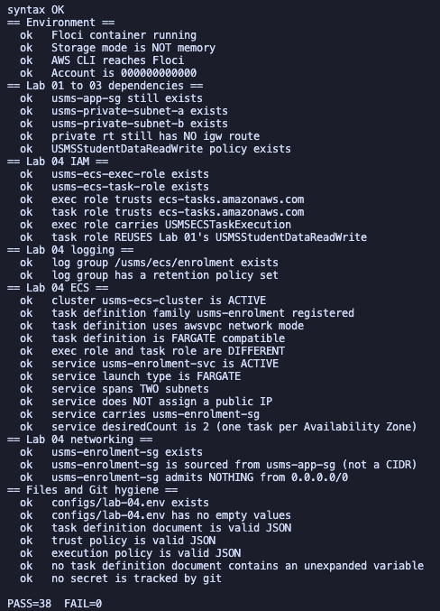

**Observation:** `syntax OK`, then all checks `ok`: `PASS=38 FAIL=0`. That is 4 environment checks,
5 Lab 01-03 dependencies, 6 IAM, 2 logging, 11 ECS, 3 networking and 7 file/git hygiene checks.

---

#### 6.1.16 Build the end-of-course cleanup script (Section 9.3)

**Task:** Write `scripts/cleanup/lab-04-cleanup.sh` and check its syntax **without running it**.

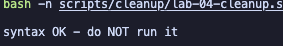

**Observation:** `syntax OK - do NOT run it`. The script was not executed. Its order is the lesson:
1. scale the service to 0 and wait,
2. delete the service,
3. deregister the task definitions,
4. delete the cluster,
5. delete the security group (only after no task network interface uses it),
6. detach the IAM policies, then delete the roles,
7. delete the log group.

It must run after the Lab 06 and Lab 05 cleanups and before the Lab 02 cleanup.

---

### 6.2 Extended Laboratory Exercises

---

#### Exercise 1: A second service (`usms-results-svc`)

**Task:** Create `usms-results-svc` from the same `usms-enrolment` family, with `desiredCount 1`, in both
private subnets, with `usms-enrolment-sg`, tagged `Service=results`. Do not record it in `lab-04.env`.

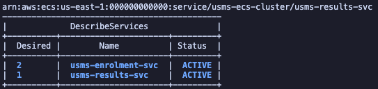

**Observation:** `describe-services` returned two `ACTIVE` services: `usms-enrolment-svc` (desired 2) and
`usms-results-svc` (desired 1). Only the name, the count and the `Service` tag changed. The subnets, security
group and `assignPublicIp` did not.

---

#### Exercise 2: A new revision and a deployment

**Task:** Register `usms-enrolment:2` with memory raised from 512 to 1024 MiB and `USMS_LOG_LEVEL=info`
added. Point the service at it, and confirm revision 1 still exists.

**Approach:** the revision 1 template was kept unchanged as `templates/lab-04-taskdef-v1.json`.
`templates/lab-04-taskdef-v2.json` was derived from it with `jq`, so the template files are immutable in
the same way as the revisions.

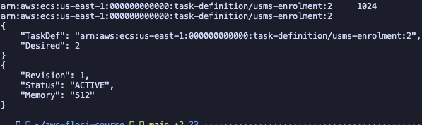

**Observation:** `usms-enrolment:2` was registered with memory `1024`. The service's `TaskDef` now ends in
`usms-enrolment:2`, still with `Desired 2`. Revision 1 still reports `Revision 1`, `ACTIVE`, memory `"512"`.

**One-sentence answer:** a task definition revision can never change, but the service's `taskDefinition`
field is only a pointer. `update-service` moved it from `:1` to `:2`, while `desiredCount`, subnets and
security group stayed exactly as they were.

---

#### Exercise 3: ECS configuration drift report

**Task:** Write `scripts/utilities/lab-04-ecs-inventory.sh`. It prints one line per service with *computed*
verdicts (`roles=SAME/SEPARATE`, `publicip=OK/RISK/N/A`), has no hard-coded service names, runs from any
directory, and also writes JSON.

**Design decisions:**
* Paths are resolved from `${BASH_SOURCE[0]}`.
* It lists services from the cluster, then describes each one.
* A missing `networkConfiguration` prints `publicip=N/A` rather than an error.
* `set -e` is deliberately **off**. One service that fails to describe must not abort the report and hide every service after it. Each call is checked explicitly instead.

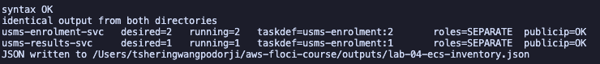

**Observation:** `identical output from both directories` (run from `~` and from `labs/lab-04-ecs/`).

```
usms-enrolment-svc   desired=2  running=2  taskdef=usms-enrolment:2  roles=SEPARATE  publicip=OK
usms-results-svc     desired=1  running=1  taskdef=usms-enrolment:1  roles=SEPARATE  publicip=OK
```

The report also caught real drift: the results service still runs revision `:1`. It was created before
Exercise 2, and Exercise 2 only updated the enrolment service. The JSON was written to
`outputs/lab-04-ecs-inventory.json`.

---

#### Exercise 4: Enrolment-week capacity plan

**Why a fixed `desiredCount` of 2 cannot answer the 08:03 problem.** `usms-enrolment-svc` has no scalable
target, no alarm and no schedule. Nothing in it reads a metric or a clock, so its capacity only changes when
a person runs `update-service`. Even then, each new Fargate task needs 20-60 seconds to start on real AWS.
The 08:00 spike arrives faster than anyone can notice it and react.

**Proposed plan.** The traffic figures are *assumptions*, to be replaced by Lab 05/06 measurements:
* 4,000 students in 20 minutes, at about 10 requests per registration, is 40,000 requests / 1,200 s ≈ 33 requests per second on average.
* Allowing 3× for the opening minutes gives a peak of ≈ 100 requests per second.
* One 0.25 vCPU task is assumed to handle about 20 requests per second.

| Setting | Value | Derivation | If too low | If too high |
|---|---|---|---|---|
| Minimum | 2 | One task per AZ | An AZ failure is an outage | Idle cost 6 days a week |
| Maximum | 8 | 100 ÷ 20 = 5, +1 headroom = 6 (even, for AZ balance), +2 for retries | Capped, overloaded service | Runaway cost if a bad metric triggers scaling |
| Scheduled floor | 6, Monday 07:45-08:30 | Pre-warm the spike, because start latency makes reactive scaling too late | 08:03 repeats | 45 minutes of extra tasks (cheap) |
| Trigger | Target tracking, `ECSServiceAverageCPUUtilization` ≈ 60 % | Container Insights is enabled on the cluster | Scales too late | Flaps and over-provisions |

The scheduled floor cannot be tested on this Floci build, because `DescribeScheduledActions` is unsupported (Step 3).

**Monthly cost.** Fargate Linux/x86 in us-east-1: $0.04048 per vCPU-hour and $0.004445 per GB-hour, over
730 hours. Source: [AWS Fargate pricing](https://aws.amazon.com/fargate/pricing/); re-check before quoting,
because prices change.

| Option | Calculation | Monthly |
|---|---|---|
| One task (0.25 vCPU, 0.5 GB) | 0.25 × 0.04048 + 0.5 × 0.004445 = $0.012343/h × 730 | ≈ $9.01 |
| Fixed at today's 2 | 2 × $9.01 | **≈ $18.02** |
| Fixed at the peak of 8 | 8 × $9.01 | **≈ $72.08** |
| Scaled (2 baseline + 4 extra for ~13 h/month) | 18.02 + 4 × 13 × 0.012343 | **≈ $18.66** |

Scaling costs about $0.64 a month more than today and about $53 a month less than running peak capacity all
the time.

**What was switched off.**

> **DANGER - irreversible.** **What will be deleted:** ECS service `usms-results-svc` (Exercise 1 practice only).
> **What depends on it:** nothing; it is not in `lab-04.env`. **Reversible?** Only by re-running Exercise 1.

The service was scaled to 0, the commands waited for it to become stable, and then it was deleted.

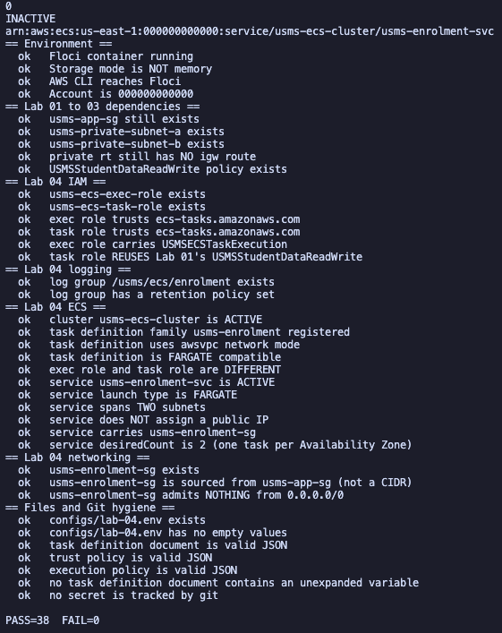

**Observation:** desired count `0`, then status `INACTIVE`. `list-services` now returns only
`usms-enrolment-svc`, and `verify-lab-04.sh` still reports `PASS=38 FAIL=0`. Nothing in the KEEP list was touched.

---

#### Exercise 5: Close the loop back to Lab 03

**Task:**
* Resolve `usms-enrolment-sg`'s source group back to the running instance that carries it.
* Compare that instance with `$USMS_WEB_INSTANCE`.
* Audit the ECS tags, using ARNs.
* Write the result where a Lab 05 reader can find it.

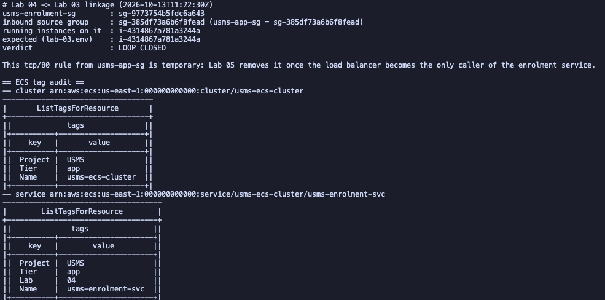

**Observation:**

```
usms-enrolment-sg        : sg-9773754b5fdc6a643
inbound source group     : sg-385df73a6b6f8fead (usms-app-sg = sg-385df73a6b6f8fead)
running instances on it  : i-4314867a781a3244a
expected (lab-03.env)    : i-4314867a781a3244a
verdict                  : LOOP CLOSED
```

The rule grants access to something real: exactly one running instance, `usms-web-01`. The file records that
this tcp/80 rule is temporary, because Lab 05 removes it once the load balancer becomes the only caller.

The tag audit (`list-tags-for-resource`, which takes an ARN, not a name) showed:
* the cluster carries `Project=USMS`, `Tier=app`, `Name=usms-ecs-cluster`,
* the service carries `Project=USMS`, `Tier=app`, `Lab=04`, `Name=usms-enrolment-svc`.

Floci stored the ECS tags, so no `tag-resource` repair was needed.

**Note:** the lab asks for this file to be committed, but `outputs/*` is git-ignored, and Step 13 forbids
committing outputs. The `.gitignore` rule was kept, and the file's contents are reproduced in this report instead.

---

## 7. Analysis and Discussion

### Outcomes Achieved
1. The USMS enrolment service runs on ECS Fargate as a service with `desiredCount 2`. It spans two private
   subnets in two Availability Zones, has no public IP, and admits traffic only from the web tier's security group.
2. The two ECS roles are separate and proven separate. The execution role is least-privilege and scoped to one
   log group. The task role reuses Lab 01's policy unchanged, giving a second permission chain to the same
   (still non-existent) bucket.
3. `desiredCount` was shown to be the single control for capacity: moving it by hand moved `runningCount`
   with it. This is the number Lab 06 will automate.
4. Everything Lab 05 and Lab 06 need is recorded by lookup in `configs/lab-04.env` (17 exports).
   `verify-lab-04.sh` reports `PASS=38 FAIL=0`.

### Errors Encountered and Solutions

* **Issue:** `verify-lab-03.sh` reported `PASS=34 FAIL=2` before the lab started.  
  **Root cause:**
  * `usms-web-01` was in the `stopped` state, left over from Lab 03's stop/start test.
  * `labs/lab-03-ec2/user-data.sh` was missing. It had never been committed, and Floci does not return stored user data.

  **Resolution:**
  * Started the instance with `start-instances` and `wait instance-running`.
  * Recovered the original script from inside the instance's Docker container (`/tmp/user-data.sh`). It was 1,656 bytes, matching the size the Lab 03 report recorded.
  * Committed the script (`afa01e6`). The script then reported `PASS=36 FAIL=0`.

* **Issue:** the support probe reported `ecs describe-services` as `not available`.  
  **Root cause:** the probe treats every error as "unsupported". The real error was
  `ClusterNotFoundException`, an argument error that proves ECS answered.  
  **Resolution:** reran each failed probe without `2>&1 >/dev/null` to read the real error before deciding the path.

* **Issue:** `configs/lab-01.env` did not define `USMS_POLICY_S3_RW`, which Step 7 uses.  
  **Root cause:** Lab 01's env file recorded the policy by name in prose only.  
  **Resolution:** exported `USMS_POLICY_S3_RW=USMSStudentDataReadWrite` and added it to `lab-01.env`.
  Without it, the policy ARN would have ended in `policy/`, and the attach would have failed.

* **Issue:** command output disappeared, or appeared one command at a time behind `(END)`.  
  **Root cause:** the AWS CLI pager. When a multi-line block was pasted, the lines after the first command were typed into the pager.  
  **Resolution:** `export AWS_PAGER=""` (and `GIT_PAGER=cat`). This is also why Checkpoint 2 is spread over two screenshots.

* **Issue:** the first Step 13 `git add` failed with `pathspec 'scripts/utilities/verify-lab-04.sh' did not match any files`.  
  **Root cause:** the verification and cleanup scripts (Section 9) had not been built yet. One missing path makes `git add` stage nothing.  
  **Resolution:** built both scripts first, then committed.

* **Issue:** `git ls-files outputs/` listed nine Lab 02 files, including `outputs/lab-02-assumed-role.json`.  
  **Root cause:** they were committed in Lab 02, before the `outputs/*` ignore rule existed. An ignore rule does not untrack files that are already tracked.  
  **Resolution:** `git rm --cached` on all nine (commit `b548a87`), so the files stay on disk but are no longer tracked.
  They remain in older commits. They contain only Floci emulator credentials (account `000000000000`), so nothing real was exposed.

### Floci vs Real AWS: what was observed

| Behaviour | Observed in Floci | Real AWS |
|---|---|---|
| ECS clusters, task definitions, services | Fully modelled, including immutable revisions | Same |
| Fargate tasks | **Containers actually started**; `runningCount` reached 2 and 3 | Real tasks, 20-60 s start latency |
| Assume-role session name | Ignored; ARN shows `floci-session` | Shows `lab04-ecs-build` |
| Service `events` | Empty (`None`) after scaling | Narrates every start and stop |
| `list-tasks` (no filter) | Includes `STOPPED` tasks | Returns `RUNNING` tasks by default |
| Container Insights setting | Stored and returned as `enabled` | Publishes CPU and memory to `AWS/ECS` every minute |
| Log retention | Applied (7 days) | Same |
| ECS tags | Stored and returned by `list-tags-for-resource` | Same |
| Application Auto Scaling | Scalable targets and policies answer; **scheduled actions unsupported** | All supported |
| Task credentials (`AWS_CONTAINER_CREDENTIALS_RELATIVE_URI`) | Not served to containers (per the lab; not tested) | Rotated automatically |
| Security group enforcement on task traffic | Not enforced (per the lab; not tested) | Every packet |

**Observed vs conceptual.** Observed directly: the cluster, the task-definition family and its revisions, the
service in two private subnets, two roles with one trust policy, a group-referenced rule, tasks actually running,
and `desiredCount` changed by hand. Reasoned about, not observed: task credentials inside the container,
security-group enforcement, Container Insights metrics actually being published, the 20-60 s start latency,
and the real monthly cost.

---

## 8. Reflection

1. **What did you learn about this AWS service?**  
   ECS is four objects, and only one of them, the service's `desiredCount`, is a moving target. Auto scaling
   does not touch containers or task definitions; it writes one integer, and the service makes reality
   match. I also learned to tell the two roles apart by their symptom. "The task never starts" points at the
   execution role; "the task runs but gets AccessDenied" points at the task role.

2. **What challenges did you encounter?**  
   Most problems came from outside the step being done:
   * a stopped instance and an uncommitted script from Lab 03,
   * a variable never written into `lab-01.env`,
   * Lab 02 output files committed before the ignore rule existed,
   * the CLI pager hiding output.

   Each was found by reading the real error, or by checking a relationship rather than trusting a summary.
   The probe's "not available" for ECS was the clearest example of a summary that was wrong.

3. **How would you apply this service in a real-world cloud environment?**  
   * Build the application image in CI and push it to a private ECR repository.
   * Register a new task-definition revision per release, and roll back by pointing the service at the previous revision.
   * Run at least two tasks across AZs behind a load balancer (Lab 05), and let Application Auto Scaling move `desiredCount` (Lab 06).
   * Use VPC endpoints for ECR and S3 so image pulls avoid NAT charges.
   * Keep every security group rule group-referenced.

4. **What additional concepts or features would you like to explore?**  
   * ECS Exec for debugging running tasks.
   * Capacity providers and Fargate Spot for cheaper non-critical services.
   * Blue/green deployments with CodeDeploy.
   * Secrets Manager values injected through the execution role.
   * Declaring this whole service in CloudFormation, as a later lab does.

---

## 9. Conclusion

The objectives of Lab 04 were achieved. The USMS enrolment service was deployed on ECS Fargate as a
two-task service across both private subnets, with no public IP. It has a least-privilege execution role, a
task role that reuses Lab 01's policy unchanged, a security group sourced from the web tier's group, and a
log group with a 7-day retention. Each property was proved with a read-back rather than assumed:
* two different role ARNs,
* two subnets,
* `FromCIDR: null`,
* `desiredCount` moving 2 → 3 → 2 with `runningCount` following,
* `LOOP CLOSED` back to `usms-web-01`.

`verify-lab-04.sh` reports `PASS=38 FAIL=0`, and `configs/lab-04.env` gives Lab 05 and Lab 06 everything
they need.

The main lesson repeated the course's theme: a command that reports success, or a probe that reports
failure, is not evidence until you read what actually happened.
