# AWS Practical Laboratory Report: Lab 05 - Putting the ECS Service Behind an Application Load Balancer

**Course:** DSO303 - Cloud Infrastructure & Services  
**Project Context:** University Student Management System (USMS)  

---

## 1. Aim / Objective

To give Lab 04's `usms-enrolment-svc` a stable name: an internet-facing Application Load Balancer (ALB) in
Lab 02's two public subnets, with its own security group, in front of the Fargate tasks that stay in the
private subnets. The lab builds the four Elastic Load Balancing objects (load balancer, listener, rule and
target group), attaches the existing ECS service to the target group so that the **service** registers its own
tasks, and then cuts over so that the load balancer is the only thing that can reach the tasks. It records
every name and ARN in `configs/lab-05.env` for Lab 06 (auto scaling).

As in earlier labs, the aim is not only to create the resources but to **prove** each property that matters:

* the target group is `--target-type ip`, the only type that works for `awsvpc` tasks,
* the load balancer has nodes in **two** Availability Zones,
* the ECS service, not the operator, fills and empties the target group,
* after the cutover, `usms-enrolment-sg` admits traffic **only** from `usms-alb-sg`,
* the whole stack survives a Floci restart,
* every claim is labelled as either **observed** on this build or **reasoned about** from AWS documentation.

---

## 2. Introduction

An Application Load Balancer is a layer-7 (HTTP-aware) entry point. It is built from four objects, and keeping
them apart is the main idea of this lab:

| Object | What it holds | In this lab |
|---|---|---|
| **Load balancer** | The DNS name, the subnets (one node per AZ), the security group | `usms-enrolment-alb`, internet-facing, public subnets a and b |
| **Listener** | One port and protocol, and exactly **one default action** | HTTP:80, default action forward |
| **Rule** | A condition and an action, evaluated lowest priority number first, first match wins | priority 10: `/alb-health` → fixed-response 200 |
| **Target group** | The targets **and the health check** | `usms-enrolment-tg`, type `ip`, HTTP:80, `GET /` |

Fargate tasks run in `awsvpc` mode: each task has its own network interface and private IP, and no EC2
instance ID. The target group must therefore register **IP addresses** (`--target-type ip`). `instance` is
accepted at creation and only fails later, when the service is attached.

There are now **two** health checks, and they can disagree:

| | Container health check | Target group health check |
|---|---|---|
| Defined in | The task definition (Lab 04, `usms-enrolment:2`) | The target group (this lab) |
| Run by | ECS, **inside** the task | The load balancer, **over the network** |
| `HEALTHY` + `unhealthy` means | The application is fine… | …but the network path (security group, port or path) is broken |

When a task is stopped, three timers run in sequence: the target group's **deregistration delay** (in-flight
requests finish, no new ones arrive), then ECS's **SIGTERM**, then the task definition's **stopTimeout**
before SIGKILL. The service's **health check grace period** stops ECS from judging a new task by its target
health before the application has had time to start.

---

## 3. Use Case

In Lab 04 the USMS enrolment API ran as two Fargate tasks with private, temporary addresses and no name. The
web tier (`usms-web-01`) could only reach it by calling a task's IP, and that IP changed every time a task
was replaced or the service scaled. This lab:

* gives the API **one stable DNS name** in front of whatever tasks happen to exist,
* lets the **service** keep the target group up to date, so Lab 06's auto scaling needs no extra wiring,
* adds a health-checked, draining deployment path, so a release does not drop in-flight requests,
* tightens the security posture: after the cutover, the only thing that may open a connection to a task is
  the load balancer,
* creates the target group whose `ALBRequestCountPerTarget` metric Lab 06 can scale on.

Lab 06 hands `desiredCount` to Application Auto Scaling; this lab supplies the signal (requests per target)
and the ResourceLabel it needs.

---

## 4. Architecture

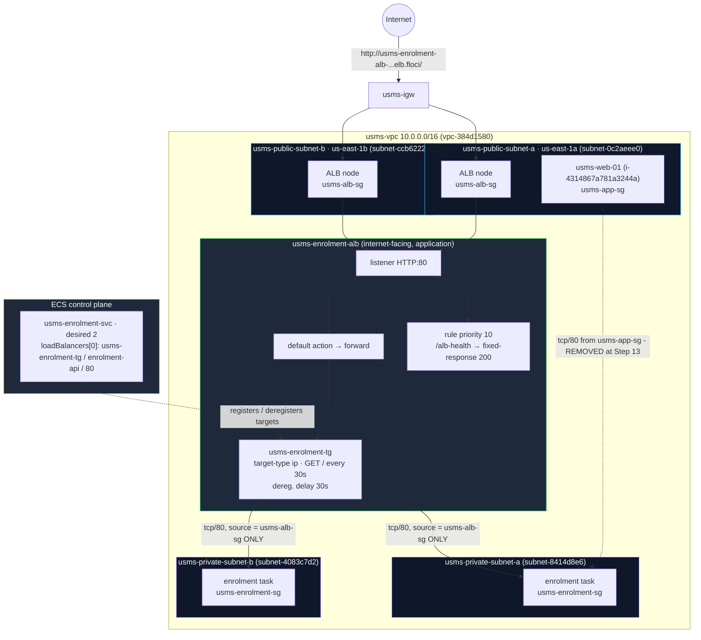

### Resources created

| Resource | ID / ARN | Notes |
|---|---|---|
| `usms-alb-sg` | `sg-3059e5c7a2deac0e6` | tcp/80 and tcp/443 from `0.0.0.0/0`; `Tier=edge` |
| `usms-enrolment-alb` | `...:loadbalancer/app/usms-enrolment-alb/cc9d002d3f6343a2` | internet-facing, application, 2 AZs |
| DNS name | `usms-enrolment-alb-cc9d002d3f6343a2.elb.floci` | does not resolve on Floci (Step 12) |
| `usms-enrolment-tg` | `...:targetgroup/usms-enrolment-tg/7750fc7480fd4dbc` | ip, HTTP:80, `GET /`, matcher 200, delay 30 s |
| Listener HTTP:80 | `...:listener/app/usms-enrolment-alb/cc9d002d3f6343a2/27b4ab5fdfb44519` | default action forward |
| `usms-enrolment-health-rule` | `.../27b4ab5fdfb44519/093412e525134c6a` | priority 10, fixed-response 200 |
| Ingress on `usms-enrolment-sg` | `sgr-9e4fa31bbe1e456a3` | tcp/80 from `usms-alb-sg` |
| **Removed** from `usms-enrolment-sg` | `sgr-a63721d619755ad20` | Lab 04's tcp/80 from `usms-app-sg` (Step 13) |
| `usms-enrolment-svc` | recreated with `loadBalancers[0]` | same name, cluster, task definition and count as Lab 04 |
| `usms-results-tg` + priority-20 rule | (Exercise 1) | created, then deleted in Exercise 4 |

### Files created

| File | Purpose |
|---|---|
| `policies/usms-alb-sg-ingress.json` | ALB ingress tcp/80 from the internet (quoted heredoc: no variables) |
| `policies/usms-alb-sg-ingress-https.json` | Step 4 "Your turn": tcp/443 from the internet |
| `policies/usms-enrolment-sg-ingress-alb.json` | Tasks' new ingress, sourced from `usms-alb-sg` (unquoted heredoc) |
| `templates/lab-05-listener-default-actions.json` | `create-listener --default-actions` |
| `templates/lab-05-rule-conditions.json`, `-rule-actions.json` | `create-rule` for `/alb-health` |
| `templates/lab-05-service-load-balancers.json` | The service's `loadBalancers` entry |
| `templates/lab-05-ex1-rule-conditions.json`, `-ex1-rule-actions.json` | Exercise 1 `/results` rule |
| `configs/lab-05.env` | 15 exports, 16 after Exercise 5 |
| `scripts/utilities/verify-lab-05.sh` | 49-check verification |
| `scripts/cleanup/lab-05-cleanup.sh` | End-of-course teardown (syntax-checked, **not run**) |
| `scripts/utilities/usms-lb-report.sh` | Exercise 3 decision-table report |
| `scripts/utilities/usms-resource-label.sh` | Exercise 5 ResourceLabel for Lab 06 |
| `scripts/utilities/verify-lab-04.sh` (changed) | Exercise 2: source check updated after the cutover |

---

## 5. Implementation Procedure

1. **Environment (Steps 1-2):** switched to bash, started Floci, sourced `course.env` and `lab-01.env` to `lab-04.env`, and re-ran the Lab 02, 03 and 04 verification scripts.
2. **Support probe (Step 3):** checked which ELBv2 and ECS operations this Floci build answers, and recorded the support path.
3. **ALB security group (Step 4):** created `usms-alb-sg` with tcp/80 from `0.0.0.0/0`, then added tcp/443 ("Your turn").
4. **Load balancer (Step 5):** created `usms-enrolment-alb` in both public subnets, waited for `active`, and set two attributes.
5. **Target group and attributes (Steps 6-7):** created `usms-enrolment-tg` (type `ip`), widened and restored the matcher ("Your turn"), and set a 30-second deregistration delay.
6. **Listener (Step 8):** created the HTTP:80 listener whose default action forwards to the target group.
7. **Security group bridge (Step 9):** let `usms-alb-sg` reach the tasks on tcp/80, alongside the old `usms-app-sg` rule.
8. **Service attachment (Step 10):** attached `usms-enrolment-svc` to the target group (fallback: recreated the service with the load balancer).
9. **Targets and health (Step 11):** watched the service register its own targets, compared the two health opinions, and scaled to 3 and back to 2.
10. **Path proof (Step 12):** tried the data path with `curl`, then built the five-block control-plane proof.
11. **Cutover (Step 13):** removed `usms-app-sg` as a source on `usms-enrolment-sg` and diffed `verify-lab-04.sh` before and after.
12. **Deployment (Step 14):** forced a new deployment and compared targets before and after.
13. **Listener rule (Step 15):** added the priority-10 `/alb-health` fixed-response rule.
14. **Persistence (Step 16):** stopped and started Floci, re-derived every ARN from the API, and diffed seven facts.
15. **Audit, record, commit (Steps 17-19):** audited the security chain and tags, wrote `configs/lab-05.env`, and committed with explicit paths.
16. **Verification and cleanup scripts (Section 8):** built and ran `verify-lab-05.sh`; syntax-checked `lab-05-cleanup.sh`.
17. **Exercises 1-5 (Section 12).**

**Support path recorded: B (control plane only).** All ELBv2 objects were created and are describable, and
targets even reported `healthy`, but the DNS name does not resolve and `curl` cannot connect (Step 12). Every
proof in this report is therefore built on control-plane fields, and no served request is claimed.

---

## 6. Results and Evidence

All commands were run from the repository root, in **bash** (the handout's quoting and loops assume bash;
the login shell is zsh), after:

```bash
source configs/course.env; source configs/lab-01.env; source configs/lab-02.env
source configs/lab-03.env; source configs/lab-04.env
export AWS_PAGER=""
```

### 6.1 Main Lab Steps

---

#### 6.1.1 Load the environment (Step 1)

**Task:** Start Floci, load the five env files, and print the twelve values this lab reads.

**Why it matters:** two empty values stop the lab. An empty `USMS_PUBLIC_SUBNET_B` means `create-load-balancer`
fails with "At least two subnets in two different Availability Zones"; an empty `USMS_ENROLMENT_SG` means
Lab 04's env file is incomplete.

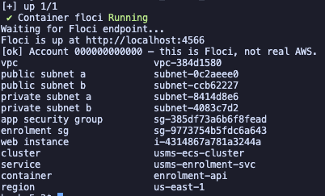

**Observation:** `[ok] Account 000000000000 — this is Floci, not real AWS.` All twelve values were
populated: VPC `vpc-384d1580`, public subnets `subnet-0c2aeee0` and `subnet-ccb62227`, private subnets
`subnet-8414d8e6` and `subnet-4083c7d2`, app SG `sg-385df73a6b6f8fead`, enrolment SG `sg-9773754b5fdc6a643`,
web instance `i-4314867a781a3244a`, cluster `usms-ecs-cluster`, service `usms-enrolment-svc`, container
`enrolment-api`, region `us-east-1`.

---

#### 6.1.2 Confirm Labs 02, 03 and 04 are intact (Step 2)

**Task:** Re-run the three earlier verification scripts and save Lab 04's output as the "before" for Step 13.

**Why it matters:** this lab changes Lab 04's security group and service. If Lab 04 is not at `FAIL=0` before
starting, the expected failure after Step 13 cannot be told apart from an existing fault.

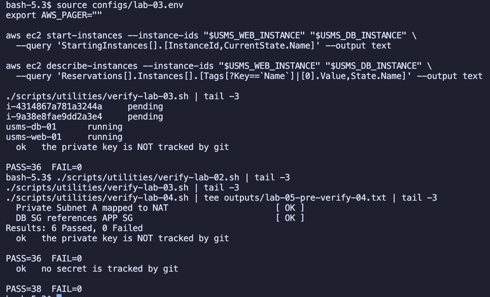

**Observation:** on the first run `verify-lab-03.sh` reported `PASS=35 FAIL=1`
(`FAIL usms-web-01 is running`): both Lab 03 instances had been stopped by a Floci restart. After
`start-instances` both read `running`, and the three scripts reported:

| Script | Result |
|---|---|
| `verify-lab-02.sh` | `Results: 6 Passed, 0 Failed` |
| `verify-lab-03.sh` | `PASS=36 FAIL=0` |
| `verify-lab-04.sh` | `PASS=38 FAIL=0` (saved to `outputs/lab-05-pre-verify-04.txt`) |

A repo-specific read-back confirmed the service runs `usms-enrolment:2` with desired 2 / running 2, and
that the container is `enrolment-api` on port `80`, the two values Step 10 must match.

---

#### 6.1.3 Probe what this Floci build supports for ELBv2 (Step 3)

**Task:** Find out which ELBv2 and ECS operations this build answers before building on them.

**Why it matters:** ELBv2 is the least reliably emulated service in the course. It is better to find a gap
now than at Step 10 with a half-built load balancer.

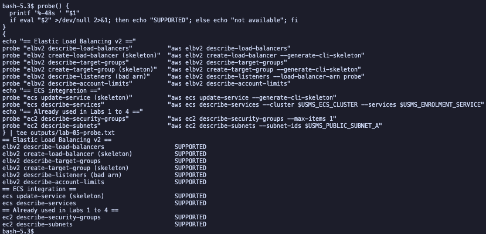

**Observation:** all ten probes printed `SUPPORTED`. Two notes:

* On the first run `ecs describe-services` printed `not available`. The cause was not Floci: the shell was a
  new bash session in which `lab-04.env` had not been sourced, so the command ran with an empty cluster and
  service name. After re-sourcing, it answered.
* `elbv2 describe-listeners --load-balancer-arn probe` printed `SUPPORTED` for the wrong reason. Run by hand,
  Floci returned `{"Listeners": []}` instead of the `ValidationError` real AWS returns for a malformed ARN:
  Floci does not validate ARNs.

The two public subnets are in **two different AZs**: `subnet-0c2aeee0` in `us-east-1a` (10.0.1.0/24) and
`subnet-ccb62227` in `us-east-1b` (10.0.2.0/24).

---

#### 6.1.4 Create the load balancer's security group (Step 4)

**Task:** Create `usms-alb-sg` in `usms-vpc`, tagged `Tier=edge`, with one inbound rule: tcp/80 from
`0.0.0.0/0`, written as a JSON document in `policies/`.

**Why it matters:**
* The load balancer is its own tier, so it gets its own group: the only thing the internet may reach, and
  (after Step 13) the only thing that may reach the tasks.
* This is the **only** `0.0.0.0/0` ingress rule in the course. It is acceptable because the ALB terminates
  every connection and forwards only to the target group.
* The document has no variables, so it was written with a **quoted** heredoc (`<< 'EOF'`).

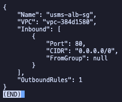

**Observation:** `usms-alb-sg` (`sg-3059e5c7a2deac0e6`) in `vpc-384d1580`, exactly one inbound rule on port
`80` from `0.0.0.0/0` with `FromGroup: null`, and `OutboundRules: 1` (the default allow-all egress that lets
the ALB connect to targets).

**"Your turn" - tcp/443:** a second rule was added from `policies/usms-alb-sg-ingress-https.json`.

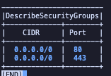

**Observation:** two inbound rules, `0.0.0.0/0` on ports `80` and `443`.

**Answer:** the load balancer still cannot serve a single HTTPS request, because a security group rule only
**opens** a port. Two things are missing: an **HTTPS listener** on port 443, and the **TLS certificate** that
listener needs. AWS Certificate Manager issues a public certificate **for free**, but it can only issue one
for a **domain name you control**, which has to be obtained from a registrar (or Route 53) and validated with
a DNS record.

---

#### 6.1.5 Create the Application Load Balancer (Step 5)

**Task:** Create `usms-enrolment-alb` (type `application`, scheme `internet-facing`, IPv4) in both public
subnets with `usms-alb-sg`, wait for it to become `active`, and set two attributes.

**Why it matters:**
* AWS places one node in each subnet named; two AZs is a hard requirement.
* `internet-facing` gives the nodes public addresses, so the subnets must route `0.0.0.0/0` to `usms-igw`.
* Type and scheme **cannot be changed** after creation.
* `--tags` uses capital `Key=`/`Value=`, and `--subnets` is space-separated: the fourth CLI list convention
  in two labs.

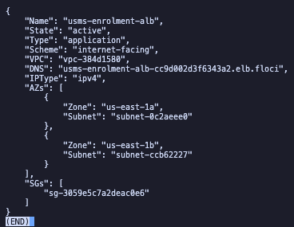

**Observation:** `State: active`, `Type: application`, `Scheme: internet-facing`, VPC `vpc-384d1580`, IP type
`ipv4`, and **two AZs**: `us-east-1a` / `subnet-0c2aeee0` and `us-east-1b` / `subnet-ccb62227`. `SGs` holds
`sg-3059e5c7a2deac0e6`. The DNS name is `usms-enrolment-alb-cc9d002d3f6343a2.elb.floci`, a Floci-specific
form rather than `*.us-east-1.elb.amazonaws.com`. The ARN suffix `app/usms-enrolment-alb/cc9d002d3f6343a2`
is the first half of Exercise 5's ResourceLabel.

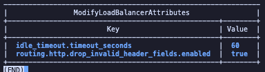

**Observation:** `idle_timeout.timeout_seconds = 60` and `routing.http.drop_invalid_header_fields.enabled =
true` were accepted. On real AWS the idle timeout must be **shorter** than the target's keep-alive, or the
client sees intermittent 502s; dropping invalid header fields defaults to `false` and should be `true` on
anything new.

---

#### 6.1.6 Create the target group (Step 6)

**Task:** Create `usms-enrolment-tg`: HTTP:80 in `usms-vpc`, `--target-type ip`, health check `GET /` every
30 s, timeout 5 s, healthy and unhealthy thresholds 2, matcher `200`.

**Why it matters:**
* `--target-type ip` is mandatory for `awsvpc` tasks, and it can never be changed.
* Interval × unhealthy threshold (30 × 2) means a dead task keeps receiving requests for up to **60 seconds**.
* The health check lives on the **target group**, not on the load balancer.

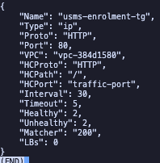

**Observation:** `Type: ip`, `Proto: HTTP`, `Port: 80`, VPC `vpc-384d1580`, `HCPath: /`,
`HCPort: traffic-port`, interval 30, timeout 5, healthy 2, unhealthy 2, `Matcher: "200"`, `LBs: 0` (not yet
attached). `describe-target-health` returned `[]`: correct, because the service fills it at Step 10.

**"Your turn" - widen the matcher and restore it.**

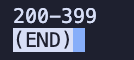


**Observation:** `modify-target-group --matcher HttpCode=200-399` read back `200-399`; the restore read back
`200`. Both took effect immediately without recreating anything: the matcher is configuration, unlike the
target type, which is identity.

**Answers:**
* **(a)** A web application whose `/` redirects anonymous users to a login page (for example a Django or
  Spring Security app returning `302 → /login`) would be reported unhealthy forever under a strict `200`
  matcher, even though it is working perfectly.
* **(b)** It would be a bug **in my work**, not in the script. A verification script records the agreed
  specification (here `GET /`, matcher `200`); a resource that differs from the spec is drift. If the spec
  itself should change, the script and the resource change together, in the same commit.

---

#### 6.1.7 Set the deregistration delay and algorithm (Step 7)

**Task:** Set `deregistration_delay.timeout_seconds` to 30 (the default is 300) and
`load_balancing.algorithm.type` to `least_outstanding_requests`.

**Why it matters:** the deregistration delay is the load balancer's half of the "how a task dies" sequence:
deregister → `draining` for up to 30 s → SIGTERM → `stopTimeout` → SIGKILL. 300 seconds is far too long for
a millisecond API. `least_outstanding_requests` routes around a slow-but-healthy target, which round robin
keeps feeding.

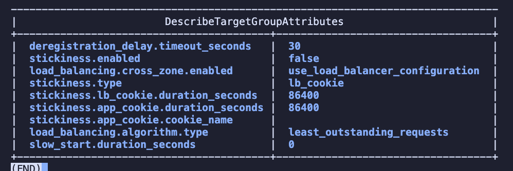

**Observation:** `deregistration_delay.timeout_seconds 30`, `load_balancing.algorithm.type
least_outstanding_requests`, `stickiness.enabled false` (correct for a stateless API) and
`slow_start.duration_seconds 0` (a newly healthy target gets full traffic at once). Floci stored both values.

---

#### 6.1.8 Create the listener: Checkpoint 3 (Step 8)

**Task:** Write the default action as a document (unquoted heredoc, so `$TG_ARN` expands) and create the
HTTP:80 listener.

**Why it matters:** until a listener exists, every connection to the load balancer is refused. A listener has
exactly **one** default action, and nested action structures are only readable as `file://` documents.

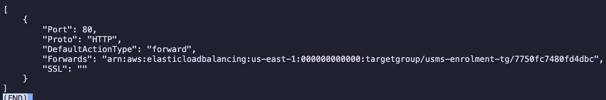
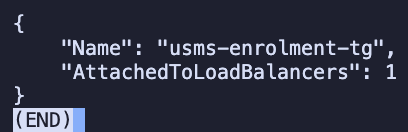

**Observation:** `valid JSON`, `grep -c '\$'` = `0`, then: `Port 80`, `HTTP`, `DefaultActionType forward`,
forwarding to `.../usms-enrolment-tg/7750fc7480fd4dbc`. `AttachedToLoadBalancers` moved from `0` to **`1`**.
`SSL` read `""`; real AWS returns `null` for an HTTP listener (only HTTPS listeners have a TLS policy).

---

#### 6.1.9 Let the load balancer reach the tasks (Step 9)

**Task:** Add tcp/80 from `usms-alb-sg` to `usms-enrolment-sg`, without removing Lab 04's rule yet.

**Why it matters:**
* Without this rule every target would fail its health check with a timeout while looking healthy to ECS.
* The rule names a **group** because AWS chooses and changes the load balancer's node addresses.
* `$ALB_SG` must expand, so the heredoc is **unquoted** (the opposite of Step 4).
* Both paths existing at once is deliberate: build the new path, prove it, then remove the old one.

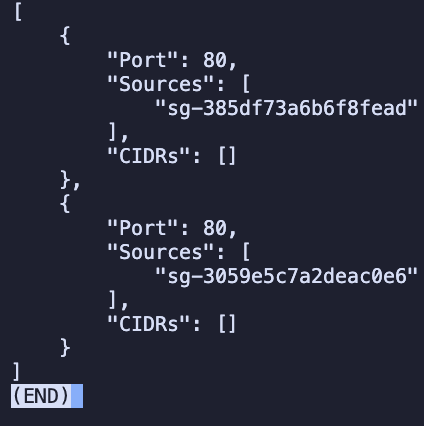

**Observation:** two sources on port 80 with empty `CIDRs`: `sg-385df73a6b6f8fead` (`usms-app-sg`, Lab 04)
and `sg-3059e5c7a2deac0e6` (`usms-alb-sg`, new). Floci returned them as two separate `IpPermission` entries;
real AWS merges both into one.

---

#### 6.1.10 Attach the service to the target group (Step 10)

**Task:** Write the service's `loadBalancers` entry (`targetGroupArn`, `containerName enrolment-api`,
`containerPort 80`) and attach it with a 60-second health check grace period.

**Why it matters:**
* `containerName` and `containerPort` are matched **by string** against `usms-enrolment:2`'s port mappings.
* From now on the service registers every task it starts and deregisters every task it stops.
* The grace period stops a slow-starting task from being judged by target health and replaced in a loop.

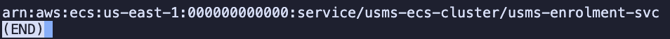

**Observation:** the in-place `update-service --load-balancers` did not keep the attachment on this build
(the Floci 2.0.1 known issue), so the documented **fallback** was used: the service was scaled to 0, deleted
and recreated with `create-service`, using the **same** name, cluster, task definition (`usms-enrolment:2`),
desired count (2), subnets, security group, `assignPublicIp=DISABLED` and `Lab=04` tag, plus
`--load-balancers` and `--health-check-grace-period-seconds 60`. The deployment configuration was passed
inline (`minimumHealthyPercent=100,maximumPercent=200`) because this repository has no
`templates/lab-04-deployment-config.json`. The new service ARN is
`arn:aws:ecs:us-east-1:000000000000:service/usms-ecs-cluster/usms-enrolment-svc`, the same as Lab 04's, so
Lab 06 and `configs/lab-04.env` are unaffected.

The read-back showed one `loadBalancers` entry (`usms-enrolment-tg` / `enrolment-api` / `80`), but
**`healthCheckGracePeriodSeconds` is not stored by Floci**: the field is absent from `describe-services`
(`None`), even after setting it again. This is recorded as a Floci limitation; on real AWS it reads `60`.

---

#### 6.1.11 Watch the targets register, and read target health: Checkpoint 4 (Step 11)

**Task:** Poll the target group until it fills, read the service's own account, and line up ECS's health
opinion of each task with the load balancer's opinion of each address.

**Why it matters:** the target group fills **itself**. Nobody runs `register-targets`; the service does it,
and would undo anything registered by hand.

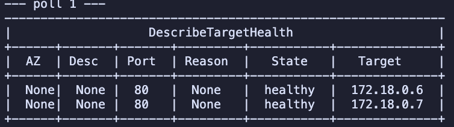

**Observation (part 1):** two targets, `172.18.0.6:80` and `172.18.0.7:80`, both **`healthy`**, registered
without any manual command. Two differences from the handout:
* The addresses are in `172.18.0.0/16`, Floci's Docker network, not `10.0.3.x`/`10.0.4.x`: Floci runs the
  tasks as real Docker containers, not inside the VPC subnets.
* `AZ` is `None`: Floci assigns no Availability Zone to IP targets.

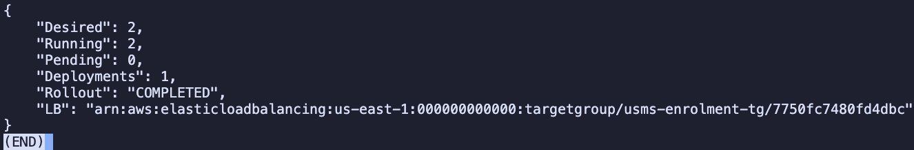


**Observation (part 2):** `Desired 2`, `Running 2`, `Pending 0`, `Deployments 1`, `Rollout COMPLETED`, `LB`
naming `usms-enrolment-tg`. The service's `events` list was `None`: Floci does not record service events
(real AWS would show "registered 1 targets in target-group usms-enrolment-tg").


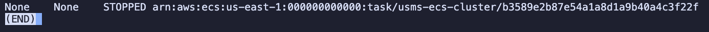


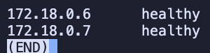

**Observation (part 3):** the CLI pager split the per-task loop into one screen per task, hence seven
screenshots. `list-tasks` returned **six** tasks: two `RUNNING` and four `STOPPED` (left over from the
fallback recreate). Real AWS returns only `RUNNING` tasks by default. For every task `ECSHealth` and `IP`
were `None`: Floci reports neither container health nor ENI attachments. The target group side read
`172.18.0.6 healthy`, `172.18.0.7 healthy`.

**Diagnosis table** (Review Question 4 and assessment Task C):

| ECS `healthStatus` | Target health | Diagnosis |
|---|---|---|
| `HEALTHY` | `healthy` | Working |
| `HEALTHY` | `unhealthy` | **Network path broken:** security group, subnet, or the health check path returning the wrong code |
| `UNHEALTHY` | `unhealthy` | Application broken: read the container logs |
| `UNKNOWN` | `healthy` | Not a fault: the task definition has no container health check |
| anything | `unused` | Nothing forwards to this target group |

This build's combination is `None` (closest to `UNKNOWN`) + `healthy`: **not a fault**. On real AWS the
first column would read `HEALTHY`, because `usms-enrolment:2` has a container health check; Floci does not
report it.

**"Your turn" - desired count 3, then back to 2.**


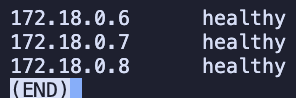

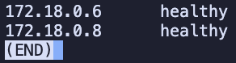

**Observation:** `desiredCount 3` → targets `172.18.0.6`, `.7`, `.8`, all `healthy`; `desiredCount 2` →
`172.18.0.6`, `.8`. The target group grew and shrank **without a single `register-targets` or
`deregister-targets`**.

**Answer:** without service-managed registration, after **every** scaling event I would have to run
`register-targets` for each new task's IP and `deregister-targets` for each stopped one by hand, which is
impossible to keep up with once Lab 06 moves `desiredCount` automatically.

---

#### 6.1.12 Prove the path, and be honest about which proof you got (Step 12)

**Task:** Try the real data path (`curl` through the DNS name); then build the control-plane proof.

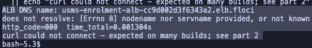

**Observation (data path):** `does not resolve: [Errno 8] nodename nor servname provided`,
`http_code=000`, `curl could not connect`. Floci runs no public DNS and the compose file publishes only port
4566. **No data path, so no `200` is claimed.** This settles the support path as **B**.

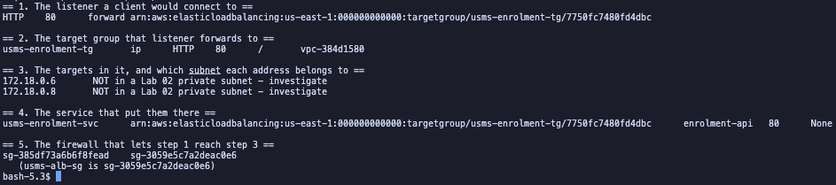

**Observation (control-plane proof, saved to `outputs/lab-05-path-proof.txt`):**

| Block | Output | Reading |
|---|---|---|
| 1. Listener | `HTTP 80 forward → usms-enrolment-tg` | ✅ |
| 2. Target group | `usms-enrolment-tg ip HTTP 80 / vpc-384d1580` | ✅ |
| 3. Targets | `172.18.0.6`, `172.18.0.8`: "NOT in a Lab 02 private subnet - investigate" | Floci's Docker network, not a fault (Step 11) |
| 4. Service | `usms-enrolment-svc ... enrolment-api 80 None` | ✅ attachment; grace period not stored |
| 5. Firewall | `sg-385df73a6b6f8fead sg-3059e5c7a2deac0e6` | ✅ both sources, correct before the cutover |

Read as one chain: client → listener HTTP:80 → forward to `usms-enrolment-tg` → targets registered by
`usms-enrolment-svc` → reachable because `usms-enrolment-sg` admits `usms-alb-sg`. The target `.7` from
Step 11 had become `.8`: a task was replaced in between and the service registered the new one itself.

---

#### 6.1.13 The cutover: remove the direct path (Step 13)

> **Read before running any delete command.** **What will be deleted:** one inbound rule on
> `usms-enrolment-sg`, tcp/80 from `usms-app-sg` (Lab 04). **What depends on it:** anything calling the tasks
> by address; here nothing, because Step 12 proved the new path first. **Reversible?** Yes:
> `policies/usms-enrolment-sg-ingress.json` and one `authorize-security-group-ingress`. **Effect on later
> labs:** `verify-lab-04.sh` reports exactly one expected failure; Lab 06 is unaffected.

**Task:** Find the rule's own ID with `describe-security-group-rules` (the only view where the two port-80
sources are separable), revoke it, and diff `verify-lab-04.sh` before and after.

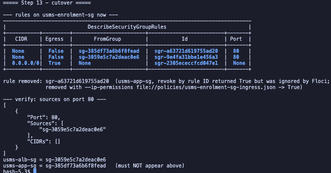

**Observation:** `OLD_RULE_ID` was `sgr-a63721d619755ad20`, the correct rule (source `sg-385df73a6b6f8fead`).
`revoke-security-group-ingress --security-group-rule-ids` returned `True`, **but the rule was still there**:
`describe-security-groups` still listed both sources and `verify-lab-04.sh` was unchanged. Revoking by
**restating the permission** (`--ip-permissions file://policies/usms-enrolment-sg-ingress.json`) removed it.
Afterwards port 80 has exactly **one** source, `sg-3059e5c7a2deac0e6` (`usms-alb-sg`), and empty `CIDRs`.

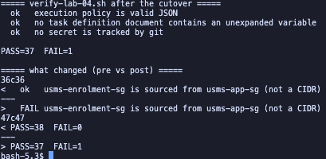

**Observation:** `verify-lab-04.sh` moved from `PASS=38 FAIL=0` to `PASS=37 FAIL=1`, and the diff shows
**exactly one** check changing state:

```
36c36
<   ok   usms-enrolment-sg is sourced from usms-app-sg (not a CIDR)
---
>   FAIL usms-enrolment-sg is sourced from usms-app-sg (not a CIDR)
```

The script failed correctly: it encodes the pre-load-balancer architecture. The three possible responses:

| Response | When it is right |
|---|---|
| Leave it, and document the expected failure | Immediately: Lab 04's script is a record of what Lab 04 built |
| Update the check to assert the new source group | Exercise 2: what you do on a real system, in the same commit as the change |
| Delete the check | Almost never: the property still matters; only the expected value changed |

---

#### 6.1.14 Deploy behind a load balancer: Checkpoint 5 (Step 14)

**Task:** Record targets, force a deployment with no change (`--force-new-deployment`), poll both sides, and
compare before and after.

**Why it matters:** behind a target group, a deployment gains a health-check gate (no traffic until
`healthy`) and a drain (`draining` for up to 30 s before SIGTERM). That is what makes it zero-downtime.

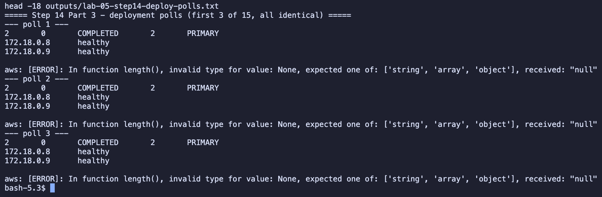

**Observation:** the service accepted the deployment (`Deployments: 1`). Every poll showed one `PRIMARY`
deployment, `COMPLETED`, with two `healthy` targets (`172.18.0.8`, `172.18.0.9`): Floci finished the roll
before the first poll. **`initial` and `draining` were never observed**; with no data path there is nothing
to drain. Each poll also printed `aws: [ERROR]: In function length() ... received: "null"`. That is a bug in
the handout's loop: it asks for `length(deployments)`, but `deployments` sits under `services[0]`, so the loop
never found `1` and ran all 15 polls.

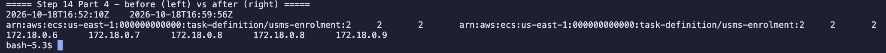

**Observation:** same task definition (`usms-enrolment:2`) and counts (`2 2`) on both sides, **different
addresses**: `172.18.0.6 .7 .8` → `172.18.0.8 .9`. The tasks were replaced. (The "before" list held a stale
`.8` left after a Floci restart; see Section 7.)

---

#### 6.1.15 Add a listener rule: Checkpoint 6 (Step 15)

**Task:** Add a priority-10 rule: path `/alb-health` or `/alb-health/*` → fixed-response `200`, `text/plain`,
body `usms-enrolment-alb ok`.

**Why it matters:** rules are evaluated lowest number first, first match wins; the default action always
runs last. A fixed-response proves the mechanism without a second target group. Two patterns are used
because `/alb-health*` would also match `/alb-healthcheck-internal`.

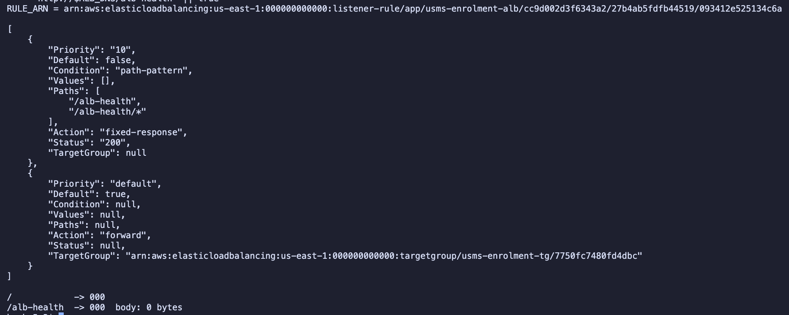

**Observation:** `RULE_ARN = ...:listener-rule/app/usms-enrolment-alb/cc9d002d3f6343a2/27b4ab5fdfb44519/093412e525134c6a`
(load balancer, listener and rule IDs nested in one ARN). `describe-rules` lists priority `"10"`
(`fixed-response`, status `"200"`, no target group) **above** `"default"` (`forward` to
`usms-enrolment-tg`). The handout's query read `Values: []`: Floci returns the paths only in
`PathPatternConfig.Values`, so an extra `Paths` column was added and shows `/alb-health`, `/alb-health/*`.
Both `curl` tests returned `000` (no data path), so the rule ordering is proven from `describe-rules`, not
from a served request.

---

#### 6.1.16 Prove the whole thing survives a restart: Checkpoint 7 (Step 16)

**Task:** Record seven configuration facts across ELBv2, ECS and EC2, stop and start Floci, re-derive every
ARN from the API (not from shell variables), and diff.

**Why it matters:** a build that persisted only some services would leave the service naming a target group
that no longer exists. `runningCount` is deliberately excluded: compare configuration, not the weather.

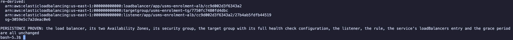

**Observation:** the four re-derived identifiers matched the originals (`.../cc9d002d3f6343a2`,
`.../7750fc7480fd4dbc`, `.../27b4ab5fdfb44519`, `sg-3059e5c7a2deac0e6`), the diff was empty, and the script
printed **`PERSISTENCE PROVEN`**, including the Step 13 cutover (`usms-enrolment-sg 1` source group). One
caveat: the grace period was `None` before and after, so "unchanged" here means `None == None`, not 60.

---

#### 6.1.17 Close the loop, and audit what this lab created (Step 17)

**Task:** Resolve both ends of the new chain to real objects and audit everything tagged `Lab=05`.

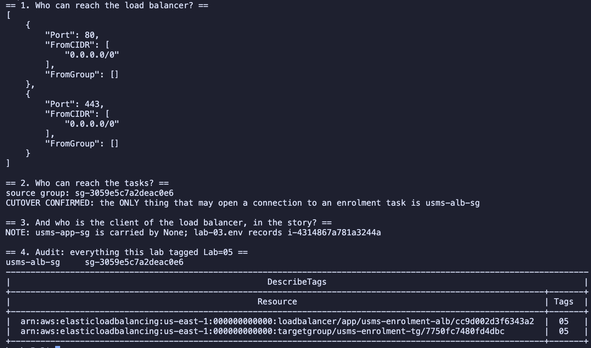

**Observation:**
* **Block 1:** the load balancer is reachable from `0.0.0.0/0` on ports 80 and 443, from no group.
* **Block 2:** `source group: sg-3059e5c7a2deac0e6` → **`CUTOVER CONFIRMED`**: the only thing that may open a
  connection to an enrolment task is `usms-alb-sg`.
* **Block 3:** `NOTE: usms-app-sg is carried by None`, **not** `LOOP CLOSED`. Step 16's restart had stopped
  `usms-web-01` again, and the query only looks at `running` instances. This is the benign case the handout
  describes; the instance still exists and still carries `usms-app-sg`, which no longer grants anything on
  the tasks.
* **Block 4:** `usms-alb-sg` is tagged `Lab=05`, and `elbv2 describe-tags` (several ARNs in one call) shows
  `Lab=05` on both the load balancer and the target group.

---

#### 6.1.18 Write `configs/lab-05.env` (Step 18)

**Task:** Record every value by **API lookup**, with an unquoted heredoc so each `$(...)` runs at write time.

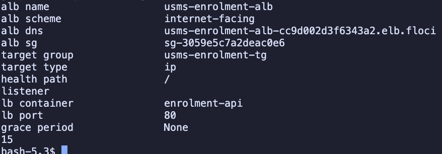

**Observation:** `15` exports. Two values were not populated:
* **`listener` was empty.** The handout escapes the JMESPath backticks as `` \` `` inside a nested `$(...)`;
  there the backslash is passed to the CLI literally, the query is invalid, and the substitution prints
  nothing. The line was later refilled **from the API** (`describe-listeners ... Listeners[?Port==\`80\`]`),
  not typed by hand, and now holds `.../27b4ab5fdfb44519`.
* **`grace period` is `None`.** This is the true state on this build (Step 10). The handout says to record
  it rather than hand-edit the file, so it was left as `None`.

---

#### 6.1.19 Commit (Step 19)

**Task:** Look before adding, prove `outputs/` is ignored, then commit with named paths (never `git add -A`).

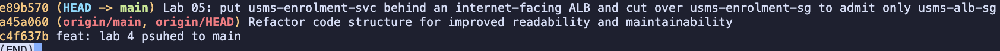

**Observation:** `git check-ignore -v` printed `.gitignore:6:outputs/*  outputs/lab-05-path-proof.txt`, and
`git ls-files outputs/` listed only `outputs/.gitkeep`. The first `git add` failed with
`pathspec 'scripts/utilities/verify-lab-05.sh' did not match any files`, because Section 8 had not been done;
one missing path makes `git add` stage nothing. After building both scripts the commit succeeded:
`e89b570 Lab 05: put usms-enrolment-svc behind an internet-facing ALB and cut over usms-enrolment-sg to
admit only usms-alb-sg`. The guide file in `labs/lab-05-alb/` was deliberately left untracked.

---

#### 6.1.20 Run the Lab 05 verification script (Section 8.1)

**Task:** Build `scripts/utilities/verify-lab-05.sh` and run it.

**Why it matters:** beyond existence, it checks the properties that fail silently: target type `ip`, public
subnets in two different AZs, the Step 13 cutover, `containerName enrolment-api`, a non-zero grace period,
exactly one deployment, and no unexpanded `$` in any document. The repository's version uses a corrected
"no secret is tracked by git" check, because the handout's version fails whenever `outputs/.gitkeep` is
tracked.

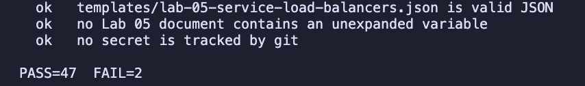

**Observation:** `PASS=47 FAIL=2`. Both failures have the same root cause, and both are listed in Section 8
as known benign failures:

| Failing check | Cause |
|---|---|
| `healthCheckGracePeriodSeconds is set (not None, not 0)` | Floci accepts the flag but does not store it |
| `configs/lab-05.env has no empty values` | `USMS_SVC_GRACE_PERIOD=None`, the same cause |

Every other check passed, including both AZs, the cutover, `ip`, matcher `200`, delay 30, the listener and
rule, and the service wiring.

---

#### 6.1.21 Build the end-of-course cleanup script (Section 8.2)

**Task:** Write `scripts/cleanup/lab-05-cleanup.sh` and check its syntax **without running it**.

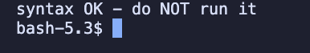

**Observation:** `syntax OK - do NOT run it`. The script was not executed. Its order follows the API's
dependencies:
1. the service first, because while it exists it keeps registering targets,
2. the rules, then the listener,
3. the load balancer before the target group (`ResourceInUseException` otherwise),
4. wait for the load balancer's ENIs to go, then delete `usms-alb-sg` (`DependencyViolation` otherwise).

It refuses to run while a Lab 06 scalable target exists, and requires typing `DELETE USMS LOAD BALANCER`.

---

### 6.2 Extended Laboratory Exercises

---

#### Exercise 1: A second path through the same load balancer

**Task:** Create `usms-results-tg` (ip, HTTP:80, `usms-vpc`, health check `/`, matcher `200-399`,
deregistration delay 15 s, tagged `Service=results`) and a priority-20 rule forwarding `/results` and
`/results/*` to it. No service, no targets, nothing recorded in `lab-05.env`.

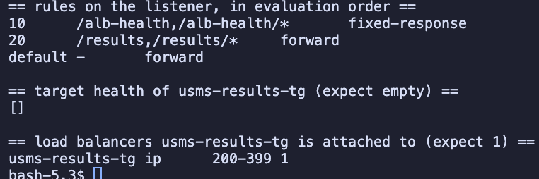

**Observation:**

```
10       /alb-health,/alb-health/*   fixed-response
20       /results,/results/*         forward
default  -                           forward
```

`describe-target-health` on `usms-results-tg` returned `[]`, and the target group is attached to `1` load
balancer, with matcher `200-399` and deregistration delay `15`. `Priority` is a **string**: `sort_by` sorts
`"10" < "20" < "default"` correctly here, but would put `"5"` after `"20"`.

**Answer:** a request to `/results` matches the priority-20 rule and is forwarded to `usms-results-tg`; with
no registered targets, the ALB answers it itself with **503 Service Temporarily Unavailable**. (Reasoned from
the AWS documentation; this build has no data path.)

---

#### Exercise 2: Repair the verification script you broke

**Property the failing check asserted:** *"the enrolment tasks accept traffic only from a named security
group (the tier in front of them), never from a CIDR."* The property still holds after the cutover; only the
expected group changed.

**Changes to `scripts/utilities/verify-lab-04.sh`:**
* It now sources `configs/lab-05.env` with `2>/dev/null || true` and defaults `USMS_ALB_SG` to `none`, so a
  student who has done Lab 04 but not Lab 05 gets a readable `FAIL`, not an unbound-variable abort.
* The original check was **changed, not deleted**: "usms-enrolment-sg is sourced from **usms-alb-sg** (not a
  CIDR)" asserts that `usms-alb-sg` is a source **and** that `IpRanges` is empty.
* A new check immediately after it: "usms-app-sg is no longer a source on usms-enrolment-sg". Without it, the
  new check would still pass if both rules existed.
* A comment at the top records the expected count, `PASS=39 FAIL=0`. A written-down count makes an
  unexpected change visible; an unwritten one lets a silently skipped or deleted check look like a pass.

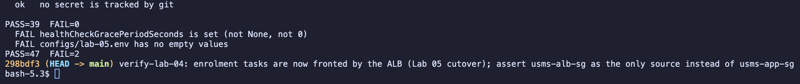

**Observation:** `verify-lab-04.sh` → `PASS=39 FAIL=0` (also when run from `/tmp`, so the
`${BASH_SOURCE[0]}` logic still works). `verify-lab-05.sh` → `PASS=47 FAIL=2`, the two benign grace-period
failures, which no change to the scripts can fix on this build. Commit `298bdf3`: "verify-lab-04: enrolment
tasks are now fronted by the ALB (Lab 05 cutover); assert usms-alb-sg as the only source instead of
usms-app-sg".

**When is updating a verification script right?** It is right when the architecture changed **on purpose**
and the check still asserts the same **property**, with only the expected value updated in the same commit
as the change. It hides a regression when it is done only to turn a failure green with no deliberate design
change behind it, or when it weakens the property, for example by deleting the check or by checking only
that the new source exists without checking that the old one is gone.

---

#### Exercise 3: A load balancer report tool

**Task:** Write `scripts/utilities/usms-lb-report.sh`, which walks every ALB named `usms-*` and prints its
decision table (load balancer → listeners → rules in evaluation order → target health), and writes
`outputs/lab-05-lb-report.json`.

**Design decisions:**
* Paths are resolved from `${BASH_SOURCE[0]}`, so it runs from any directory.
* Bash only resolves the repository and the environment; Python does the four levels of nested calls and
  the sort, which are much easier to get right there.
* `Priority` is a string, and the default's is `"default"`: it is sorted with `int()`, and `"default"` is
  mapped to infinity so it is always last.
* No listeners, no non-default rules and an empty target group each print an explicit line, never a blank
  row. Non-forward actions print their own summary (`fixed-response 200`, `redirect ...`).
* It reads `PathPatternConfig.Values`, because Floci leaves `Values` empty.
* `set -uo pipefail` **without `-e`**: one failing describe call should cost one line of the report, not
  abort it.

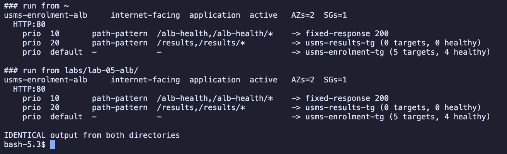

**Observation:** run from `~` and from `labs/lab-05-alb/`, the output was **identical**:

```
usms-enrolment-alb     internet-facing  application  active   AZs=2  SGs=1
  HTTP:80
    prio  10       path-pattern  /alb-health,/alb-health/*    -> fixed-response 200
    prio  20       path-pattern  /results,/results/*          -> usms-results-tg (0 targets, 0 healthy)
    prio  default  -             -                            -> usms-enrolment-tg (5 targets, 4 healthy)
```

The report surfaced real drift: `usms-enrolment-tg` holds **5** targets for a service of **2** tasks. Floci
keeps targets from earlier deployments and restarts instead of deregistering them; real ECS deregisters a
stopped task's target automatically.

---

#### Exercise 4: The exposure review

**What changed.** The enrolment API used to be reachable only by calling a task's private address from
`usms-web-01`; it now has one stable public entry point, the internet-facing `usms-enrolment-alb` in the two
public subnets, forwarding HTTP:80 to tasks that are still private with no public IP. On the security groups,
`usms-enrolment-sg` used to admit tcp/80 from `usms-app-sg`, and after the cutover it admits tcp/80 **only**
from `usms-alb-sg`, which itself admits tcp/80 from `0.0.0.0/0`.

**Internal versus internet-facing.** With `--scheme internal`, Step 5 would change only in the scheme and,
preferably, in using the **private** subnets; the DNS name would start with `internal-` and resolve only to
private 10.0.x.x addresses, and `usms-alb-sg` would admit tcp/80 from `usms-app-sg` instead of the internet.
The target group, listener, rules, service attachment and `usms-enrolment-sg` would not change. Because the
portal is the only client, **I recommend internal**: the same stable name and health-checked routing, without
the course's only `0.0.0.0/0` rule. The other side: if students' browsers or a mobile app must call the API
directly, or a CDN or WAF in front needs a public origin, it has to be internet-facing, and the right control
is then HTTPS and a WAF rather than hiding it.

**Exposure delta.**

| What can reach… | Before (Lab 04) | After (Lab 05) |
|---|---|---|
| the load balancer | (there was none) | anyone on the internet, tcp/80 (tcp/443 open, nothing listening) |
| the tasks, via a supported path | `usms-web-01` (`usms-app-sg`) on tcp/80 | only the ALB (`usms-alb-sg`), so anyone who can reach the listener, limited to what its rules forward |
| the tasks **directly** (by private IP) | `usms-web-01` | **nothing** |

**Monthly cost estimate (us-east-1).** Prices: ALB $0.0225 per hour and $0.008 per LCU-hour
([Elastic Load Balancing pricing](https://aws.amazon.com/elasticloadbalancing/pricing/)); Fargate $0.04048
per vCPU-hour and $0.004445 per GB-hour ([AWS Fargate pricing](https://aws.amazon.com/fargate/pricing/)).
Prices change; re-check before quoting.

| Item | Derivation | Per month |
|---|---|---|
| ALB hours | $0.0225 × 730 h | ≈ **$16.43** |
| LCUs, idle | ~0 LCU | ≈ $0 |
| LCUs, under load | **Assumption:** 50 req/s, 10 KB responses, no keep-alive, ~1 s connections. New connections 50/s ÷ 25 = **2.0 LCU**; active connections ~3,000/min ÷ 3,000 = 1.0; bytes 1.8 GB/h ÷ 1 GB = 1.8; rule evaluations (≤ 10 rules free) = 0. Billed on the **largest**: 2.0 × $0.008 × 730 | ≈ **$11.68** |
| **ALB total** | idle ≈ $16.43; under load ≈ $28.11 | |
| Two Fargate tasks (comparison) | (0.25 × 0.04048 + 1 × 0.004445) = $0.014565/h × 730 × 2 | ≈ **$21.27** |

For a low-traffic API the **new connections** dimension dominates, not bytes. An idle ALB still costs about
$16 a month, close to the price of both tasks; on Floci all of this is $0.

**HTTPS plan.** *Opening the port* is already done (Step 4 "Your turn": tcp/443 on `usms-alb-sg`). *Making
something listen on it*, in order:
1. a **domain name** you control: from a registrar or Route 53, **outside** the load balancer, and it costs money;
2. an **ACM public certificate** for that name, `--validation-method DNS`: **free**;
3. the **DNS validation CNAME** in that domain's zone; wait for `ISSUED`;
4. an **HTTPS:443 listener** with the certificate and a TLS policy (e.g. `ELBSecurityPolicy-TLS13-1-2-2021-06`),
   default action forward to `usms-enrolment-tg`, and the `/alb-health` rule re-created on it;
5. the port-80 listener's default action changed to a **`redirect`** action (HTTPS, 443, `HTTP_301`), so a
   plaintext login is never served;
6. a DNS alias from the domain to the ALB's DNS name.

Sources: AWS documentation, "Create an HTTPS listener for your Application Load Balancer" and "AWS
Certificate Manager - requesting a public certificate". Not buildable on Floci (no certificate authority).

**Tidy-up.**

> **Read before running any delete command.** **What will be deleted:** the priority-20 `/results` rule and
> `usms-results-tg` (Exercise 1 practice only). **What depends on it:** nothing; no service uses it and it is
> not in `lab-05.env`. **Reversible?** Yes, by re-running Exercise 1. **Effect on later labs:** none; Section
> 15 lists both under CLEAN UP.

The rule was deleted first (it forwards to the target group), then the target group. The `/alb-health` rule
was not touched.

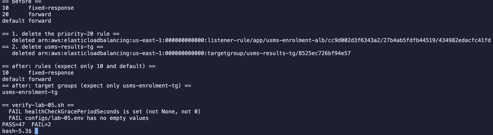

**Observation:** before: `10 fixed-response`, `20 forward`, `default forward`. Both deletions printed
`deleted`, and the read-back confirmed them (necessary on this build, after Step 13's ignored revoke): rules
`10` and `default` only, target groups `usms-enrolment-tg` only. `verify-lab-05.sh` stayed at
`PASS=47 FAIL=2`, the same two benign grace-period failures; nothing in the KEEP list changed.

---

#### Exercise 5: The ResourceLabel hand-off to Lab 06

**Task:** Write `scripts/utilities/usms-resource-label.sh`, which derives
`app/<lb-name>/<lb-id>/targetgroup/<tg-name>/<tg-id>` from the API, validates it, appends it to
`configs/lab-05.env`, and writes a readiness file for Lab 06.

**Design decisions:**
* Both ARNs are looked up every run, from optional `[lb-name] [tg-name]` arguments; it never reads
  `lab-05.env` and contains no access key.
* The two suffixes need different treatment: the LB half must **not** contain the word `loadbalancer`
  (`${LB_ARN#*:loadbalancer/}`), while the TG half **must** start with `targetgroup`
  (`targetgroup/${TG_ARN#*:targetgroup/}`).
* It validates before printing: exactly six segments, first segment `app`, both names in place. A wrong name
  prints an error on stderr and exits 1.

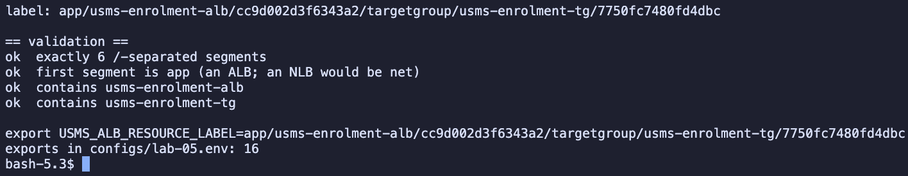

**Observation:** `app/usms-enrolment-alb/cc9d002d3f6343a2/targetgroup/usms-enrolment-tg/7750fc7480fd4dbc`,
four `ok` validation lines, the appended `export USMS_ALB_RESOURCE_LABEL=...` line, and
`exports in configs/lab-05.env: 16`.

**Readiness file** (`outputs/lab-05-lab04c-readiness.txt`, git-ignored, so reproduced here):

```
resource_label:      app/usms-enrolment-alb/cc9d002d3f6343a2/targetgroup/usms-enrolment-tg/7750fc7480fd4dbc
target_group_arn:    arn:aws:elasticloadbalancing:us-east-1:000000000000:targetgroup/usms-enrolment-tg/7750fc7480fd4dbc
load_balancer_arn:   arn:aws:elasticloadbalancing:us-east-1:000000000000:loadbalancer/app/usms-enrolment-alb/cc9d002d3f6343a2
scalable_resource:   service/usms-ecs-cluster/usms-enrolment-svc
scalable_dimension:  ecs:service:DesiredCount
desired_count_now:   2
replacement_time:    21s on Floci - not meaningful (see below)
recommended_metric:  ALBRequestCountPerTarget
```

**Measured replacement time:** 21 s on Floci (timestamps via `python3`), from `--force-new-deployment` until
one deployment and a stable target list. The figure is **not meaningful**: Floci finished the roll before the
first poll and drained nothing. On real AWS a Fargate replacement takes minutes (image pull, start, two
health checks 30 s apart, then the 30 s deregistration delay), so Lab 06's cooldowns should be sized in
minutes.

**Recommended metric:** `ALBRequestCountPerTarget`. It measures the load each task actually receives through
the load balancer, so scaling follows demand directly instead of waiting for CPU to rise.

**Why `app`:** it is the load balancer **type** that ELB puts in every ARN: `app` for an Application Load
Balancer and `net` for a Network Load Balancer, which tells Application Auto Scaling which metric namespace
the label refers to.

---

## 7. Analysis and Discussion

### Outcomes Achieved
1. `usms-enrolment-svc` is behind `usms-enrolment-alb`: internet-facing, type application, nodes in two AZs,
   with an HTTP:80 listener, a priority-10 `/alb-health` rule, and a default action forwarding to
   `usms-enrolment-tg` (type `ip`, `GET /` every 30 s, matcher 200, 30 s deregistration delay).
2. The **service** filled the target group itself, and kept it in step with 2 → 3 → 2 tasks and a forced
   deployment, without a single `register-targets`.
3. The cutover is complete and proven: `usms-enrolment-sg` admits tcp/80 **only** from `usms-alb-sg`
   (`CUTOVER CONFIRMED`), and the old direct path was removed only after the new one was in place.
4. The stack survived a Floci restart (`PERSISTENCE PROVEN`), and every ARN is recorded in
   `configs/lab-05.env` (16 exports, including the ResourceLabel Lab 06 needs).
5. `verify-lab-05.sh` reports `PASS=47 FAIL=2`, both failures the documented grace-period limitation;
   `verify-lab-04.sh` reports `PASS=39 FAIL=0` after Exercise 2.

### Errors Encountered and Solutions

* **Issue:** `verify-lab-03.sh` reported `PASS=35 FAIL=1` at Step 2, and Step 17 printed `NOTE: usms-app-sg is carried by None`.  
  **Root cause:** every Floci restart (`floci-down.sh` / `floci-up.sh`) leaves `usms-web-01` and `usms-db-01` `stopped`.  
  **Resolution:** `aws ec2 start-instances` before Step 3; `verify-lab-03.sh` then reported `PASS=36 FAIL=0`.
  At Step 17 the instance had been stopped again by Step 16's restart, which is why `LOOP CLOSED` was not printed.

* **Issue:** the probe reported `ecs describe-services` as `not available`; later `describe-target-health` failed with `TargetGroupNotFound` and `describe-services` returned `None`.  
  **Root cause:** a new terminal (or a new `bash` inside zsh) loses every shell variable: `$TG_ARN`, `$ALB_ARN` and the sourced env values were empty.  
  **Resolution:** re-sourced the env files and ran the guide's Appendix A recovery block, which re-derives every ARN from the API.

* **Issue:** `update-service --load-balancers` did not keep the attachment.  
  **Root cause:** the Floci 2.0.1 known issue.  
  **Resolution:** the documented fallback, recreating the service with the same name, cluster, revision and
  count; the deployment configuration was passed inline because `templates/lab-04-deployment-config.json`
  does not exist in this repository.

* **Issue:** `revoke-security-group-ingress --security-group-rule-ids sgr-a63721d619755ad20` returned `True`, but the rule remained and `verify-lab-04.sh` did not change.  
  **Root cause:** Floci ignores revocation by rule ID.  
  **Resolution:** revoked by restating the permission with `--ip-permissions file://policies/usms-enrolment-sg-ingress.json`, then confirmed with a read-back. This is why every later deletion was followed by a read-back rather than trusting the return value.

* **Issue:** the Step 14 polling loop printed `In function length(), invalid type for value: None` on every poll and never stopped early.  
  **Root cause:** a bug in the handout: `--query 'length(deployments)'` instead of `length(services[0].deployments)`.  
  **Resolution:** recorded; the result itself is unaffected. Exercise 5's measurement loop uses the correct path.

* **Issue:** `USMS_ALB_LISTENER_ARN` was empty in `configs/lab-05.env`.  
  **Root cause:** a bug in the handout: inside a nested `$(...)` in an unquoted heredoc, `` \` `` reaches the CLI as a literal backslash, so the JMESPath query is invalid.  
  **Resolution:** refilled the line from the API with the same `describe-listeners` query, not typed by hand.

* **Issue:** the first `git add` staged nothing (`pathspec 'scripts/utilities/verify-lab-05.sh' did not match any files`).  
  **Root cause:** the Section 8 scripts had not been built yet; one missing path aborts the whole `git add`.  
  **Resolution:** built both scripts, then committed (`e89b570`).

* **Issue:** empty files named `not` and `fixed-response` appeared in the repository root.  
  **Root cause:** expected-output text was pasted into the shell; a `->` in it was read as a redirect (`> fixed-response`).  
  **Resolution:** deleted both (untracked, empty); only command blocks are pasted now.

* **Issue:** output appeared one command at a time behind `(END)`.  
  **Root cause:** the AWS CLI pager.  
  **Resolution:** `export AWS_PAGER=""`. This is also why Step 11 part 3 is spread over seven screenshots.

### Floci vs Real AWS: what was observed

| Behaviour | Observed in Floci | Real AWS |
|---|---|---|
| Load balancer, target group, listener, rule objects | Created, described, tagged, persisted | Same |
| `provisioning` → `active` | Instant | 2-4 minutes |
| DNS name | `*.elb.floci`, **does not resolve** | Public name resolving to the nodes |
| Data path (`curl`) | `http_code=000` | Requests served in milliseconds |
| Target group health checks | Targets reported `healthy` | Run every interval from each node |
| Target addresses | `172.18.0.x` (Docker network), AZ `None` | ENI address in the private subnet, with its AZ |
| Service registers / deregisters targets | **Yes** (2 → 3 → 2, deployment) | Yes |
| Stale targets | Kept after restarts (5 targets for 2 tasks) | Deregistered automatically |
| `update-service --load-balancers` in place | Did not keep the attachment; fallback needed | Supported (ECS deployment controller) |
| `healthCheckGracePeriodSeconds` | **Not stored** (`None`) | Stored and enforced |
| Deployment states `initial` / `draining` | Never observed; roll complete before the first poll | Visible over 1-2 minutes |
| Service `events` | `None` | Narrates registrations and draining |
| `list-tasks` (no filter) | Includes `STOPPED` tasks | `RUNNING` only by default |
| Container health / task IP in `describe-tasks` | `None` | `HEALTHY`, ENI address |
| Revoke rule by `--security-group-rule-ids` | Returns `True`, **does nothing** | Removes the rule |
| ARN validation | `describe-listeners --load-balancer-arn probe` → `[]` | `ValidationError` |
| `describe-rules` path values | Only in `PathPatternConfig.Values` | Also in `Values` |
| HTTP listener `SslPolicy` | `""` | `null` |
| Security group enforcement | Not enforced (per the lab; not tested) | Every packet |
| Cost | $0 | ≈ $16/month idle per ALB, plus LCUs |

**Observed vs reasoned about.** Observed directly on this build: every ELBv2 object and its configuration,
the 0 → 1 attachment count, targets registered and replaced **by the service**, targets reporting `healthy`,
the forced deployment changing addresses, the rule ordering in `describe-rules`, the cutover, and the restart
proof. Reasoned about, not observed: a served request through the listener, the `/alb-health` fixed
response, the 503 for an empty target group, real health probes against the security group, draining of
in-flight requests, the grace period being enforced, HTTPS, and the monthly cost.

---

## 8. Reflection

1. **What did you learn about this AWS service?**  
   An ALB is four objects, and the health check belongs to the target group, not the load balancer. The most
   important idea was ownership: the ECS service owns the contents of the target group, so the operator
   configures *which* target group and *which container and port*, never the targets themselves. That is what
   makes Lab 06 possible, because auto scaling only writes `desiredCount` and the targets follow. I also
   learned that two health checks can disagree, and that the combination tells you whether the application
   or the network path is broken.

2. **What challenges did you encounter?**  
   Most problems were about trust:
   * a revoke that returned `True` and did nothing,
   * a probe that said `SUPPORTED` because a fake ARN was accepted,
   * a loop and an env-file line that failed because of the handout's own quoting,
   * instances quietly stopped by every restart.

   Each was found by reading the state back after the action instead of trusting the return value. Working
   in a separate bash session also showed how easily shell variables are lost, and why every ARN is
   re-derived from the API.

3. **How would you apply this service in a real-world cloud environment?**  
   * Put an **internal** ALB in front of private services that only other tiers call, and an internet-facing
     one only where browsers must connect, always with an HTTPS listener (ACM certificate) and a port-80
     redirect.
   * Keep the tasks private, with their security group sourced only from the ALB's group.
   * Use weighted `forward` actions for canary and blue/green releases, and fixed-response rules to block or
     answer paths without touching a task.
   * Scale on `ALBRequestCountPerTarget` and alarm on `HTTPCode_Target_5XX_Count` and `TargetResponseTime`.
   * Declare the whole stack in infrastructure code, since a real ALB takes minutes to provision.

4. **What additional concepts or features would you like to explore?**  
   * HTTPS listeners with ACM certificates, TLS policies and HTTP-to-HTTPS redirects.
   * AWS WAF in front of the ALB, and access logs to S3.
   * `authenticate-oidc` / `authenticate-cognito` actions for apps without their own login.
   * Weighted target groups for blue/green deployments, and slow start.
   * The same stack as a CloudFormation template, as a later lab does.

---

## 9. Conclusion

The objectives of Lab 05 were achieved on support path B (control plane only). Lab 04's
`usms-enrolment-svc` now sits behind `usms-enrolment-alb`, an internet-facing Application Load Balancer with
nodes in `us-east-1a` and `us-east-1b`, an HTTP:80 listener, a priority-10 `/alb-health` rule, and a target
group of type `ip` that the **service** fills and empties itself. The direct path from the web tier was
removed only after the new path was in place, so the only thing that may now open a connection to an
enrolment task is the load balancer. Each property was proved with a read-back rather than assumed:
* `Type: ip`, two AZs, `AttachedToLoadBalancers: 1`,
* targets appearing and changing with 2 → 3 → 2 tasks and a forced deployment, with no manual registration,
* `CUTOVER CONFIRMED` and the one-line `verify-lab-04.sh` diff,
* `PERSISTENCE PROVEN` after a restart.

`verify-lab-05.sh` reports `PASS=47 FAIL=2`, both failures the documented grace-period limitation of this
build, and `configs/lab-05.env` gives Lab 06 the target group and the ResourceLabel it needs.

The lesson repeated the course's theme more strongly than any earlier lab: a `True`, a `SUPPORTED` or a
`deleted` is not evidence until the state is read back. Where this build could not serve a request, the
report says so, and claims only what was observed.
