# AWS Practical Laboratory Report: Lab 06 - Implementing Auto Scaling for an ECS-Based Application

## 1. Aim / Objective

To make Lab 04's `usms-enrolment-svc`, already behind Lab 05's Application Load Balancer, size itself.
Application Auto Scaling registers the service as a **scalable target**. **Scaling policies**, driven by
**CloudWatch alarms**, then decide a single integer, `desiredCount`, within a floor of 2 and a ceiling of 10.
ECS, the target group and the load balancer handle everything after that number changes.

The lab builds:

* the service-linked role that writes `desiredCount` on the operator's behalf,
* a scalable target (min 2, max 10),
* two **target tracking** policies, one on CPU (50 %) and one on `ALBRequestCountPerTarget` (1000),
* a **step scaling** policy driven by a custom alarm on a hand-published queue-depth metric,
* two **scheduled actions** (weekday 07:45 floor of 4, weekday 20:00 floor of 2, Asia/Thimphu),

and then **proves** four things: an alarm (not the operator) moved `desiredCount`, scaling can be suspended
and resumed without touching any policy, the configuration survives a restart, and every identifier is
recorded in `configs/lab-06.env`.

---

## 2. Introduction

Three ideas carry the whole lab.

| Concept | Meaning | In this lab |
|---|---|---|
| **Scalable target** | "This dimension of this resource may move between these two numbers." Addressed by namespace + resource ID + dimension, none of them an ARN | `ecs` / `service/usms-ecs-cluster/usms-enrolment-svc` / `ecs:service:DesiredCount`, 2..10 |
| **Target tracking** | One metric and one set point. AWS creates two alarms (high and low) and **computes** a capacity: `current x metric / target` | CPU at 50, requests per target at 1000 |
| **Step scaling** | A piecewise table on an alarm **you** write. Bounds are relative to the alarm threshold | queue >= 100: breach 0-100 -> +1, breach 100+ -> +3 |
| **Scheduled scaling** | Changes the **bounds** at a time, never `desiredCount` directly. The only form that can be early | 07:45 min 4, 20:00 min 2 |
| **Suspension** | Three independent switches on the target: scale-in, scale-out, scheduled | exercised and cleared |

Reactive scaling is always late. A metric must be published, aggregated and compared, and the alarm must
change state. Then ECS starts a task, and the load balancer health-checks it through the grace period.
Three to five minutes pass, and the capacity that was already running absorbs that window. This is why
the lab uses a floor of 2 (one task per AZ), scales out eagerly (60 s cooldown) and in reluctantly (300 s),
and uses scheduled scaling for spikes that are known in advance.

When policies disagree, **scale-out takes the largest request of any policy**, and **scale-in happens only
when every policy agrees**.

---

## 3. Architecture

```text
Internet -> usms-enrolment-alb (public a/b, usms-alb-sg) -> usms-enrolment-tg (ip)
                                                              |
                         usms-enrolment-svc tasks in usms-private-subnet-a / -b  <- 2 .. 10
                                     ^
                                     | ECS makes runningCount match desiredCount
                                     |
Application Auto Scaling  ---- writes ONE integer: desiredCount ----+
  scalable target  service/usms-ecs-cluster/usms-enrolment-svc  min 2  max 10
  usms-enrolment-cpu-target-tracking       ECSServiceAverageCPUUtilization -> 50   (+2 managed alarms)
  usms-enrolment-requests-target-tracking  ALBRequestCountPerTarget        -> 1000 (+2 managed alarms)
  usms-enrolment-queue-step-out            StepScaling +1 / +3, cooldown 60
      <- usms-enrolment-queue-high  USMS/Enrolment EnrolmentQueueDepth >= 100  (alarm YOU wrote)
  scheduled  07:45 min 4 / 20:00 min 2  Asia/Thimphu           (unsupported on this Floci build)
  identity   AWSServiceRoleForApplicationAutoScaling_ECSService (service-linked role)
```

Nothing about the task definition, the service, the target group or the listener rules was changed.
The lab only adds the control loop.

---

## 4. Pre-flight (Steps 1-3)

* Docker Desktop was started and Floci brought up with `floci-up.sh`; six env files sourced; `whoami.sh`
  confirmed account `000000000000`.
* `verify-lab-02` 6/0, `verify-lab-04` PASS=39 FAIL=0.
* `verify-lab-03` reported `usms-web-01 is running` FAIL. This is the known issue from Lab 05: Floci stops
  EC2 instances on restart. After `start-instances`, it reported PASS=36 FAIL=0.
* `verify-lab-05` reported PASS=47 FAIL=2. Both failures come from one Floci limitation:
  `healthCheckGracePeriodSeconds` is not stored (it reads `None` even after re-applying 60). The failures
  existed before Lab 06, and the diff of `verify-lab-05.sh` output taken before and after this lab was empty.
* **Support path (Step 3 probe): A for alarm-driven scaling**. Scheduled actions return
  `UnsupportedOperation`, which is the documented Floci 2.0.1 known issue.

---

## 5. Procedure, Evidence and Observations

### 5.1 Service-linked role (Step 4)

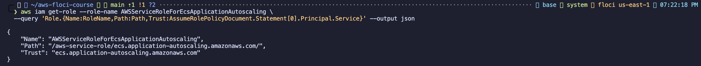

The role is service-owned: its path is `/aws-service-role/ecs.application-autoscaling.amazonaws.com/` and
its trust principal is `ecs.application-autoscaling.amazonaws.com`. Floci named it
`AWSServiceRoleForEcsApplicationAutoscaling` rather than AWS's fixed name
`AWSServiceRoleForApplicationAutoScaling_ECSService`. On real AWS, every `UpdateService` call the scaling
service makes would be made as this role and recorded in CloudTrail.

### 5.2 Scalable target and its bounds (Steps 5-6)

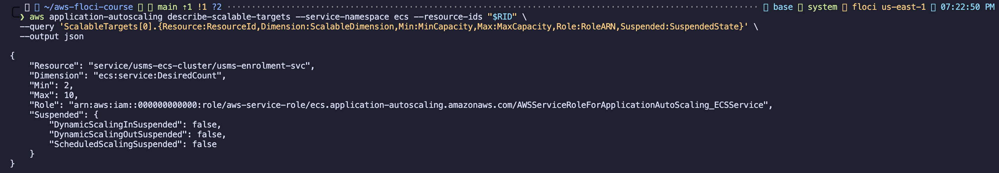

* The resource ID was **derived from the service ARN** (`${SVC_ARN##*:}`), not typed: three segments, the
  first one `service`.
* Min 2, Max 10, dimension `ecs:service:DesiredCount`, all three suspension switches `false`.
* `Role` was filled in by AWS even though no `--role-arn` was passed.
* Step 6: re-registering with only `--max-capacity 12` kept the minimum at 2. This confirms that
  re-registration replaces only the parameters you pass. It was then put back to 2/10, and exactly one
  target exists.
* "Your turn" (`--min-capacity 5`): on AWS this raises `desiredCount` to 5 immediately. On Floci the bound
  was stored but `desiredCount` stayed at 2 and no activity was recorded, so Floci does not enforce the
  floor. It was restored to 2.

### 5.3 Target tracking policies (Steps 7-9) - Checkpoint 3

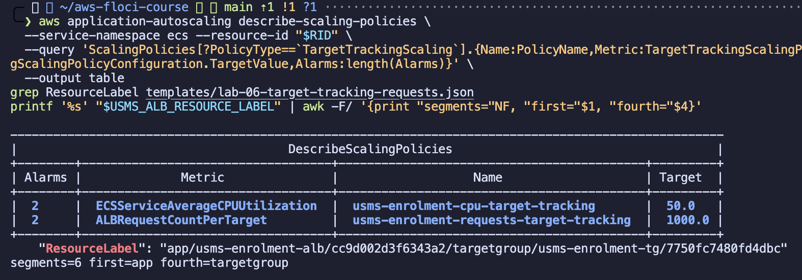

* `usms-enrolment-cpu-target-tracking`: `ECSServiceAverageCPUUtilization`, target 50.0, out 60 s, in 300 s.
* `usms-enrolment-requests-target-tracking`: `ALBRequestCountPerTarget`, target 1000.0 (requests per
  target **per minute**).
* Both policies show **2 alarms** each.
* `ResourceLabel` = `app/usms-enrolment-alb/cc9d002d3f6343a2/targetgroup/usms-enrolment-tg/7750fc7480fd4dbc`
  was validated as `segments=6 first=app fourth=targetgroup`.
* The CPU document uses a quoted heredoc (no variables). The requests document uses an unquoted heredoc so
  that `$RESOURCE_LABEL` expands. `grep -c '\$'` printed `0` for both.

### 5.4 The managed alarms (Step 8)

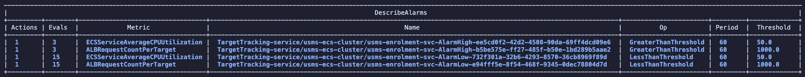

Four alarms that I did not create: AlarmHigh with 3 x 60 s `GreaterThanThreshold`, and AlarmLow with
15 x 60 s `LessThanThreshold`. Each alarm has exactly one action, its policy's ARN. The asymmetry is
deliberate: about 3 minutes of evidence to scale out and about 15 minutes to scale in. These alarms
belong to the policy, so they must not be edited or deleted by hand.

Floci differs from AWS in two ways here. The metric name is the predefined type rather than
`CPUUtilization` / `RequestCountPerTarget`. The low threshold equals the target (50) instead of sitting
just below it (e.g. 45), so there is no dead band.

**Time at 100 % CPU before a third task serves (Step 8 "Your turn"):**
180 s alarm (3 x 60) + ~0 s invocation + ~60 s Fargate start + 60 s grace period = **about 300 s**.

### 5.5 Step scaling policy and its alarm (Step 10)

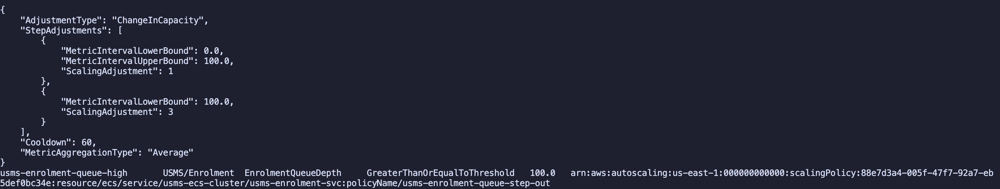

| MetricIntervalLowerBound | MetricIntervalUpperBound | ScalingAdjustment | queue depth |
|---|---|---|---|
| 0 | 100 | +1 | 100 to 200 |
| 100 | (none - open-ended) | +3 | 200 and above |

`ChangeInCapacity`, `Average`, cooldown 60. The alarm `usms-enrolment-queue-high` watches
`USMS/Enrolment EnrolmentQueueDepth` with `>= 100` over 1 x 60 s, and its action is the step policy's ARN.
The policy was created **before** the alarm, because the alarm needs the policy's ARN. Floci did not store
`TreatMissingData`, and it does not back-link the alarm into the policy's `Alarms` list.

### 5.6 Scheduled actions (Step 11)

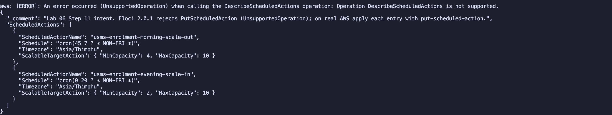

`PutScheduledAction` and `DescribeScheduledActions` both return `UnsupportedOperation`, with and without
`--timezone`. The intended actions are recorded in `templates/lab-06-scheduled-actions.json`:
`cron(45 7 ? * MON-FRI *)` Asia/Thimphu sets min 4 / max 10, and `cron(0 20 ? * MON-FRI *)` sets min 2 /
max 10. As a stand-in, the bound changes each action would make were applied by hand (min 4, then
min 2). That shows only what the action would write; it does not show a scheduler firing.

### 5.7 Firing the alarm (Step 12) - Checkpoint 5

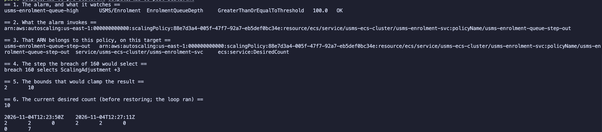

**Prediction:** a metric of 260 against a threshold of 100 gives a breach of 160, which falls in the
open-ended interval, so +3 (2 -> 5).

**Observed (path A, the loop ran):**

* The alarm evaluated **by itself** and went to `ALARM` ("Threshold Crossed: 1 datapoint(s)").
* Seven `Successful` scaling activities followed. Each has the `Cause` *"monitor alarm
  usms-enrolment-queue-high in state ALARM triggered policy usms-enrolment-queue-step-out"*, which shows
  that something other than me moved `desiredCount`.
* The first activity was **2 -> 3 (+1), not +3**. The one-minute bucket the alarm evaluated averaged
  **106.4**, because it mixed the earlier 3/5/4 datapoints with the first 260. That is a breach of 6.4,
  which selects the first step. This is correct `Average` behaviour; the prediction assumed the whole
  minute was 260.
* Floci then re-invoked the policy **every 10 seconds**, ignoring the 60 s cooldown: 3, 4, 5, 6, 7, 8, 10.
  The last step (8 + 3 = 11) was **clamped by MaxCapacity to 10**.
* The six-block wiring proof confirms the chain: metric -> alarm `>= 100` -> `AlarmActions` = step policy
  ARN -> that ARN is `usms-enrolment-queue-step-out` on this target -> a breach of 160 selects +3 ->
  clamped to 10.
* **Return to baseline**, in the correct order: the metric was pushed down (4, 3, 2) and the alarm set to
  `OK` first, then `desiredCount` was set to 2. Before: `2 2 0` at 12:23:50Z with 0 activities. After:
  `2 2 0` at 12:27:11Z with 7 activities.

### 5.8 Suspend and resume (Step 13)

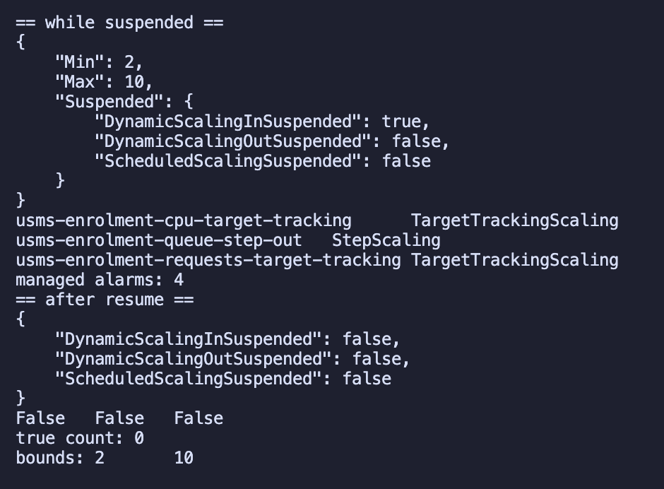

Scale-in was suspended through `register-scalable-target --suspended-state
file://templates/lab-06-suspended-state.json`; there is no separate suspend call. While suspended, the
bounds stayed at 2/10 and all three policies and four managed alarms were unchanged. After resuming, the
switches read `False False False` and `SuspendedState.* | grep -ci true` returned **0**. The `-i` flag
matters because `--output text` prints `True` with a capital T. A target left with scale-out suspended
would silently fail to grow during the next incident.

### 5.9 Persistence across a restart (Step 14) - Checkpoint 7

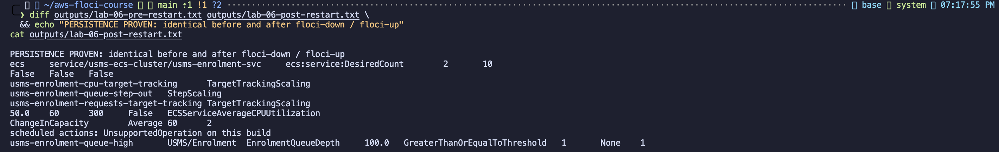

After `floci-down.sh` / `floci-up.sh`, the resource ID, dimension, policy names and alarm name were
**re-derived from the API** (policies found by type and by name fragment), not reused from shell
variables. The `diff` of the before and after snapshots was empty, and **PERSISTENCE PROVEN** was printed.
The following survived:

* the target, 2/10 with three `False` switches,
* three policies with CPU `50.0 60 300 False`,
* the step policy `ChangeInCapacity Average 60 2`,
* the custom alarm `>= 100`, 1 evaluation, 1 action.

Scheduled actions printed `UnsupportedOperation` both before and after.

### 5.10 Closing the loop (Step 15)

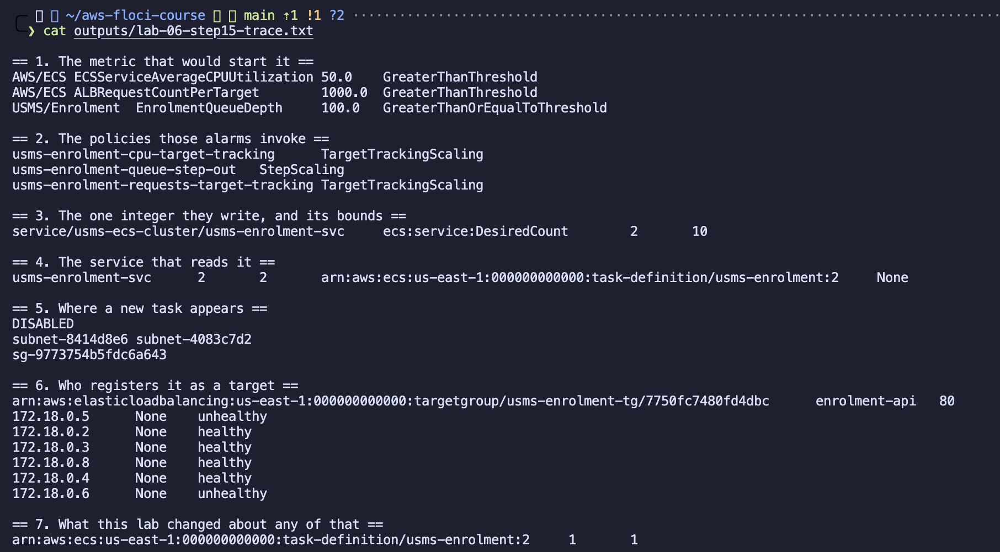

| # | Link in the chain | Owner |
|---|---|---|
| 1 | A student clicks Register | - |
| 2 | Requests per target pass 1000, or the queue passes 100 (block 1) | **Lab 06** |
| 3 | An alarm fires and invokes a policy (blocks 1-2) | **Lab 06** |
| 4 | The policy writes `desiredCount`, clamped to 2..10 (block 3) | **Lab 06** |
| 5 | ECS starts a task from `usms-enrolment:2` (block 4) | Lab 04 |
| 6 | The task gets an ENI in a private subnet, no public IP (block 5) | Lab 02/04 |
| 7 | `usms-enrolment-sg` admits tcp/80 only from `usms-alb-sg` | Lab 05 |
| 8 | The service registers the task in `usms-enrolment-tg` (block 6) | Lab 05 |
| 9 | The ALB health-checks it; block 7 shows `:2`, 1 LB, 1 deployment, unchanged | Lab 04/05 |

This lab owns three of the nine links. Block 6 lists six targets (two unhealthy) after the service went
back down to 2 tasks: Floci does not deregister stopped tasks. Real ECS deregisters them.

### 5.11 Recording and verification (Steps 16-17, Section 8)

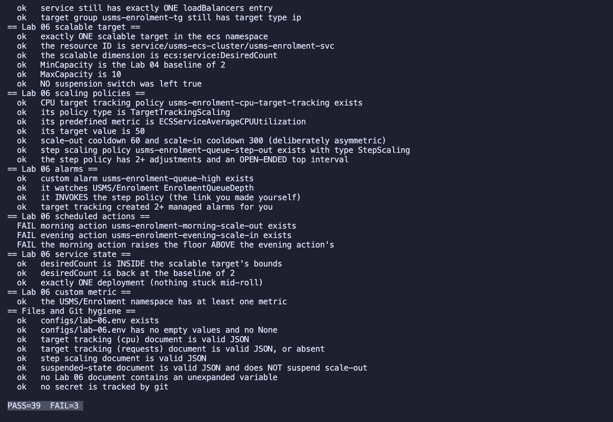

**`verify-lab-06.sh`: PASS=39 FAIL=3.** The three failures are the scheduled-action checks, which the lab
lists as benign when `describe-scheduled-actions` is not implemented. Every non-benign check passes:

* no suspension switch is left on,
* `desiredCount` is back at the baseline of 2,
* `MinCapacity` is 2,
* the alarm invokes the step policy,
* the top step interval is open-ended,
* no document contains an unexpanded variable.

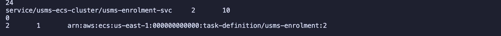

Section 16 readiness:

* `configs/lab-06.env` has **24** exports (22 from Step 16, plus 2 from Exercise 5),
* there is exactly one target, `service/usms-ecs-cluster/usms-enrolment-svc 2 10`,
* the suspension count is **0**,
* the service is at desired `2`, with `1` deployment, on `usms-enrolment:2`.

Corrections made to the lab's own scripts:

1. **Step 16:** `awk -F: '{print \$NF}'` inside the unquoted heredoc gave an **empty** resource ID on
   macOS (both zsh and bash 3.2). Inside `$(...)` the single quotes already protect `$NF`, so the
   unescaped form is correct.
2. **Section 8:** the git-hygiene check `! git ls-files | grep -q '^outputs/'` always failed, because the
   lab itself expects `outputs/.gitkeep` to be tracked. It now ignores exactly that one file.
3. **Step 17 part 1:** the Lab 04/05 cleanup hint strings already named `lab-06-cleanup.sh`. The lab's
   blanket replace would have broken the correct `lab-04-cleanup.sh` references in `lab-05-cleanup.sh`,
   so it was not applied.

`scripts/cleanup/lab-06-cleanup.sh` was written and passes `bash -n`. It has **not** been run.

---

## 6. Results

| Checkpoint | Result |
|---|---|
| 1 - Ready to build | Done. Support path A recorded; the pre-existing Lab 05 grace-period failures are documented |
| 2 - Scalable target | One target, 2/10, RoleARN filled in, switches false |
| 3 - Target tracking | CPU 50 and requests 1000, 2 alarms each, label validated |
| 4 - Step + scheduled | Step policy and alarm done. Scheduled actions **unsupported** on this build |
| 5 - Scaling observed | **Path A**: 7 activities naming the alarm and the policy; back to 2 |
| 6 - Suspension | Exercised and cleared, `grep -ci true` = 0 |
| 7 - Persistence | PERSISTENCE PROVEN after restart |
| 8 - Recorded | `configs/lab-06.env` committed (24 exports); nothing under `outputs/` staged |

---

## 7. Floci vs Real AWS (observed on this build)

| Feature | Real AWS | Observed on Floci |
|---|---|---|
| Service-linked role name | `AWSServiceRoleForApplicationAutoScaling_ECSService` | `AWSServiceRoleForEcsApplicationAutoscaling` |
| Raising MinCapacity above desired | `desiredCount` raised immediately | Bound stored, not enforced |
| Managed alarms | Created; low threshold below target | Created; low threshold = target, metric named by type |
| Alarm evaluation and policy invocation | Every period | **Worked**: the alarm self-evaluated and invoked the policy |
| Cooldown | Respected (60 s) | Ignored: re-invoked every 10 s |
| MaxCapacity clamp | Enforced | **Enforced** (8 + 3 -> 10) |
| Scheduled actions | Full, with IANA time zones | `UnsupportedOperation` |
| `TreatMissingData`, policy `Alarms` back-link | Stored | Not stored |
| `DisableScaleIn` policy | Creates no AlarmLow | Still created one (Exercise 1) |
| Fargate start + grace period | 20-60 s + 60 s | Tasks running in seconds; grace period not stored |
| Target deregistration on scale-in | Automatic | Stale targets left behind |
| Cost, quotas, IAM authorisation, subnet exhaustion | Enforced | None |

---

## 8. Independent Exercises (summary - full answers in [exercises.md](exercises.md))

1. **Memory policy, scale-out only:** target 70 with `DisableScaleIn: true`. Floci created 6 managed
   alarms where AWS would create 5. The policy was removed in Exercise 4.
2. **Step scale-in pair:** a -1/-2 table with non-positive bounds, and a `< 20` alarm over 3 x 60 s.
   Forcing the alarm at the floor of 2 did nothing (correct). Both objects were deleted, alarm first.
3. **`usms-scaling-report.sh`:** gives identical output from any directory, and returned the correct
   verdict in each state tested: AT-FLOOR, FROZEN (suspended) and PINNED (min = max = 3).
4. **Enrolment-week capacity plan:** 10 tasks x 1000 req/min is about 167 req/s, while a 40x spike needs
   about 80 tasks, so the problem is capacity, not scaling speed. The safe ceiling is about 240, given
   251 usable IPs per /24 and room for rolling deploys. The plan pre-warms with scheduled actions, and the
   extra cost is about $20 for the month.
5. **Lab 10 hand-off:** `outputs/lab-06-scaling-history.json` (16,240 bytes); latency cited at 60 s because
   Floci does not enforce the floor; the bucket ARN was read from the policy document; `head-bucket` on
   `usms-student-data` returned 404 (exit 254) because the bucket does not exist yet.

Review question answers and the "Your turn" answers are in
[`notes/lab-06-notes.md`](../../notes/lab-06-notes.md).

---

## 9. Files Produced

| Path | Purpose |
|---|---|
| `templates/lab-06-target-tracking-cpu.json`, `-requests.json`, `-memory.json` | target tracking configurations |
| `templates/lab-06-step-scaling-out.json`, `-in.json` | step adjustment tables |
| `templates/lab-06-suspended-state.json` | runbook: suspend scale-in during an incident |
| `templates/lab-06-scheduled-actions.json` | the scheduled actions this build cannot store |
| `configs/lab-06.env` | 24 exports, read by the CloudWatch and CloudFormation labs |
| `scripts/utilities/verify-lab-06.sh` | 42 checks |
| `scripts/utilities/usms-scaling-report.sh`, `usms-scaling-history.sh` | Exercises 3 and 5 |
| `scripts/cleanup/lab-06-cleanup.sh` | end of course only, run before the lab-05 and lab-04 cleanups |
| `screenshots/lab6/01-12` | evidence |

---

## 10. Conclusion

Auto scaling changes exactly one thing about the application: **who writes `desiredCount`, and when.**
The scalable target fixes the range (2..10), the policies decide the number, and CloudWatch alarms decide
when. Everything downstream (task start, ENI placement, security group, target registration, health
check) was already built in Labs 02, 04 and 05 and needed no change.

On this Floci build the alarm-to-policy loop really ran. An alarm I wrote moved the service from 2 to 10
tasks, the ceiling held, and every activity named the alarm and policy responsible. The run also exposed
two lessons that apply on real AWS:

* **Average aggregation can choose a smaller step than expected.** The first step was +1, not +3.
* **Cooldowns are what stop runaway scaling.** Floci ignores them, and the service ran straight to the
  ceiling.

Scheduled scaling could not be exercised here. It remains the only mechanism that can have capacity ready
*before* a known spike, which is why Exercise 4 concludes that a forty-fold enrolment surge needs a
pre-warmed floor and a higher ceiling, not faster reactive scaling.
