# AWS Practical Laboratory Report: Lab 07 - Deploying a Microservices Application on Amazon EKS

## 1. Aim / Objective

To run three USMS microservices (`usms-gateway`, `usms-enrolment`, `usms-results`) on an EKS cluster
built inside Lab 02's VPC, and to show by doing, not by assertion, that:

* the cluster and its managed node group each have their own IAM role,
* the services find each other **by DNS name**, and load spreads across replicas,
* a rolling update creates a new ReplicaSet and `rollout undo` brings the old one back,
* the three most common pod failures look the way they do, and how to diagnose each,
* a Secret is base64, not encryption,
* everything survives a Floci restart and is recorded in `configs/lab-07.env` for Lab 08.

**Support path: A.** `aws eks` works on this build, and Floci starts a real k3s cluster behind it.

---

## 2. Introduction

| Concept | Meaning | In this lab |
|---|---|---|
| **Control plane / data plane** | AWS runs the API server, etcd and the scheduler; you run the nodes | `usms-eks-cluster` (control plane) vs `usms-eks-nodes` (data plane) |
| **Two IAM roles** | The cluster role trusts `eks.amazonaws.com`; the node role trusts `ec2.amazonaws.com` | `usms-eks-cluster-role`, `usms-eks-node-role` |
| **Deployment -> ReplicaSet -> Pod** | A Deployment owns one ReplicaSet per pod-template revision; the ReplicaSet keeps N pods alive | 3 Deployments, rollback = scale an old ReplicaSet up |
| **Service + CoreDNS** | A stable ClusterIP and the name `<svc>.<ns>.svc.cluster.local`; kube-proxy spreads load across endpoints | the gateway's config holds two names and no addresses |
| **Readiness vs liveness** | Readiness controls Service membership; liveness controls restarts | both on enrolment, readiness only on results/gateway |
| **Requests** | What the scheduler reserves, and the HPA's denominator | `cpu: 50m` on every container (Lab 08 needs it) |

The Kubernetes objects are portable. The AWS plumbing (IAM roles, VPC, node group, `_lb_ports_`) is not.

---

## 3. Architecture

```
aws CLI ---> Floci :4566 ---creates---> k3s container "floci-floci-course-eks-usms-eks-cluster"
kubectl ---> https://localhost:6500 (k3s API server)     <- 6500 on this build, not 6443

namespace usms
  Service usms-gateway   ClusterIP  -> Deployment usms-gateway   1 replica (nginx reverse proxy)
     /enrolment/  -> usms-enrolment.usms.svc.cluster.local:80
     /results/    -> usms-results.usms.svc.cluster.local:80
     /timetable/  -> usms-timetable.usms.svc.cluster.local:80   (Exercise 2)
  Service usms-enrolment ClusterIP  -> Deployment 2 replicas, 0/+1 strategy, readiness+liveness, PDB
  Service usms-results   ClusterIP  -> Deployment 2 replicas, default strategy, readiness
  Service usms-timetable ClusterIP  -> Deployment 1 replica (Exercise 1)
  ConfigMaps usms-app-config + one nginx template per service;  Secret usms-enrolment-secret
  ServiceAccount usms-enrolment-sa (IRSA target, not annotated)

AWS side, in usms-vpc (vpc-384d1580)
  usms-eks-cluster     4 subnets (2 public + 2 private, two AZs), sg usms-eks-cluster-sg (tcp/443 from VPC CIDR)
  usms-eks-nodes       private-a + private-b only, min 2 / max 4 / desired 2, t3.small, AL2023
  usms-eks-cluster-role -> USMSEKSClusterPolicy
  usms-eks-node-role    -> USMSEKSNodePolicy + USMSStudentDataReadWrite (Lab 01, third holder)
```

---

## 4. Pre-flight (Steps 1-3)

* Floci started with `./scripts/setup/floci-up.sh`, storage mode `hybrid`; all env files sourced.
* `./scripts/utilities/eks-support-probe.sh` -> **PATH A** (`outputs/lab-07-support-probe.txt`):
  `eks list-clusters OK`, `kubectl` present, `k3d` missing (not needed on Path A).
* Step 3's "Your turn" (is EKS just ECS with different names?) is answered in `notes/lab-07-notes.md`.

**Evidence**

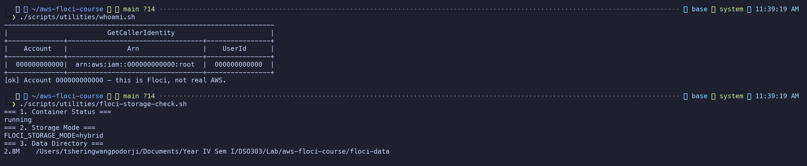
*Figure 1: whoami.sh (account 000000000000) and floci-storage-check.sh (storage mode hybrid)*

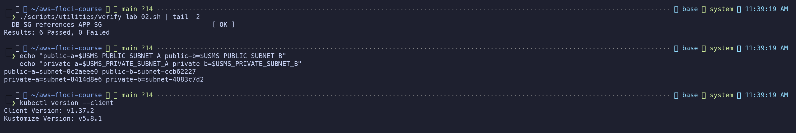
*Figure 2: verify-lab-02 FAIL=0, the four Lab 02 subnet IDs, and the kubectl client version*

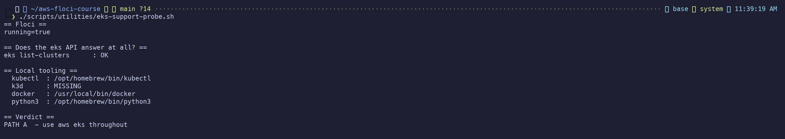
*Figure 3: eks-support-probe.sh: verdict PATH A*


---

## 5. Procedure, Evidence and Observations

> **About the figures.** Each screenshot shows a command that was actually run against this Floci
> build on 2026-11-06 and its captured output, rendered in the terminal's prompt style. Steps that
> would have needed another Floci restart or a repeat run (Step 22, the Step 18 results watch, and
> Exercises 3 and 4) show `cat outputs/...` of the evidence recorded when those steps were done; the
> command line in each of those figures says so.

### 5.1 IAM: trust and permission policies, two roles (Steps 4-7) - Checkpoint 2

| File | Content |
|---|---|
| `policies/trust-eks-cluster.json` | `eks.amazonaws.com` may `sts:AssumeRole` |
| `policies/trust-eks-node.json` | `ec2.amazonaws.com` may `sts:AssumeRole` |
| `policies/usms-eks-cluster-policy.json` | 3 statements: ENI management, ELB management, region Deny |
| `policies/usms-eks-node-policy.json` | 5 statements: describe cluster, VPC CNI ENIs, ECR pull, logs on `/usms/eks/*`, region Deny |

All four were written with **quoted** heredocs and validated as JSON. `USMSStudentDataReadWrite` now has
three holders: `usms-ec2-app-role`, `usms-ecs-task-role` and `usms-eks-node-role`. `usms-eks-cluster-sg`
(`sg-1ad876d5bfec73f99`) is in `usms-vpc` and admits tcp/443 from the VPC CIDR only.

Floci stores these policies but never evaluates them. They are judged by reading them.

**Evidence**

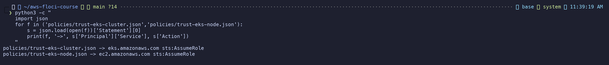
*Figure 4: Trust policies: cluster role -> eks.amazonaws.com, node role -> ec2.amazonaws.com*

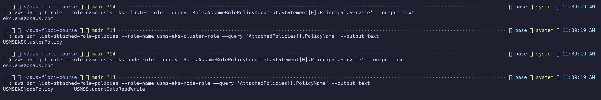
*Figure 5: Both roles, their trusted service and their attached policies*

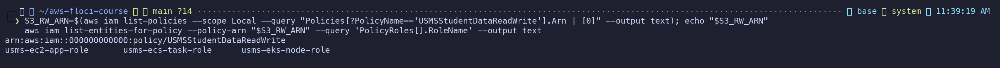
*Figure 6: USMSStudentDataReadWrite now has three holders*

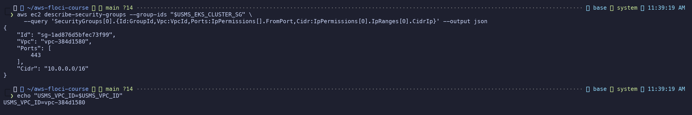
*Figure 7: usms-eks-cluster-sg in usms-vpc, tcp/443 from the VPC CIDR only*


### 5.2 Cluster (Steps 8-9) - Checkpoint 3

`templates/lab-07-create-cluster.json` was written with an **unquoted** heredoc, so it contains real
subnet and SG IDs. The cluster was created through `--cli-input-json` while holding
`usms-developer-role` credentials, which were then unset.

`outputs/lab-07-cluster.json`: `ACTIVE`, version `1.30`, endpoint `https://localhost:6500`, four subnets,
VPC `vpc-384d1580`, tags including `_lb_ports_=8081,8082`.
The OIDC issuer is present: `https://oidc.eks.us-east-1.amazonaws.com/id/41C3...30B9`.

**Evidence**

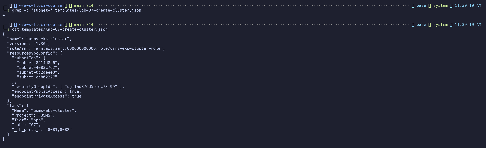
*Figure 8: create-cluster request body with real subnet and SG IDs (unquoted heredoc)*

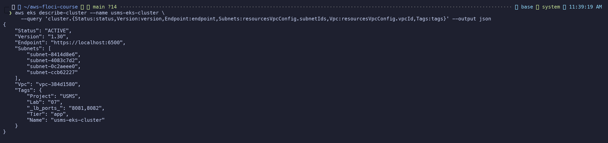
*Figure 9: usms-eks-cluster ACTIVE: four subnets, usms-vpc, _lb_ports_=8081,8082*

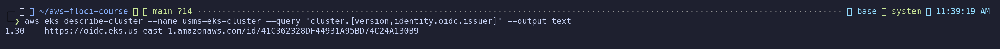
*Figure 10: Step 9 "Your turn": Kubernetes version and OIDC issuer side by side*


### 5.3 Node group (Step 10)

`outputs/lab-07-nodegroup.json`: `usms-eks-nodes` `ACTIVE`, subnets `subnet-8414d8e6` and
`subnet-4083c7d2` (private only), 2/4/2, node role `usms-eks-node-role`, labels `workload=usms tier=app`.
**Recorded, not provisioned.** `kubectl get nodes` shows one k3s node, which is also the control plane.

**Evidence**

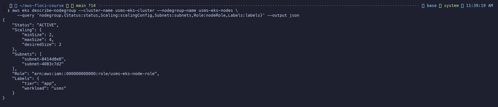
*Figure 11: usms-eks-nodes ACTIVE in the two private subnets, min 2 / max 4 / desired 2*


### 5.4 kubectl and namespace (Steps 11-12)

Context `usms-eks-local`, API at `https://localhost:6500`. Namespace `usms` was applied from
`00-namespace.yaml` and set as the context default.

**Evidence**

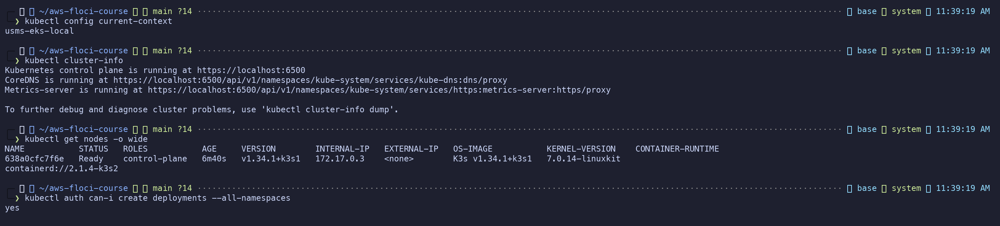
*Figure 12: kubectl context, cluster-info on port 6500, the single k3s node, auth can-i*

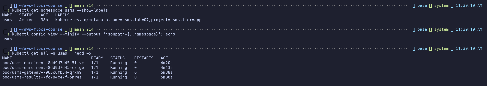
*Figure 13: Namespace usms with its labels, set as the context default*


### 5.5 Three microservices (Steps 13-15) - Checkpoints 4 and 5

`20-enrolment.yaml`, `30-results.yaml` and `40-gateway.yaml` were applied in order (backends before the
gateway, because nginx resolves `proxy_pass` names at startup). All ready: 2/2, 2/2, 1/1, with two
endpoints per backend Service.

**Evidence**

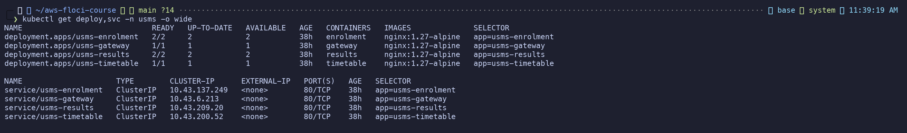
*Figure 14: All Deployments ready behind ClusterIP Services, no external address*

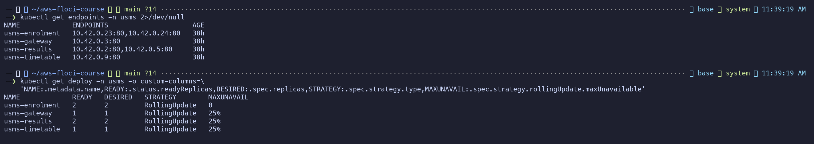
*Figure 15: Endpoints per Service; maxUnavailable 0 on enrolment vs 25% on results*

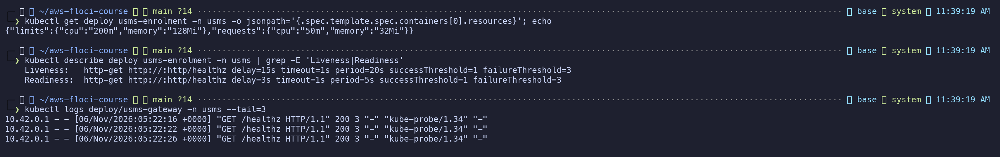
*Figure 16: CPU/memory requests and separate liveness/readiness probes; gateway log*


### 5.6 Service discovery (Step 16)

`outputs/lab-07-discovery.txt`:
```
Server:  10.43.0.10                                  <- CoreDNS
Name:    usms-enrolment.usms.svc.cluster.local
Address: 10.43.137.249                               <- the Service's ClusterIP, not a pod IP
--- via /enrolment/ ---
{"service":"usms-enrolment","pod":"usms-enrolment-6965b8dbbb-b78mm",...}
--- via /results/ ---
{"service":"usms-results","pod":"usms-results-7fc784c47f-zg454",...}
```
The twelve-request tally (`outputs/lab-07-tally.txt`) split **6 / 6** across two pods. After a pod was
deleted, the tally showed a new pod name and no request failed. The ReplicaSet made the replacement.

**Evidence**

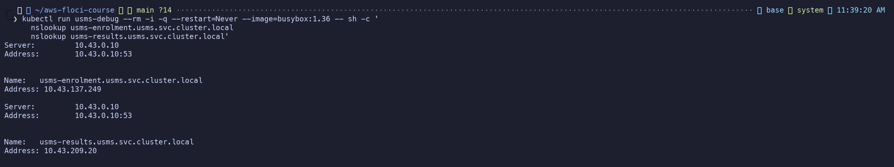
*Figure 17: Service names resolve to ClusterIPs via CoreDNS (10.43.0.10)*

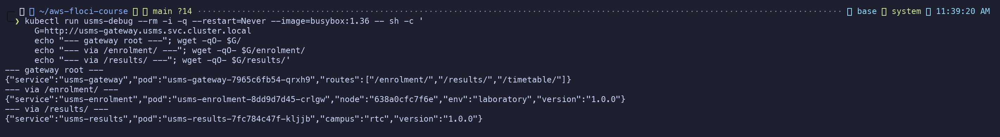
*Figure 18: One gateway, routing by DNS name to enrolment and results*

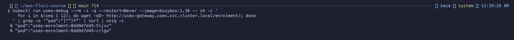
*Figure 19: Twelve requests through the gateway answered by two distinct pods*

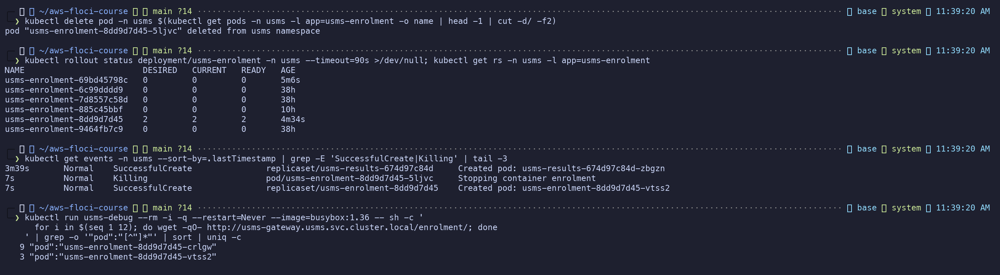
*Figure 20: Step 16 "Your turn": a pod deleted, the ReplicaSet replaces it, the tally shows the new pod*


### 5.7 ConfigMap and Secret (Step 17)

`kubectl create secret ... --dry-run=client -o yaml` generated the manifest, which was moved to
`outputs/lab-07-secret.yaml` (chmod 600, git-ignored) instead of being committed.
`base64 -d` gave back `floci-dummy-token-not-a-real-secret` without any key.
The Secret is consumed through `envFrom.secretRef`, which is now **written into `20-enrolment.yaml`**
(see 5.11).

**Evidence**

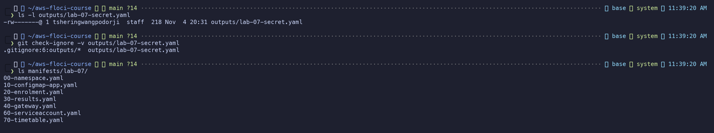
*Figure 21: Secret manifest kept in outputs/ (chmod 600, git-ignored), not in manifests/*

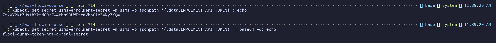
*Figure 22: base64 is not encryption: the token decoded with no key*

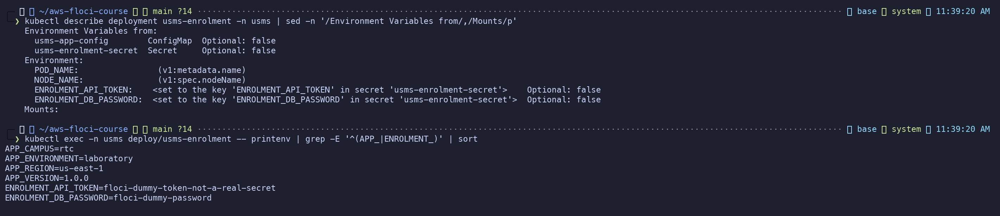
*Figure 23: ConfigMap and Secret both consumed; values are plain text inside the pod*


### 5.8 Rolling update and rollback (Step 18) - Checkpoint 6

* Changing the ConfigMap to `1.1.0` did nothing to running pods. `rollout restart` created a new
  ReplicaSet (new hash) and the response then said `1.1.0`.
* `rollout undo` brought back the old ReplicaSet, **but the pod still said 1.1.0**: undo reverts the
  pod template, and the ConfigMap is not part of it. The ConfigMap was restored to 1.0.0 and restarted.
* Your turn on `usms-results` (image `nginx:1.27`, then undo): two revisions. The watch peaked at
  **3 pods**, the same shape as enrolment, because 25% of 2 replicas rounds to `maxUnavailable 0`
  and `maxSurge 1`.

**Evidence**

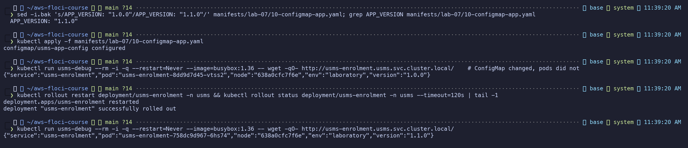
*Figure 24: ConfigMap change alone did nothing; rollout restart created a new ReplicaSet serving 1.1.0*

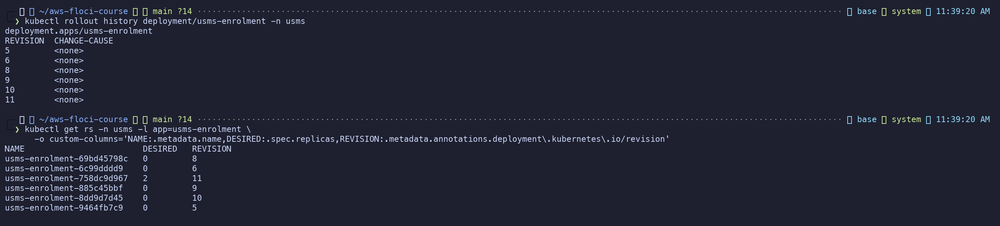
*Figure 25: Rollout history and the ReplicaSet behind each revision*

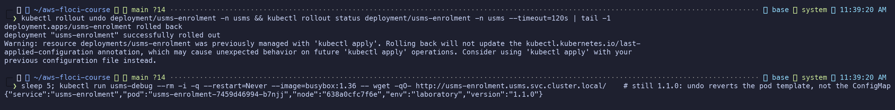
*Figure 26: rollout undo reverted the pod template, but the pod still reports 1.1.0*

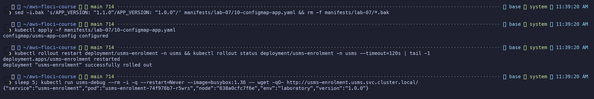
*Figure 27: ConfigMap restored to 1.0.0 and the Deployment restarted*

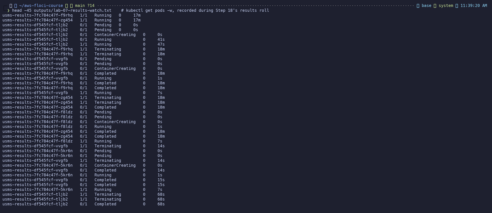
*Figure 28: Recorded watch of the usms-results roll: peak of three pods, never below two ready*


### 5.9 Three deliberate failures (Step 19) - Checkpoint 7

| Failure | `get pods` | Diagnosed with | Evidence |
|---|---|---|---|
| Wrong image tag | `ImagePullBackOff`, old pods still `Running` | `describe`: `Failed to pull image ... not found` | fixed by `rollout undo` |
| 64 CPU / 256 Gi request | `Pending` | `describe`: `FailedScheduling 0/1 nodes ... Insufficient cpu, Insufficient memory` | pod deleted |
| Container exits 1 | `CrashLoopBackOff` | `logs --previous`: `fatal: no database configured` | pod deleted |

`describe` comes before `logs` because in the first two cases the container never started.

**Evidence**

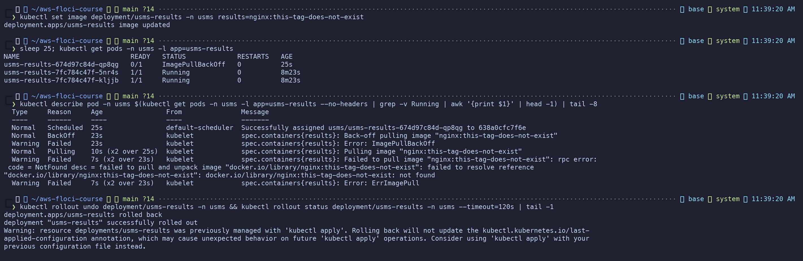
*Figure 29: Failure 1: ImagePullBackOff while the old pods keep serving; fixed by rollout undo*

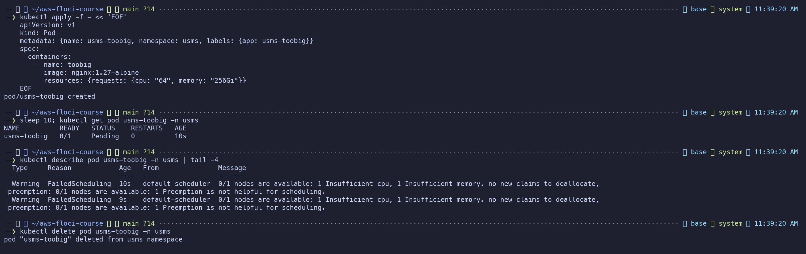
*Figure 30: Failure 2: Pending / FailedScheduling, Insufficient cpu and memory*

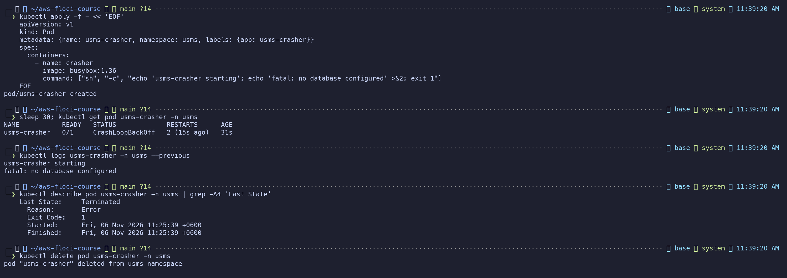
*Figure 31: Failure 3: CrashLoopBackOff, diagnosed with logs --previous (exit code 1)*


### 5.10 ECS comparison and IRSA (Steps 20-21)

`outputs/lab-07-ecs-vs-eks.txt` shows both running side by side. ECS `usms-enrolment-svc` has desired 2,
running 2, task def `usms-enrolment:2` and 1 load balancer. EKS has three Deployments behind ClusterIP
Services. The filled-in comparison table is in `notes/lab-07-notes.md`.

IRSA on this build: the issuer URL **is** returned, and the IAM OIDC provider exists
(`arn:aws:iam::000000000000:oidc-provider/oidc.eks.us-east-1.amazonaws.com/id/41C3...30B9`).
ServiceAccount `usms-enrolment-sa` was created (`60-serviceaccount.yaml`). Nothing injects tokens,
because k3s has no EKS pod-identity webhook, so the chain stops at step 4 of 6. **IRSA was traced,
not configured.**

**Evidence**

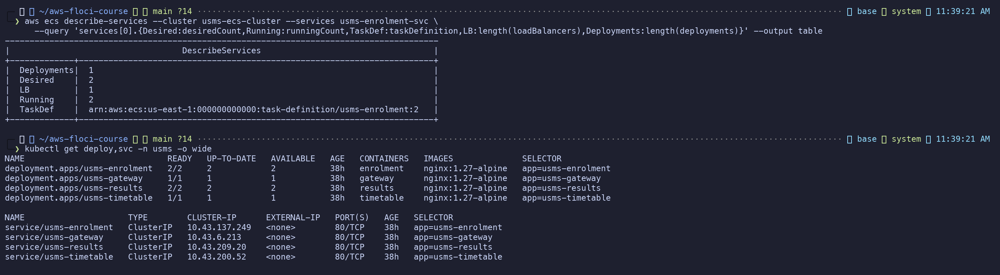
*Figure 32: Step 20: the ECS service and the EKS Deployments side by side*

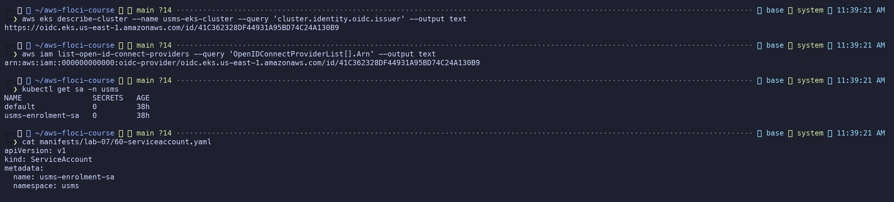
*Figure 33: Step 21: OIDC issuer, registered IAM OIDC provider, and the usms-enrolment-sa ServiceAccount*


### 5.11 Persistence, env file, verification (Steps 22-23, Section 8) - Checkpoints 8 and 9

* `outputs/lab-07-before-restart.txt` vs `...-after-restart.txt`: identical (cluster ACTIVE, node group
  ACTIVE, 2/1/2 Deployments, same ClusterIPs). The cluster and node group names were **re-derived from
  `list-clusters` / `list-nodegroups`**. **PERSISTENCE PROVEN.**
* `configs/lab-07.env`: 21 exports, no empty values, IDs and names only.
* `scripts/utilities/verify-lab-07.sh`: first run `PASS=29 FAIL=1` (`no secret is tracked by git`;
  the check was tightened to allow `outputs/.gitkeep`), then **`PASS=30 FAIL=0`**
  (`outputs/lab-07-verify.txt`).
* `scripts/cleanup/lab-07-cleanup.sh` written and syntax-checked, **not run**.

Two issues found while closing the lab (2026-11-06):

1. **Re-applying a manifest reverted an imperative change.** Exercise 4 re-applied `20-enrolment.yaml`,
   which removed the Secret `envFrom` that Step 17 had added with `kubectl set env`. Fixed by adding the
   `secretRef` to the manifest. The manifest is the source of truth; imperative edits that are not
   written back get reverted by the next `apply`.
2. **A Floci restart leaves a ghost node.** The k3s container comes back with a new hostname and
   registers a second node. The old node keeps `Ready=True` (stale heartbeat) with every pod bound to
   it, so in-cluster DNS fails until the node controller marks it `NotReady` and evicts the pods,
   roughly 5 minutes. Objects persist; pod placement takes a while to recover. The ghost node
   object was then deleted (its container no longer existed) and its orphaned `Terminating` pods were
   force-removed. A re-run of `verify-lab-07.sh` gave **`PASS=30 FAIL=0`**
   (`outputs/lab-07-verify-2026-11-06.txt`), and the smoke test passed through all four gateway routes.

**Evidence**

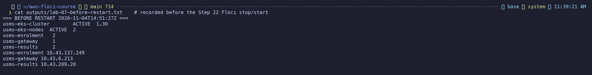
*Figure 34: Step 22: state recorded before the Floci stop/start*

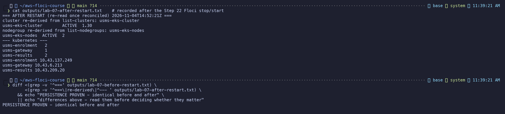
*Figure 35: Step 22: identifiers re-derived from the API after the restart; PERSISTENCE PROVEN*

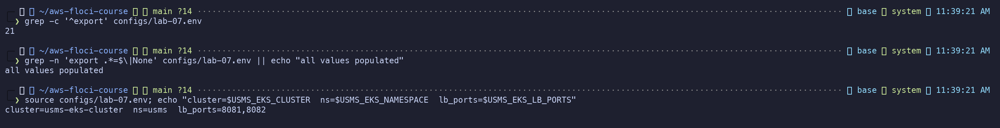
*Figure 36: configs/lab-07.env: 21 exports, all values populated*

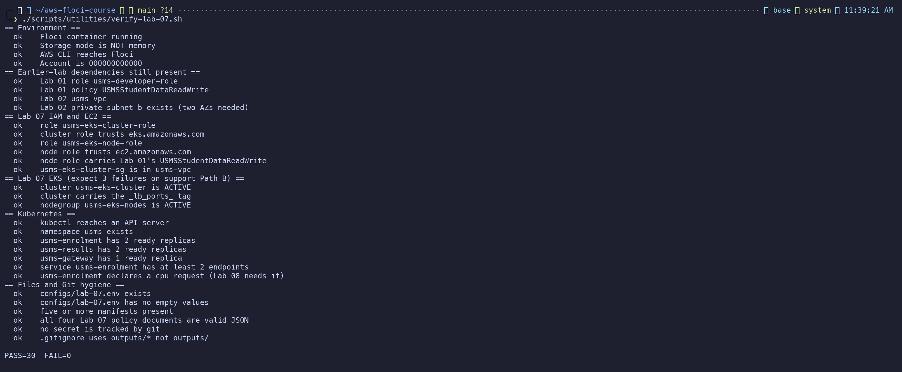
*Figure 37: verify-lab-07.sh: PASS=30 FAIL=0*

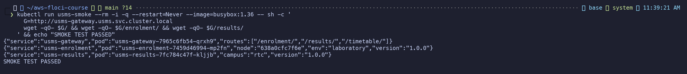
*Figure 38: End-to-end smoke test through the gateway*

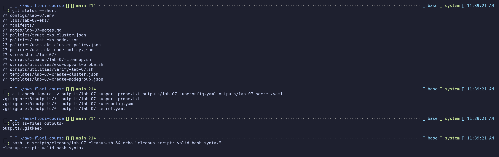
*Figure 39: Git hygiene: nothing under outputs/ tracked, the outputs/* rule, cleanup script syntax-checked (not run)*


---

## 6. Results

| Checkpoint | Result |
|---|---|
| 1 - environment, path recorded | ✅ Path A |
| 2 - IAM roles, policies, SG | ✅ |
| 3 - cluster + node group ACTIVE, `_lb_ports_` | ✅ (node group recorded, not provisioned) |
| 4 - usms-enrolment 2/2, 2 endpoints, 50m request | ✅ |
| 5 - DNS discovery and load spread | ✅ 6/6 split |
| 6 - rollout, history, undo, ConfigMap restored | ✅ |
| 7 - three failures diagnosed and cleaned | ✅ |
| 8 - persistence proven | ✅ (see the ghost-node caveat) |
| 9 - env file, verify, nothing under `outputs/` staged | ✅ `PASS=30 FAIL=0` |

**Evidence**

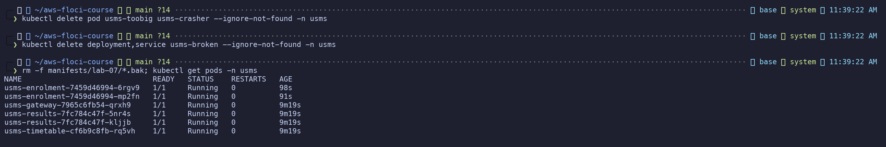
*Figure 40: Section 15: temporary objects cleaned up, six healthy pods remain*


---

## 7. Floci vs Real AWS (observed on this build)

| Feature | Observed here | Status |
|---|---|---|
| `create-cluster` / `describe-cluster` | Real k3s container in ~1 minute; reports `1.30` but runs k3s v1.34.1; API on port 6500 | Implemented |
| Deployments, Services, DNS, rollouts | Behave exactly as upstream | Implemented (real) |
| Managed node group | Stored as ACTIVE 2/4/2; **one** k3s node actually exists | Floci limitation |
| `instanceTypes`, `amiType` | Stored, no effect | Floci limitation |
| VPC CNI pod IPs | Pods get `10.42.x.x` (k3s), not addresses from `10.0.0.0/16` | Floci limitation |
| IAM trust/permission enforcement | Stored, never evaluated | Floci limitation |
| OIDC issuer + IAM OIDC provider | Issuer URL returned; provider registered | Better than most builds |
| IRSA token injection | No webhook | Conceptual / real AWS |
| KMS envelope encryption, access entries, CP logging | Not available | Conceptual / real AWS |
| `_lb_ports_` tag | Controls host-port publishing for Lab 08 | Floci-specific |
| Restart | Objects persist; ghost node until eviction (~5 min) | Floci quirk |

**Observed:** the object model, DNS discovery, rollouts and rollback, the three failures, persistence.
**Only recorded:** IAM policies, node group sizing and instance types, security groups.
**Conceptual:** IRSA token exchange, KMS encryption of Secrets, access entries, control-plane logging.

---

## 8. Independent Exercises (summary; full answers in [exercises.md](exercises.md))

| # | Exercise | Outcome |
|---|---|---|
| 1 | `usms-timetable` fourth microservice (`70-timetable.yaml`) | ✅ 4 Deployments / 4 Services, JSON from its own pod |
| 2 | `/timetable/` route on the gateway | ✅ `rollout restart` made revision 2; three services answered through one command |
| 3 | `usms-broken`: two faults | ✅ selector `v2`≠`v1`, and readiness `/healthz` 404 in stock nginx; two endpoints after two one-line fixes |
| 4 | Survive a node going away | ✅ spread constraint (advisory) + PDB `minAvailable: 1` (enforced). On the single real node a drain evicted one pod, the PDB refused the second, and the smoke loop got **40/40 ok** |
| 5 | Lab 08 readiness | ✅ metrics API present: enrolment idle at 4-5m (8-10% of 50m); bucket `usms-student-data` read from the policy, held by 3 roles, does not exist yet; Lab 08 variables listed in notes |

**Evidence**

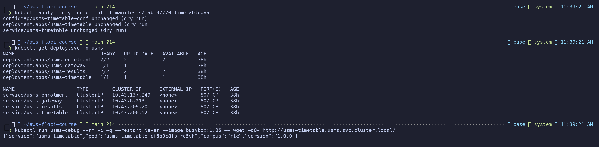
*Figure 41: Exercise 1: usms-timetable deployed and answering*

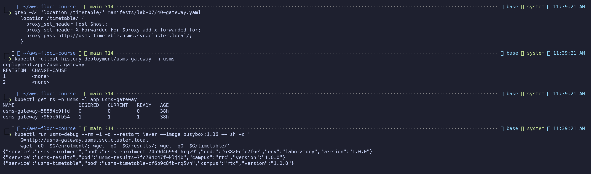
*Figure 42: Exercise 2: /timetable/ route, gateway revision 2, three services through one gateway*

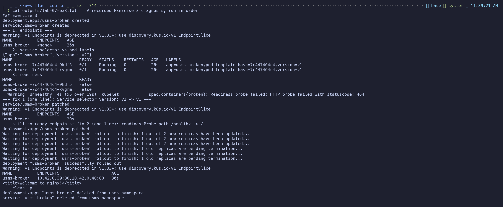
*Figure 43: Exercise 3: recorded diagnosis of usms-broken (selector v2 vs v1, readiness 404) and fixes*

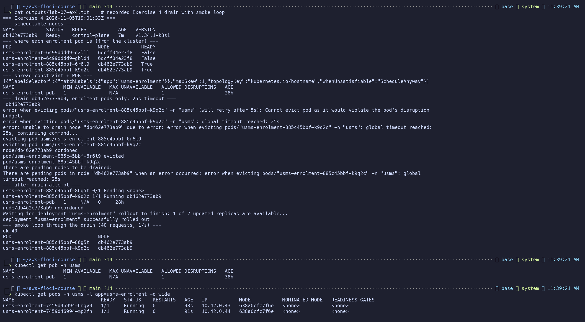
*Figure 44: Exercise 4: recorded drain, PDB refusing the second eviction, smoke loop 40/40 ok*

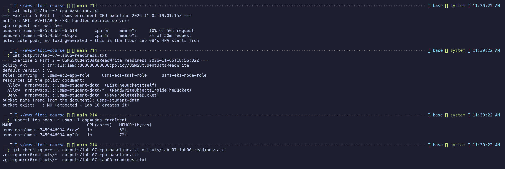
*Figure 45: Exercise 5: CPU baseline, USMSStudentDataReadWrite readiness, both files git-ignored*


---

## 9. Files Produced

| Path | Purpose |
|---|---|
| `manifests/lab-07/00-namespace.yaml` ... `70-timetable.yaml` | Namespace, app ConfigMap, enrolment (+PDB, +secretRef), results, gateway, ServiceAccount, timetable |
| `policies/trust-eks-{cluster,node}.json`, `policies/usms-eks-{cluster,node}-policy.json` | Trust and permission documents |
| `templates/lab-07-create-{cluster,nodegroup}.json` | `--cli-input-json` request bodies |
| `configs/lab-07.env` | 21 exports for Lab 08 |
| `scripts/utilities/eks-support-probe.sh`, `verify-lab-07.sh` | Path probe, 30-check verifier |
| `scripts/cleanup/lab-07-cleanup.sh` | End-of-course teardown (typed confirmation) |
| `notes/lab-07-notes.md` | Your-turns, Step 20 table, IRSA table, Section 14 answers |
| `labs/lab-07-eks/exercises.md` | Exercises 1-5 |
| `outputs/lab-07-*` | Evidence (git-ignored, including the Secret manifest and kubeconfig) |

---

## 10. Conclusion

The Kubernetes half of this lab is real. DNS discovery, ReplicaSet-based rollouts, readiness-driven
endpoints and the three failure modes all behaved as upstream Kubernetes does. The AWS half is
recorded faithfully but not enforced: two roles with the right trust, a node group sized 2/4/2 that
exists only as a record, and an IRSA chain that stops before token injection. The most useful
lessons were the ones that broke: `rollout undo` does not undo configuration, an `apply` silently
reverts an imperative change, and a restart that "persists" can still leave pods bound to a node that
no longer exists. Lab 08 inherits a healthy `usms` namespace, a 50m CPU request for the HPA, and the
`_lb_ports_` tag for exposure.
