# Lab 07 - Independent Lab Exercises

Support path **A** (Floci `aws eks` + a real k3s cluster). Raw evidence for every exercise is in
`outputs/lab-07-ex*.txt` (git-ignored). Output below is copied from those files, not retyped.

Screenshots are in `screenshots/lab-07/`. Each one shows a command that was actually run and its
captured output. Exercise 3 was **re-run live on 2026-11-06** for its screenshots, so pod names and
IPs there differ from the text log below; the faults and fixes are identical. The Exercise 4 drain is
shown from its recorded log (`cat outputs/lab-07-ex4.txt`), with a live view of the configuration.

---

## Exercise 1 - Basic: a fourth microservice (`usms-timetable`)

**File:** `manifests/lab-07/70-timetable.yaml`: ConfigMap `usms-timetable-conf`, Deployment
`usms-timetable` (1 replica, `nginx:1.27-alpine`, requests 50m / 32Mi, readiness probe on
`/healthz`), and ClusterIP Service `usms-timetable` on port 80. The labels are `app`, `project` and
`tier`, as in the rest of the lab. Written by hand from `30-results.yaml`, not generated.

```bash
kubectl apply --dry-run=client -f manifests/lab-07/70-timetable.yaml
kubectl apply -f manifests/lab-07/70-timetable.yaml
kubectl rollout status deployment/usms-timetable --timeout=120s
kubectl get deploy,svc -n usms
kubectl run usms-debug --rm -i --restart=Never --image=busybox:1.36 -- \
  wget -qO- http://usms-timetable.usms.svc.cluster.local/
```

```
deployment.apps/usms-enrolment   2/2   ...
deployment.apps/usms-gateway     1/1   ...
deployment.apps/usms-results     2/2   ...
deployment.apps/usms-timetable   1/1   ...
service/usms-timetable   ClusterIP   10.43.200.52   <none>   80/TCP
{"service":"usms-timetable","pod":"usms-timetable-cf6b9c8fb-7zfcp","campus":"rtc","version":"1.0.0"}
```

Four Deployments, four Services, and the response names the service and its own pod. ✅

**Screenshots**

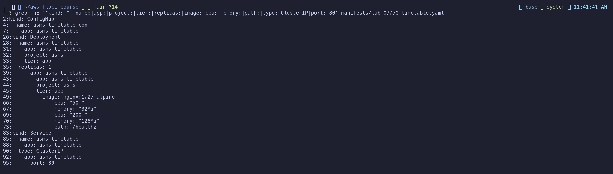
*Exercise figure 1: Exercise 1 - the hand-written 70-timetable.yaml: three objects, the lab label scheme, requests, readiness probe, ClusterIP on 80*

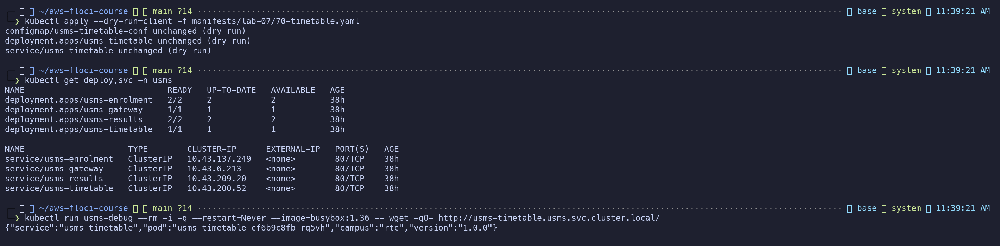
*Exercise figure 2: Exercise 1 - client-side validation, four Deployments and four Services, and usms-timetable answering with its own pod name*


---

## Exercise 2 - Intermediate: route `/timetable/` through the gateway

**Change:** added a `location /timetable/ { proxy_pass http://usms-timetable.usms.svc.cluster.local/; }`
block to `usms-gateway-conf` in `manifests/lab-07/40-gateway.yaml`, and `/timetable/` to the root
response's route list. Re-applied the file; no `kubectl edit`.

```bash
kubectl rollout history deployment/usms-gateway        # before: revision 1 only
kubectl apply -f manifests/lab-07/40-gateway.yaml       # configmap configured, deployment UNCHANGED
kubectl get rs -l app=usms-gateway                      # same RS 58854c9ffd -> pod still on old config
kubectl rollout restart deployment/usms-gateway         # <- the command that made the new ReplicaSet
kubectl rollout status deployment/usms-gateway
kubectl rollout history deployment/usms-gateway        # now revisions 1 and 2
kubectl run usms-debug --rm -i --restart=Never --image=busybox:1.36 -- sh -c '
  G=http://usms-gateway.usms.svc.cluster.local
  wget -qO- $G/enrolment/; wget -qO- $G/results/; wget -qO- $G/timetable/'
```

```
usms-gateway-58854c9ffd   0   0   0   23m      <- revision 1, kept
usms-gateway-7965c6fb54   1   1   1   8s       <- revision 2, serving
{"service":"usms-enrolment","pod":"usms-enrolment-9464fb7c9-d8qn6",...}
{"service":"usms-results","pod":"usms-results-7fc784c47f-5kr6n",...}
{"service":"usms-timetable","pod":"usms-timetable-cf6b9c8fb-7zfcp",...}
```

**Why `rollout restart` and not `annotate`:** applying the file changed only the ConfigMap. The
Deployment's pod template was byte-identical (`deployment.apps/usms-gateway unchanged`), so no
rollout started and nginx kept the config it read at startup. Of Step 18's two commands, only
`rollout restart` writes into the pod template (a `restartedAt` annotation). The `annotate` command
touches Deployment metadata only. ✅

**Screenshots**

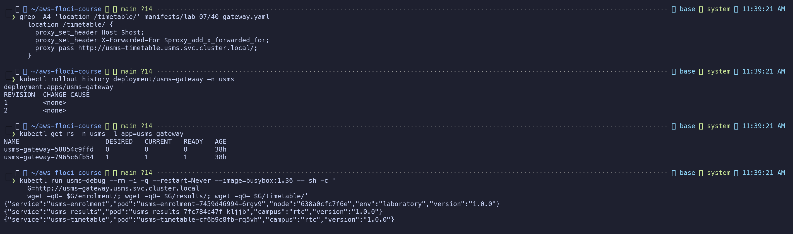
*Exercise figure 3: Exercise 2 - the /timetable/ route in the gateway config, gateway revision 2 on a new ReplicaSet, and all three routes answering in one command*


---

## Exercise 3 - Problem solving: `usms-broken`

Applied exactly as given (`outputs/lab-07-ex3-broken.yaml`). Diagnosed with commands, in this order:

```bash
kubectl get endpoints usms-broken                                   # 1
kubectl get svc usms-broken -o jsonpath='{.spec.selector}'; echo     # 2
kubectl get pods -l app=usms-broken --show-labels                   # 2
kubectl get pods -l app=usms-broken \
  -o custom-columns='NAME:.metadata.name,READY:.status.conditions[?(@.type=="Ready")].status'   # 3
kubectl describe pod -l app=usms-broken | grep -i readiness          # 3
```

| # | Output that revealed it | Fault |
|---|---|---|
| 1 | `usms-broken   <none>` | No endpoints at all |
| 2 | selector `{"app":"usms-broken","version":"v2"}` vs pod labels `app=usms-broken,...,version=v1` | **Fault 1: the Service selector asks for `version: v2`; the pods are `v1`**, so no pod matches |
| 3 | READY `False` on both pods; `Readiness probe failed: HTTP probe failed with statuscode: 404` | **Fault 2: the readiness probe hits `/healthz`, which stock nginx does not serve (404)**, so even matching pods never become Ready |

**Cause in one sentence:** the Service selected a label (`version: v2`) no pod carries, and the
pods could never pass readiness because their probe path does not exist in the base nginx image.

**Fixes, one line each:**
1. Service `selector.version: v2` -> `v1`. Afterwards endpoints existed but were empty (pods not ready).
2. `readinessProbe.httpGet.path: /healthz` -> `/`. The pods then became Ready.

```
usms-broken   10.42.0.39:80,10.42.0.40:80   36s
<title>Welcome to nginx!</title>
```

Two endpoints and a working Service. Fixing either fault alone was not enough, as the brief said.
`usms-broken` Deployment and Service deleted afterwards (CLEAN UP item). ✅

**Screenshots**

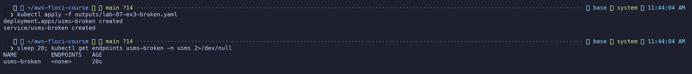
*Exercise figure 4: Exercise 3, command 1 - manifest applied as given; the Service has no endpoints*

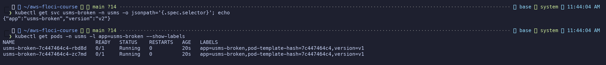
*Exercise figure 5: Exercise 3, command 2 - fault 1: the Service selects version=v2 but the pods are labelled version=v1*

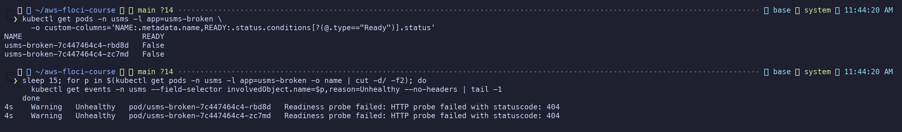
*Exercise figure 6: Exercise 3, command 3 - fault 2: both pods Ready=False, readiness probe on /healthz returns 404*

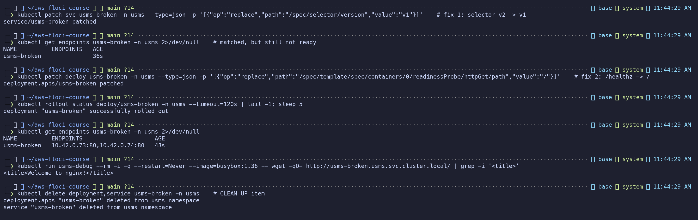
*Exercise figure 7: Exercise 3 - two one-line fixes (selector v2->v1, probe path /healthz->/), two endpoints, nginx answering, then cleaned up*


---

## Exercise 4 - Challenge: survive a node going away

**Changes to `usms-enrolment` (no new Deployment), in `manifests/lab-07/20-enrolment.yaml`:**

1. `topologySpreadConstraints` on `kubernetes.io/hostname`, `maxSkew: 1`, `whenUnsatisfiable: ScheduleAnyway`
   (**advisory**).
2. A new object, `PodDisruptionBudget usms-enrolment-pdb` with `minAvailable: 1` (**enforced**).
3. (Already there) `replicas: 2`, readiness probe, and `maxUnavailable: 0` on rollouts.

**Justification.**
*Not all capacity on one node:* the spread constraint tells the scheduler to keep the per-node
count of `app=usms-enrolment` pods within 1 of each other, so two replicas on two nodes land one
per node. I chose `ScheduleAnyway` over `DoNotSchedule` on purpose. With `DoNotSchedule` a single
surviving node could only ever hold `maxSkew` more than an empty peer, and on a one-node cluster or
after a node loss the second replica would stay `Pending`. Losing capacity to enforce a placement
rule is the wrong trade for a service whose brief is "keep serving". `podAntiAffinity` with
`requiredDuringScheduling` has the same `Pending` problem; its `preferred` form would also work,
but the spread constraint scales more cleanly past two replicas.
*Never below one healthy pod during a voluntary disruption:* only a PDB is *enforced*. The
eviction API refuses any eviction (`kubectl drain`, node-group upgrades, the cluster autoscaler)
that would leave fewer than `minAvailable` ready pods. It does not protect against involuntary
loss (a node crashing). That is what the spread, plus two replicas, is for.
*Say from the cluster where each pod is:* `kubectl get pods -o wide`, or
`-o custom-columns=POD:.metadata.name,NODE:.spec.nodeName`. `NODE_NAME` also comes from the
downward API, so every response body names its node.

**This cluster has one schedulable node** (`db462e773ab9`). Floci records the node group as desired 2
but runs a single k3s server (see notes, Step 10). So the spread constraint can be shown only as
configured, not as placing pods apart. On two nodes I would have shown one pod per node in
`-o wide`, drained one node, watched the PDB let that node's pod go only while the other was ready,
and watched the smoke test stay green.

**What the cluster allows: the PDB, under a real drain** (`outputs/lab-07-ex4.txt`). The command
drained the enrolment pods only, with a smoke loop sending 40 requests at 1/s to the enrolment Service:

```bash
kubectl run usms-smoke-loop ... wget http://usms-enrolment.usms.svc.cluster.local/ x40
kubectl drain db462e773ab9 --pod-selector=app=usms-enrolment --timeout=25s
kubectl uncordon db462e773ab9
```

```
node/db462e773ab9 cordoned
evicting pod usms/usms-enrolment-885c45bbf-6r6l9
pod/usms-enrolment-885c45bbf-6r6l9 evicted
error when evicting pods/"usms-enrolment-885c45bbf-k9q2c" -n "usms" (will retry after 5s):
  Cannot evict pod as it would violate the pod's disruption budget.
--- after drain attempt ---
usms-enrolment-885c45bbf-86g5t 0/1 Pending <none>        <- replacement, nowhere to go (cordoned)
usms-enrolment-885c45bbf-k9q2c 1/1 Running db462e773ab9  <- the PDB kept this one
usms-enrolment-pdb   1   N/A   0                          <- ALLOWED DISRUPTIONS 0
node/db462e773ab9 uncordoned
--- smoke loop through the drain (40 requests, 1/s) ---
ok 40
```

The first eviction was allowed (2 ready, 1 required). The second was refused, the drain timed out
rather than taking the service to zero, and **40/40 requests succeeded**. After `uncordon` the
Pending replica was scheduled and the Deployment returned to 2/2. (spread: configured only, one node)

**Screenshots**

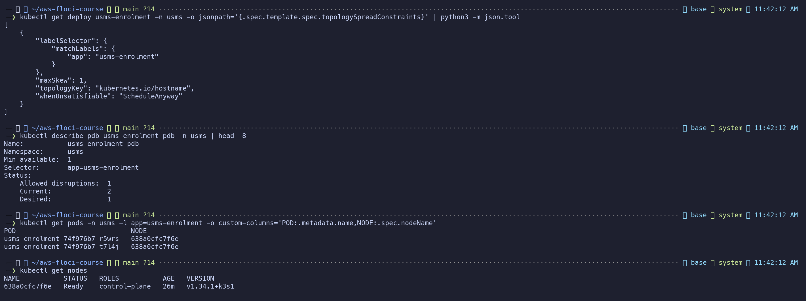
*Exercise figure 8: Exercise 4 - the topology spread constraint (advisory), the PodDisruptionBudget (enforced), pod placement read from the cluster, and the single schedulable node*

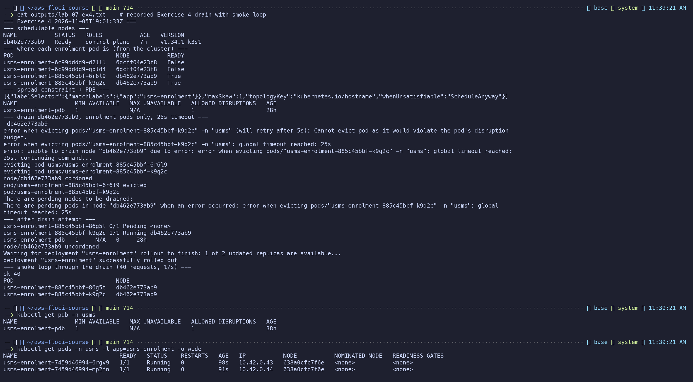
*Exercise figure 9: Exercise 4 - recorded drain: the PDB refuses the second eviction and the smoke loop gets 40/40 ok*


---

## Exercise 5 - Integration: prepare what Lab 08 needs

**Part 1: CPU baseline** (`outputs/lab-07-cpu-baseline.txt`)

```bash
kubectl get --raw /apis/metrics.k8s.io/v1beta1     # metrics API present? yes
kubectl top pods -n usms -l app=usms-enrolment
```

```
metrics API: AVAILABLE (k3s bundled metrics-server)
cpu request per pod: 50m
usms-enrolment-885c45bbf-6r6l9   cpu=5m  mem=6Mi   10% of 50m request
usms-enrolment-885c45bbf-k9q2c   cpu=4m  mem=6Mi    8% of 50m request
```

Honest note: right after the Floci restart, `kubectl top` returned `Metrics API not available`,
because metrics-server was still bound to the ghost node (see notes, Step 22). Once it was
rescheduled onto the live node the API answered. These are idle numbers; no load was generated.
An HPA targeting 50% would see ~8-10% and hold at the minimum.

**Part 2: `USMSStudentDataReadWrite` readiness** (`outputs/lab-07-lab06-readiness.txt`).
The bucket name was read from the policy document via `get-policy` -> `DefaultVersionId` ->
`get-policy-version`:

```
policy ARN      : arn:aws:iam::000000000000:policy/USMSStudentDataReadWrite
default version : v1
roles carrying  : usms-ec2-app-role  usms-ecs-task-role  usms-eks-node-role
  Allow  arn:aws:s3:::usms-student-data    (ListTheBucketItself)            <- bucket ARN
  Allow  arn:aws:s3:::usms-student-data/*  (ReadWriteObjectsInsideTheBucket) <- object ARN
  Deny   arn:aws:s3:::usms-student-data    (NeverDeleteTheBucket)
bucket exists   : NO (expected - Lab 10 creates it)
```

`ListBucket` applies to the bucket ARN and `GetObject`/`PutObject` to the `/*` object ARN. Dropping
either entry breaks half the access, which is the distinction Lab 10 depends on.

**Part 3:** in `notes/lab-07-notes.md`, section "Exercise 5 Part 3".

Both output files are git-ignored:
```
.gitignore:6:outputs/*  outputs/lab-07-cpu-baseline.txt
.gitignore:6:outputs/*  outputs/lab-07-lab06-readiness.txt
```

**Screenshots**

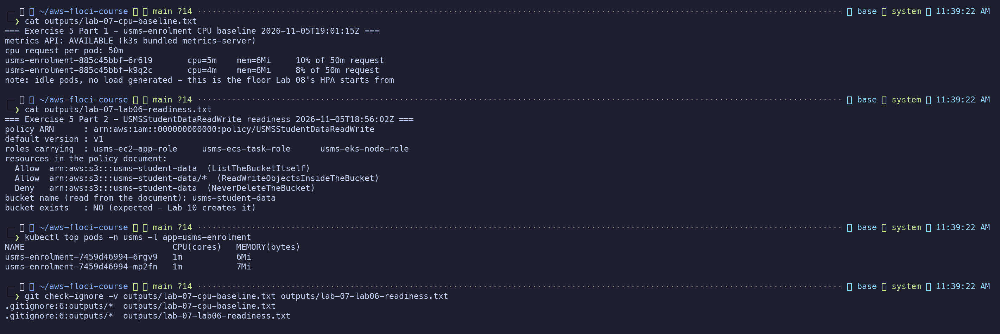
*Exercise figure 10: Exercise 5, Parts 1 and 2 - CPU baseline vs the 50m request, USMSStudentDataReadWrite holders and bucket ARNs read from the policy, both files git-ignored*

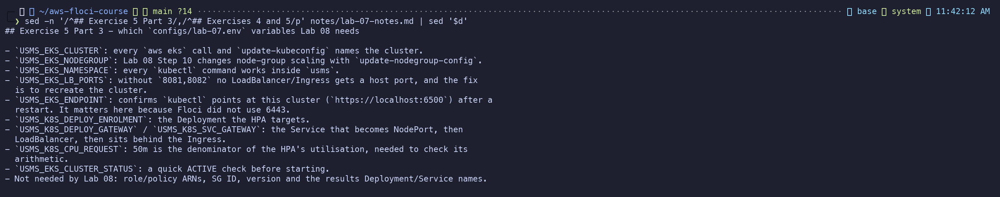
*Exercise figure 11: Exercise 5, Part 3 - the Lab 08 variables and why each is needed, from notes/lab-07-notes.md*

