# AWS Practical Laboratory Report: Lab 08 - EKS Scaling and Service Exposure

## 1. Aim / Objective

To take Lab 07's three healthy but fixed-size, unreachable microservices and:

* scale `usms-enrolment` by hand, by manifest, and with an `autoscaling/v2` **HorizontalPodAutoscaler**,
  mapping the HPA to Lab 06's Application Auto Scaling,
* change the managed node group's scaling from the AWS side, and explain why that is a separate control loop,
* use requests, QoS classes, a `nodeSelector` and **PodDisruptionBudgets**, saying what each protects and what it doesn't,
* climb the exposure ladder (`port-forward`, **NodePort**, **LoadBalancer**, **Ingress**) and compare the Ingress with Lab 05's ALB,
* prove the configuration survives a restart, and record it in `configs/lab-08.env`.

**Support path: A** (Floci 2.1.0, a real one-node k3s cluster behind the `eks` API).

---

## 2. Introduction

Scaling is always **one integer**. What changes is who writes it.

| Step | Mechanism | Who writes the integer |
|---|---|---|
| 4 | `kubectl scale` | me |
| 5 | `replicas:` in the manifest | Git, via `kubectl apply` |
| 8-9 | HorizontalPodAutoscaler | a controller inside the cluster |
| 10 | `update-nodegroup-config` | me, a **different** integer on the AWS side |
| 11 | Cluster Autoscaler / Karpenter | a controller (conceptual here) |

Exposure is a ladder in which each rung keeps the one below it: a LoadBalancer Service still has a
nodePort and a clusterIP, and an Ingress routes to ClusterIP Services.

| Concept | In this lab |
|---|---|
| **HPA arithmetic** | `desired = ceil(current x utilisation / target)`; utilisation is a % of the **request** (50m) |
| **behavior** | scale up instantly (rate-limited: +100% or +2 pods per 15 s, the larger); scale in after a 300 s window, 1 pod/min |
| **QoS** | requests < limits -> Burstable; equal -> Guaranteed; none -> BestEffort |
| **PDB** | constrains the **eviction API** (drain, autoscalers), not `kubectl delete` |
| **Two control loops** | the HPA adds pods; only a node autoscaler adds nodes. They don't know about each other |

---

## 3. Architecture

```
YOUR MACHINE
  kubectl ---> https://localhost:6500 (k3s API)   port-forward 18080/8080/30080 -> Services
  localhost:8081/8082 ---> NOT published on this build (the _lb_ports_ tag did not take effect)

namespace usms
  Ingress usms-portal-ingress     /enrolment -> usms-enrolment   /results -> usms-results   / -> usms-gateway
  Ingress usms-results-ingress    /results only, same IngressGroup (Exercise 4)      <- no controller: stored only
  Service usms-gateway   LoadBalancer  clusterIP 10.43.6.213  nodePort 30564  external 172.17.0.3 (k3s svclb)
  Service usms-results-np NodePort 80:30080 (same pods as usms-results)
  Deployment usms-gateway   2 replicas (Exercise 2)           PDB usms-gateway-pdb    minAvailable 1 -> allows 1
  Deployment usms-enrolment 2..8 via usms-enrolment-hpa (50% of 50m), nodeSelector workload=usms
                                                              PDB usms-enrolment-pdb  maxUnavailable 1
  Deployment usms-results   2..6 via usms-results-hpa (60%, Exercise 1)
  usms-loadgen (3 x busybox wget loop): the load source, deleted at the end

AWS side
  usms-eks-nodes 2/4/2: update-nodegroup-config is UNSUPPORTED on Floci 2.1.0, so it stays 2/4/2
```

> **About the figures.** Each screenshot shows a command that was run against this build on
> 2026-11-06 and its captured output, rendered in the terminal's prompt style. They were taken while
> each step ran, not re-run afterwards. Where a take was wrong it was retaken, and the notes say why.

---

## 4. Pre-flight (Steps 1-2) - Checkpoint 1

The CPU request `{"cpu":"50m","memory":"32Mi"}` (the HPA's denominator) and `_lb_ports_=8081,8082` are
both present; `verify-lab-07.sh` gives `PASS=30 FAIL=0`. The baseline is in `outputs/lab-08-baseline.txt`.

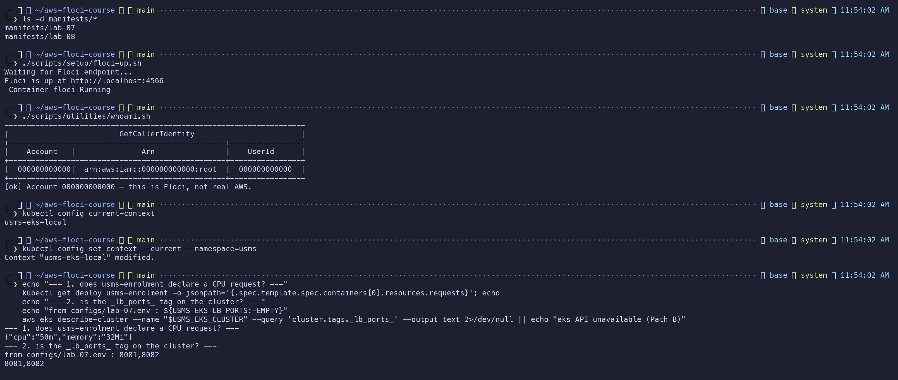
*Figure 1: folders, Floci up, identity, context and namespace default, and the two checks that matter.*

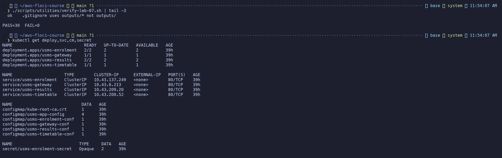
*Figure 2: Lab 07 still verified; Deployments, ClusterIP Services, ConfigMaps, one Secret.*

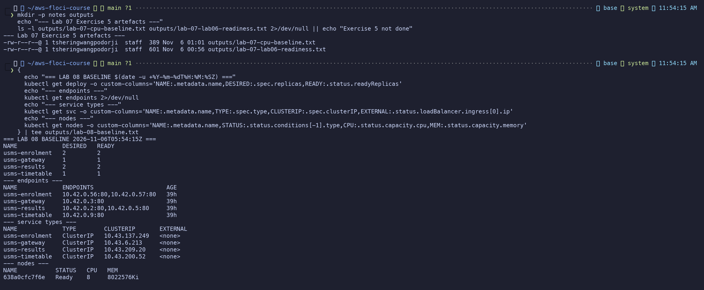
*Figure 3: Lab 07 Exercise 5 artefacts present, and the baseline (every Service ClusterIP with no external address).*

---

## 5. Procedure, Evidence and Observations

### 5.1 Scaling by hand (Step 4)

`kubectl scale --replicas=5` changed one field. The same ReplicaSet went 2 -> 5, with no rollout. The
watcher shows new pods `Running 0/1` for about 6 s before `1/1`: **endpoints follow readiness**. Forty
requests through the gateway reached **all five pods** (12/10/7/6/5) without touching the gateway.

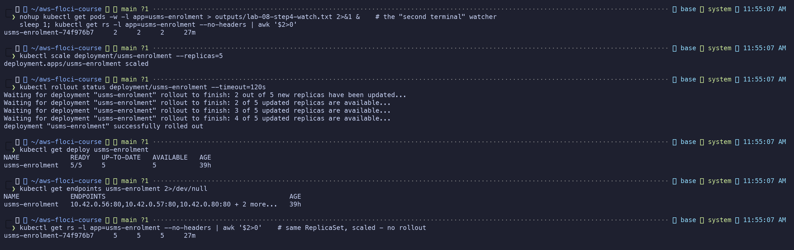
*Figure 4: scale to 5, same ReplicaSet, endpoints grow.*

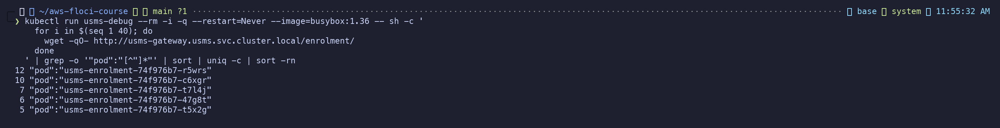
*Figure 5: forty requests answered by five distinct pods.*

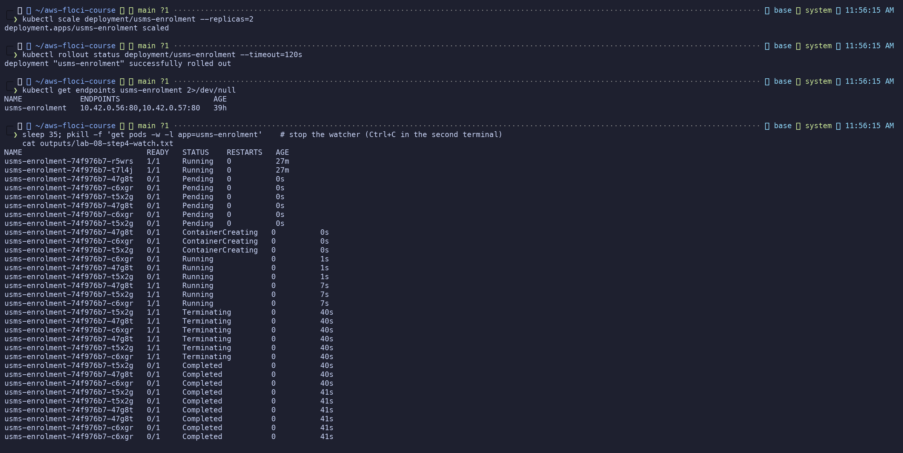
*Figure 6: scale back to 2, and the watcher's record (Pending -> Running 0/1 -> 1/1, then Terminating).*

### 5.2 Drift and `kubectl diff` (Step 5) - Checkpoint 2

The cluster said 6 and the file said 2, and `apply` silently restored 2. `kubectl diff` showed the
`replicas` change and **exited 1**.

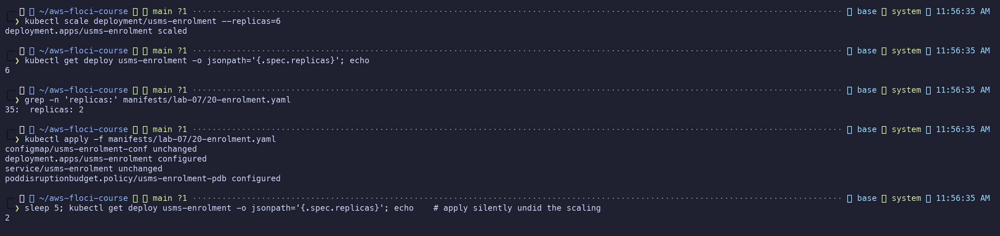
*Figure 7: drift created and silently undone by `apply`.*

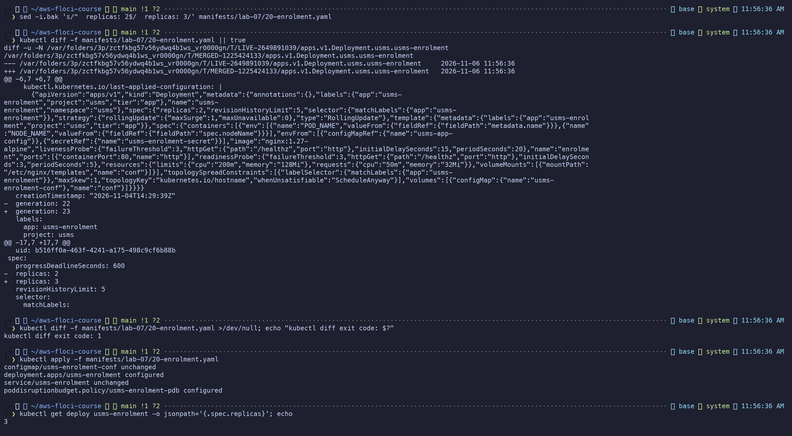
*Figure 8: `kubectl diff` before applying, and its exit code 1.*

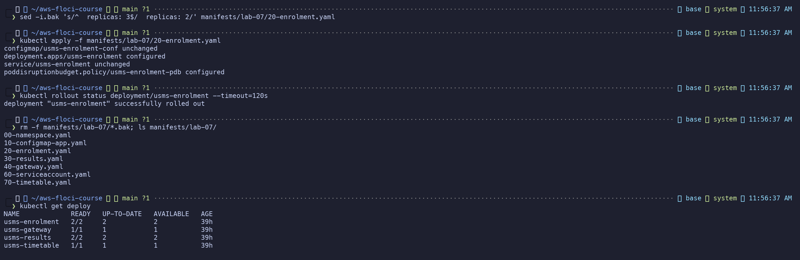
*Figure 9: baseline restored, no `.bak` files.*

### 5.3 Requests, limits and QoS (Step 6)

Every pod is `Burstable` (50m/200m). Allocated requests on the node are 500m (6%); on this k3s build
capacity equals allocatable. Your turn: the gateway went **Burstable -> Guaranteed -> Burstable**, a
**new pod each time**, because resources live in the pod template (which is why VPA is used less than HPA).

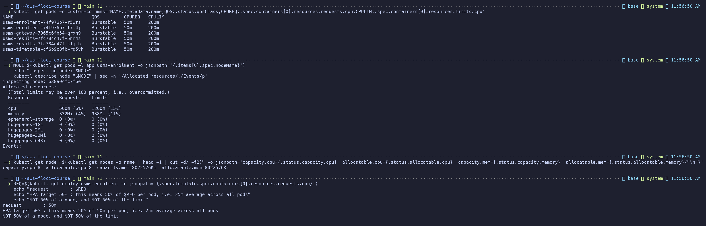
*Figure 10: QoS classes, the scheduler's allocated-resources table, and the HPA denominator.*

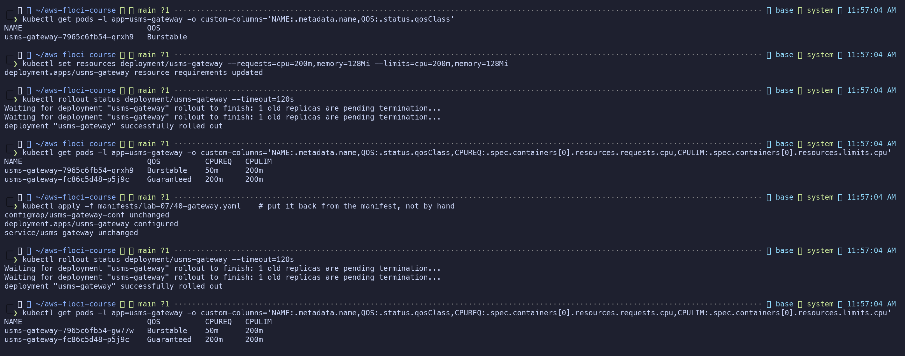
*Figure 11: the gateway made Guaranteed (requests = limits), then restored from the manifest.*

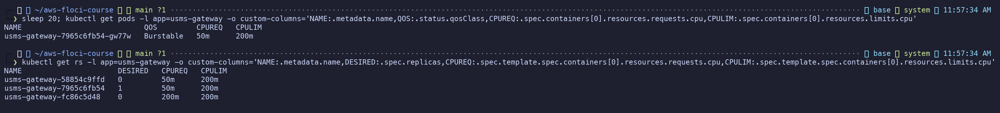
*Figure 12: final state Burstable, and one ReplicaSet per resource setting.*

### 5.4 Metrics pipeline and HPA (Steps 7-8)

metrics-server ships with k3s: the API is **AVAILABLE** and idle pods use 1m (2%). The HPA read
`<unknown>/50%` in its first seconds, then `cpu: 2%/50%` with `ScalingActive True ValidMetricFound`.

| Lab 06 (Application Auto Scaling) | Lab 08 (HPA) |
|---|---|
| `RegisterScalableTarget` on `service/usms-ecs-cluster/usms-enrolment-svc` | `spec.scaleTargetRef` (typed reference) |
| `MinCapacity 2 / MaxCapacity 10` | `minReplicas 2 / maxReplicas 8` |
| `ECSServiceAverageCPUUtilization` (% of task CPU) | `resource cpu averageUtilization 50` (% of **request**) |
| `ScaleInCooldown 300` | `scaleDown.stabilizationWindowSeconds 300` + 1 pod/60 s |
| `ScaleOutCooldown` | `scaleUp.stabilizationWindowSeconds 0` + Percent 100 / Pods 2 per 15 s, `selectPolicy Max` |
| Two CloudWatch alarms created for you | No alarms; the controller polls every 15 s |
| Runs in an AWS service | Runs in the cluster's controller manager |

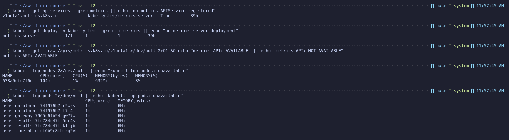
*Figure 13: APIService registered, metrics-server running, `kubectl top` working.*

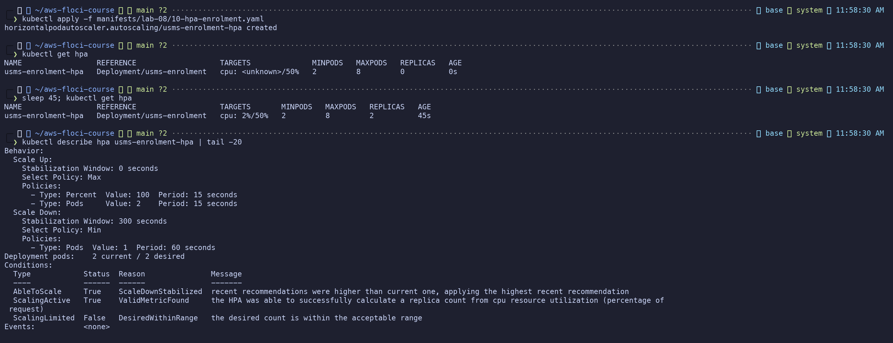
*Figure 14: HPA created, `<unknown>` then 2%/50%, behavior and conditions.*

### 5.5 Load, scale-out and the stabilisation window (Step 9) - Checkpoint 3

Under three load generators, CPU went 2% -> 42% -> **61%**, and the HPA scaled **2 -> 3**
(ceil(2 x 61 / 50) = 3); CPU then settled at about 42%.

**A correction to the lab text:** the PDF's example has 71% going to 4 "because the scale-up policy
allowed doubling". `behavior` policies cap how *much* can change per period; the formula still chooses
the target. My run shows that: the policy allowed +2 and the formula asked for +1.

With the load removed, CPU fell to 2% within a minute, but **replicas held at 3 for about 5 minutes**
and then dropped to 2. The HPA's own words:
`New size: 3; reason: cpu resource utilization (percentage of request) above target` and
`New size: 2; reason: All metrics below target`.

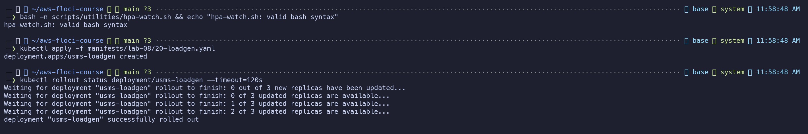
*Figure 15: hpa-watch.sh syntax-checked, load generator rolled out.*

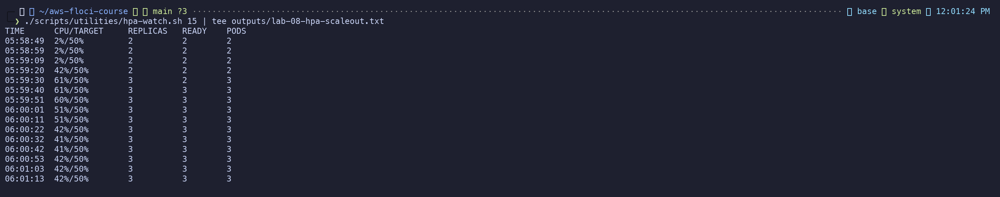
*Figure 16: the HPA scaling 2 -> 3 at 61%.*

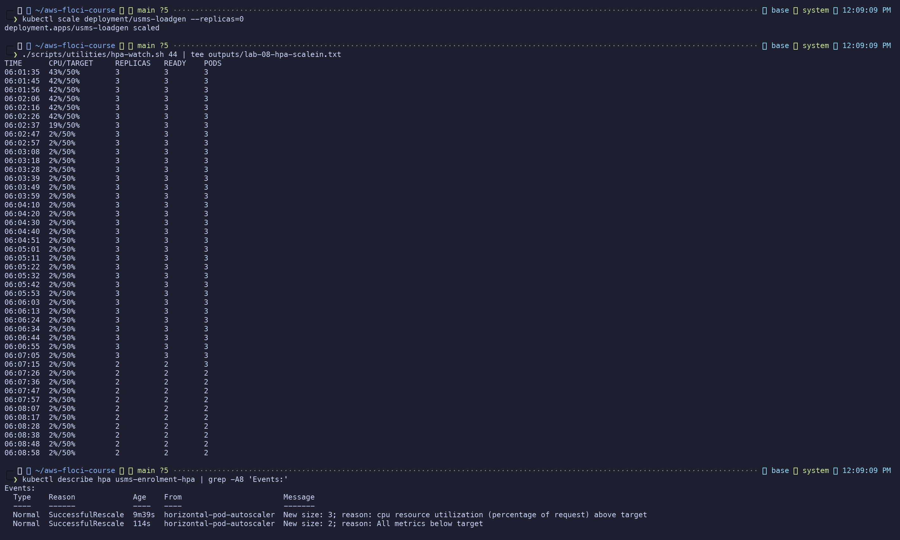
*Figure 17: load removed; 3 replicas held through the 300 s window, then 2; events quoted.*

### 5.6 The data plane from the AWS side (Step 10)

`update-nodegroup-config --scaling-config minSize=2,maxSize=6,desiredSize=3` returned
**`UnknownOperationException`**. The PDF flags this for Floci 2.0.1, and it is still the case on 2.1.0.
The node group stays 2/4/2, there is no Update object, and no node appears. On real AWS the call returns
an asynchronous `InProgress` Update, and the ASG launches a third EC2 instance that joins `Ready`
minutes later. I did not delete and recreate the node group as a workaround.

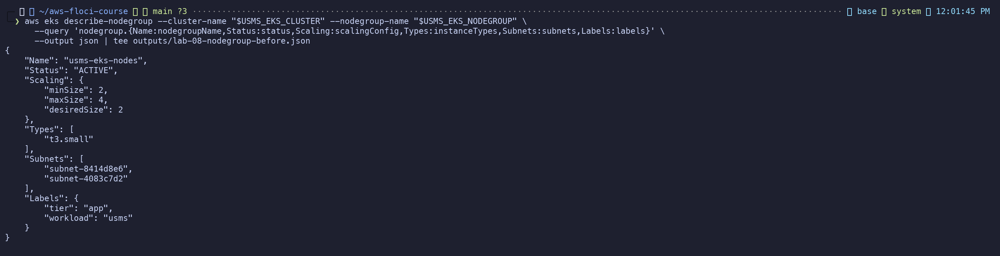
*Figure 18: node group before: 2/4/2, t3.small, private subnets, labels.*

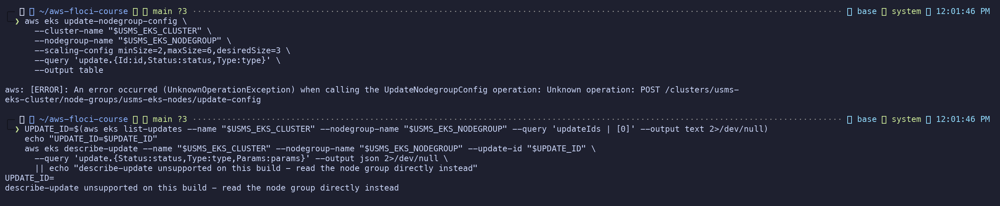
*Figure 19: `update-nodegroup-config` unsupported on this build; no update to describe.*

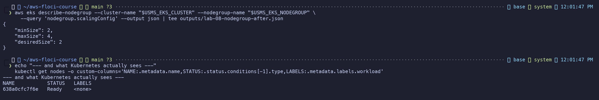
*Figure 20: still 2/4/2, and one node in Kubernetes, without the node group's labels.*

### 5.7 nodeSelector (Step 11)

Cluster Autoscaler raises an ASG you defined; Karpenter launches right-sized instances directly. Neither
is installed, because both need IRSA and real EC2. The node group's labels never reached the node, so I
applied them by hand. With `workload=nonexistent` the new pod sat **Pending** (`didn't match Pod's node
affinity/selector`) while the **old pods kept serving** (`maxUnavailable: 0`). The nodeSelector was
written back into `manifests/lab-07/20-enrolment.yaml`, and `kubectl diff` shows no spec difference.

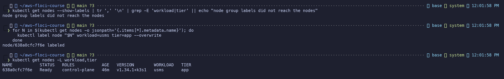
*Figure 21: labels absent, applied by hand.*

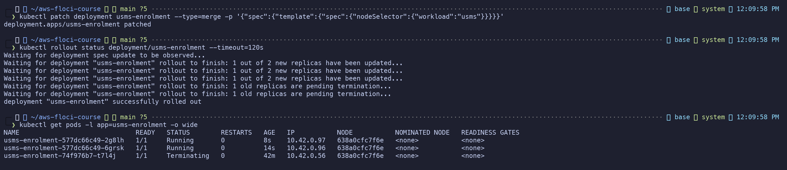
*Figure 22: nodeSelector `workload=usms` applied.*

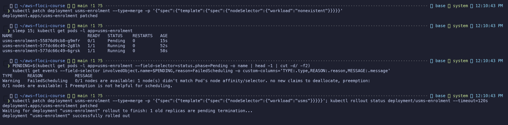
*Figure 23: enforcement proven: an unmatchable selector leaves the new pod Pending, and the old pods keep serving.*

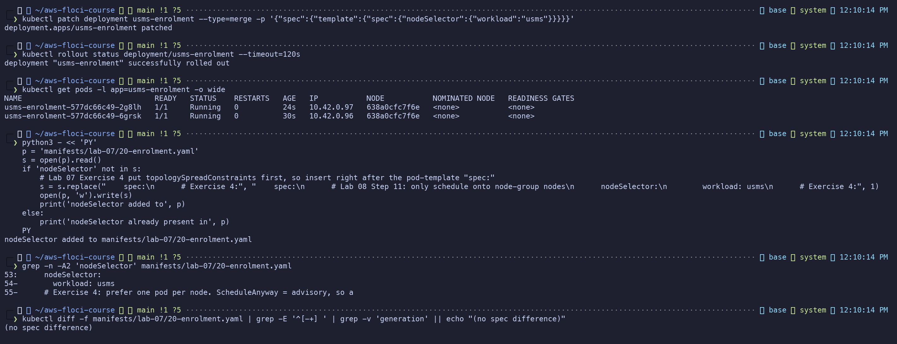
*Figure 24: restored, and the manifest updated so the repository matches the cluster.*

### 5.8 PodDisruptionBudgets (Step 12) - Checkpoint 4

`usms-gateway-pdb` (minAvailable 1, one replica) -> **0** allowed; `usms-enrolment-pdb` (maxUnavailable 1)
-> **1**. The eviction API refused (`TooManyRequests ... would violate the pod's disruption budget`); a
plain `kubectl delete pod` went through. The drain was dry-run only.
*Ownership fix:* Lab 07 Exercise 4 had declared `usms-enrolment-pdb` (minAvailable 1) in
`20-enrolment.yaml`. It now lives only in `manifests/lab-08/30-pdb-gateway.yaml`, so two files no longer
fight over one object.

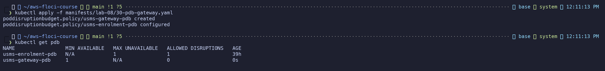
*Figure 25: both PDBs and their ALLOWED DISRUPTIONS.*

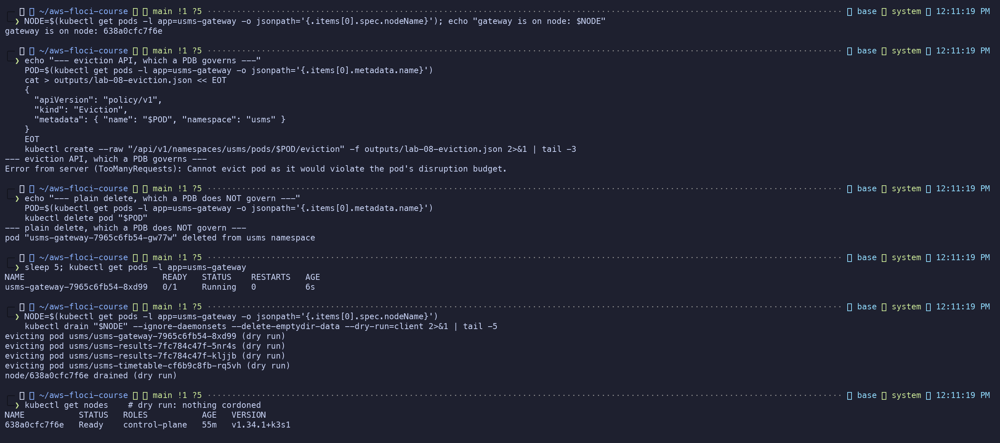
*Figure 26: eviction API refused, plain delete succeeded, and a drain dry run.*

### 5.9 Exposure ladder (Steps 13-16) - Checkpoints 5 and 6

| Rung | Observed | Notes |
|---|---|---|
| ClusterIP | unroutable from the Mac | `curl 10.43.6.213` fails |
| port-forward | gateway, enrolment and results via `localhost:18080` | one tunnel, one pod, through the API server: debugging only |
| NodePort | `usms-results-np 80:30080`; in-cluster via node IP `172.17.0.3:30080` | from the Mac `localhost:30080` fails: the node container publishes only 6443 |
| LoadBalancer | `type=LoadBalancer clusterIP=10.43.6.213 nodePort=30564 external=172.17.0.3`; in-cluster `wget` to the external IP works | fulfilled by k3s's `svclb` DaemonSet; host ports 8081/8082 not published |
| Ingress | `usms-portal-ingress` stored, three Prefix paths, **no CLASS, no ADDRESS** | no ingress controller: conceptual |

The three Service annotations are the only EKS-specific lines: `aws-load-balancer-type: external` (use
the AWS Load Balancer Controller), `nlb-target-type: ip` (register pod IPs, **the same target type as
Lab 05's target group**) and `scheme: internet-facing` (public subnets).

| Lab 05, by hand | Lab 08, from one Ingress |
|---|---|
| `aws elbv2 create-load-balancer` | the Ingress + `scheme: internet-facing` |
| `create-target-group --target-type ip` | one per backend Service, `target-type: ip`, `healthcheck-path: /healthz` |
| `create-listener` | `listen-ports: [{"HTTP": 80}]` |
| `create-rule --priority N` | `spec.rules[].http.paths[]`: **longest prefix wins**, not priority |
| ECS registers/deregisters tasks | the controller watches Endpoints |

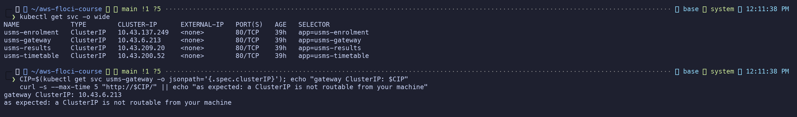
*Figure 27: a ClusterIP is not routable from the host.*

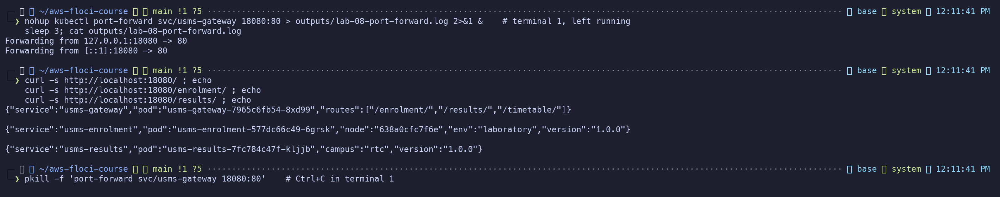
*Figure 28: port-forward: all three services through a tunnel.*

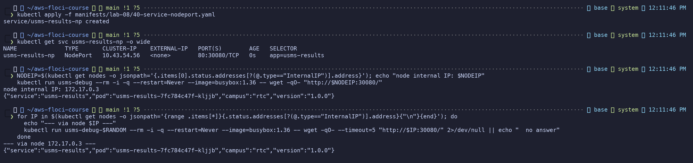
*Figure 29: NodePort 30080 answering on the node address, in-cluster.*

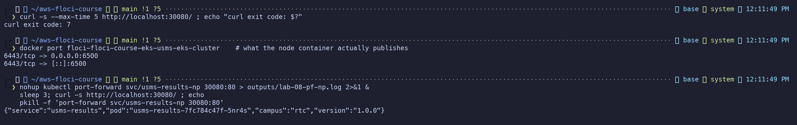
*Figure 30: not reachable from the host (only 6443 published); port-forward fallback.*

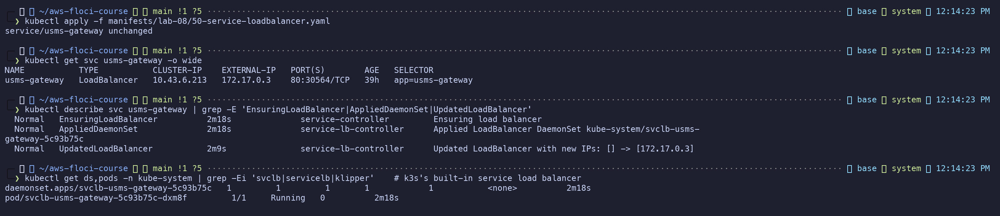
*Figure 31: LoadBalancer fulfilled by k3s's svclb: EXTERNAL-IP 172.17.0.3.*

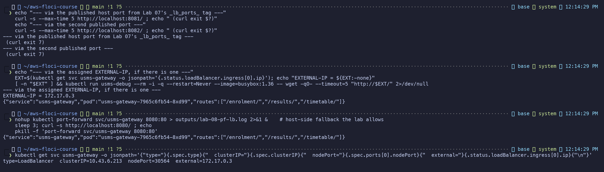
*Figure 32: 8081/8082 not published; the external IP answers in-cluster; the ladder on one line.*

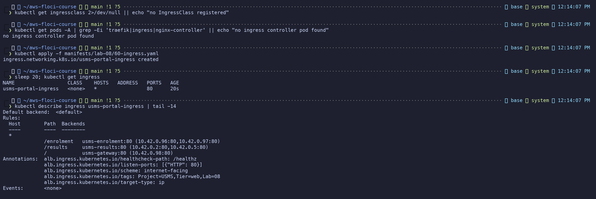
*Figure 33: no IngressClass or controller; the Ingress is stored with its rules and ALB annotations.*

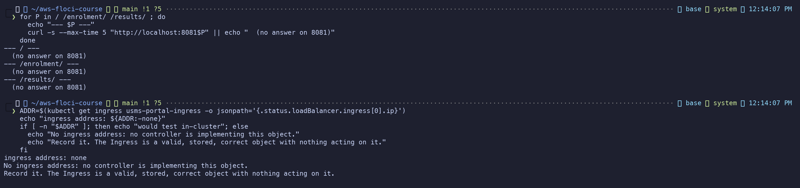
*Figure 34: no answer on 8081 and no ingress address, recorded as such.*

### 5.10 Practical 2 vs Practical 4 (Step 17)

ECS: `usms-enrolment-svc` desired 2 / running 2, target group `usms-enrolment-tg`, scalable target 2..10,
three policies (two target tracking, one step). EKS: HPA, PDBs, NodePort, LoadBalancer and Ingress side
by side. Both comparison tables and the two prose paragraphs are in `notes/lab-08-notes.md`.

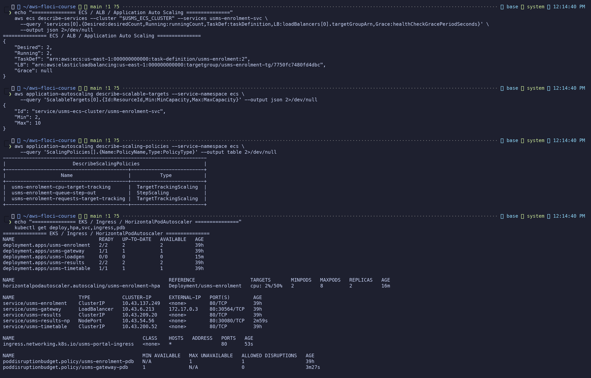
*Figure 35: both stacks, running at the same time.*

### 5.11 Persistence (Step 18) - Checkpoint 7

**PERSISTENCE PROVEN**: HPA bounds, both PDBs, the pinned NodePort 30080, **and** the gateway's
auto-allocated nodePort 30564 (the Service object persisted), the Ingress paths, and the node group.

What the diff does not show:
- The cluster was still `CREATING` 30 s after start.
- The k3s container returned as a **new node**, leaving a ghost node to delete.
- **The new node had no `workload=usms` label**, so with the nodeSelector a rescheduled enrolment pod sat
  `Pending` until I relabelled it. On real EKS the node group labels every node it launches.
- The HPA read `<unknown>` for about a minute while metrics-server restarted.

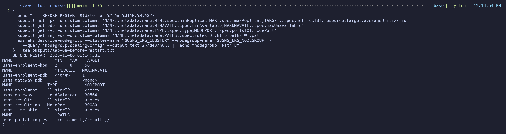
*Figure 36: the truth recorded before the restart.*

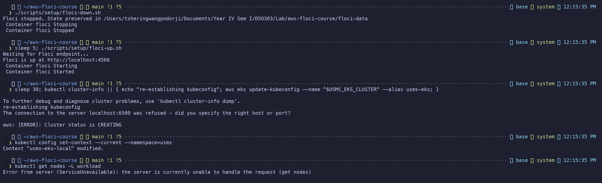
*Figure 37: Floci stopped and started; 30 s later the cluster is still CREATING.*

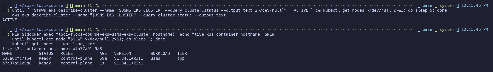
*Figure 38: cluster ACTIVE; a new unlabelled node beside the ghost.*

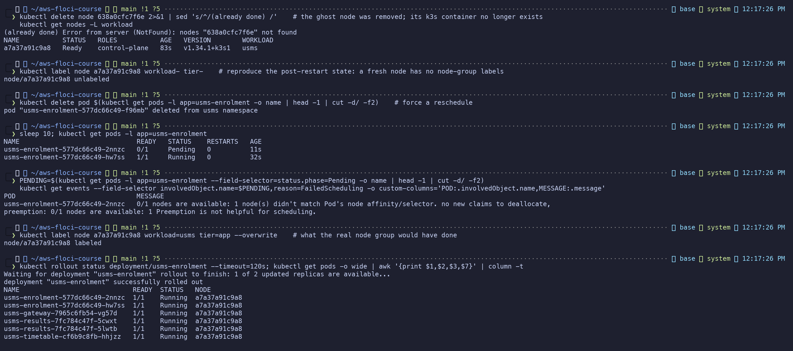
*Figure 39: the missing label leaves enrolment Pending (current event); relabelling fixes it.*

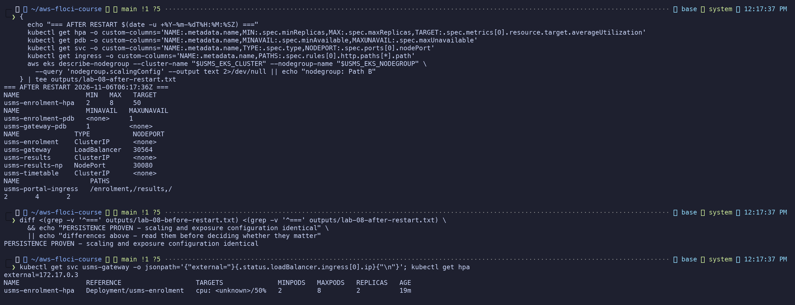
*Figure 40: read back after the restart: PERSISTENCE PROVEN.*

### 5.12 Recording and verification (Step 19, Section 8) - Checkpoint 8

`configs/lab-08.env` has **19 exports**; `USMS_INGRESS_CLASS` is empty, as expected with no controller.
The lab's empty-value check (`grep 'export .*=$\|None'`) is **silently broken on macOS**: BSD grep has no
`\|` in basic regex, so it printed "all values populated". `grep -E` finds the empty line.
`verify-lab-08.sh`: **PASS=33 FAIL=1**. The one failure is the node group's `maxSize`, a direct
consequence of 5.6. The smoke test passed, and `lab-08-cleanup.sh` was written and syntax-checked, **not run**.

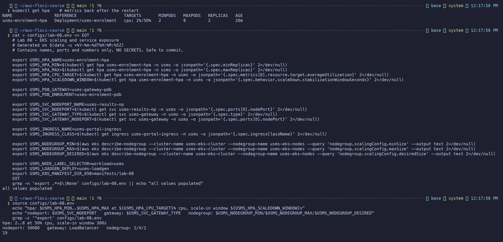
*Figure 41: configs/lab-08.env generated, 19 exports.*

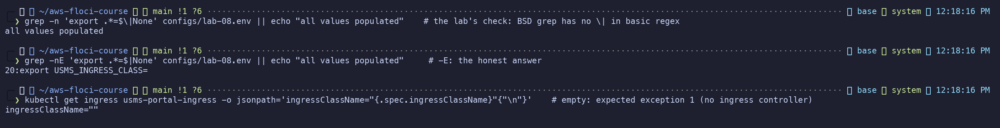
*Figure 42: the lab's grep misses the empty value on macOS; `grep -E` finds it.*

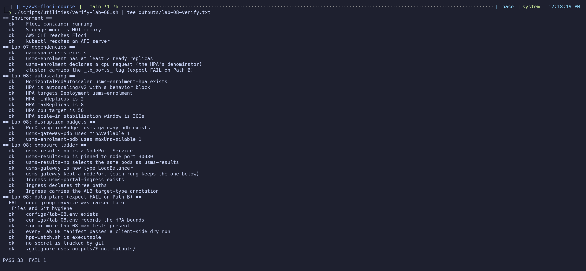
*Figure 43: verify-lab-08.sh: PASS=33 FAIL=1 (node group maxSize).*

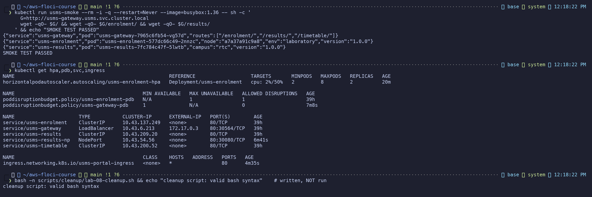
*Figure 44: smoke test, and the final HPA/PDB/Service/Ingress set.*

---

## 6. Results

| Checkpoint | Result |
|---|---|
| 1 - prerequisites and baseline | ✅ |
| 2 - scale, readiness, drift, `kubectl diff` | ✅ 5 pods all answering; diff exit 1 |
| 3 - HPA moved under load and back | ✅ 2 -> 3 at 61%, held about 5 min, back to 2 |
| 4 - node group, nodeSelector, PDBs | ⚠️ node group **unsupported** (still 2/4/2); nodeSelector and PDBs ✅ |
| 5 - ClusterIP, port-forward, NodePort | ✅ (NodePort in-cluster only) |
| 6 - LoadBalancer, Ingress | ✅ LoadBalancer with external IP in-cluster; Ingress stored, no controller |
| 7 - persistence | ✅ PERSISTENCE PROVEN (node relabel needed after restart) |
| 8 - env file, hygiene | ✅ 19 exports; commit not yet made |

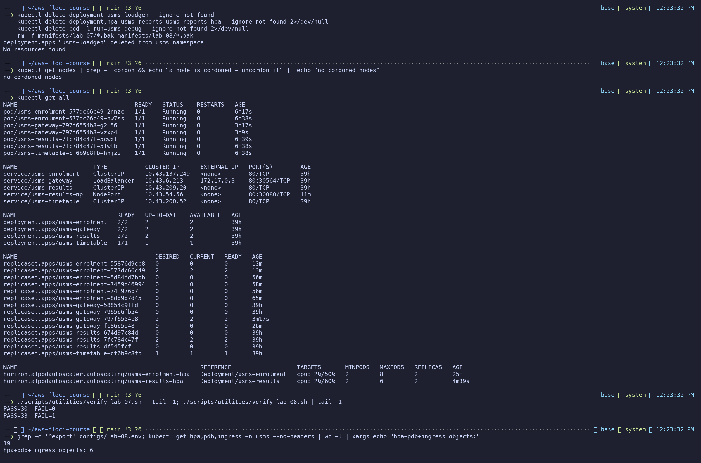
*Figure 45: Section 15 cleanup: load generator gone, no cordoned nodes, Lab 07 `PASS=30 FAIL=0`, Lab 08 `PASS=33 FAIL=1`.*

---

## 7. Floci vs Real AWS (observed on this build)

| Feature | Here | Status |
|---|---|---|
| `kubectl scale`, manifests, rollouts, readiness | standard | Observed |
| HPA `autoscaling/v2` + behavior | scaled 2 -> 3 -> 2 | Observed |
| metrics-server / `kubectl top` | shipped with k3s | Observed |
| PDB + eviction API | refusal and delete both shown | Observed |
| nodeSelector | enforced; node-group labels **did not** reach the node | Observed (with caveat) |
| NodePort | in-cluster only; host port not published | Observed / Floci limitation |
| LoadBalancer | k3s svclb assigns the node IP; host 8081/8082 not published | Observed / Floci limitation |
| Ingress | stored, no controller | Conceptual |
| `update-nodegroup-config` | `UnknownOperationException` | Floci limitation |
| AWS Load Balancer Controller, Cluster Autoscaler, Karpenter, custom metrics, cost | not installed / free | Conceptual |

**Observed:** scaling by hand, by file and by HPA; QoS; PDBs; nodeSelector; ClusterIP, port-forward,
NodePort and LoadBalancer in-cluster; persistence. **Recorded but not enacted:** node-group sizes, AWS
annotations, Ingress rules. **Conceptual:** ALB from an Ingress, Cluster Autoscaler, Karpenter, IRSA, cost.

---

## 8. Independent Exercises (summary; full answers in [exercises.md](exercises.md))

| # | Exercise | Outcome |
|---|---|---|
| 1 | `usms-results-hpa` | ✅ 2..6 at 60%, 180 s window, +2 pods/30 s; two HPAs reporting % |
| 2 | Make the gateway drainable | ✅ replicas 2 -> ALLOWED DISRUPTIONS 1; clean diff; single node noted |
| 3 | The autoscaler that won't act | ✅ min = max = 4 found; request defaulted from the limit (not `<unknown>` on v1.34); two one-field fixes |
| 4 | Expose results properly | ✅ results-only Ingress in the same IngressGroup, source-IP condition, cost and failure modes |
| 5 | Lab 10 artefacts | ✅ scaling-evidence JSON, readiness with IRSA SA, 295-word essay |

---

## 9. Files Produced

| Path | Purpose |
|---|---|
| `manifests/lab-08/10-hpa-enrolment.yaml`, `11-hpa-results.yaml` | HPAs (Step 8, Exercise 1) |
| `manifests/lab-08/20-loadgen.yaml` | load source (deleted from the cluster at the end) |
| `manifests/lab-08/30-pdb-gateway.yaml` | both PDBs (now the sole owner of `usms-enrolment-pdb`) |
| `manifests/lab-08/40-service-nodeport.yaml`, `50-service-loadbalancer.yaml` | NodePort 30080; gateway as LoadBalancer (sole owner of that Service) |
| `manifests/lab-08/60-ingress.yaml`, `70-ingress-results.yaml` | portal Ingress; results-only Ingress (Exercise 4) |
| `manifests/lab-07/20-enrolment.yaml`, `40-gateway.yaml` | nodeSelector added; PDB and Service moved out; gateway replicas 2 |
| `scripts/utilities/hpa-watch.sh`, `verify-lab-08.sh` | watcher; 34-check verifier |
| `scripts/utilities/verify-lab-07.sh` | gateway check relaxed to at least 1 replica |
| `scripts/cleanup/lab-08-cleanup.sh` | end-of-course teardown (not run) |
| `configs/lab-08.env` | 19 exports |
| `notes/lab-08-notes.md` | Your-turns, Step 17 tables, Section 14, the essay |
| `outputs/lab-08-*` | evidence (git-ignored) |
| `screenshots/lab-08/` | 54 screenshots |

---

## 10. Conclusion

The workload half of scaling worked exactly as designed. The HPA turned 61% of a 50m request into a
third pod in about 20 seconds, and then refused to give it back for five minutes. That is the asymmetry
Lab 06 encoded as cooldowns. The infrastructure half did not exist here: `update-nodegroup-config` is
unsupported, the node group's labels never reached the node, and a restart produces a fresh unlabelled
node. That is the clearest demonstration of the lab's main point: **the HPA and the node group are two
separate control loops**, and only the first one was real here. On the exposure side, every rung up to
LoadBalancer worked inside the cluster. The Ingress, which is where Lab 05's ALB and Lab 08 meet, is a
correct declaration with nothing acting on it. The other lessons came from failures: twice, two
manifests claimed the same object (the enrolment PDB and the gateway Service), and the fix both times
was to give it exactly one owning file. The same theme already appeared in Lab 07, where an `apply`
silently undid an imperative change.
