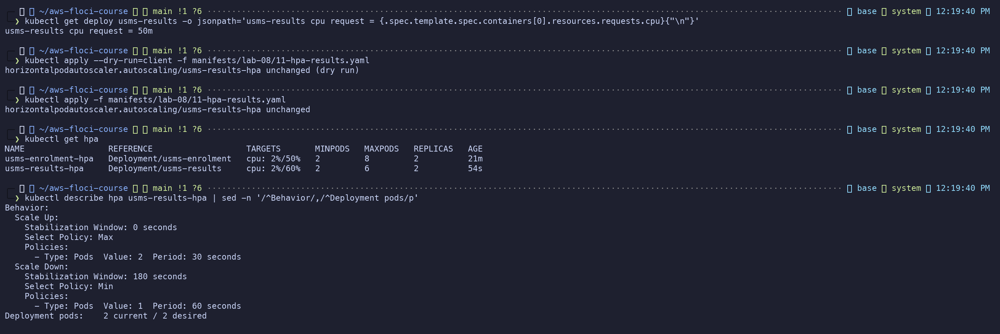
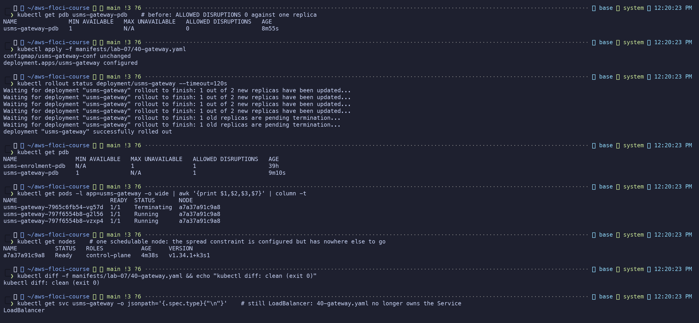
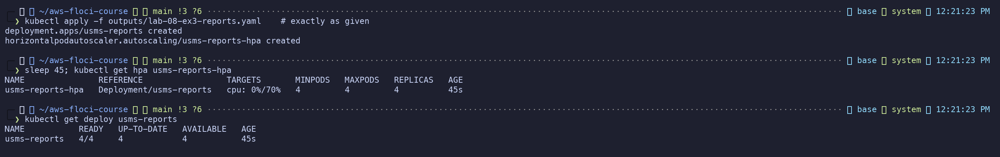
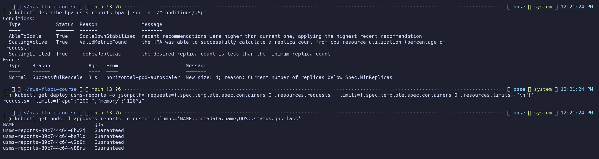
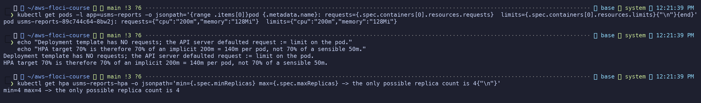
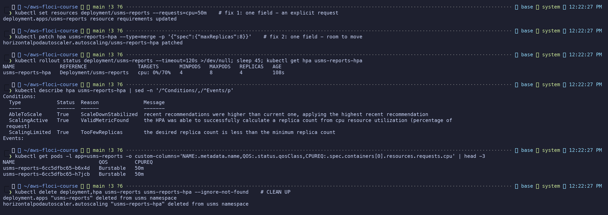
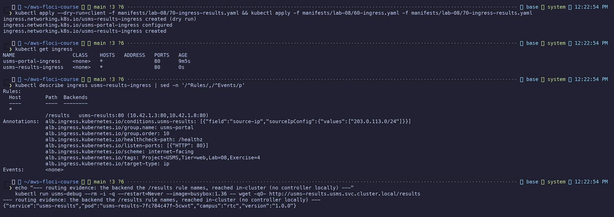
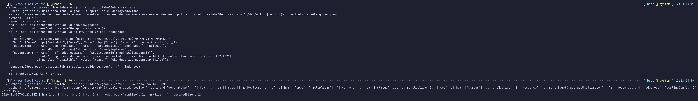
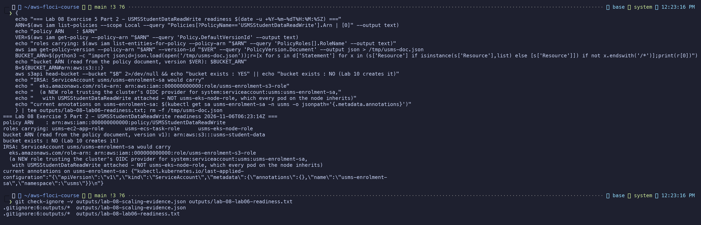

# Lab 08 - Independent Lab Exercises

Support path **A** (Floci 2.1.0, one k3s node). Every screenshot in `screenshots/lab-08/` shows a
command that was actually run on 2026-11-06 and its captured output.

---

## Exercise 1 - Basic: a second autoscaler (`usms-results-hpa`)

**File:** `manifests/lab-08/11-hpa-results.yaml`, `autoscaling/v2`, written as a manifest (no
`kubectl autoscale`): min 2, max 6, 60% CPU, scale-up at most **+2 pods per 30 s**, scale-in behind a
**180 s** stabilisation window (then 1 pod per 60 s).

Checked first that `usms-results` declares a CPU request (`50m`); the client-side dry run passed
before the real apply.

**Why 60% for results when enrolment uses 50%:** results is read-mostly and spiky only when marks are
released. Its requests are cheap and cacheable, so it can run hotter per pod before latency matters.
Enrolment writes (registrations) during a deadline-driven rush, where a slow response loses a student,
so it keeps more headroom.

**Outcome:** two HPAs, both reporting percentages: `usms-enrolment-hpa cpu: 2%/50%` and
`usms-results-hpa cpu: 2%/60%`.

*Exercise figure 1: the request checked, dry run, apply, both HPAs reporting, and the behavior block (+2 pods/30 s up, 180 s window down).*

---

## Exercise 2 - Intermediate: make the gateway drainable

`usms-gateway-pdb` (`minAvailable: 1`) against **one** replica allowed **0** disruptions, so any drain
of its node would hang. The PDB is not the problem; one replica is.

**Fix (in `manifests/lab-07/40-gateway.yaml`, re-applied, no `kubectl edit`):**
1. `replicas: 2`. With two pods and `minAvailable: 1`, one can be evicted: **ALLOWED DISRUPTIONS 1**.
   The PDB stays exactly as written.
2. `topologySpreadConstraints` on `kubernetes.io/hostname`, `ScheduleAnyway`, so the two replicas land
   on different nodes whenever there is more than one. **This cluster has one schedulable node**
   (`a7a37a91c9a8`), so both pods share it. On two or more nodes I would show one gateway pod per node
   in `kubectl get pods -o wide`; for a hard rule I would use `DoNotSchedule` or a required
   `podAntiAffinity`, at the cost of a `Pending` replica when a node is lost.

**Ownership fix needed for a clean diff:** `40-gateway.yaml` also declared the `usms-gateway` Service as
`ClusterIP`, while Step 15's `manifests/lab-08/50-service-loadbalancer.yaml` made it `LoadBalancer`.
Re-applying the Lab 07 file would have silently demoted the gateway. I moved the Service definition out
of `40-gateway.yaml` (pointer comment left) so each object has exactly one owning file.
`verify-lab-07.sh`'s "usms-gateway has 1 ready replica" became "at least 1", with a comment, because this
exercise raises it on purpose. Lab 07 verify is still `PASS=30 FAIL=0`.

**Outcome:** ALLOWED DISRUPTIONS **0 -> 1**, two gateway pods, `kubectl diff: clean (exit 0)`, and the
Service still `LoadBalancer`.

*Exercise figure 2: PDB before (0), apply, PDB after (1), pod placement on the single node, clean `kubectl diff`, Service still LoadBalancer.*

---

## Exercise 3 - Problem solving: the autoscaler that will not act (`usms-reports`)

Applied exactly as given (saved as `outputs/lab-08-ex3-reports.yaml`).

**Commands, in order, and what each revealed:**

| # | Command | Revealing output |
|---|---|---|
| 1 | `kubectl get hpa usms-reports-hpa` / `get deploy` | `cpu: 0%/70%`, MIN 4 MAX 4, REPLICAS 4 (the HPA jumped 2 -> 4 for `minReplicas`) |
| 2 | `kubectl describe hpa` (all three conditions) | `ScalingActive True` but **`ScalingLimited True TooFewReplicas`** |
| 3 | `get deploy -o jsonpath=...resources` | template `requests=` **empty**, `limits={"cpu":"200m"...}` |
| 4 | `get pods -o jsonpath=...resources` / QoS | pod `requests={"cpu":"200m"...}`, QoS **Guaranteed** |

**The two causes, one sentence each:**
- **Fault 1 (the request):** the container declares only a CPU *limit*, so there is no request the
  author chose, and on this cluster the API server **defaulted the request to the 200m limit**. The
  70% target therefore means 140m per pod, four times what a 50m request would give.
- **Fault 2 (the bounds):** `minReplicas: 4` equals `maxReplicas: 4`, so the only possible replica
  count is 4 and the HPA can never act, however perfect the metrics are.

**Which gives `<unknown>`:** the PDF says fault 1 produces `<unknown>` (no request, so no denominator).
**On this Kubernetes v1.34 it did not.** Request defaulting from the limit gave the HPA a denominator,
so it reported `0%/70%`. On a cluster where the request is truly absent (no limit either, or a
policy that strips defaults) fault 1 gives `<unknown>` with `FailedGetResourceMetric ... missing
request for cpu`. Fault 2 is the one that "prevents action even with perfect metrics", and that's
what I saw.

**Fixes, one field each:**
1. `kubectl set resources deployment/usms-reports --requests=cpu=50m`: an explicit request (pods now
   `Burstable` 50m).
2. `kubectl patch hpa usms-reports-hpa ... {"spec":{"maxReplicas":8}}`: room to move (4..8).

**Outcome:** `cpu: 0%/70%` with MIN 4 MAX 8. It reports a percentage and can now scale out
(`TooFewReplicas` at idle just means "would like fewer than the minimum"). Deleted afterwards (CLEAN UP).

*Exercise figure 3: applied exactly as given; the HPA reports 0%/70% and is pinned at 4.*

*Exercise figure 4: all three conditions (`ScalingLimited True TooFewReplicas`), the template with no requests, and pods Guaranteed.*

*Exercise figure 5: the pod's request was defaulted to the 200m limit, and min = max = 4 leaves one possible count.*

*Exercise figure 6: one-field fixes (explicit 50m request, maxReplicas 8), the HPA with room to move, then cleaned up.*

---

## Exercise 4 - Challenge: expose the results service properly

**Design (`manifests/lab-08/70-ingress-results.yaml`, plus one annotation on `60-ingress.yaml`):**

- **A second Ingress carrying only `/results`** -> `usms-results:80`. Rung: **Ingress** (top), backed
  by the existing `usms-results` **ClusterIP** (bottom rung). No new Service. Enrolment is not
  mentioned, so this exposure path cannot reach it.
- **One load balancer, not two:** `alb.ingress.kubernetes.io/group.name: usms-portal` on both this
  Ingress and `usms-portal-ingress`. The AWS Load Balancer Controller merges an IngressGroup into **one
  ALB** with extra listener rules. **No second `type: LoadBalancer`**: every LoadBalancer Service is its
  own NLB with its own hourly charge and its own address, which is exactly what the Office wants to avoid.
- **University network only:** `alb.ingress.kubernetes.io/conditions.usms-results` adds a `source-ip`
  condition to that one rule (`203.0.113.0/24` is an RFC 5737 placeholder for the university's real
  CIDR). Other sources get the ALB's default 404 on `/results`.
- **Stable address, normal port:** the ALB listens on HTTP 80 (`listen-ports`). Its DNS name is stable
  for the ALB's lifetime; a Route 53 alias such as `results.usms.rtc.bt` would give a friendly name. In
  production I would add HTTPS 443 with an ACM certificate.

**What this build could and could not show:** the Ingress is stored and validated, with the rule,
backend endpoints and all annotations visible, and the backend it names answers in-cluster.
There is **no ingress controller** here, so there is no ADDRESS, no ALB and no source-IP enforcement.
On real EKS, the **AWS Load Balancer Controller** (IRSA role, Helm chart, public subnets tagged
`kubernetes.io/role/elb=1`) would turn these annotations into the ALB rule.

**Cost:** one shared ALB, billed per hour plus LCUs. Adding `/results` adds a listener rule, not a load
balancer: roughly the same bill as the portal alone. Ten paths on one IngressGroup are still one ALB;
ten LoadBalancer Services would be ten NLBs.

**If the cluster were unavailable:**
- *Control plane down, nodes up:* the ALB and its registered pod targets keep serving. Nothing can
  change (no new pods, no target updates).
- *Nodes or pods down:* the ALB stays up but its targets fail health checks (`/healthz`), so it returns
  **503**.
- *The whole cluster deleted:* the controller is gone too. The ALB is orphaned and billed until someone
  deletes it, which is why `lab-08-cleanup.sh` removes Ingresses first.

The Office would see 503s rather than a dead DNS name, and the results data itself is unaffected.

*Exercise figure 7: dry run and apply, two Ingresses with no class or address (no controller), the `/results` rule with its backend endpoints and ALB annotations, and the backend answering in-cluster.*

---

## Exercise 5 - Integration: the artefacts Lab 10 needs

**Part 1 - `outputs/lab-08-scaling-evidence.json`:** assembled with `python3` from live
`kubectl get hpa -o json`, `kubectl get deploy -o json` and `aws eks describe-nodegroup`. It holds a
timestamp, the HPA's full spec and status, the Deployment's spec/ready replicas, and the node group's
scaling config, with an explicit note that `update-nodegroup-config` is unsupported here.
`python3 -m json.tool` accepts it.

**Part 2 - `outputs/lab-08-lab06-readiness.txt`:** policy ARN, three holders (`usms-ec2-app-role`,
`usms-ecs-task-role`, `usms-eks-node-role`). The bucket ARN `arn:aws:s3:::usms-student-data` is
**re-derived from the policy document** (default version v1, the non-`/*` resource), and the bucket
does **not** exist yet. Under IRSA, ServiceAccount **`usms/usms-enrolment-sa`** would carry
`eks.amazonaws.com/role-arn: arn:aws:iam::000000000000:role/usms-enrolment-s3-role`. That's a **new**
role trusting the cluster's OIDC provider for `system:serviceaccount:usms:usms-enrolment-sa`, with
`USMSStudentDataReadWrite` attached. It is **not** `usms-eks-node-role`, because every pod on the node
inherits the node role, so the bucket would be open to the gateway, the load generator and anything
compromised.

**Part 3:** "ECS or Kubernetes for USMS", 295 words, at the end of `notes/lab-08-notes.md`.

Both files are git-ignored (`.gitignore:6:outputs/*`).

*Exercise figure 8: the evidence JSON assembled from live API calls, validated, and summarised.*

*Exercise figure 9: holders, the bucket ARN read from the policy document, the bucket's absence, the IRSA annotation, and both files git-ignored.*
