# AWS Practical Laboratory Report: Lab 09 - Security Review

## 1. Aim / Objective

To review the security of everything Labs 01 to 08 built, change only what the review justifies, and
prove that nothing else moved:

* inventory every identity and audit it for wildcards, unscoped `iam:PassRole` and confused-deputy trust,
* split the transcripts policy into a read-only half, and add `aws:SourceAccount` / `aws:SourceArn` to the task role's trust,
* cap a new deploy role with a **permissions boundary** and scope its `iam:PassRole`,
* compute a session policy's effective permissions, rotate an access key in four steps, and require **IMDSv2**,
* replace the default allow-all **egress** on three security groups with written rules, and narrow SSH to a bastion group,
* compute who can reach what from rules alone, and prove the database is unreachable with five independent controls,
* prove the whole posture survives a restart, and that five earlier verification scripts are unchanged.

**Support path: B** (Floci 2.1.0: `simulate-principal-policy` works; account authorisation details,
credential report and Access Analyzer are not available; nothing is enforced).

---

## 2. Introduction

Access control has two axes, and each produces its own kind of failure:

| Axis | Question | Failure mode | This lab |
|---|---|---|---|
| **Identity** (IAM) | *Who* may call *what*? | Over-permissive: a principal can do more than its job | Steps 4-11 |
| **Network** (security groups, routes) | *What* may open a connection to *what*? | Over-reachable: something can be reached, or can reach out, that should not | Steps 12-17 |

| Concept | In this lab |
|---|---|
| **Confused deputy** | A service principal in a trust policy acts for *anyone* unless `aws:SourceAccount` / `aws:SourceArn` pin it |
| **Permissions boundary** | A ceiling: effective = identity ∩ boundary. It never grants anything |
| **Session policy** | A third intersection at `assume-role` time |
| **`iam:PassRole`** | The escalation path: whoever can pass a role can borrow its permissions |
| **Default egress** | Every new group allows all outbound; "the rule nobody wrote" |
| **Defence in depth** | A claim that survives the failure of any single control |

Nothing here could be proven by watching a command fail, because Floci authorises everything. Every
"cannot" is proven by **reading** documents and rules, plus the IAM simulator.

---

## 3. Architecture (after this lab)

```
IDENTITY
  usms-ecs-task-role            trust ecs-tasks + SourceAccount + SourceArn   USMSStudentDataReadWrite
  usms-transcripts-reader-role  same scoped trust (NEW)                      USMSStudentDataReadOnly (NEW, explicit Deny on writes)
  usms-deploy-role (NEW)        trusts user/usms-admin-01                    USMSDeployBase: PassRole -> 3 ARNs, only to ecs-tasks
                                boundary USMSPermissionsBoundary (attached to NOTHING else; not stored by Floci)
  usms-breakglass-role (Ex 2)   admin-01 + MFA AND ExternalId, 3600 s, boundary, 2 actions
  usms-dev-01                   ONE access key, rotated today
  usms-web-01                   IMDSv2 required, hop limit 1      usms-db-01  metadata endpoint DISABLED

NETWORK (vpc-384d1580, 10.0.0.0/16)
  internet --80/443--> usms-alb-sg --tcp/80 only--> usms-enrolment-sg --tcp/443--> S3 prefix list / 0.0.0.0/0
  internet --80/443--> usms-app-sg (web-01)    <- the SECOND front door (Exercise 4)
                       usms-app-sg  <--tcp/22-- usms-bastion-sg (NEW) <--tcp/22-- 203.0.113.10/32
                       usms-app-sg  --written egress (Ex 1)--> pl-s3, 443, alb-sg:80, db-sg:5432, 10.0.0.2:53 udp+tcp
                       usms-db-sg   <--tcp/5432-- usms-app-sg        egress tcp/443 only
```

> **About the figures.** Each screenshot shows a command that was run against this build on
> 2026-11-06 and its captured output, rendered in the terminal's prompt style. They were taken while
> each step ran. Where a take was wrong it was retaken, and where a first attempt failed for a reason
> worth seeing (figures 24 and 32a), it is kept and explained.

---

## 4. Pre-flight (Steps 1-3) - Checkpoint 1

Lab 01's three users had disappeared, probably after an earlier state reset. I recreated them and
gave `usms-dev-01` one key, so Step 10 has something to rotate. `configs/lab-01.env` gained the four
names the lab sources.

Step 2's baseline is in `outputs/lab-09-pre-verify.txt`:

| Script | Result |
|---|---|
| lab-02 | `6 Passed, 0 Failed` |
| lab-03 | `PASS=35 FAIL=1` (web-01 stopped) |
| lab-04 | `39/0` |
| lab-05 | `47/2` |
| lab-06 | `39/3` |

Each failure is a Floci limitation recorded in its own lab. The probe (Step 3) found
`simulate-principal-policy` **supported**, and `get-account-authorization-details` and
`get-credential-report` **not available**: path **B**.

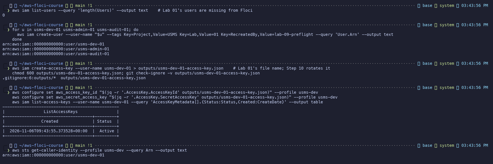
*Figure 0: the Lab 01 users recreated, one Active key for usms-dev-01, the key file git-ignored, and the profile answering.*

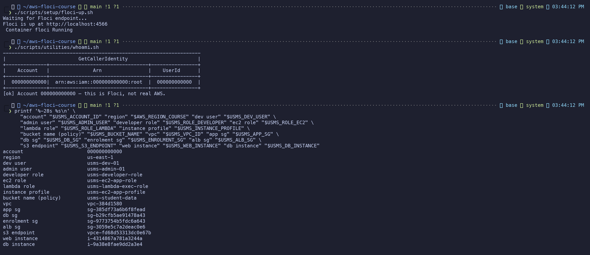
*Figure 1: Floci up, account 000000000000, and every identifier the lab needs, each looked up rather than typed.*

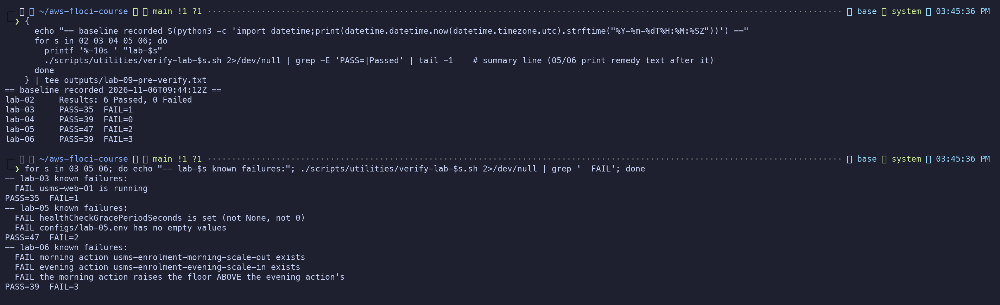
*Figure 2: the five earlier verification scripts' summary lines, captured for Step 18's diff.*

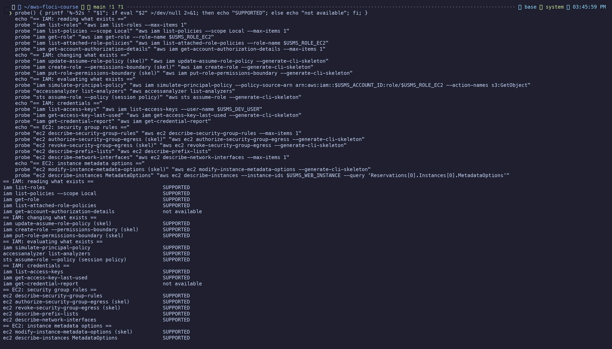
*Figure 3: the capability probe. Simulate is supported; account authorisation details and the credential report are not.*

---

## 5. Procedure, Evidence and Observations

### 5.1 Identity inventory and audit (Steps 4-5) - Checkpoint 2

There are 7 roles (including Lab 06's service-linked role), 3 users and 8 customer-managed policies.
**No role has a permissions boundary.** `outputs/lab-09-identity-inventory.json` holds every role's
trust policy and every policy document.

The side-by-side "Your turn" shows the structural difference: `usms-ec2-app-role` trusts a **service**,
and `usms-developer-role` trusts **`"AWS": "*"`**, which means anyone (notes, Step 4).

`usms-iam-audit.sh`: **`HIGH=7 MED=19 roles=7`, exit 1.** The findings:
- five unconditioned service trusts
- `Principal "*"`
- the service-linked role
- `USMSEKSNodePolicy`'s ENI actions on `*`
- `USMSDeveloperBase`'s `ec2:*`

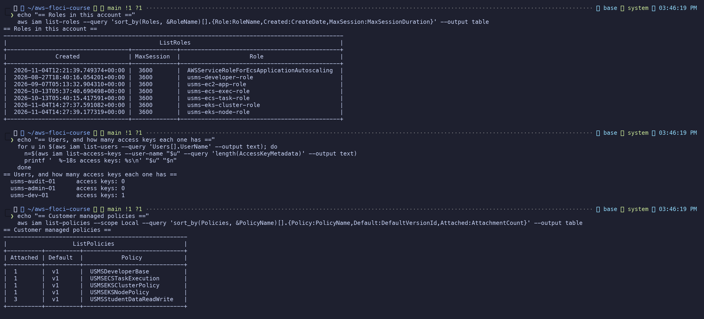
*Figure 4: roles, users with key counts, customer-managed policies with attachment counts.*

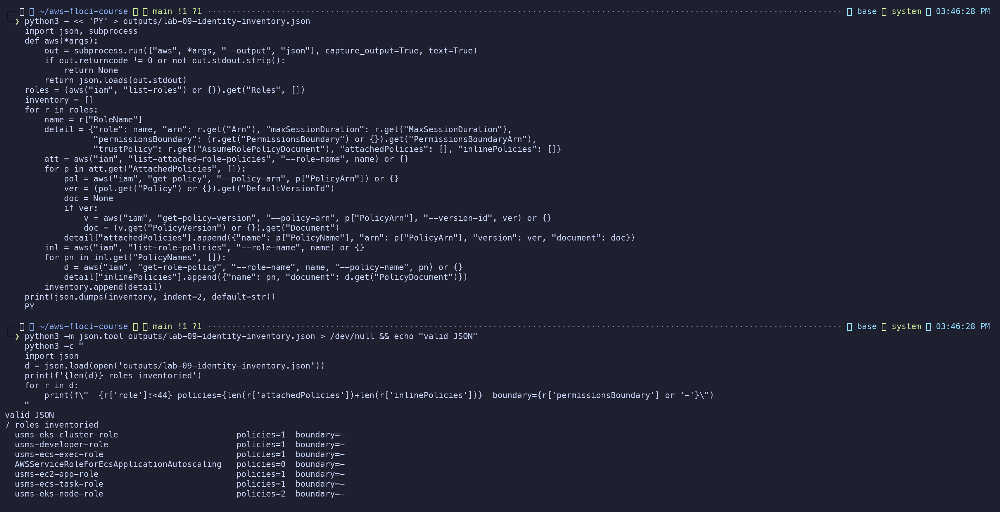
*Figure 5: the inventory as JSON: 7 roles, policy counts, and boundary "-" for every one.*

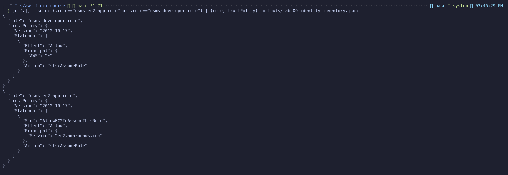
*Figure 6: two trust policies side by side, a service principal against `Principal AWS "*"`.*

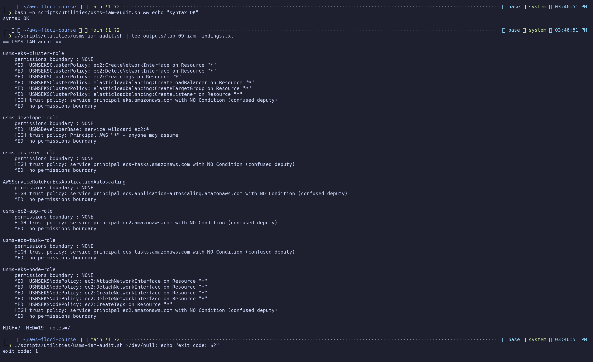
*Figure 7: the IAM audit: HIGH=7 MED=19, exit code 1.*

### 5.2 The read-only split and the confused-deputy fix (Steps 6-7) - Checkpoint 3

`USMSStudentDataReadWrite` is on **three** roles here (ec2-app, ecs-task, eks-node), not the two the
lab expects. It also grants `s3:DeleteObject` and `s3:GetBucketLocation`.

**The bucket does not exist** (`head-bucket` 404), so the review is of documents, not objects.

**`USMSStudentDataReadOnly`:**
- Allow `s3:ListBucket` on the bucket ARN, and `s3:GetObject` on `.../*`.
- An **explicit Deny** on `PutObject`, `DeleteObject`, `DeleteBucket` and `PutBucketPolicy`.
- It is carried by the new `usms-transcripts-reader-role`.

`usms-ecs-task-role`'s trust was replaced with the same principal plus `aws:SourceAccount` and
`aws:SourceArn`. The comparison printed **SAME PRINCIPAL, NEW CONDITION**.

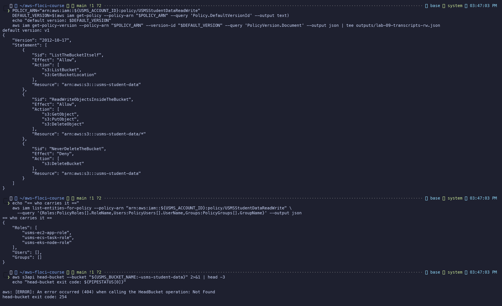
*Figure 8: Lab 01's transcripts policy (note DeleteObject), its three holders, and the bucket's absence.*

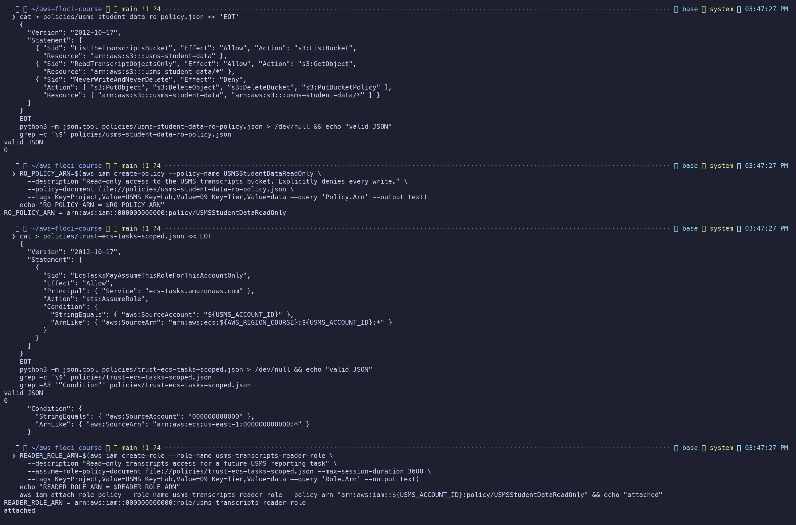
*Figure 9: the read-only policy (quoted heredoc), the scoped trust document (unquoted, live account ID), and the new role.*

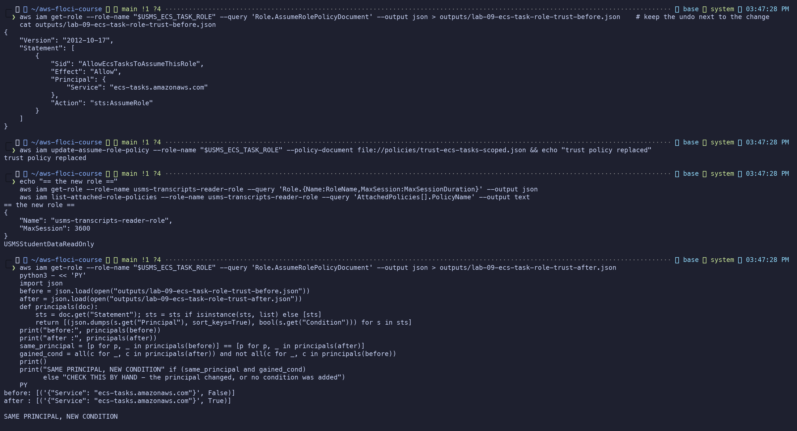
*Figure 10: the task role's trust before and after: SAME PRINCIPAL, NEW CONDITION.*

### 5.3 PassRole, the boundary and the deploy role (Step 8) - Checkpoint 4

**`USMSPermissionsBoundary` is the ceiling:**
- It allows the deploy toolset.
- It **denies** every identity-changing call (`CreateUser`, `AttachRolePolicy`,
  `DeleteRolePermissionsBoundary`, `UpdateAssumeRolePolicy`, and so on).
- It denies deleting the course network.
- `Resource "*"` is correct for a ceiling.

**`USMSDeployBase`:**
- The ECS deploy calls.
- `iam:PassRole` on **three named ARNs** with `iam:PassedToService = ecs-tasks.amazonaws.com`.
- An explicit Deny on passing anything to EC2.

`usms-deploy-role` trusts `user/usms-admin-01`.

**Floci limitation:** both `--permissions-boundary` on `create-role` and `put-role-permissions-boundary`
return success, but `get-role` has **no `PermissionsBoundary` key** (figure 13). The boundary has
**zero attachments**, which is correct: it must never be attached as an ordinary policy.

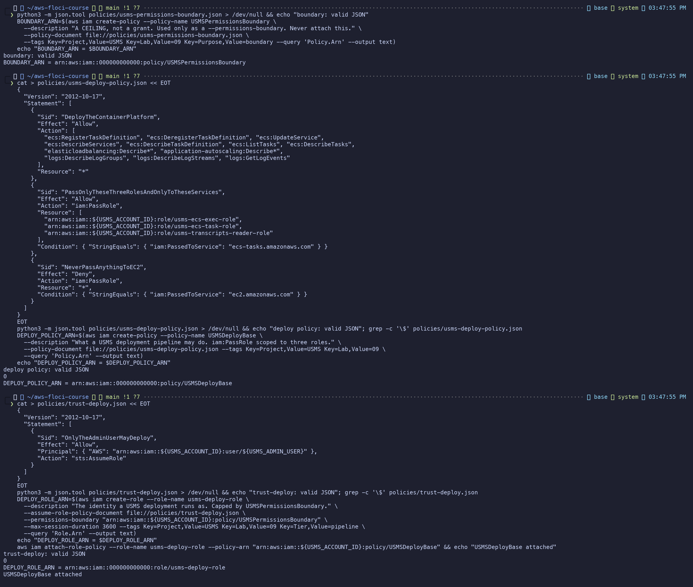
*Figure 11: the boundary, the deploy policy, the deploy trust, and the role with its one policy.*

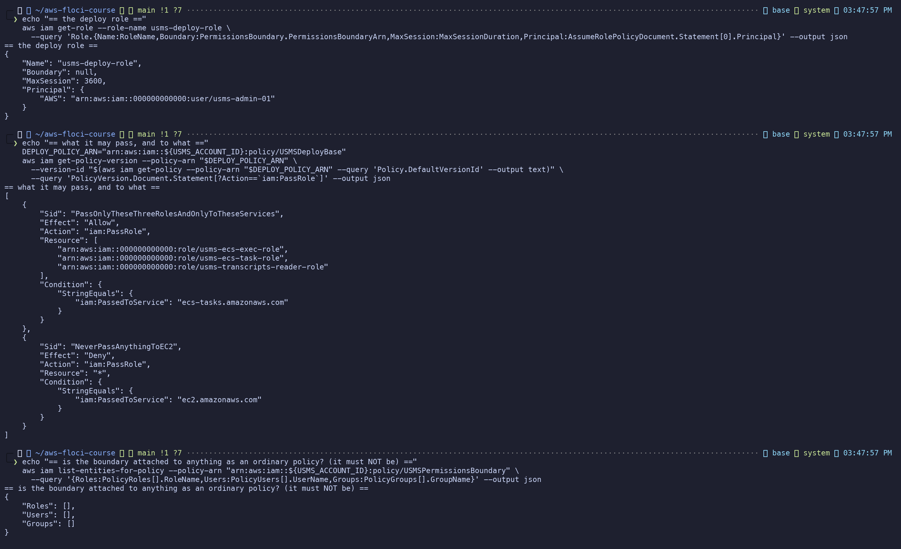
*Figure 12: Checkpoint 4: the deploy role's principal and maximum session, what it may pass and to what, and the boundary attached to nothing.*

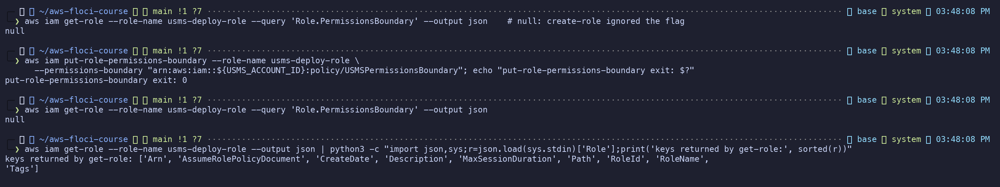
*Figure 13: `put-role-permissions-boundary` exits 0 and `get-role` still has no PermissionsBoundary key: accepted, not stored.*

### 5.4 Effective permissions with a session policy (Step 9)

I assumed `usms-developer-role` with a session policy that allows four describe or identity actions.

- **The hand-computed intersection:** identity `ec2:*` ∩ session {3 EC2 describes, `sts:GetCallerIdentity`}
  = the three describes. **`sts:GetCallerIdentity` is denied**, because it is not in the identity
  policy.
- **`simulate-principal-policy` agrees:** `ec2:DescribeVpcs` allowed, `sts:GetCallerIdentity` and
  `iam:CreateUser` implicitDeny.
- **Floci quirks:** it named the session `floci-session` instead of `lab09-scoped-review`, and it
  answered `iam list-users` under the session credentials. Neither would happen on real AWS.
- The session file was deleted at the end of the step.

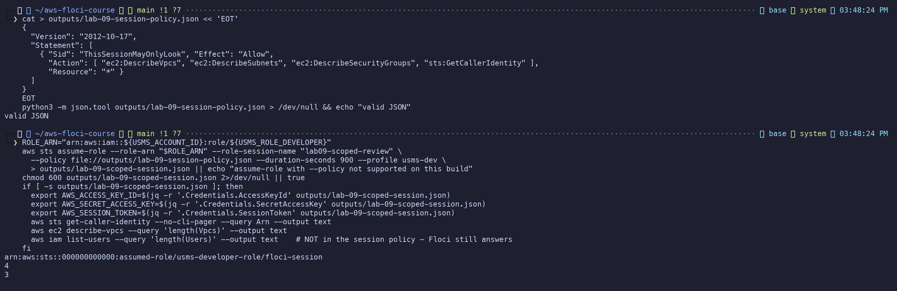
*Figure 14: the session policy, assume-role with it, and the assumed-role ARN.*

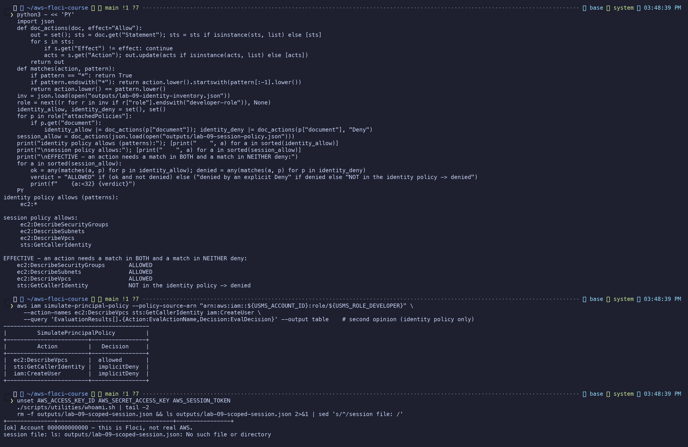
*Figure 15: identity ∩ session computed by hand, confirmed by the simulator: at least one action not allowed.*

### 5.5 Access key rotation in four steps (Step 10) - Checkpoint 5

1. **Before:** one Active key, last used `N/A`.
2. **Create:** a second key into a git-ignored, mode-600 file. The `usms-dev` profile now uses it:
   `aws configure get` prints the new ID and the ARN still reads `user/usms-dev-01`.
3. **Deactivate the old key:** two keys, one Active and one Inactive, and the profile still answers.
   *On a real system this pause is a day to a week; this lab compressed it to seconds.*
4. **Delete the old key:** one Active key, created today. Lab 01's key file is removed.

The key IDs visible in these figures were issued by the emulator. No secret key appears in any figure
or committed file.

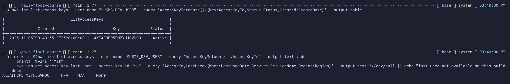
*Figure 16: before: one Active key, last used N/A.*

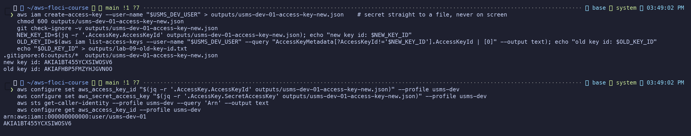
*Figure 17: the new key written to a git-ignored file, and the profile moved to it.*

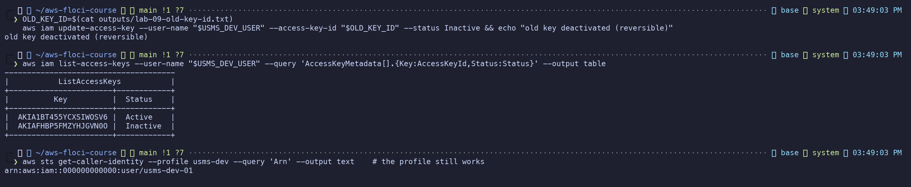
*Figure 18: during: two keys, one Active and one Inactive; the profile still works.*

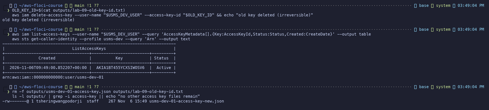
*Figure 19: after: the old key deleted, one Active key, and the old key files removed.*

### 5.6 IMDSv2 (Step 11) - Checkpoint 6

| Instance | Before | After |
|---|---|---|
| `usms-web-01` | `HttpTokens: optional`, hop limit 1, endpoint enabled | **`required`**, hop limit **1**, endpoint **enabled** (it has a role and needs it) |
| `usms-db-01` ("Your turn"; no instance profile) | (default) | **`HttpEndpoint: disabled`**, `HttpTokens: required`. With no role, the safest metadata service is none |

On `usms-web-01`, the same disabled setting would cut off its instance-profile credentials.

The attacks (SSRF vs one-hop-away), and the rollout order using the `MetadataNoToken` metric, are in
the notes. Floci stores the options, but there is no metadata service to enforce them.

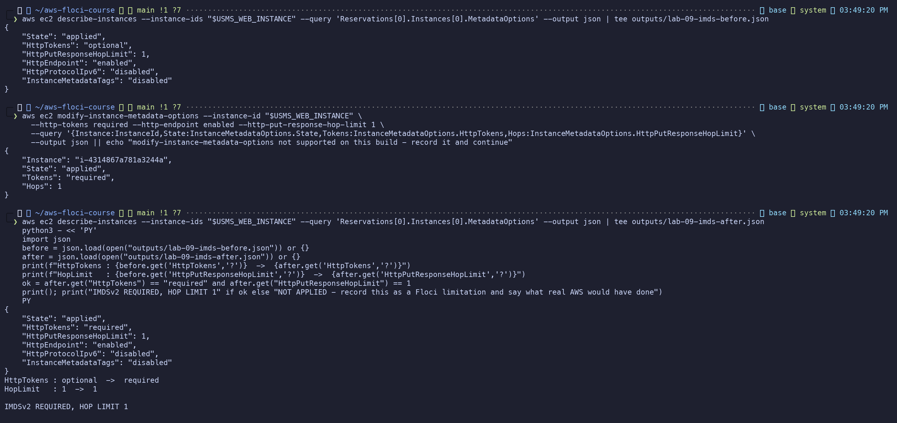
*Figure 20: usms-web-01 optional -> required, hop limit 1: IMDSv2 REQUIRED, HOP LIMIT 1.*

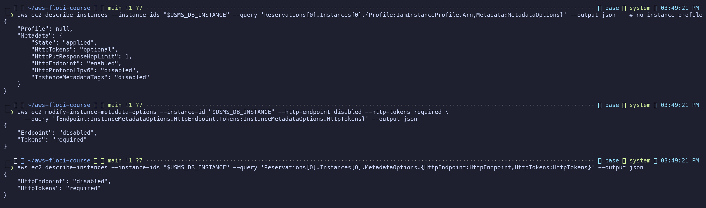
*Figure 21: usms-db-01 has no profile, so its metadata endpoint is disabled entirely.*

### 5.7 Security-group audit and written egress (Steps 12-15) - Checkpoints 7 and 8

**`usms-sg-audit.sh` before: `HIGH=5 MED=7 LOW=4 groups=6`.**
- Every group has the default allow-all egress.
- `usms-app-sg` admits **SSH from `0.0.0.0/0`**. That is worse than the `10.0.0.0/16` the lab expected.
- `usms-alb-sg` also admits 443 from the internet.
- The ALB and enrolment groups have 0 interfaces on Floci.

The S3 prefix list `pl-63a5400a` exists (Step 13 Part 1).

**The changes, each authorised first and revoked second:**

| Step | Group | Egress written |
|---|---|---|
| 13 | `usms-enrolment-sg` | tcp/443 -> `pl-63a5400a` and tcp/443 -> `0.0.0.0/0` (APIs with no prefix list) |
| 14 | `usms-alb-sg` | tcp/80 -> **`usms-enrolment-sg`** (a group, not a CIDR) |
| 15 | `usms-db-sg` | tcp/443 -> `0.0.0.0/0` only. DNS, SSH, SMTP and 80 are now denied. **HTTPS POST of the data anywhere is still possible**; only hostname filtering stops that (Exercise 4) |

**Two traps found on this build** (figure 24):
1. Floci's `describe-security-group-rules` is a **stale** view. It still listed the revoked `-1` rule,
   and a revoke by a bogus rule ID returned `True`. **`describe-security-groups` is authoritative**
   (figure 24b), so every check here uses it.
2. **The PDF's count `` IpProtocol==`-1` `` is a number literal and never matches** the string
   `"-1"`. It would report 0 even with the default rule present. All counts use `'-1'`.

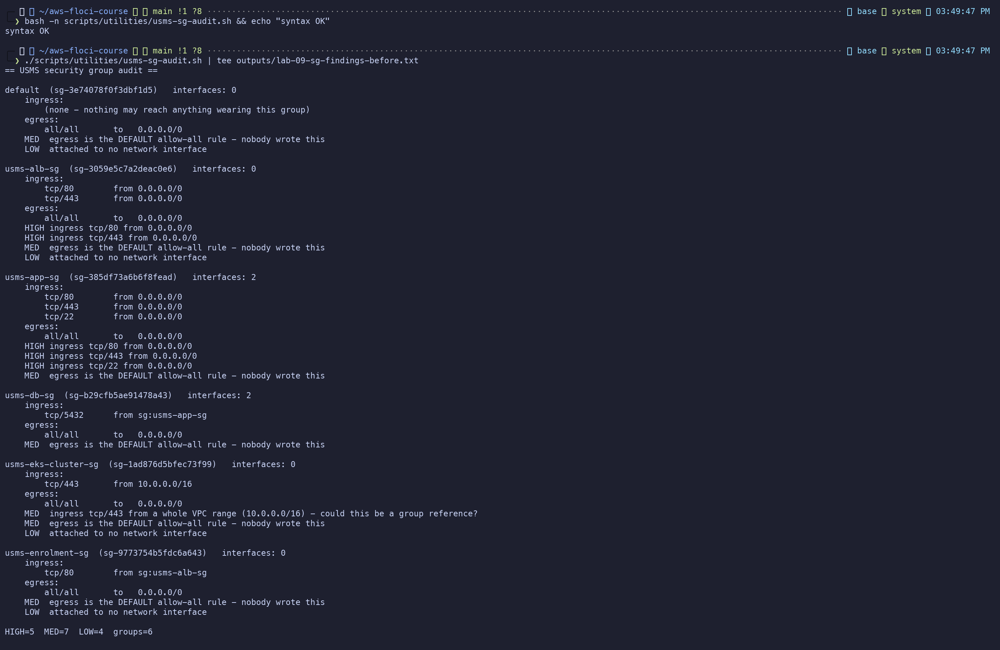
*Figure 22: the SG audit before: default egress on every group, SSH from 0.0.0.0/0. HIGH=5 MED=7 LOW=4.*

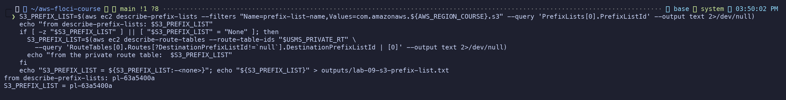
*Figure 23: the S3 managed prefix list, pl-63a5400a.*

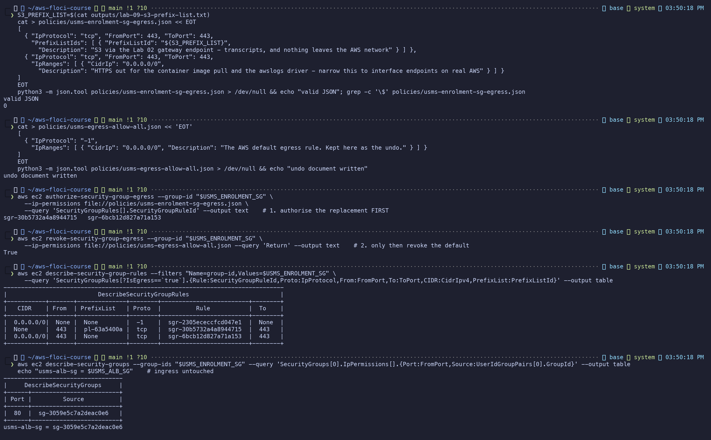
*Figure 24: Step 13, the enrolment egress written and the default revoked. **Note the `-1` row in the rules table: this is Floci's stale `describe-security-group-rules` view, not a surviving rule.** Figure 24b shows the authoritative state.*

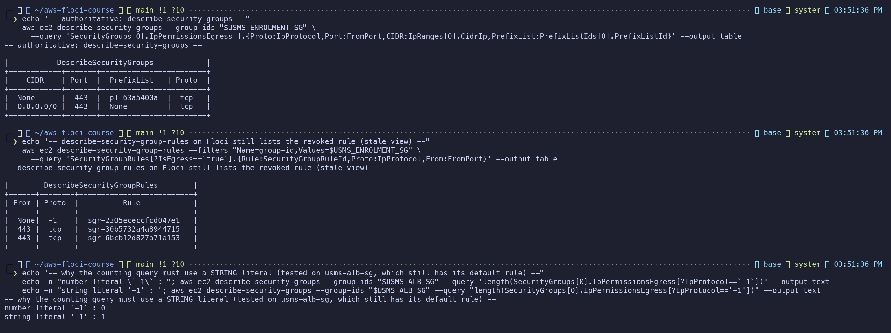
*Figure 24b: the authoritative `describe-security-groups`: only the two tcp/443 rules remain.*

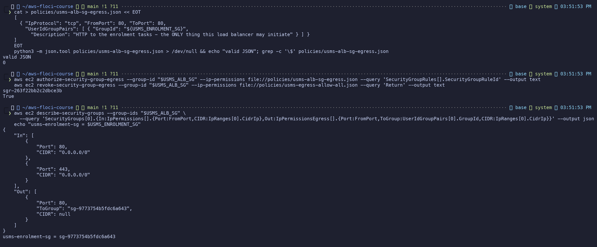
*Figure 25: Step 14: usms-alb-sg egress is tcp/80 to the enrolment group, CIDR null.*

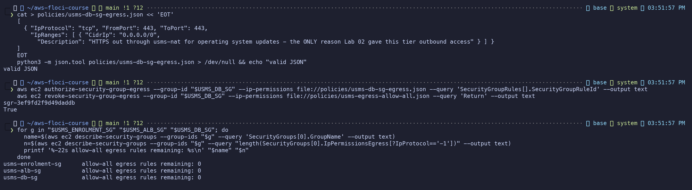
*Figure 26: Checkpoint 8: the data tier's 443-only egress, and zero allow-all rules on all three groups (counted with the string literal `'-1'`).*

### 5.8 SSH narrowed to a bastion group (Step 16) - Checkpoint 9

`usms-bastion-sg` did not exist (Lab 02 Exercise 2 had not been done), so I created it with ingress
tcp/22 from `203.0.113.10/32`.

**Order:**
1. Authorise tcp/22 from `usms-bastion-sg` on `usms-app-sg` (`policies/usms-app-sg-ssh-bastion.json`,
   unquoted heredoc, no unexpanded variables).
2. **Then** revoke the CIDR rule.

The PDF's lookup searched for `10.0.0.0/16` and would have found nothing, because the rule here was
`0.0.0.0/0`. It would have printed "already removed" and **left SSH open to the internet**. Instead,
the step removed whichever CIDR SSH rules existed.

The authoritative view shows port 22 **FromGroup `sg-a76e55a201af44474`, CIDR None**. Ports 80 and
443 are unchanged.

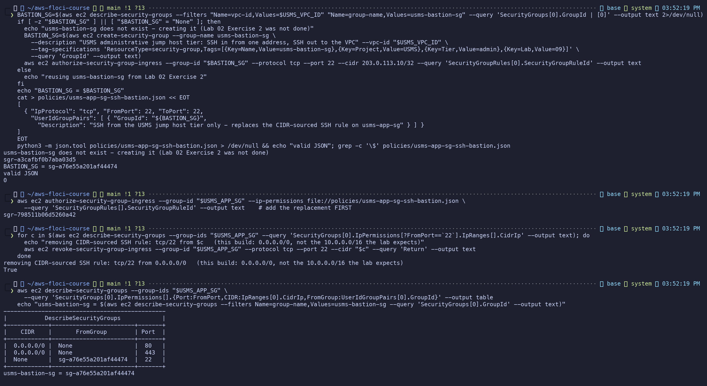
*Figure 27: Checkpoint 9: bastion group created, the replacement added first, the 0.0.0.0/0 SSH rule revoked, port 22 now from a group only.*

### 5.9 Reachability matrix and two negatives (Step 17) - Checkpoint 10

`usms-reachability-matrix.sh` derives every verdict from `IpPermissions` and `IpPermissionsEgress`
only, never from names or tags.

**Ingress:**
- **Two groups admit the internet:** `usms-alb-sg` (80, 443) and `usms-app-sg` (80, 443). The latter
  is never argued for, which is Exercise 4.
- `usms-db-sg` and `usms-enrolment-sg` admit only a group.

**Egress:** `usms-app-sg` and `usms-bastion-sg` kept the default at this point. Exercise 1 fixes the
first.

**Single point of control:** `usms-bastion-sg`, `usms-db-sg`, `usms-eks-cluster-sg` and
`usms-enrolment-sg` are each protected by **one** ingress rule. One mistake in that rule is the whole
of the security-group protection. `usms-alb-sg` is not on the list, because it has two rules.

**Negative proof for `usms-db-01`** (`outputs/lab-09-negative-proof.txt`); each control would have to
fail independently:

| # | Control | Result |
|---|---|---|
| 1 | Public address | **None** |
| 2 | Subnet `MapPublicIpOnLaunch` | **False** |
| 3 | Private route table's `0.0.0.0/0` | **NAT** `nat-f10bc257a7f8f3f59`, no `igw-` |
| 4 | `usms-db-sg` ingress | 5432 from `sg-385df73a6b6f8fead` (usms-app-sg), CIDR **None** |
| 5 | Subnet's NACL | `acl-1ebb38e1948af1cc0`, **IsDefault False** |

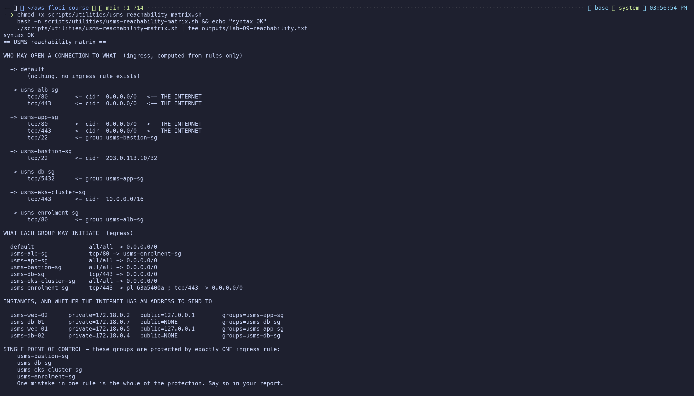
*Figure 28: the reachability matrix: who may open what, what each group may initiate, instance addresses, and the single-point-of-control list.*

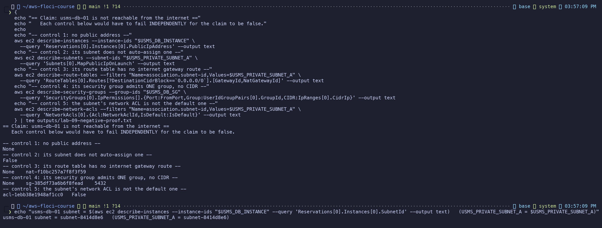
*Figure 29: Checkpoint 10: five independent controls on usms-db-01, all as required.*

### 5.10 Restart persistence and regression (Step 18) - Checkpoint 11

**Nine facts recorded before** `floci-down.sh` / `floci-up.sh`:

| Fact | Value |
|---|---|
| Task-role condition keys | 2 |
| Deploy-role boundary | `None`: consistently absent, a Floci limitation |
| Reader role and its policy | `usms-transcripts-reader-role` / `USMSStudentDataReadOnly` |
| Access keys on `usms-dev-01` | 1 |
| Allow-all egress on three groups | 0, 0, 0 |
| CIDR SSH sources on `usms-app-sg` | 0 |
| `usms-web-01` HttpTokens | `required` |

**The first post-restart diff said PERSISTENCE FAILED** (figure 32a). Nothing had been lost: Floci
holds **three VPCs named `usms-vpc`** and **two `usms-db-sg` groups**, and the PDF's tag-only lookup
returned the group in the wrong VPC.

Re-deriving the VPC from `usms-web-01` and scoping every lookup to it gave the same IDs as before, and
**PERSISTENCE PROVEN** (figure 32b).

**Regression:** all five scripts' summary lines are identical to Step 2's: **NOTHING BROKE**.

The restart also re-created the k3s node (Labs 07 and 08). I deleted the ghost node, relabelled the new
one `workload=usms tier=app`, and all 7 pods were running again.

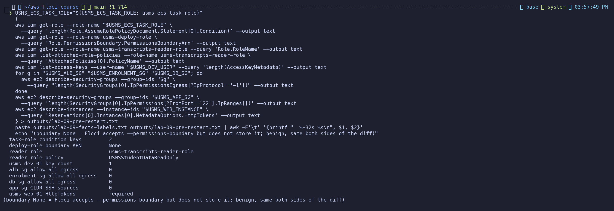
*Figure 30: the nine facts before the restart.*

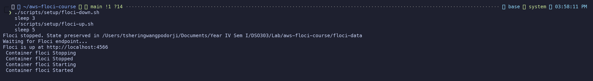
*Figure 31: floci-down (docker compose stop, state kept) and floci-up.*

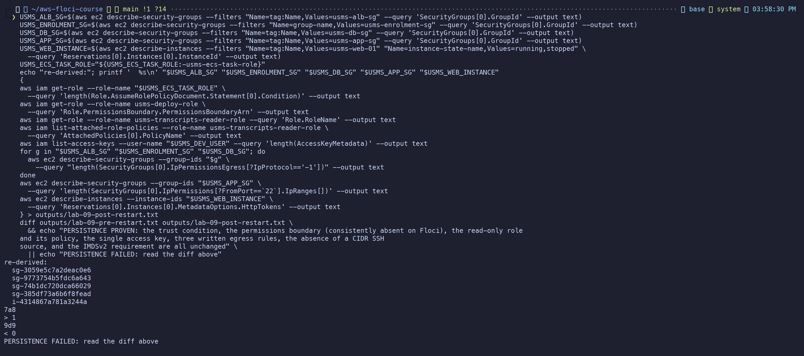
*Figure 32a: the first diff: PERSISTENCE FAILED, because the tag-only lookup found a different usms-db-sg (sg-74b1...).*

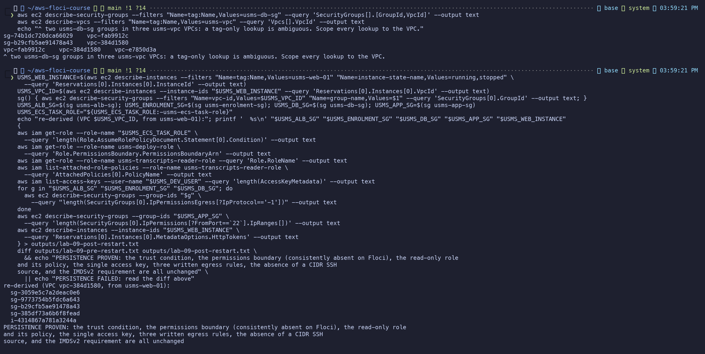
*Figure 32b: the cause shown (two usms-db-sg groups, three usms-vpc VPCs), every lookup scoped to the VPC of usms-web-01, PERSISTENCE PROVEN.*

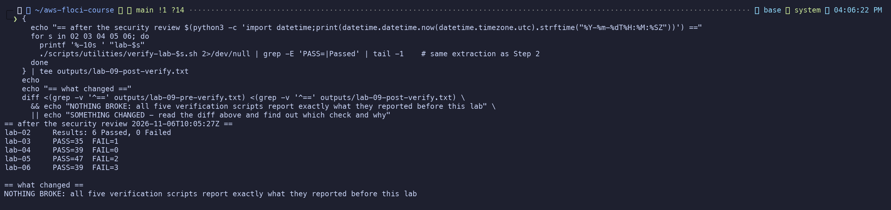
*Figure 33: Checkpoint 11: the five verification scripts re-run, identical to Step 2: NOTHING BROKE.*

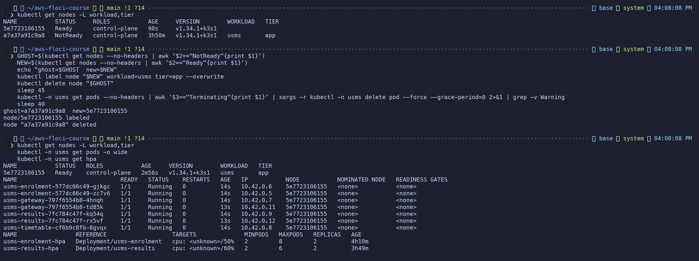
*Figure 34: side effect on the EKS cluster: ghost node deleted, new node relabelled, pods running (the HPAs read `<unknown>` while metrics-server warms up).*

### 5.11 Recording (Steps 19-20) - Checkpoint 12

`configs/lab-09.env` has **16 exports**, all populated, and **no access key ID** (`grep -ci AKIA` = 0).
It records the rotation **date** instead.

`USMS_EGRESS_ALLOW_ALL_REMAINING=0` is read from the API with the corrected query, scoped to the VPC.

**Pre-commit checks:**
- nothing under `outputs/` in `git status`
- `git check-ignore -v` names `.gitignore:6:outputs/*` for the access-key file and for the inventory
- `git ls-files outputs/` lists only `.gitkeep`

The PDF's `grep '\$'` flags Lab 01's `${aws:username}`, which is an **IAM** variable. A shell-variable
check finds none.

**Not committed:** the commit is left for you to run.

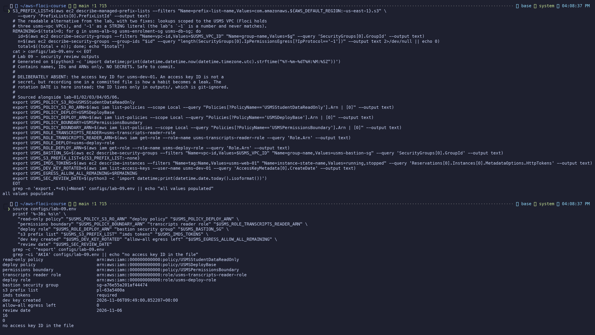
*Figure 35: configs/lab-09.env written by lookup and read back: 16 exports, allow-all egress left 0, no access key ID.*

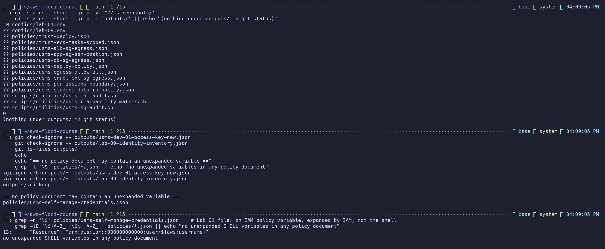
*Figure 36: look before you add: no outputs/ in status, check-ignore names the rule twice, only .gitkeep tracked, and no unexpanded shell variables.*

---

## 6. Verification (Section 8)

`scripts/utilities/verify-lab-09.sh` gives **`PASS=49 FAIL=1`**. The PDF expects 50/0.

The **one failure is benign and on the PDF's list:** "usms-deploy-role HAS a permissions boundary".
Floci does not store boundaries (figure 38).

**The script is the PDF's, with six fixes, each commented in its header:**
1. the `'-1'` string literal
2. `SecurityGroups[0]` in every group query
3. shell-only variable detection
4. `outputs/.gitkeep` allowed
5. the **boundary-attachment check's quoting**. As printed, it failed with `AttachmentCount` really 0.
   That is a script bug, not a Floci limitation, and is now fixed.
6. the route-table check first asserts that the table exists

`scripts/cleanup/lab-09-cleanup.sh` passes `bash -n` and **has not been run**. Compared with the PDF,
it also revokes the bastion-referencing rule before deleting `usms-bastion-sg`, and restores the
intended `10.0.0.0/16` SSH rule, never `0.0.0.0/0`.

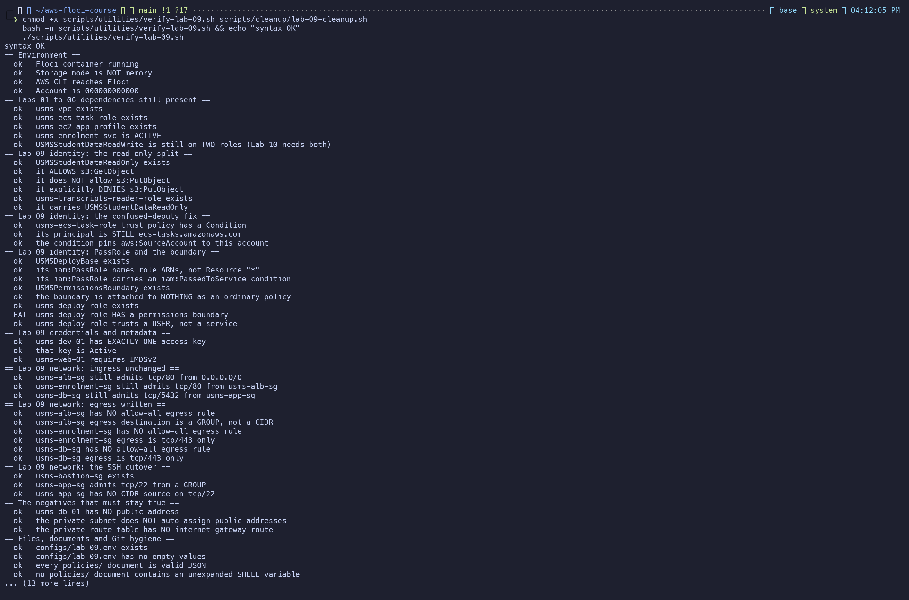
*Figure 37: verify-lab-09.sh: PASS=49 FAIL=1.*

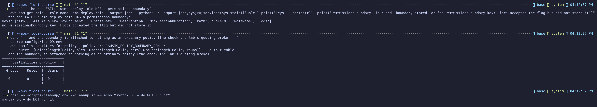
*Figure 38: the one failure confirmed benign (no PermissionsBoundary key), the boundary attached to nothing, and the cleanup script syntax-checked, not run.*

---

## 7. Results

| Control | Before | After |
|---|---|---|
| IAM audit | HIGH=7 MED=19 (7 roles) | **HIGH=0** MED=27 **ACCEPTED=3** (11 roles), exit 0 |
| SG audit | HIGH=5 MED=7 LOW=4 | HIGH=4 MED=4 LOW=5 (7 groups; the HIGHs are internet ingress on alb and app) |
| Allow-all egress on alb/enrolment/db/app SGs | 4 | **0** |
| CIDR SSH sources on `usms-app-sg` | 1 (`0.0.0.0/0`) | **0** (bastion group only) |
| `Principal "*"` trust | 1 | **0** |
| Unconditioned service trusts | 6 | **0 unaccepted** (3 accepted with reasons) |
| Access keys on `usms-dev-01` | 1 (old) | 1 (new, rotated today) |
| IMDSv2 on `usms-web-01` | optional | **required**, hop 1 |
| Persistence across restart | - | 9/9 facts |
| Earlier verification scripts | baseline | identical |
| `verify-lab-09.sh` | - | 49/1 (1 benign) |

---

## 8. Floci vs Real AWS (observed on this build)

| Feature | Floci 2.1.0 | Real AWS |
|---|---|---|
| IAM evaluation, `iam:PassRole`, `aws:SourceArn`, MFA, ExternalId | Stored, never evaluated | Enforced on every call |
| Permissions boundary | Accepted, **not stored** | Stored and enforced |
| Session policy | Ignored; session name replaced by `floci-session` | Third intersection |
| `simulate-principal-policy` | **Works** | Works |
| Account authorisation details, credential report, Access Analyzer | Not available | Available |
| Instance metadata options | Stored; no metadata service | Enforced at the hypervisor |
| `describe-security-group-rules` | **Stale** (keeps revoked rules); a bogus rule ID revokes "successfully" | Accurate |
| Security groups and NACLs | Stored, not evaluated | Every packet |
| Public addresses | `127.0.0.1` on instances, none on ENIs; NAT ENI unlisted | Real addresses on ENIs |
| Restart | State kept; k3s returns as a new node | N/A |

**Observed:** documents, rules, the restart, the regression diff, and the simulator. **Reasoned only:**
all enforcement, SSRF and the hop limit, prefix-list routing, and costs.

Everything here is **preventive**. The detective half (CloudTrail, EventBridge, GuardDuty, Config) is
designed and priced in Exercise 4.

---

## 9. Independent Exercises (summary; full answers in [exercises.md](exercises.md))

| Exercise | Outcome |
|---|---|
| 1. Web-tier egress | Six written rules (S3 prefix list, AWS 443, ALB group, DB group, DNS UDP and TCP to `10.0.0.2/32`); default revoked; ingress unchanged |
| 2. Break-glass and open findings | `usms-breakglass-role` (MFA **AND** ExternalId, 3600 s, boundary, 2 actions); 4 trusts fixed, 3 accepted from a committed TSV; the audit exits 1 if a reason is missing |
| 3. Exposure report | Routing + address + ingress verdicts: EXPOSED 3, ISOLATED 2; identical from any directory |
| 4. Security review | The four answers for the ISO, the transcripts access list, the priced detective controls, and the unexecuted cut-over plan with danger admonitions |
| 5. Bucket policy draft | 6 statements computed from the inventory; mechanical checks pass; readiness file; 17 exports |

---

## 10. Files Produced

| Kind | Files |
|---|---|
| Policies (new) | `usms-student-data-ro-policy.json`, `trust-ecs-tasks-scoped.json`, `usms-permissions-boundary.json`, `usms-deploy-policy.json`, `trust-deploy.json`, `usms-enrolment-sg-egress.json`, `usms-alb-sg-egress.json`, `usms-db-sg-egress.json`, `usms-egress-allow-all.json`, `usms-app-sg-ssh-bastion.json`; Exercises: `usms-app-sg-egress.json`, `trust-breakglass.json`, `usms-breakglass-policy.json`, `trust-lambda-scoped.json`, `trust-eks-cluster-scoped.json` |
| Scripts | `scripts/utilities/{usms-iam-audit.sh, usms-sg-audit.sh, usms-reachability-matrix.sh, verify-lab-09.sh, usms-exposure-report.sh, usms-bucket-policy-draft.sh}`, `scripts/cleanup/lab-09-cleanup.sh` |
| Config | `configs/lab-09.env` (17 exports), `configs/lab-09-accepted-findings.tsv`, `configs/lab-01.env` (+4 names) |
| Evidence (git-ignored) | `outputs/lab-09-*` (inventory, findings before and after, reachability, negative proof, pre/post restart, pre/post verify, exposure, bucket policy draft, readiness) |
| Write-up | this report, [exercises.md](exercises.md), `notes/lab-09-notes.md`, 52 figures in `screenshots/lab-09/` |

---

## 11. Conclusion

The review changed the system's **permissions** a great deal and its **behaviour** not at all. That is
exactly what Step 18 proved: nine controls survived a restart, and 172 earlier assertions are
unchanged.

The largest real risks it found were not the ones the lab text anticipated:
- **SSH open to the whole internet**, not just the VPC;
- a **developer role anyone could assume**;
- a **transcripts policy that lets three roles, including every Kubernetes node, delete academic
  records**.

The first two are fixed. The third is a decision for Lab 10.

The lab also showed that the review tools need reviewing too. A number literal where a string was
needed, a query missing its first key, a quote that survived `eval`, and a tag lookup that matched two
groups each produced a confident wrong answer. Each was caught only because an output was read rather
than trusted.
