# Lab 09 - Independent Lab Exercises

Support path **B** (Floci 2.1.0). Every screenshot in `screenshots/lab-09/` shows a command that was
actually run on 2026-11-06 and its captured output. Nothing here was enforced by Floci: every claim
about what is *refused* is proven by reading the document, plus `simulate-principal-policy` where it
applies.

---

## Exercise 1 - Basic: finish the egress work on the web tier

**Document:** `policies/usms-app-sg-egress.json`, written with an **unquoted** heredoc. Unlike Steps 13
to 15, it has to contain four live values: `usms-alb-sg`'s ID, `usms-db-sg`'s ID, the S3 prefix list,
and the resolver address computed from the VPC CIDR. A quoted heredoc would have written
`${USMS_ALB_SG}` literally, and `authorize-security-group-egress` would reject it as a malformed
group ID. The check `grep -cE '\$[A-Z_]|\$\{'` returned 0.

| Req | Rule | Why this destination |
|---|---|---|
| 1 S3 (Lab 10 transcripts) | tcp/443 -> `pl-63a5400a` | The S3 prefix list: traffic to S3 goes through `usms-s3-endpoint` (gateway endpoint), not the NAT |
| 2 AWS APIs incl. STS | tcp/443 -> `0.0.0.0/0` | STS and most APIs have no prefix list; it leaves via `usms-nat` |
| 3 enrolment API | tcp/80 -> **`usms-alb-sg`** | Since Lab 05 the API is the **load balancer**, not the tasks. A group reference survives re-addressing |
| 4 database | tcp/5432 -> **`usms-db-sg`** | Mirrors `usms-db-sg`'s ingress from `usms-app-sg` |
| 5a DNS | **udp**/53 -> `10.0.0.2/32` | Every normal query is UDP |
| 5b DNS | **tcp**/53 -> `10.0.0.2/32` | Answers over 512 bytes (or with the TC bit) are retried over TCP |

**Requirement 5's destination:**
- AWS reserves five addresses in every subnet. Lab 02 listed them: `.0` network, `.1` VPC router,
  **`.2` DNS (AmazonProvidedDNS)**, `.3` reserved, and the broadcast address.
- The resolver is the **VPC CIDR base + 2**: `10.0.0.0/16` gives `10.0.0.2`. The script computes it
  with `ipaddress`, so a different CIDR would still be right.
- It is a `/32`: allowing 53 to `0.0.0.0/0` would allow DNS tunnelling to any resolver on the internet.
- **UDP comes first** because it is the normal path. TCP is only the fallback, but without it large
  responses (DNSSEC, many A records) would fail mysteriously.

**169.254.169.254** needs no rule. It is **link-local**: the hypervisor answers it on the instance's
own interface, and the traffic never enters the VPC network where security groups apply. That is why
IMDS hardening is done with `modify-instance-metadata-options` (Step 11), not with a security group.
The same applies to `169.254.169.253` (the resolver's link-local alias) and to NTP at
`169.254.169.123`.

**Authorise before revoking:** while the allow-all rule still exists, adding six narrower rules changes
nothing, so nothing is ever without a path. Revoking first would leave the web tier with **no egress at
all** until the authorise succeeded. If it then failed on a typo, the tier would be dark. That is the
same cutover discipline as Lab 05 and Step 13.

The revoke restated `policies/usms-egress-allow-all.json` rather than using a rule ID, because Floci's
rule-ID view is stale (Step 13). Every rule has a Description, and ingress was not touched: the
`IpPermissions` SHA-1 fingerprint is `f9e79193fe68` before and after.

**Outcome:**
- `usms-sg-audit.sh` shows written egress on `usms-app-sg` and no "DEFAULT allow-all" finding:
  `HIGH=5 MED=7` before, `HIGH=4 MED=4` after.
- The matrix shows the six destinations.
- `verify-lab-09.sh` is unchanged at `PASS=49 FAIL=1`. The one failure is the benign
  unstored-boundary check.

**Why `usms-bastion-sg` is different in kind:**
- A jump host's *purpose* is to initiate connections, so its egress is its **function**, not a side
  effect to be minimised.
- Its destination should be **tcp/22 to `usms-app-sg`** (a group reference), plus tcp/443 to the S3
  prefix list for patches. It should never keep `0.0.0.0/0`, or a stolen jump host becomes a free
  launch point.

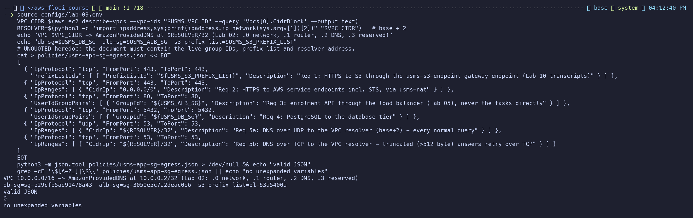
*Exercise figure 1: resolver computed from the VPC CIDR, unquoted heredoc with live IDs, valid JSON, no unexpanded variables.*

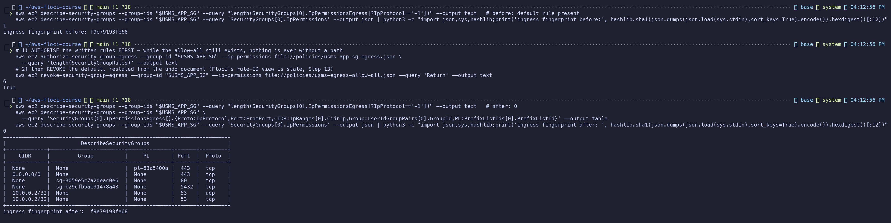
*Exercise figure 2: one allow-all before; authorise six rules, then revoke the default; zero allow-all after; ingress fingerprint identical.*

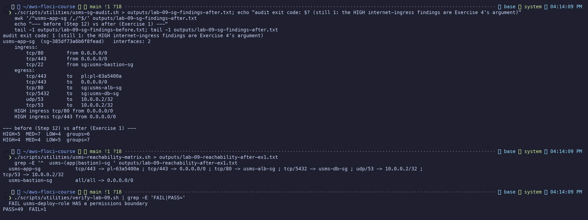
*Exercise figure 3: the audit's usms-app-sg block (written egress, no default finding), before and after totals, the matrix line, and verify unchanged.*

---

## Exercise 2 - Intermediate: the break-glass role, and the findings this lab left open

### Part A - `usms-breakglass-role`

| Requirement | How |
|---|---|
| 1. only `usms-admin-01` | `Principal: {"AWS": "arn:aws:iam::000000000000:user/usms-admin-01"}` |
| 2. MFA | `"Bool": {"aws:MultiFactorAuthPresent": "true"}` |
| 3. ExternalId | `"StringEquals": {"sts:ExternalId": "usms-breakglass-suspend-scaling"}` |
| 4. shortest maximum session | `--max-session-duration 3600`; IAM rejects 900 (*"valid min value: 3600"*, shown) |
| 5. permissions boundary | `USMSPermissionsBoundary` (already allows `application-autoscaling:*`, so it caps without starving) |
| 6. exactly Lab 06's suspend calls | `USMSBreakGlassSuspendScaling`: `RegisterScalableTarget` on **the scalable target's ARN** and `DescribeScalableTargets` (which has no resource-level support, hence `*`) |

There are no wildcard actions anywhere.

Lab 06 suspended scaling with `register-scalable-target ... --suspended-state ...` and read it back
with `describe-scalable-targets`. Those are the only two calls this role needs.

`simulate-principal-policy` shows `RegisterScalableTarget` and `DescribeScalableTargets` **allowed**,
and `DeleteScalingPolicy`, `ecs:UpdateService` and `iam:PassRole` **implicitDeny**.

**AND, not OR.** Both conditions sit in **one `Condition` block** under different operators (`Bool`,
`StringEquals`). IAM ANDs every operator in a block, and every key within an operator. Only values
listed for the *same* key are ORed. So assuming the role needs MFA **and** the ExternalId. That is
what makes it deliberate: a stolen session cookie with MFA still needs the incident word, and someone
who knows the word still needs the token.

**What `sts:ExternalId` buys in one account:**
- It is designed for cross-account confused-deputy protection. Here it is not a secret: it is
  committed in `policies/trust-breakglass.json`.
- It works as a **speed bump and an intent marker**. A script or a muscle-memory `assume-role` cannot
  use the role by accident.
- The ExternalId appears in the CloudTrail `AssumeRole` event, so every use is tagged as break-glass
  and can be alerted on.

Floci enforces neither MFA nor ExternalId. The conditions are stored as written (shown), and their
effect is reasoned from IAM's documented evaluation.

> **The ten-second policy:** two actions, one of them on one ARN, for at most an hour, only for one
> human with MFA who typed the incident word, and capped by a boundary.

### Part B - the unconditioned trust policies

| Role | Decision | Why |
|---|---|---|
| `usms-ecs-exec-role` | **Fixed** | Same principal as the task role (`ecs-tasks.amazonaws.com`), and ECS sends `aws:SourceAccount` and `aws:SourceArn`. Applied Step 7's `trust-ecs-tasks-scoped.json` |
| `usms-lambda-exec-role` | **Fixed** (recreated) | Missing since Lab 01's reset. Recreated with `policies/trust-lambda-scoped.json`: `aws:SourceAccount` plus `aws:SourceArn` `arn:aws:lambda:us-east-1:000000000000:function:usms-*`. Inline `usms-lambda-basic` from Lab 01's document |
| `usms-ec2-app-role` | **ACCEPTED** | EC2 delivers instance-profile credentials through IMDS and sends **no** `aws:SourceArn` or `aws:SourceAccount`, so a condition would deny every instance (the Step 7 caveat). Compensating controls: IMDSv2 required with hop limit 1 (Step 11), and only a holder of `iam:PassRole` **on this ARN** can attach it (`USMSDeployBase` doesn't name it, and denies PassRole to EC2 outright) |

The audit also showed **more than the three named roles**, and I dealt with them the same way:

| Role | Decision |
|---|---|
| `usms-developer-role` (`Principal "*"`) | **Fixed**: this account's root (`trust-account-developers.json`) |
| `usms-eks-cluster-role` | **Fixed**: `policies/trust-eks-cluster-scoped.json` with `aws:SourceAccount` and an `aws:SourceArn` of `cluster/usms-*`. `verify-lab-07.sh` still gives `PASS=30 FAIL=0`. On real AWS I would confirm EKS sends both keys with a test `create-cluster` before relying on it (Review Question 7) |
| `usms-eks-node-role` | **ACCEPTED**: same IMDS mechanism as ec2-app-role |
| `AWSServiceRoleForEcsApplicationAutoscaling` | **ACCEPTED**: service-linked, so AWS owns the trust policy and it cannot be edited |

**Accepted, read from a file, not hard-coded:** `configs/lab-09-accepted-findings.tsv` is committed.
Each line has the role, the finding text it matches, a review-by date and the reason. To stop it
becoming a suppression list, `usms-iam-audit.sh` enforces three rules:
- a line with **no reason** is **IGNORED** and the finding stays HIGH;
- a line **past its review-by date** is ignored;
- matches are **per role**.

Accepted findings print as `ACCEPTED (HIGH, review by 2027-05-06) ...` with the reason underneath.
The exit code is `1` for **any unaccepted HIGH**.

**Outcome:**
- Step 5: `HIGH=7 MED=19 roles=7`. Now: `HIGH=0 MED=27 ACCEPTED=3 roles=11`, **exit 0**. MED rose
  because there are four more roles, each without a stored boundary.
- With the reasons stripped from a copy of the file, the same audit reports three `IGNORED - no reason
  given` lines, `HIGH=3`, **exit 1**.

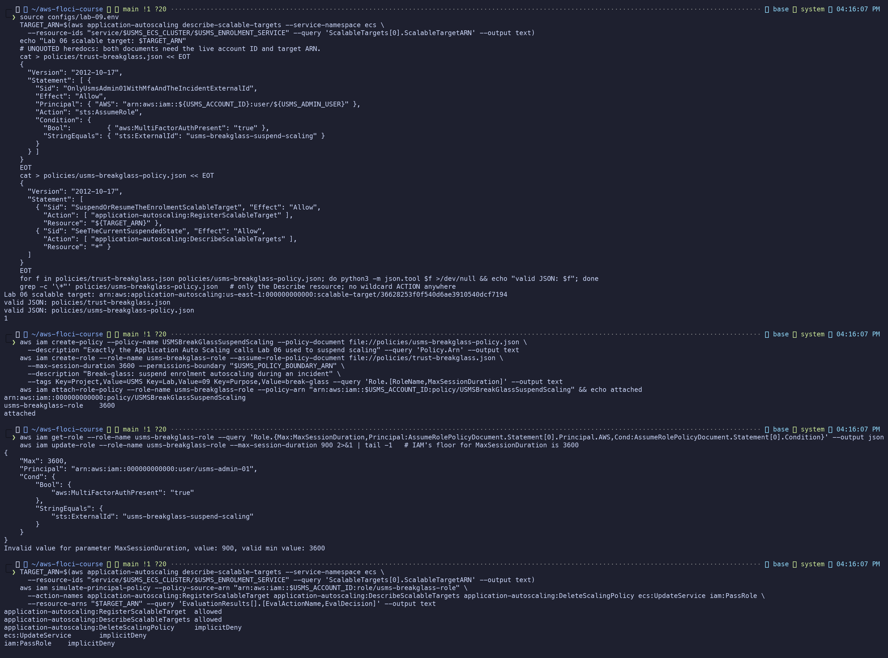
*Exercise figure 4: both documents, the policy and role, conditions read back, IAM refusing a 900 s maximum, and the simulator allowing exactly two actions.*

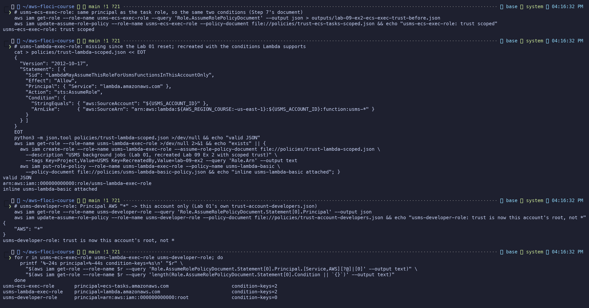
*Exercise figure 5: ecs-exec scoped, lambda-exec recreated with a scoped trust, developer-role narrowed from `*` to the account.*

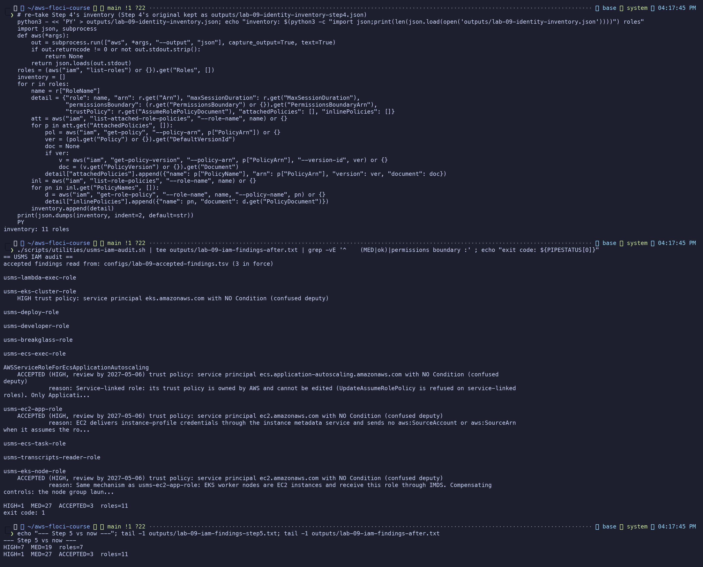
*Exercise figure 6: inventory re-taken (11 roles); three findings reported as ACCEPTED with their reasons; one unaccepted HIGH left (eks-cluster-role), exit 1.*

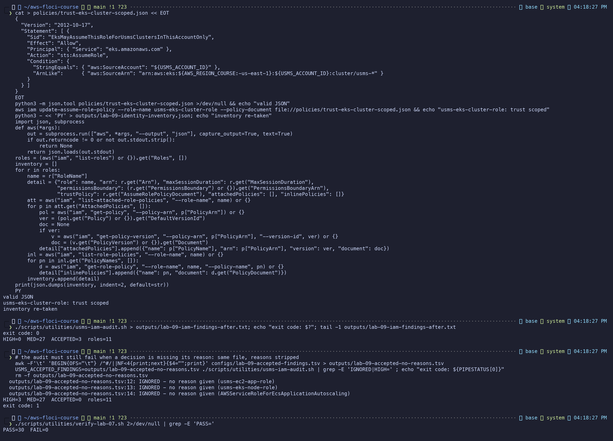
*Exercise figure 7: eks-cluster-role scoped, audit HIGH=0 exit 0; reasons stripped gives IGNORED x3, HIGH=3, exit 1; Lab 07 still verified.*

---

## Exercise 3 - Problem solving: the exposure report

**Script:** `scripts/utilities/usms-exposure-report.sh`. It resolves `configs/` from
`${BASH_SOURCE[0]}`, takes no arguments, hard-codes no IDs, and writes `outputs/lab-09-exposure.json`.

**Verdict (from the route table, the public address and ingress rules only):**

| Verdict | Condition |
|---|---|
| `ISOLATED` | subnet has no `0.0.0.0/0 -> igw-` route, **or** no public address |
| `EXPOSED` | IGW route + public address + some ingress from `0.0.0.0/0` |
| `LIMITED` | IGW route + public address + internet ingress only from narrow CIDRs (e.g. a `/32`) |
| `UNKNOWN` | a group could not be read, so no verdict is safe |

Names and tags are read only by `label()`, never by `classify()`. Egress is never read, so Exercise 1
cannot move a verdict. The classifier contains no `IpPermissionsEgress` reference at all.

**Edge cases handled:**

| Case | How |
|---|---|
| A group not in the VPC cache | Fetched by ID. If that fails, `UNKNOWN` |
| No description | Label falls back: instance Name tag -> description -> interface type -> ENI ID |
| A subnet with no explicit association | The VPC's **main** route table, said in the reason |
| An ENI of a terminated or vanished instance | Classified normally and marked `[lingering ...]` |
| An interface `describe-network-interfaces` doesn't list | The NAT gateway's, on this build: added from `describe-nat-gateways` and marked as such |

**`set -uo pipefail` without `-e`, justified in the script:** it is a report. One failed describe
call must become one `UNKNOWN` line, not abort the run and hide every other interface. Each call's
result is checked explicitly instead.

**The defended verdict for a public interface with no ingress rule (the NAT row): `EXPOSED`.** Two of
the three controls (routing and addressing) are already absent. The only thing between it and the
internet is an empty rule list, and one `authorize-security-group-ingress`, the most common change in
this course, makes it reachable. For a NAT gateway there is not even a security group to change, so
the reason says so. I would rather a reader investigate a false alarm than miss a host one rule away
from exposure.

**Result:**
- `EXPOSED=3`: usms-web-01, usms-web-02 and the NAT.
- `ISOLATED=2`: usms-db-01 and -02, "no igw route on subnet (rtb-f85a612e, explicit)".
- **Identical output from `~` and from `labs/lab-09-security/`.**

The ALB and Fargate tasks have no ENIs on Floci, so they do not appear. On real AWS they would: the ALB
nodes `EXPOSED` (80 from `0.0.0.0/0`) and the enrolment tasks `ISOLATED`. That second verdict is the
point of Review Question 5: Step 17's matrix called `usms-enrolment-sg` a single point of control, and
this tool, modelling both axes, shows the tasks are not reachable at all.

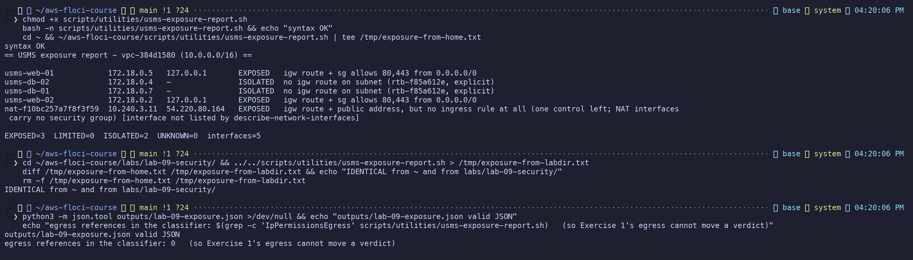
*Exercise figure 8: the report from `~`, the same output from the lab folder, the JSON valid, and no egress in the classifier.*

---

## Exercise 4 - Challenge: the security review

> **To:** Information Security Officer
> **From:** USMS platform engineering
> **Re:** Lab 09 security review, four questions
> **Date:** 6 November 2026
> **Environment:** the course's local emulator (Floci). Every control below is configured and
> recorded, but **no control is enforced by the emulator**. Costs are AWS list prices for us-east-1
> from the cited pricing pages; confirm them on the day before relying on them.

### 1. The second front door: the web server

**What it is.** `usms-web-01` sits in a public subnet with a public address. Its security group
(`usms-app-sg`) admits ports 80 and 443 from the whole internet. Lab 2 Step 14 wrote those rules when
the web server *was* the front door: there was no load balancer.

Lab 5 put a load balancer in front of the **enrolment service**, but nobody revisited the web server.
So the university now has two internet entry points, and only one of them was designed as one.

**What changed in this review.** We narrowed the web server's SSH from "anyone on the internet"
(`0.0.0.0/0`, wider than Lab 2 intended) to "the administrative jump-host group only". We also wrote
its outbound rules (Exercise 1). Its public web ports are **unchanged**.

**Should it still be reachable? No.** Reachable directly, the web server can be scanned and attacked
on its own operating system and web server software, bypassing everything the load balancer gives us:
- a single place to apply TLS
- an attachment point for a web application firewall
- health-checked failover
- one audited entry point

**What would have to change** (the full command sequence is at the end of this section):
1. Create a target group for the web tier and register the web server in it.
2. Add a listener rule on the existing load balancer (for example `/portal/*`, or a `portal.` host
   name) forwarding to that target group.
3. Allow the load balancer to reach the web server: add `usms-app-sg` ingress tcp/80 from
   `usms-alb-sg`, **and** `usms-alb-sg` egress tcp/80 to `usms-app-sg`. Step 14 limited the load
   balancer's egress to the enrolment tier, so this second rule is easy to forget, and forgetting it
   gives 502s.
4. Only when the target is healthy, remove 80 and 443 from `0.0.0.0/0` on `usms-app-sg`.
5. Later, move the instance to a private subnet so it has no public address at all.

**What would break:**
- Anyone using the web server's public address or DNS name directly: bookmarks, any partner
  integration, and monitoring checks pointed at it.
- During step 4, any request in flight to the old address.

None of the course's verification scripts assert those rules, so automation would not break.

**The other side, in two sentences.** The web server serves only static, public content and holds no
credentials to the transcripts that the load balancer path doesn't also reach, so the extra exposure is
patching risk, not data risk. Putting it behind the load balancer adds a hop, a target group and a
health check to maintain for a service that today has none of those failure modes.

### 2. What restricting outbound connections actually bought

| Attacker behaviour | Prevented? |
|---|---|
| A compromised database server **opening a reverse shell** or other raw-TCP command channel to the attacker (any port but 443) | **Prevented**: the data tier may now only open HTTPS (Step 15) |
| **Exfiltrating over DNS** (tunnelling data in queries to the attacker's own name server), from the database or enrolment tiers | **Prevented**: they have no DNS egress at all. The web tier may only query the VPC's own resolver (Exercise 1) |
| A compromised load balancer path or enrolment task **moving sideways** to other systems inside the network (SSH, database ports, other services) | **Prevented**: the load balancer may only reach the enrolment tier on port 80, and enrolment tasks may only open HTTPS (Steps 13-14) |
| **Uploading stolen data over HTTPS** to an attacker-controlled website | **Not prevented**: port 443 to anywhere is still open, and security groups match addresses, never names |
| **Using a stolen access key from outside**, from the attacker's own laptop | **Not prevented**: egress rules only govern our servers, not where our credentials are used |

**Stopping HTTPS upload** needs hostname-based filtering: **AWS Network Firewall** with a domain
allow-list (only `*.amazonaws.com` and named partners). The cost is about **$0.395 per endpoint-hour
plus $0.065 per GB** processed. Two AZs is roughly **$577 a month** before traffic.
([AWS Network Firewall pricing](https://aws.amazon.com/network-firewall/pricing/))

A cheaper partial measure: S3 **VPC endpoint policies** plus a bucket condition on `aws:SourceVpce`,
so transcripts can only be read through our own endpoint. Gateway endpoints are free.
([VPC pricing / gateway endpoints](https://aws.amazon.com/vpc/pricing/))

**Stopping stolen-key use** needs bucket and IAM conditions on `aws:SourceVpc` or `aws:SourceIp`.
Those are free, but they are policy work, not network work.

So what we bought is the removal of the **easy** channels (raw TCP, DNS, lateral movement), and with
them most commodity malware. It is **not** data-loss prevention. Any vendor who said "we restricted
egress" without a hostname filter sold you the same.

### 3. The transcripts: who can read, who can write, and how we know

The bucket does not exist yet (Lab 10 creates it), so today **nobody can read or write a transcript**.
The list below is who **will** be able to the moment it exists. It is derived from
`policies/usms-student-data-rw-policy.json`, `policies/usms-student-data-ro-policy.json` and
`outputs/lab-09-identity-inventory.json` (Exercise figure 9).

| Principal | How it gets access | Read | Write | Granting document |
|---|---|---|---|---|
| `usms-ecs-task-role` | Assumed by ECS for every enrolment task (trust now scoped to this account) | yes | **yes** (Put **and Delete**) | `USMSStudentDataReadWrite` |
| `usms-ec2-app-role` | Instance profile on `usms-web-01` (and anything launched with that profile) | yes | **yes** | `USMSStudentDataReadWrite` |
| `usms-eks-node-role` | Every EKS worker node, so **every pod on those nodes** | yes | **yes** | `USMSStudentDataReadWrite` |
| `usms-transcripts-reader-role` | Assumed by ECS tasks that use it | yes | **no** (explicit Deny on Put, Delete, DeleteBucket, PutBucketPolicy) | `USMSStudentDataReadOnly` |
| Any administrator (the account root, or anyone with `s3:*` or `AdministratorAccess`) | Account ownership | yes | yes | (implicit: root is not limited by identity policies) |
| `usms-deploy-role` (indirect) | Can start ECS tasks **as** `usms-ecs-task-role` or the reader role (`iam:PassRole` scoped to those ARNs) | yes, indirectly | yes, indirectly | `USMSDeployBase` |

Users `usms-dev-01`, `usms-admin-01` and `usms-audit-01` have **no policies** and there are **no
groups**, so none of them holds access directly.

**Recommendations:**
- **Remove** the node role's access (move it to a per-pod IRSA role; designed in Lab 08 Exercise 5).
- **Remove `s3:DeleteObject`** from all three read-write holders. Deletion of an academic record belongs
  to a separate, approved records process.

**How we know the list is complete:**
- On real AWS, `aws iam get-account-authorization-details` returns every user, group, role and policy
  in the account in one call. Combined with **IAM Access Analyzer**, which reads the bucket's own
  policy and reports any access from outside the account, that answers the question from both the
  identity side and the resource side.
- The course emulator does not implement `get-account-authorization-details` (Step 3's probe:
  "not available"), and Access Analyzer has no findings to give.
- **What we did instead:**
  - listed **every** role and fetched every attached and inline policy document into
    `outputs/lab-09-identity-inventory.json` (11 roles);
  - ran `list-entities-for-policy` on both transcripts policies;
  - listed every user's attached and inline policies, and the groups (none);
  - confirmed there is no bucket, so no bucket policy or ACL can add anyone.

  That is complete for **this** account today. It does not cover a future bucket policy, which is
  why Exercise 5 drafts one that denies everyone not on this list.

### 4. Knowing when any of this changes

Everything this review put in place is **preventive**: it stops things. None of it is **detective**:
it does not tell us when someone tries, or when a rule is changed. For that:

| Service | What it would tell us | Cost |
|---|---|---|
| **AWS CloudTrail** (management events trail) | Every API call: who changed a security group, attached a policy or assumed a role, from where | **First copy of management events free**; you pay for S3 storage of the logs ([CloudTrail pricing](https://aws.amazon.com/cloudtrail/pricing/)) |
| **Amazon EventBridge rules** on CloudTrail events | An alert within a minute of `AuthorizeSecurityGroupIngress`, `AttachRolePolicy`, `UpdateAssumeRolePolicy`, or `AssumeRole` on the break-glass role | **Free** for AWS service events on the default bus; the email or SNS notification costs cents ([EventBridge pricing](https://aws.amazon.com/eventbridge/pricing/)) |
| **AWS Config** with managed rules (e.g. `restricted-ssh`, `vpc-sg-open-only-to-authorized-ports`, `iam-policy-no-statements-with-admin-access`) | A continuous record of every configuration change, and a non-compliant flag when a rule like ours is undone | About **$0.003 per configuration item** recorded plus **$0.001 per rule evaluation** ([AWS Config pricing](https://aws.amazon.com/config/pricing/)) |
| **Amazon GuardDuty** | **Unusual** behaviour: credentials used from an unexpected country, an instance talking to a known command-and-control address, anomalous `AssumeRole` | **30-day free trial**, then priced by events analysed (typically tens of dollars a month for an account this size) ([GuardDuty pricing](https://aws.amazon.com/guardduty/pricing/)) |
| **IAM Access Analyzer** (external access) | Any resource, including the future transcripts bucket, that becomes reachable from outside the account | **Free** for external-access analyzers ([Access Analyzer pricing](https://aws.amazon.com/iam/access-analyzer/pricing/)) |

**What I would put in place first:** CloudTrail (free), EventBridge alerts on the five calls above
(free), and an external-access analyzer (free). That is no cost beyond log storage, and it covers
"someone changed it".

Then GuardDuty after its free trial, which covers "someone is using it". Then Config, which covers
"prove it stayed that way" for the audit committee.

**The morning after an incident, in order:**
1. **GuardDuty findings.** What it already noticed tells me where to look.
2. **CloudTrail for the break-glass role and any `AssumeRole`** in the window: who became what, from
   which IP, with or without MFA.
3. **CloudTrail for IAM and security-group changes** (`Attach*`, `Put*Policy`, `UpdateAssumeRolePolicy`,
   `Authorize*`, `Revoke*`) in the window, compared against this review's recorded state in git.
4. **S3 data events for the transcripts bucket** (`GetObject` volume per principal), if data events
   were enabled. **Recommendation:** enable them for this one bucket. They are paid per event, but this
   is the bucket that matters.
5. **VPC Flow Logs** for unexpected outbound volume on 443 from the data tier.

### The cut-over sequence (written, not run)

Assumes `configs/lab-05.env` (`USMS_ALB_ARN`, `USMS_ALB_LISTENER_ARN`), `configs/lab-02.env` and
`configs/lab-03.env` are sourced. Every identifier comes from the API.

```bash
# 1. Target group for the web tier (additive)
WEB_TG_ARN=$(aws elbv2 create-target-group --name usms-web-tg --protocol HTTP --port 80 \
  --vpc-id "$USMS_VPC_ID" --target-type instance --health-check-path / \
  --query 'TargetGroups[0].TargetGroupArn' --output text)

# 2. Register usms-web-01 (additive)
aws elbv2 register-targets --target-group-arn "$WEB_TG_ARN" --targets Id="$USMS_WEB_INSTANCE",Port=80

# 3. The load balancer must be ALLOWED to reach the web tier, both directions of the pair (additive)
aws ec2 authorize-security-group-egress  --group-id "$USMS_ALB_SG" \
  --ip-permissions "IpProtocol=tcp,FromPort=80,ToPort=80,UserIdGroupPairs=[{GroupId=$USMS_APP_SG,Description='ALB to web tier'}]"
aws ec2 authorize-security-group-ingress --group-id "$USMS_APP_SG" \
  --ip-permissions "IpProtocol=tcp,FromPort=80,ToPort=80,UserIdGroupPairs=[{GroupId=$USMS_ALB_SG,Description='Web tier from the ALB only'}]"

# 4. Listener rule: /portal/* -> web tier (additive; the default action still goes to enrolment)
aws elbv2 create-rule --listener-arn "$USMS_ALB_LISTENER_ARN" --priority 20 \
  --conditions Field=path-pattern,Values='/portal/*' \
  --actions Type=forward,TargetGroupArn="$WEB_TG_ARN"

# 5. Wait until healthy - do NOT continue past this line until it prints "healthy"
aws elbv2 wait target-in-service --target-group-arn "$WEB_TG_ARN" --targets Id="$USMS_WEB_INSTANCE" \
  && echo healthy
```

> **DANGER - step 6.**
> **What will be deleted:** `usms-app-sg` ingress tcp/80 from `0.0.0.0/0` (Lab 02 Step 14).
> **What depends on it:** anyone reaching `usms-web-01` by its public address on HTTP.
> **Reversible?** Yes: `authorize-security-group-ingress --protocol tcp --port 80 --cidr 0.0.0.0/0`.
> **Effect on later labs:** none. No verification script asserts this rule.

```bash
# 6.
aws ec2 revoke-security-group-ingress --group-id "$USMS_APP_SG" --protocol tcp --port 80 --cidr 0.0.0.0/0
```

> **DANGER - step 7.**
> **What will be deleted:** `usms-app-sg` ingress tcp/443 from `0.0.0.0/0`.
> **What depends on it:** HTTPS directly to `usms-web-01`. TLS should terminate at the ALB (ACM certificate) instead.
> **Reversible?** Yes: the same authorize with `--port 443`.
> **Effect on later labs:** none.

```bash
# 7.
aws ec2 revoke-security-group-ingress --group-id "$USMS_APP_SG" --protocol tcp --port 443 --cidr 0.0.0.0/0
```

> **DANGER - step 8 (later, in a maintenance window).**
> **What will be deleted:** `usms-web-01` itself, replaced by an instance in `usms-private-subnet-a` with no public address.
> **What depends on it:** its instance ID (`configs/lab-03.env`, `verify-lab-03.sh`), its EBS volume, and its public IP.
> **Reversible?** No: an instance's subnet cannot be changed. Take an AMI first, and keep the old instance stopped until the new one is healthy in `usms-web-tg`.
> **Effect on later labs:** `verify-lab-03.sh` must be re-pointed at the new instance ID.

```bash
# 8.
AMI=$(aws ec2 create-image --instance-id "$USMS_WEB_INSTANCE" --name usms-web-01-pre-move --query ImageId --output text)
aws ec2 wait image-available --image-ids "$AMI"
NEW=$(aws ec2 run-instances --image-id "$AMI" --instance-type t3.micro --subnet-id "$USMS_PRIVATE_SUBNET_A" \
  --security-group-ids "$USMS_APP_SG" --no-associate-public-ip-address \
  --iam-instance-profile Name=usms-ec2-app-profile \
  --metadata-options HttpTokens=required,HttpPutResponseHopLimit=1,HttpEndpoint=enabled \
  --tag-specifications 'ResourceType=instance,Tags=[{Key=Name,Value=usms-web-01}]' \
  --query 'Instances[0].InstanceId' --output text)
aws elbv2 register-targets   --target-group-arn "$WEB_TG_ARN" --targets Id="$NEW",Port=80
aws elbv2 wait target-in-service --target-group-arn "$WEB_TG_ARN" --targets Id="$NEW"
aws elbv2 deregister-targets --target-group-arn "$WEB_TG_ARN" --targets Id="$USMS_WEB_INSTANCE"
aws ec2 stop-instances --instance-ids "$USMS_WEB_INSTANCE"     # stop, not terminate, until signed off
```

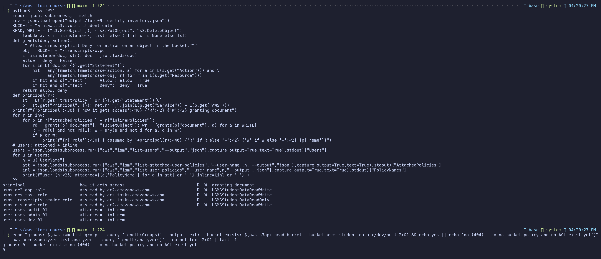
*Exercise figure 9: the access list computed from the inventory (Allow minus Deny per document), every user's policies, no groups, no bucket yet, so no resource policy.*

---

## Exercise 5 - Integration: the bucket policy the S3 configuration lab will apply

**Script:** `scripts/utilities/usms-bucket-policy-draft.sh`. It applies nothing, works without the
bucket, and touches no credentials.

1. **Bucket name from a document, never typed.** It reads `USMSStudentDataReadWrite`'s default version
   and takes the `arn:aws:s3:::` resource without `/`. It then uses the shell parameter expansion
   **`${BUCKET_ARN##*:::}`**: `##` deletes the *longest* prefix matching `*:::`, which leaves the bare
   name with no extra process. The comment in the script says so.
   `grep -c usms-student-data` on the script gives **0**.
2. **Holders:** every customer policy whose document names the bucket (from the inventory), then
   `list-entities-for-policy` per policy, merged. That finds **2 policies and 4 roles**. The lab text
   expects three transcripts policies; this account has two (`USMSStudentDataReadWrite`,
   `USMSStudentDataReadOnly`), and the script reports what it finds rather than a fixed number.
3. **The draft** (`outputs/lab-09-bucket-policy-draft.json`, 6 statements):
   - **Allow** per set of holders, limited to the actions **they already have**, net of their own
     Denies. The read-write set gets bucket `ListBucket` and `GetBucketLocation`, and objects
     `GetObject`, `PutObject` and `DeleteObject`. The reader gets `ListBucket` and `GetObject` only,
     because its Deny removes `PutObject` and `DeleteObject`.
   - **Deny** `s3:*` for `Principal "*"` when `aws:SecureTransport` is `false`.
   - **Deny** `s3:*` for every principal except the four roles and the account root.

     I used `Principal "*"` with **`ArnNotEquals aws:PrincipalArn`**, not `NotPrincipal`. Requests are
     made by **assumed-role sessions** (`arn:aws:sts::...:assumed-role/<role>/<session>`), which a
     `NotPrincipal` list of role ARNs does not match, so it would deny the very roles it means to keep.
     `aws:PrincipalArn` resolves a session to its role.

     So the mechanical check is: Allow principals are all ARNs; the TLS Deny is `*`; the second Deny
     is `*` **narrowed by a condition whose every value is an ARN**.
4. **Checks:** valid JSON, every principal rule above, and the bucket ARN present **with and without
   `/*`**. Result: **MECHANICAL CHECKS PASS**.
5. **`outputs/lab-09-lab10-readiness.txt`**: the bucket name, whether it exists (no), both policy names
   with their role ARNs, the non-role holders (none), the principal count (4), and the sentence on what
   changes when Lab 10 runs `create-bucket`.
6. **`configs/lab-09.env`** now ends with `export USMS_BUCKET_POLICY_DRAFT=outputs/lab-09-bucket-policy-draft.json`.
   **Export count: 17** (16 + 1).

**This Deny vs `USMSStudentDataReadOnly`'s, in three sentences:**
1. `USMSStudentDataReadOnly`'s Deny is an **identity** policy: it stops only the principal it is
   attached to (`usms-transcripts-reader-role`) from writing, whatever else that role is granted.
2. The bucket policy's Deny is a **resource** policy: it stops **every** principal that is not on the
   list, including a role someone creates next year and wrongly grants `s3:*`, and every request not
   over TLS.
3. Only the bucket policy applies to a principal **in another account**. Our identity policies are
   never consulted for a foreign principal, but the bucket's own policy is evaluated on every request
   to it, from anywhere.

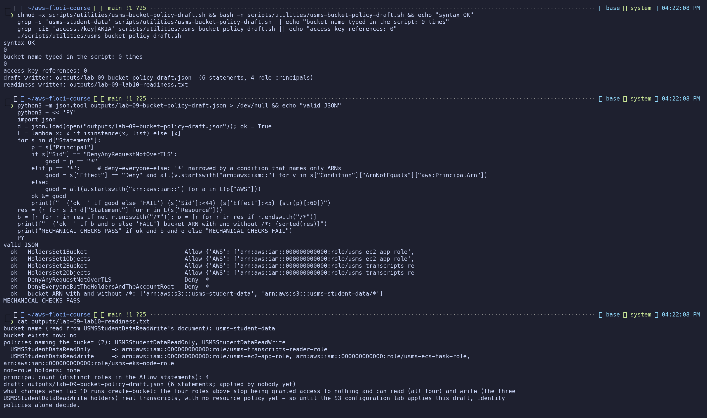
*Exercise figure 10: bucket name typed 0 times, no credential references, the draft written, mechanical checks passing, and the readiness file.*

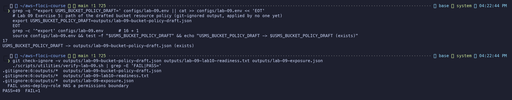
*Exercise figure 11: 17 exports, the draft path resolving, all three new outputs git-ignored, and verify unchanged.*
