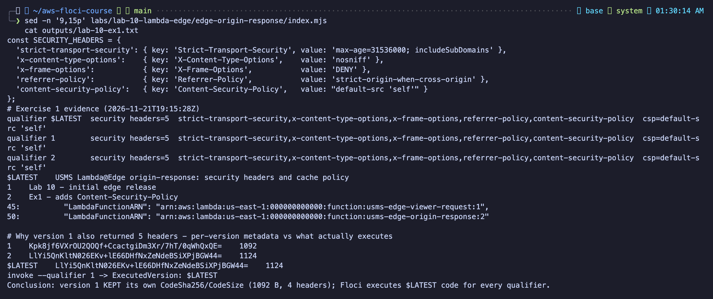
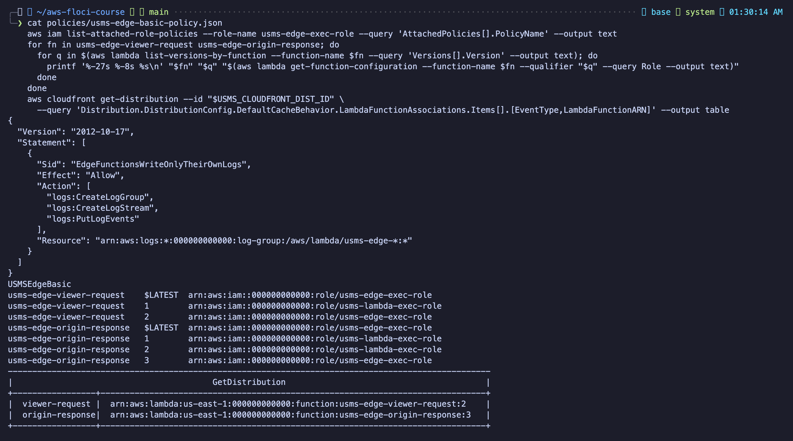
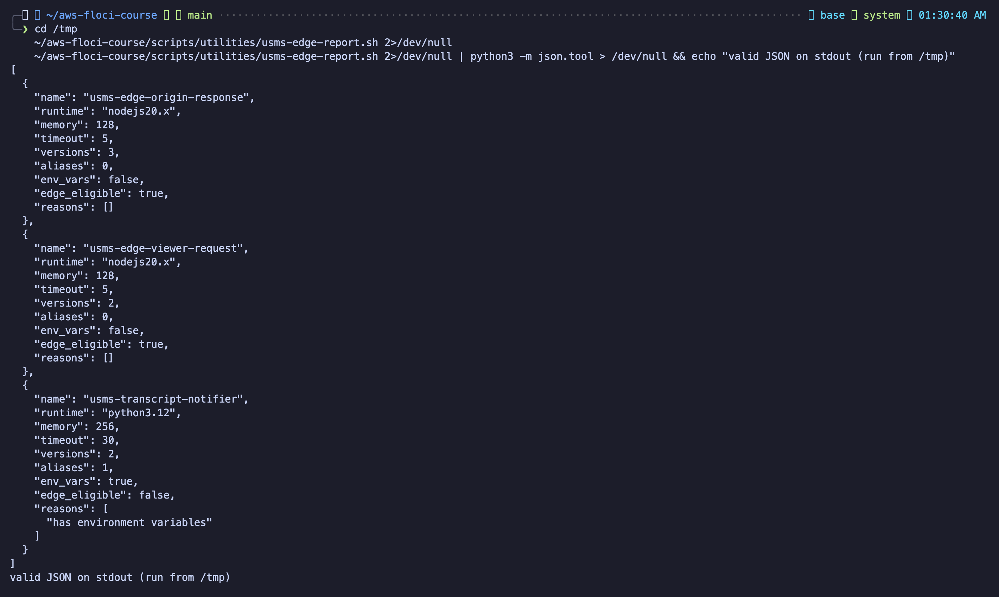
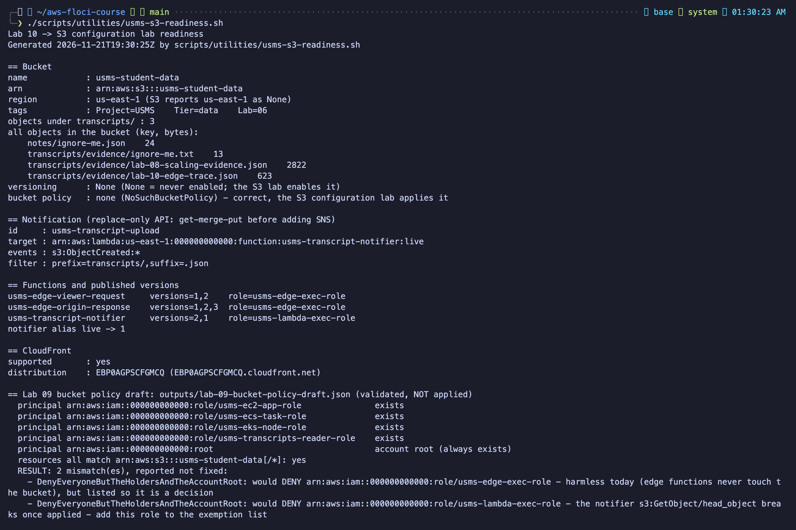
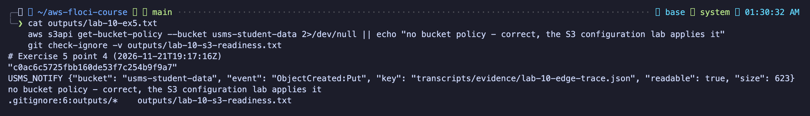

# Lab 10 - Independent Lab Exercises

Floci 2.1.0, support path **A** (CloudFront supported as a record). Every command below was run on
2026-11-22. Its captured output is in the `outputs/lab-10-ex*.txt` file named in each section
(git-ignored).

---

## Exercise 1 - Basic: extend the security header set

**Change:** one line added to the `SECURITY_HEADERS` object in
`labs/lab-10-lambda-edge/edge-origin-response/index.mjs`. No new code block.

```js
'content-security-policy':   { key: 'Content-Security-Policy',   value: "default-src 'self'" }
```

The value uses double quotes because it contains single quotes. The loop in step 1 of the handler
picks the new header up without any other change.

**Commands:**

```bash
( cd labs/lab-10-lambda-edge/edge-origin-response \
  && python3 -m zipfile -c "$PWD/../../../outputs/usms-edge-origin-response.zip" index.mjs )
aws lambda update-function-code --function-name usms-edge-origin-response \
  --zip-file fileb://outputs/usms-edge-origin-response.zip
aws lambda wait function-updated-v2 --function-name usms-edge-origin-response
aws lambda publish-version --function-name usms-edge-origin-response \
  --description "Ex1 - adds Content-Security-Policy"                     # -> 2
for q in '$LATEST' 1 2; do
  aws lambda invoke --function-name usms-edge-origin-response --qualifier "$q" \
    --payload fileb://templates/lab-10-origin-response-event.json out.json
done
```

**Output** (`outputs/lab-10-ex1.txt`):

```
qualifier $LATEST  security headers=5  ...,content-security-policy  csp=default-src 'self'
qualifier 1        security headers=5  ...,content-security-policy  csp=default-src 'self'
qualifier 2        security headers=5  ...,content-security-policy  csp=default-src 'self'

1        Kpk8jf6VXrOU2QOQf+CcactgiDm3Xr/7hT/0qWhQxQE=  1092
2        LlYi5QnKltN026EKv+lE66DHfNxZeNdeBSiXPjBGW44=  1124
$LATEST  LlYi5QnKltN026EKv+lE66DHfNxZeNdeBSiXPjBGW44=  1124
invoke --qualifier 1 -> ExecutedVersion: $LATEST
```

**Result against the expected outcome:**

| Expected | Observed |
|---|---|
| `$LATEST` returns five security headers | Yes |
| `--qualifier 1` returns four | **No, five.** Version 1 was *not* overwritten: its `CodeSha256` and `CodeSize` (1092 B, the 4-header file) differ from v2's. But Floci keeps one code location per function, runs `$LATEST` for every qualifier, and says so in `ExecutedVersion` |
| The distribution file names version 2 | Yes, `usms-edge-origin-response:2` (moved to `:3` in Exercise 2) |

On real AWS, `--qualifier 1` executes version 1's frozen archive and returns four headers. Floci keeps
versions immutable in metadata only. The publish step was still right: v1 was neither deleted nor
modified, which is what the constraint asked.


*Exercise figure ex1: the one-line SECURITY_HEADERS change and the per-version evidence: v1 keeps its own SHA, Floci executes $LATEST.*


---

## Exercise 2 - Intermediate: a dedicated edge execution role

**Policy** `policies/usms-edge-basic-policy.json` grants **only** log writes, scoped to the edge functions:

```json
"Action": ["logs:CreateLogGroup", "logs:CreateLogStream", "logs:PutLogEvents"],
"Resource": "arn:aws:logs:*:000000000000:log-group:/aws/lambda/usms-edge-*:*"
```

- **Region `*`:** Lambda@Edge writes its logs to the region nearest the viewer, under the name
  `/aws/lambda/us-east-1.<fn>`. Real AWS needs that region wildcard, and the name prefix may need
  widening to `/aws/lambda/us-east-1.usms-edge-*` too. Floci never runs edge code, so neither case
  can be tested here.
- **Trailing `:*`:** covers the log streams.

**Commands:**

```bash
aws iam create-policy --policy-name USMSEdgeBasic --policy-document file://policies/usms-edge-basic-policy.json
aws iam create-role --role-name usms-edge-exec-role \
  --assume-role-policy-document file://policies/trust-lambda-edge.json      # reused as-is
aws iam attach-role-policy --role-name usms-edge-exec-role \
  --policy-arn arn:aws:iam::000000000000:policy/USMSEdgeBasic
for fn in usms-edge-viewer-request usms-edge-origin-response; do
  aws lambda update-function-configuration --function-name $fn \
    --role arn:aws:iam::000000000000:role/usms-edge-exec-role
  aws lambda wait function-updated-v2 --function-name $fn
  aws lambda publish-version --function-name $fn --description "Ex2 - dedicated usms-edge-exec-role"
done
```

**Output** (`outputs/lab-10-ex2.txt`):

```
usms-edge-viewer-request published version 2
  1        arn:aws:iam::000000000000:role/usms-lambda-exec-role
  2        arn:aws:iam::000000000000:role/usms-edge-exec-role
  $LATEST  arn:aws:iam::000000000000:role/usms-edge-exec-role
usms-edge-origin-response published version 3
  1        arn:aws:iam::000000000000:role/usms-lambda-exec-role
  3        arn:aws:iam::000000000000:role/usms-edge-exec-role
usms-lambda-exec-role still carries: USMSLambdaBasic
notifier role: arn:aws:iam::000000000000:role/usms-lambda-exec-role
```

`usms-lambda-exec-role` was not modified, and the notifier still uses it. The distribution template
and the live distribution were updated to `viewer-request:2` and `origin-response:3`.

**What happened to version 1's role.** A published version freezes *configuration* as well as code,
and the execution role is configuration. Version 1 was snapshotted while the function pointed at
`usms-lambda-exec-role`, and it keeps that role for as long as it exists. `update-function-configuration`
only changed `$LATEST`, and only the next `publish-version` carried the new role into an immutable
version.

The consequence is easy to miss: **rolling back to an old version also rolls back its role.** If the
distribution were pointed back at `:1`, the edge functions would run again with
`usms-lambda-exec-role`, which can `s3:GetObject` every transcript. That is exactly the privilege this
exercise removed. Least privilege for a versioned function only holds if old versions are retired, or
their roles are tightened too.


*Exercise figure ex2: USMSEdgeBasic, the role per version (v1 on the old role), and the distribution on :2/:3.*


---

## Exercise 3 - Problem solving: an edge-readiness report

`scripts/utilities/usms-edge-report.sh`:

- **No hard-coded list:** one `list-functions` call filtered with `starts_with(FunctionName, 'usms-')`.
- **Versions and aliases:** these aren't in `list-functions`, so the script makes one call each per
  function.
- **JSON built in Python** from files in a `mktemp -d` directory, cleaned up by a `trap`.
- **Missing keys handled:** `(f.get('Environment') or {}).get('Variables')` means a function with no
  `Environment` key cannot trip `set -u`, and an image-based function with no `Runtime` is handled too.
- **Caps:** 128 MB / 5 s if the name contains `viewer`, otherwise 10240 MB / 30 s.
- **Extra field:** I added `reasons`, so `false` is explained.
- **Output channels:** stdout is JSON only; progress messages go to stderr.

**Run from `/tmp`** (`outputs/lab-10-edge-report.json`, validated with `json.tool`):

```json
[
  { "name": "usms-edge-origin-response", "runtime": "nodejs20.x", "memory": 128, "timeout": 5,
    "versions": 3, "aliases": 0, "env_vars": false, "edge_eligible": true,  "reasons": [] },
  { "name": "usms-edge-viewer-request",  "runtime": "nodejs20.x", "memory": 128, "timeout": 5,
    "versions": 2, "aliases": 0, "env_vars": false, "edge_eligible": true,  "reasons": [] },
  { "name": "usms-transcript-notifier",  "runtime": "python3.12", "memory": 256, "timeout": 30,
    "versions": 2, "aliases": 1, "env_vars": true,  "edge_eligible": false,
    "reasons": ["has environment variables"] }
]
```

**On "two independent reasons".** Under the rules the exercise states, the notifier fails for only
**one**: environment variables. Its name does not contain `viewer`, so it is held to the origin caps,
and 256 MB / 30 s is within 10240 MB / 30 s. A second reason would appear only under a stricter rule,
for example:

- treating a function with no edge *association role* as viewer-bound (then 256 > 128 and 30 > 5), or
- counting its use of an **alias** as its reference, which the edge refuses.

I kept the rule as written and report what it gives, rather than add a reason to match the expected
text.


*Exercise figure ex3: the report run from /tmp: valid JSON, notifier not eligible (environment variables).*


---

## Exercise 4 - Challenge: design the transcript delivery policy

See [`notes/lab-10-edge-design.md`](../../notes/lab-10-edge-design.md).

---

## Exercise 5 - Integration: hand the S3 lab a bucket it can start from

**1-2. Draft located and validated, not fixed.** `outputs/lab-09-bucket-policy-draft.json` exists
(Lab 09 Exercise 5), so nothing was generated. The generator branch is in the script for the case
where it is missing.

`scripts/utilities/usms-s3-readiness.sh` checks:
- that every `Resource` is `arn:aws:s3:::usms-student-data` or `.../*`: **yes**,
- that every principal, including those in `aws:PrincipalArn` conditions, is an existing role or the
  account root: **all 5 exist**,
- and, beyond what was asked, whether a `Deny ... ArnNotEquals aws:PrincipalArn` statement would catch
  any role the Lab 10 functions run as.

It reported **2 mismatches**, left unfixed:

```
- DenyEveryoneButTheHoldersAndTheAccountRoot: would DENY .../usms-edge-exec-role
    - harmless today (edge functions never touch the bucket), but listed so it is a decision
- DenyEveryoneButTheHoldersAndTheAccountRoot: would DENY .../usms-lambda-exec-role
    - the notifier s3:GetObject/head_object breaks once applied - add this role to the exemption list
```

The draft was written in Lab 09, before the notifier existed. Applied as it stands, its explicit Deny
would beat `USMSLambdaBasic`'s Allow, and the notifier's `head_object` would fail on every upload.
That's a decision for the S3 configuration lab: exempt the role, or give the notifier a holder role.

**3. Not applied:**

```
$ aws s3api get-bucket-policy --bucket usms-student-data
An error occurred (NoSuchBucketPolicy) ... The bucket policy does not exist
```

**4. Allow trace uploaded and seen** (`outputs/lab-10-ex5.txt`):

```
aws s3api put-object --bucket usms-student-data \
  --key transcripts/evidence/lab-10-edge-trace.json --body outputs/lab-10-edge-trace.json
USMS_NOTIFY {"bucket": "usms-student-data", "event": "ObjectCreated:Put",
             "key": "transcripts/evidence/lab-10-edge-trace.json", "readable": true, "size": 623}
```

The first log search used `--filter-pattern '"lab-10-edge-trace"'` and returned nothing. Floci did not
match a quoted term containing hyphens, although real CloudWatch Logs would. Searching for
`USMS_NOTIFY` and grepping for the key found the line.

**5. Readiness file.** `outputs/lab-10-s3-readiness.txt` is produced by
`./scripts/utilities/usms-s3-readiness.sh`, which is re-runnable and read-only. It records:
- the bucket name, ARN, region and tags,
- 3 objects under `transcripts/` (4 in the bucket) and versioning never enabled,
- no bucket policy,
- the notification id, target ARN, events and filter,
- the three functions with their published versions and roles, and `live` → 1,
- CloudFront `yes` / `EBP0AGPSCFGMCQ`,
- the point 2 result.

```
$ git check-ignore -v outputs/lab-10-s3-readiness.txt
.gitignore:6:outputs/*	outputs/lab-10-s3-readiness.txt
```


*Exercise figure ex5a: the readiness file: bucket, notification, versions, CloudFront, and the draft's two reported mismatches.*


*Exercise figure ex5b: the trace upload seen by the notifier, NoSuchBucketPolicy, and the readiness file git-ignored.*

