# AWS Practical Laboratory Report: Lab 11 - Building a CI/CD Pipeline with CodePipeline and CodeBuild

## 1. Aim / Objective

To build the first half of a delivery pipeline for the USMS enrolment service, and prove each link
from the artifact rather than from a green status:

* create a **versioned** S3 artifact store and prove versioning by create, perturb, read back,
* write the enrolment service source tree and a `buildspec.yml`, and run it in CodeBuild and with a local runner,
* create scoped CodeBuild and CodePipeline service roles, including a **conditioned `iam:PassRole`**,
* build a two-stage pipeline (S3 Source → CodeBuild Build), prove what it consumed, and diagnose a deliberate failure.

**Support path: A** by the probe: CodeBuild, CodePipeline, ECR and CodeDeploy all answer on Floci
2.1.0. Running the lab showed three gaps, though. One of them (the pipeline never hands its source
to CodeBuild) means the **Source → Build link behaves like Path B**. Section 8 separates what was
observed from what was only recorded.

Run date: 2026-11-22 (UTC timestamps in evidence read 2026-11-21T19:4x-20:0x).

> **About the figures.** Every figure in `screenshots/lab-11/` is a command run **as the step ran**,
> rendered with its captured output in my terminal's prompt style. The git counts in the prompt are
> the real working-tree state at that moment. Four figures had one line of my capture tool's
> bookkeeping (saving a build ID) removed from the displayed command; nothing in any output was
> edited. Figure ex2 was re-captured as a read-back of the same build, because the first take
> printed a misleading last line (explained in exercises.md).

---

## 2. Introduction

| Idea | Where it shows up |
|---|---|
| **Every arrow between stages is a zip in S3** | `SourceOutput` and `BuildOutput` live in `usms-pipeline-artifacts`; nothing streams |
| **The pipeline does not build** | It calls `codebuild:StartBuild`; the build runs as `usms-codebuild-role` |
| **The buildspec is inside the source** | A build change is a reviewed, versioned source change |
| **`iam:PassRole` + `iam:PassedToService`** | The pipeline may hand exactly one role to exactly one service |
| **Create → perturb → read back** | Versioning proved by two versions; releases proved by the artifact's `build-metadata.json` |

---

## 3. Architecture (after this lab)

```
labs/lab-11-cicd/app ──usms-pack-source.sh──> s3://usms-pipeline-artifacts/source/usms-enrolment-src.zip
                                                (versioned: r3, r4, r5, broken, fixed, ...)
usms-enrolment-pipeline   (role usms-codepipeline-role: artifact store + StartBuild on ONE project
  │                        + PassRole usms-codebuild-role ONLY to codebuild.amazonaws.com)
  ├── Source  S3 action  ──> SourceOutput        observed: reads the exact new version id
  └── Build   CodeBuild  ──> BuildOutput         Floci: the build receives NO source (Section 5.10)
                usms-enrolment-build  (source CODEPIPELINE, image aws/codebuild/standard:7.0,
                                        role usms-codebuild-role: own logs + artifact bucket,
                                        explicit Deny on usms-student-data)

Exercises:  usms-results-build (S3 source)  ·  EventBridge rule usms-enrolment-source-changed
            -> usms-events-pipeline-role (StartPipelineExecution on one pipeline)
```

---

## 4. Pre-flight (Steps 1-3) - Checkpoint 1

- **Floci is up.** Docker shows the container as `unhealthy`. That's harmless: the compose
  healthcheck calls `curl`, which the image doesn't contain, while `/_floci/health` answers 200.
- **Storage check:** the repo's `floci-storage-check.sh` is the older three-section version, with no
  `PASS=16` line. All three sections pass (running, `hybrid`, data directory). Figure 1.
- **Environment:** all ten env files are sourced (`lab-09.env` is present). Cluster
  `usms-ecs-cluster`, service `usms-enrolment-svc`, container `enrolment-api`, the target group and
  the exec role all resolve.
- **Baseline:** Lab 04 **39/0**, Lab 05 **47/2**, Lab 10 **51/0**. Lab 05's two failures are the
  grace-period limitation documented in Lab 05 (Floci doesn't store `healthCheckGracePeriodSeconds`,
  so the env value is `None`). That's the baseline Lab 09 recorded too, so I continued past the
  lab's "stop" rule. Figure 2.
- **Probe:** **PATH A**. Unexpectedly, `codedeploy list-applications` also answers. Figure 3.

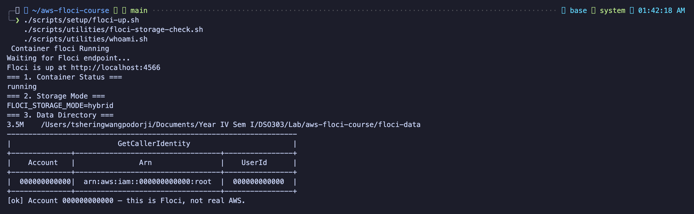
*Figure 1: Floci up, hybrid storage, account 000000000000.*

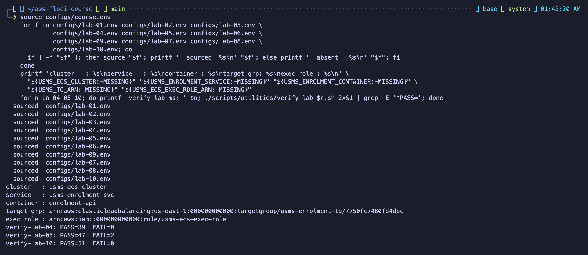
*Figure 2: every env file sourced, no MISSING, and the earlier labs' verification baseline.*

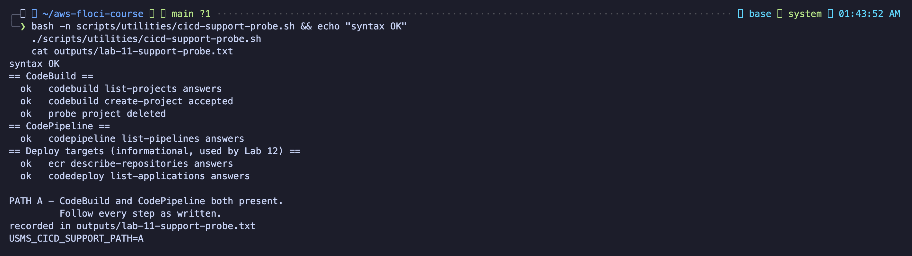
*Figure 3: the support probe - Path A; the probe project created and deleted.*

---

## 5. Procedure, Evidence and Observations

### 5.1 Artifact store and versioning (Steps 4-6) - Checkpoint 2

- `usms-pipeline-artifacts` was created in us-east-1, with no `LocationConstraint`. It's tagged
  `Project/Tier/Lab`, versioning is **Enabled**, and all four public-access blocks are `True`.
- **Proof:** two `put-object` calls to `probe/versioning.txt` gave **two versions**, sizes 7 (Latest)
  and 6. Both were then deleted by version ID, and the count read **0**.
- **Change from the lab text:** the probe file was written to `outputs/` (git-ignored) instead of
  `/tmp`, and removed afterwards.

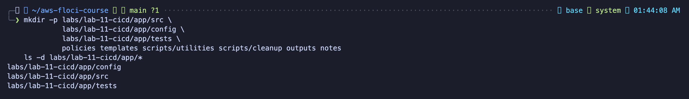
*Figure 4: the lab's directories.*

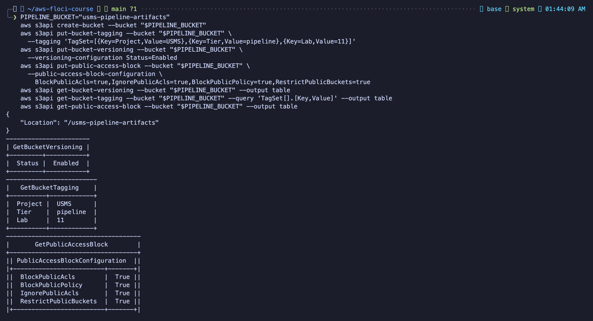
*Figure 5: the bucket - versioning Enabled, three tags, public access fully blocked.*

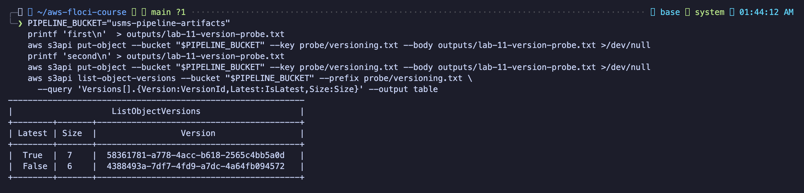
*Figure 6: two versions at one key - the behaviour, not the configuration.*

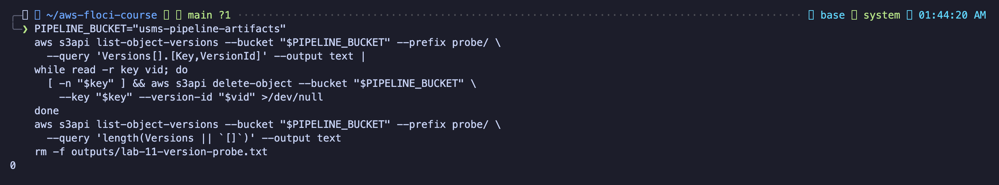
*Figure 7: the probe versions deleted; `length(Versions || [])` = 0.*

### 5.2 Source tree and buildspec (Steps 7-8) - Checkpoint 3

- **Source tree:** `VERSION` (r3), `src/index.html` with the `__RELEASE__` and `__BUILT_AT__`
  placeholders, `src/healthz.html`, `config/service.json` and `tests/smoke.sh` (7 assertions). All
  were written with quoted heredocs.
- **`buildspec.yml`:** version 0.2, four phases, `artifacts.base-directory: dist`.
- **Parse check:** PyYAML isn't installed on this machine, so the lab's parse check printed its skip
  message (figure 9). I checked the file separately with PyYAML in a throwaway scratch venv: it
  parses, and the nested `<< META` heredoc survives as one literal block.
- **"Your turn" (port check):** a second `- |` block in `pre_build` that fails unless `"port": 80,`
  is present, with a message that says what to fix and why. It was proved in Step 14 (figure 23).

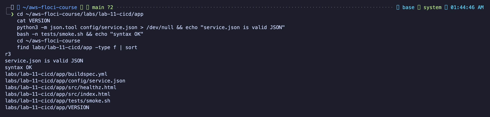
*Figure 8: VERSION r3, valid service.json, valid smoke.sh, the source files.*

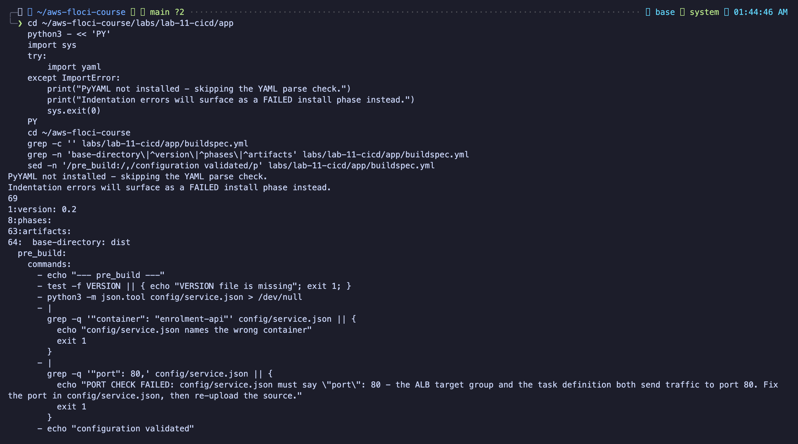
*Figure 9: one each of version / phases / artifacts / base-directory, and the pre_build phase with the port check.*

### 5.3 Build identity and project (Steps 9-10) - Checkpoint 4

- **Role:** `usms-codebuild-role` trusts `codebuild.amazonaws.com` with `aws:SourceAccount`. It
  carries exactly one policy, `USMSCodeBuildBase`:
  - log writes on the group and on its streams (`:*`),
  - get, put, ACL and location on the artifact bucket and its objects,
  - an **explicit Deny on `usms-student-data`**. Builds never need student records, and an explicit
    Deny survives any future Allow that's added by mistake.
- **Project:** `usms-enrolment-build` was created from a template with **0** unexpanded `$`, using
  source S3, `standard:7.0`, SMALL and a 15-minute timeout.

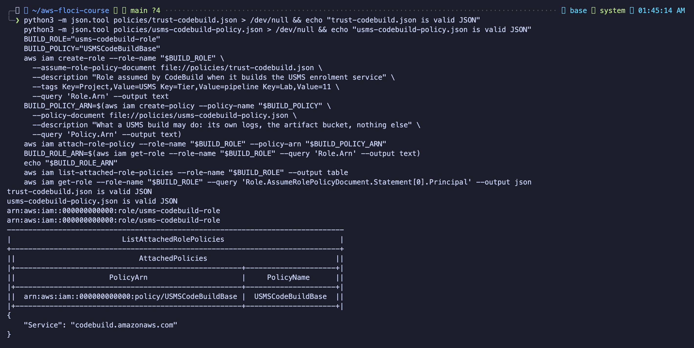
*Figure 10: the build role, its one policy, and the global codebuild.amazonaws.com principal.*

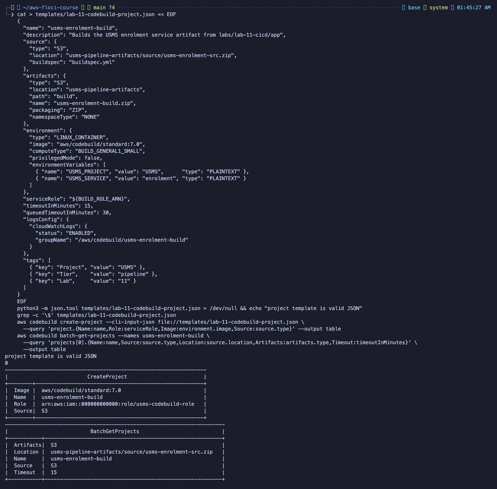
*Figure 11: the project template (0 unexpanded $) and the project read back.*

### 5.4 Packaging (Step 11)

`usms-pack-source.sh` zipped the directory's **contents**: 9 entries, `buildspec.yml` and `VERSION`
at the root, nothing under `app/`. The upload returned version `069a4344-…`, and `git check-ignore`
names `.gitignore:6:outputs/*`.

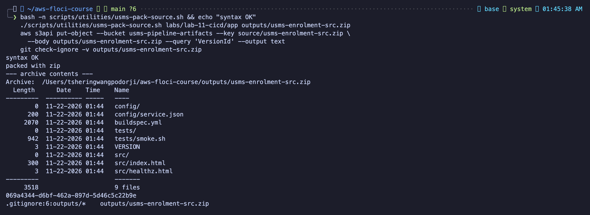
*Figure 12: the archive layout, the version ID, and the ignore rule.*

### 5.5 Running the build standalone - three Floci problems in a row (Steps 12-13) - Checkpoint 5

This step took the longest. Each problem looked like success or like a permissions error, and was
really something else.

| # | What happened | How I found it | What I did |
|---|---|---|---|
| 1 | Build 1 **FAULT** after DOWNLOAD_SOURCE | `contexts[0].message`: *pull access denied for aws/codebuild/standard* - the image is not on Docker Hub (the lab's Floci 2.0.1 known issue) | Tagged a small local **stand-in**, `python:3.12-slim` (bash, python3, GNU sed), as `aws/codebuild/standard:7.0`. The project keeps the lab's image name. Reversible with `docker rmi`; the cleanup script now does that |
| 2 | Builds 2-5 **SUCCEEDED** with every phase 0 s and **no artifact** | Floci's log shows the container started and stopped within 80 ms. `docker events` showed Floci copies the source in and runs **no** command at all | Inline `--buildspec-override` (build 6, then build 7 with our real buildspec) *did* run, and produced a correct artifact. So the buildspec is fine and the project field is the problem |
| 3 | Root cause of 2 | A throwaway project with **no** `buildspec` field ran all four phases from `./buildspec.yml` | **Floci reads `source.buildspec` as inline YAML.** `"buildspec.yml"` parses as a bare string, so no phases run and everything reports SUCCEEDED. I removed that one field from the template and the project. On real AWS that's identical, because `buildspec.yml` at the root is the default |

After the fix, **build 8** ran all eleven phases, and its artifact contains `build-metadata.json` with
`"release": "r3"` and `"buildId": "usms-enrolment-build:8"`. That ID isn't `local`, so CodeBuild built it.

More gaps, recorded rather than worked around:
- **Artifact location:** the artifact lands at the bucket root as `usms-enrolment-build-<n>.zip`;
  the project's `path: build` and `name` are ignored, so `build/` stays empty.
- **Logs:** the log stream exists but is empty (figure 18). The lab predicts this.
- **Source version:** `CODEBUILD_RESOLVED_SOURCE_VERSION` isn't set, so `sourceVersion` reads `local`.
- **Timings:** every phase reports 0 s.
- **Throwaway resources:** two probe projects were deleted at once. The test artifact
  `usms-enrolment-build-7.zip` is kept in the bucket as evidence.

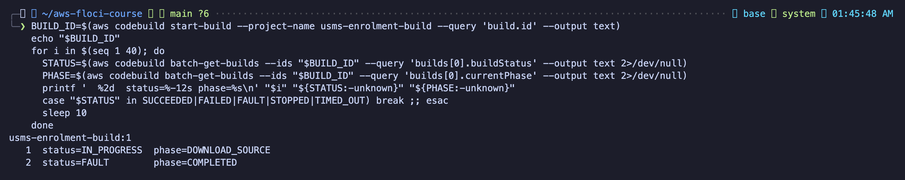
*Figure 13: build 1 - FAULT after one poll.*

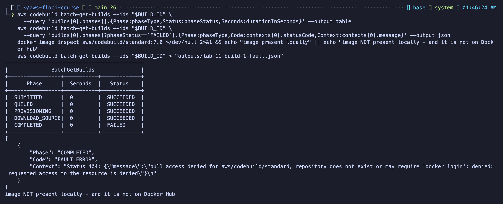
*Figure 14: the diagnosis - pull access denied for aws/codebuild/standard; the image is not present locally either.*

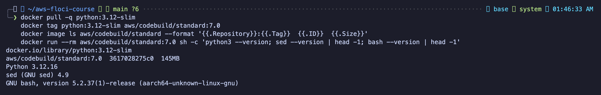
*Figure 15: the local stand-in tagged as aws/codebuild/standard:7.0, with python3, GNU sed and bash.*

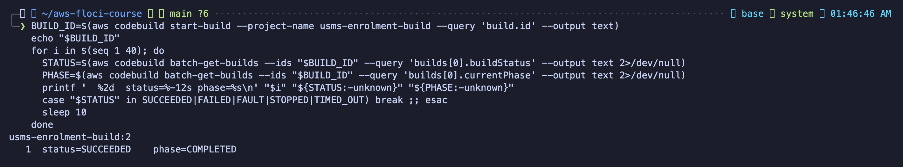
*Figure 16: build 2 "SUCCEEDED" - which turned out to mean nothing ran (row 2 above).*

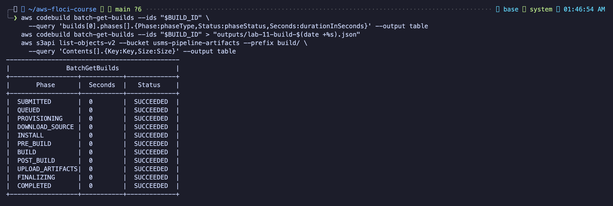
*Figure 17: eleven phases, all 0 s, and an empty build/ prefix - the clue that led to rows 2 and 3.*

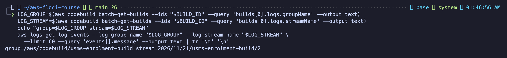
*Figure 18: the log group and stream exist; the stream is empty (Floci limitation).*

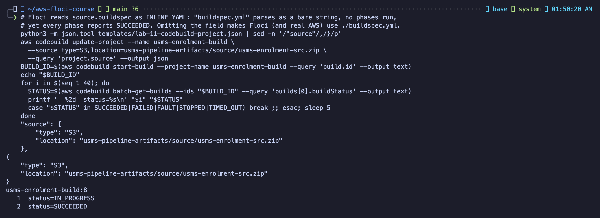
*Figure 19: the buildspec field removed from the template and the project; build 8 SUCCEEDED.*

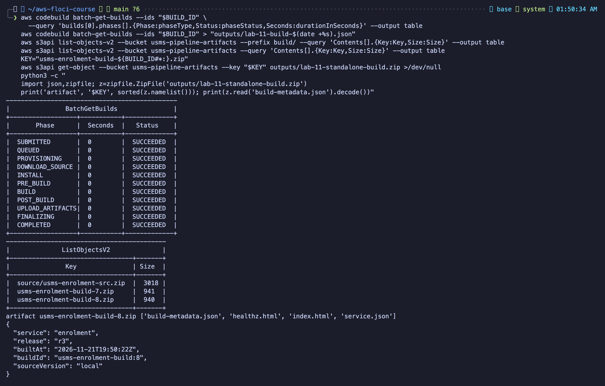
*Figure 20: build 8's phases, the bucket listing (artifact at the root, not build/), and the artifact naming release r3 and a CodeBuild build ID.*

### 5.6 The local runner (Step 14) - Checkpoint 6

- **Runner:** `usms-buildspec-run.sh` parsed the buildspec with the **built-in minimal parser**
  (no PyYAML), found 4 phases, generated valid bash and ran it on macOS ("BSD sed", Python 3.15.2).
- **Result:** 7/7 smoke tests, exit 0, `"buildId": "local"`, `release: r3` in `index.html`.
- **Ignore rule:** `labs/lab-11-cicd/app/dist/` was added to `.gitignore` (line 13), and
  `check-ignore` confirms it.
- **Step 8 "Your turn":** port 8080 stops the build in **pre_build** with the message *"PORT CHECK
  FAILED: config/service.json must say "port": 80 - the ALB target group and the task definition both
  send traffic to port 80…"*. Restoring 80 makes the build pass again.

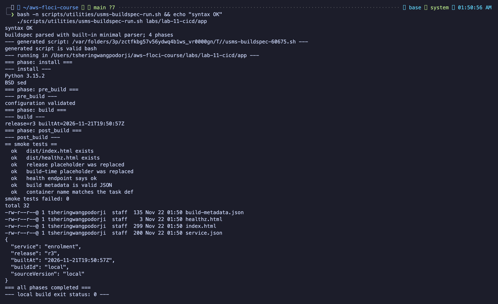
*Figure 21: the local build - four phases, seven ok, exit 0.*

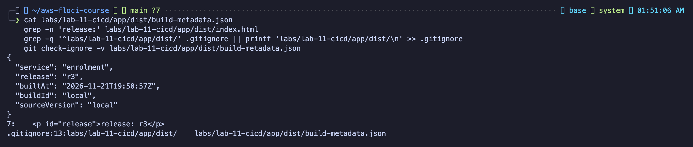
*Figure 22: build-metadata.json with buildId local; dist/ git-ignored.*

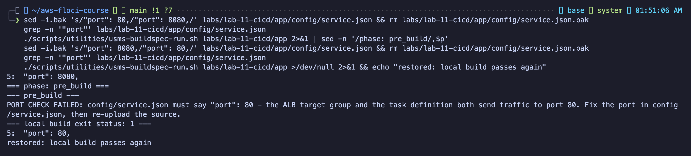
*Figure 23: Step 8 "Your turn" - port 8080 fails pre_build with an actionable message; restored.*

### 5.7 Pipeline identity (Step 15)

`usms-codepipeline-role` trusts `codepipeline.amazonaws.com` with `aws:SourceAccount`.
`USMSCodePipelineBase` (v1, attached to 1 role) grants:
- artifact-store access, including `s3:GetBucketVersioning`,
- `StartBuild`, `BatchGetBuilds` and `StopBuild` on **one** project ARN,
- `iam:PassRole` on **only** `usms-codebuild-role`, **only** to `codebuild.amazonaws.com`.

Figure 24 also prints Lab 09's `USMSDeployBase` for comparison: three named roles, `ecs-tasks` only,
and an explicit Deny on passing anything to EC2.

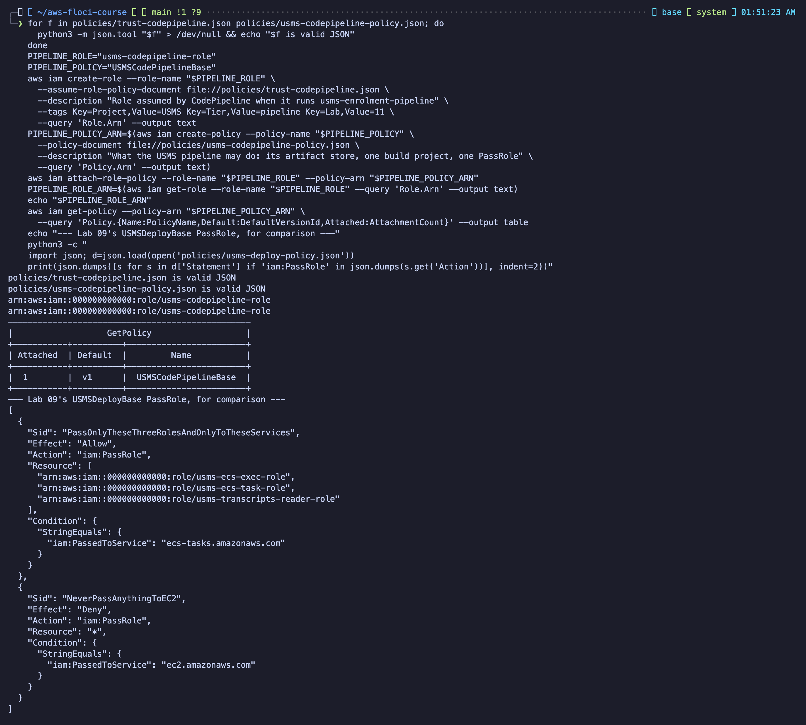
*Figure 24: the pipeline role and policy (Default v1, Attached 1), beside Lab 09's scoped PassRole.*

### 5.8 Pipeline (Steps 16-17) - Checkpoint 7

- **Template:** 0 unexpanded `$`; the role ARN was substituted.
- **`create-pipeline`:** returned 2 stages.
- **Floci difference:** creating the pipeline did **not** start an execution. The stage states read
  `None` and `list-pipeline-executions` is empty (the lab says creation starts one on real AWS).

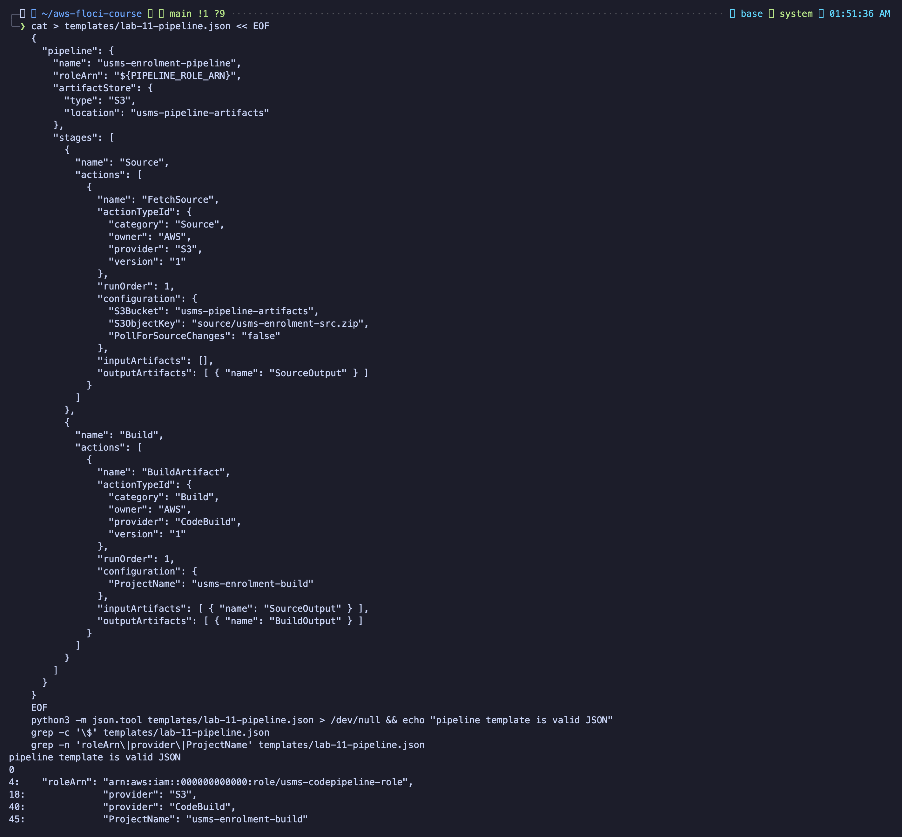
*Figure 25: the pipeline document - valid JSON, no unexpanded variables.*

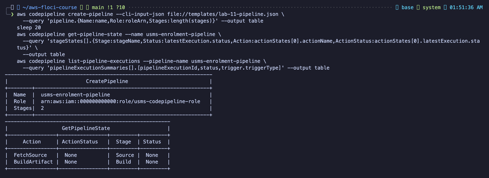
*Figure 26: the pipeline created with two stages; no automatic first execution on Floci.*

### 5.9 Handing the project to the pipeline (Step 18)

- **`update-project`** set source and artifacts to `CODEPIPELINE`. Because of the bug in 5.5 I
  omitted `buildspec=buildspec.yml`; on real AWS it means the same.
- **`start-build` was *accepted* (build 9).** Real AWS refuses it with `InvalidInputException`; on
  Floci the build ran and then FAILED for lack of source. That refusal is **recorded, not observed**.
- **The override escape hatch was *ignored*.** Build 10 kept source type `CODEPIPELINE` with no
  location, and FAILED.

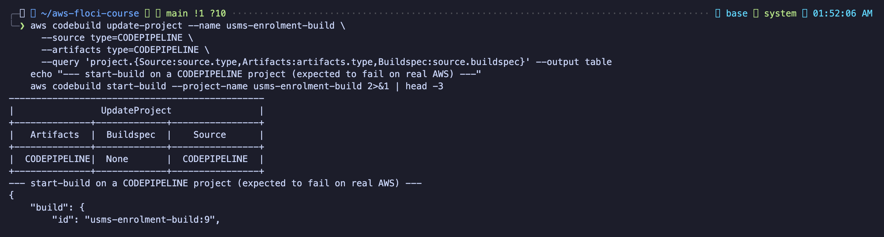
*Figure 27: the project converted to CODEPIPELINE; start-build still accepted by Floci.*

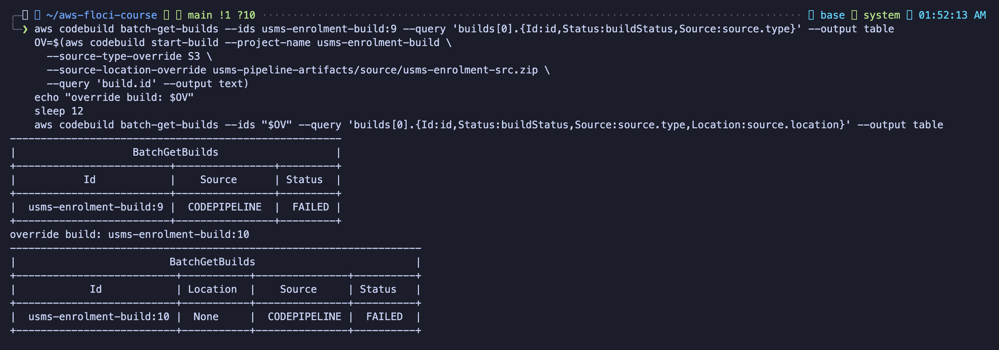
*Figure 28: build 9 FAILED; the S3 source override ignored (build 10 still CODEPIPELINE, FAILED).*

### 5.10 End to end, and what it proves (Step 19) - Checkpoint 8

- **Upload:** r4 was uploaded as version `f7783912-…`; the source key now has two versions.
- **Source stage — Succeeded, observed.** Its external execution ID **is** `f7783912-…`, the exact
  version just uploaded. On r5 (the "Your turn") the execution's `artifactRevisions[0].revisionId` is
  the r5 version `db95f5c2-…`.
- **Build stage — Failed.** Build 11: `DOWNLOAD_SOURCE` → *"No buildspec found in source or
  request"*.
- **Why it failed:** a throwaway pipeline whose project carried the buildspec **inline** got past
  that point, but then failed in `pre_build` with **"VERSION file is missing"**. That was our own
  check firing. Floci's pipeline never hands `SourceOutput` to CodeBuild: no zip is written under
  `usms-enrolment-pipeline/`, and the build container receives no files. The throwaway pipeline and
  project were deleted.
- **What I claim:** that the pipeline fetched the version I uploaded (**observed**), and that the r4
  build artifact was produced by the **local runner** (`release r4`, `buildId local`; figure 31). The
  lab sanctions that evidence for Path B.
- **What I don't claim:** that CodePipeline built r4.
- **"Your turn" counts:** **3 source versions** (r3, r4, r5) against **0 BuildOutput objects**. They
  aren't equal by design, because a source version is written by me and a BuildOutput by each
  *successful* Build action. Here every execution failed at Build, and an execution that fails, or
  is never started, adds no BuildOutput. On real AWS the counts would also differ: the automatic
  execution at creation adds one, executions can be superseded, and one upload can be built twice.

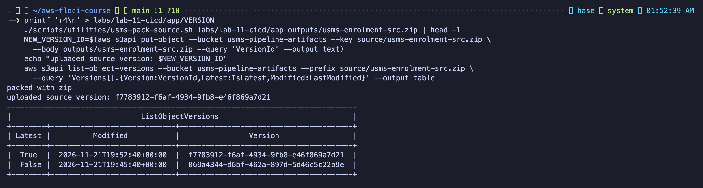
*Figure 29: r4 uploaded; two versions, one Latest.*

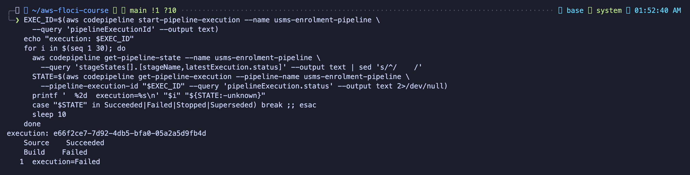
*Figure 30: the execution - Source Succeeded, Build Failed.*

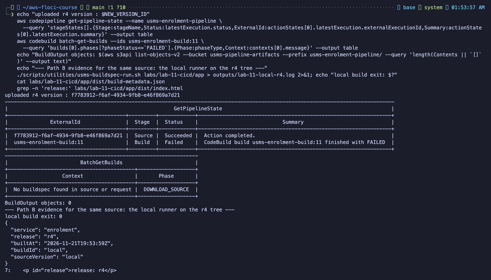
*Figure 31: the Source action's external ID equals the uploaded version; Build fails at DOWNLOAD_SOURCE; 0 BuildOutput; the local runner builds release r4.*

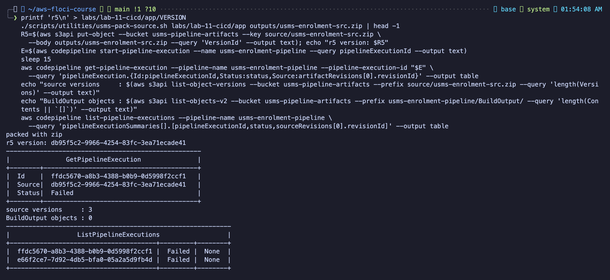
*Figure 32: Step 19 "Your turn" - r5's version recorded as the execution's source revision; 3 source versions, 0 BuildOutput.*

### 5.11 Deliberate failure (Step 20) - Checkpoint 9

- **Break:** the container was set to `enrolment-api-v2`, packed and uploaded. Execution `017fbb21`
  **Failed at Build**.
- **Diagnose (stage → build → phase → command):**
  - Stage = Build, and `list-builds-for-project` gives build 13.
  - Phase = DOWNLOAD_SOURCE on Floci, for the reason in 5.10. Floci never reaches `pre_build` from a
    pipeline, so the stage alone **cannot** distinguish this failure from any other.
  - Following the lab's fallback, the local runner names the command:
    `pre_build` → *"config/service.json names the wrong container"*, exit 1.
- **Fix:** the container was restored, the **local build passed again before repacking**, and the
  fix was uploaded. That execution, `768f214a`, also reads Failed on Floci, for the Floci reason.

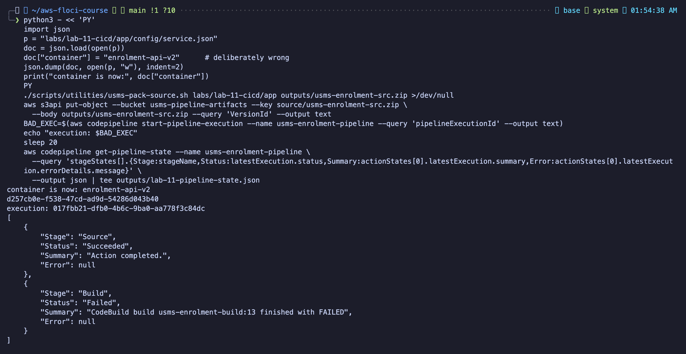
*Figure 33: the broken release uploaded; the pipeline fails at Build.*

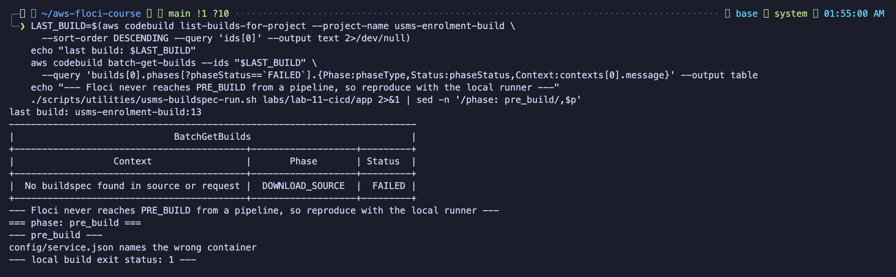
*Figure 34: build 13's failed phase, then the local runner naming the exact failing check.*

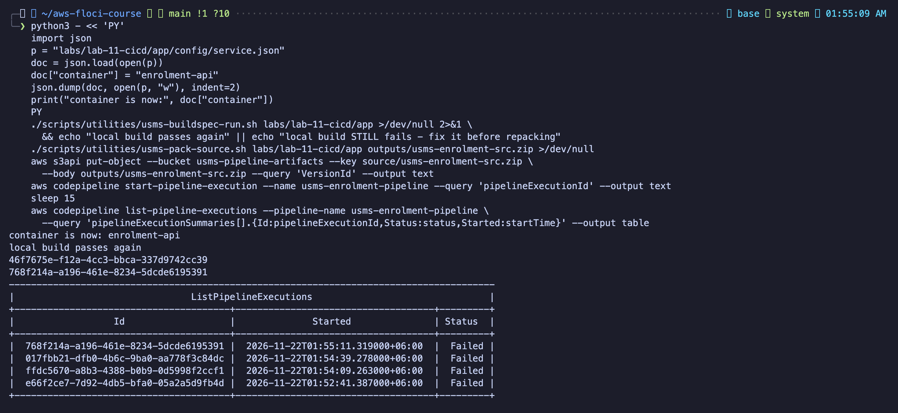
*Figure 35: fixed, validated locally, re-uploaded; four executions listed.*

### 5.12 Recording (Step 21) - Checkpoint 10

`configs/lab-11.env` has **26 exports** and `all values populated`: `versioning=Enabled`,
`stages=2`, `release=r5`, `path=A`.

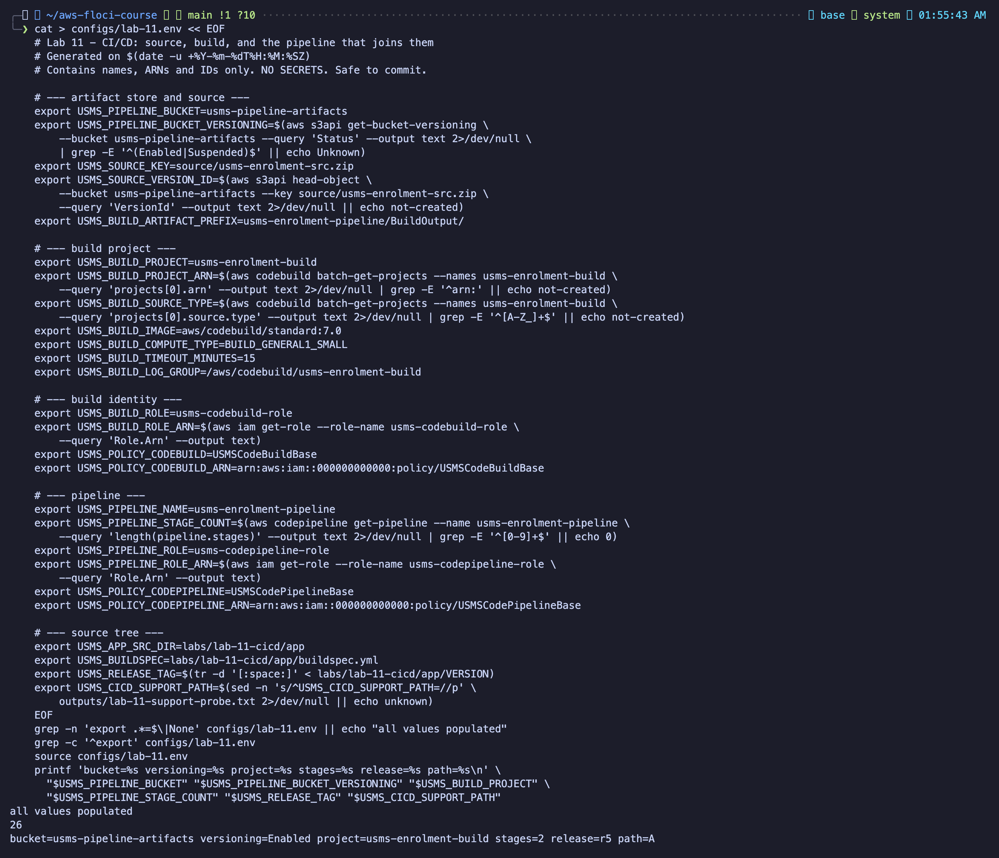
*Figure 36: lab-11.env - 26 exports, all populated.*

---

## 6. Verification (Section 8)

**`verify-lab-11.sh` → PASS=46 FAIL=0**, the Path A target.

The script checks existence and configuration. It doesn't check that a pipeline execution produced a
BuildOutput, so it passes even though the Source → Build handoff never succeeds on this build. The
evidence in 5.10 is what bounds the claim.

`lab-11-cleanup.sh` was written and syntax-checked, and **not run**. Its one addition removes the
local stand-in image.

Final cross-check (figures 39 and 40):
- Lab 04 is 39/0 and Lab 05 is 47/2, both unchanged.
- Lab 11 is 46/0.
- **Lab 10 read 50/1 once,** in the run right after the exercises' burst of CodeBuild activity. It
  read **51/0 on three re-runs**. I couldn't make it happen again to name the check, so I'm
  recording it as one transient failure rather than claiming 51/0 throughout.

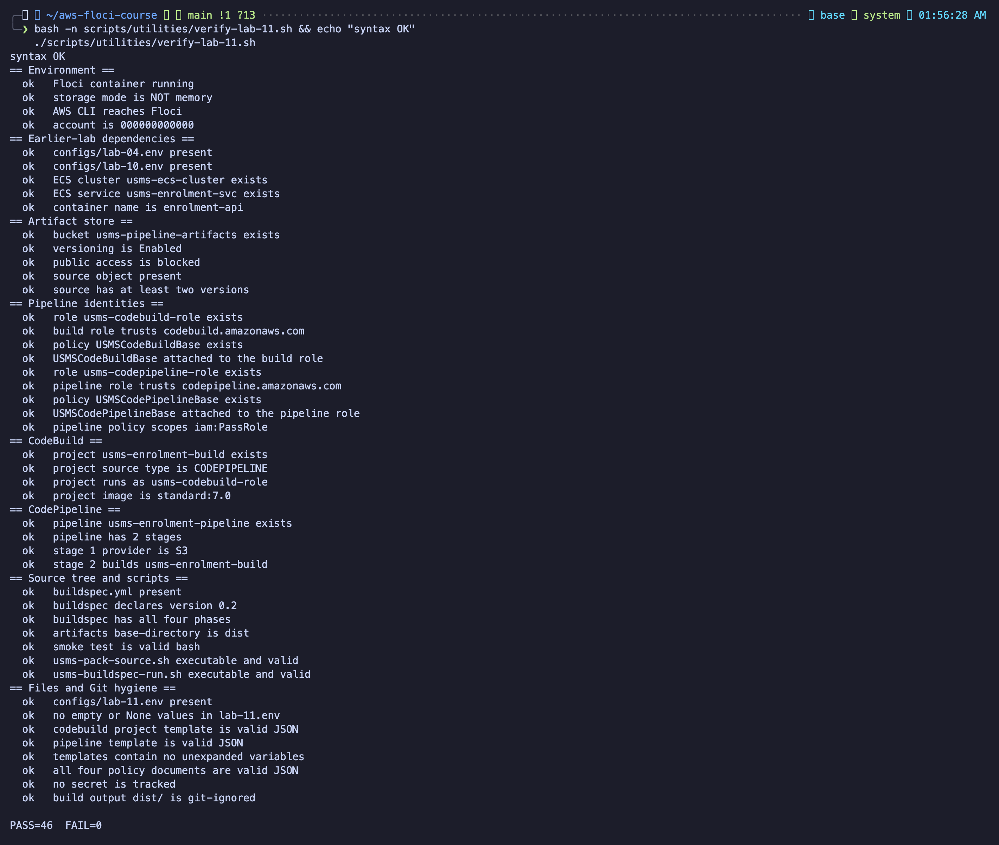
*Figure 37: verify-lab-11.sh - PASS=46 FAIL=0.*

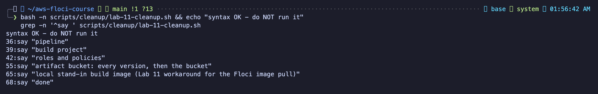
*Figure 38: the cleanup script, syntax-checked, not run.*

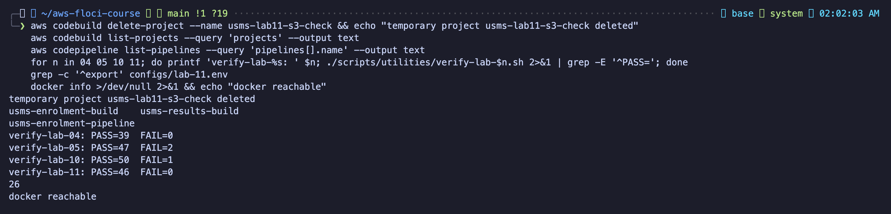
*Figure 39: after the exercises - temporary project deleted; Lab 10 at 50/1 on this run.*

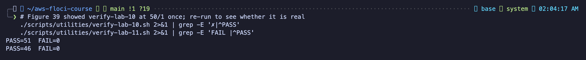
*Figure 40: the re-run - Lab 10 51/0, Lab 11 46/0.*

---

## 7. Results

| Item | Result |
|---|---|
| Artifact store | versioned (proved), public access blocked, 7 source versions by the end |
| Standalone CodeBuild | runs the real buildspec (build 8: release r3, CodeBuild build ID) after two workarounds |
| Local runner | 4 phases, 8 smoke tests (after Exercise 5), exit 0; fails the right phase on purpose |
| Pipeline Source stage | **observed** consuming the exact uploaded version every time |
| Pipeline Build stage | **fails on Floci**: no source handed to CodeBuild |
| Deliberate failure | diagnosed to the command via the local runner |
| `verify-lab-11.sh` | **46/0** |

---

## 8. Floci vs Real AWS (observed on this build)

| Feature | Floci 2.1.0 (observed) | Real AWS |
|---|---|---|
| `aws/codebuild/standard:7.0` | Pull denied, so FAULT. Works with a local stand-in tag | Managed, cached image |
| `source.buildspec: "buildspec.yml"` | **Read as inline YAML; nothing runs, all phases SUCCEEDED** | A path in the source |
| Artifact `path` / `name` | Ignored; `<project>-<n>.zip` at the bucket root | `build/usms-enrolment-build.zip` |
| Build logs / phase durations | Stream empty; every phase 0 s | Full log, real timings |
| `CODEBUILD_RESOLVED_SOURCE_VERSION` | Unset | The S3 version ID |
| `start-build` on a CODEPIPELINE project | Accepted, then FAILED | `InvalidInputException` |
| `--source-*-override` | Ignored | Honoured |
| Pipeline execution on create | None | Starts immediately |
| Pipeline Source action | **Works**; records the version ID | Same |
| SourceOutput → CodeBuild | **Never handed over**; Build fails at DOWNLOAD_SOURCE | The zip is the build's source |
| `finally` blocks | Accepted, **not run** (Exercise 2) | Run |
| S3 → EventBridge → CodePipeline | Rule, target and bucket setting stored; **no execution starts**; target `RoleArn` not stored | Starts the pipeline |
| IAM, trust conditions, PassRole | Stored, never evaluated | Enforced |
| CodeDeploy API | Answers | Answers |

**Observed:**
- versioning by behaviour,
- the zip layout,
- the buildspec's phases in CodeBuild (standalone),
- smoke tests passing and failing,
- an artifact naming its release and CodeBuild build ID,
- a `pre_build` failure (locally),
- the pipeline's Source action consuming exact versions,
- `imagedefinitions.json` at the artifact root (Exercise 5, standalone CodeBuild).

**Recorded only:**
- every role's scoping, the explicit Deny, the scoped `iam:PassRole` and the single project ARN,
- the CODEPIPELINE `start-build` refusal,
- the pipeline building a release end to end,
- `finally` inside CodeBuild,
- the EventBridge trigger.

**Not available:** build reports, approvals, KMS-encrypted artifacts, real cost and timing.

---

## 9. Independent Exercises (summary; full answers in [exercises.md](exercises.md))

| Exercise | Outcome |
|---|---|
| 1. Results project | `usms-results-build` (S3 source, same role). Builds 1 and 2 SUCCEEDED; the artifact's metadata says `results r1`, distinguishable from `enrolment r3` |
| 2. `finally` | Added to `post_build`; status captured without hiding the failure. On Floci the failed build uploaded an artifact **without** the summary, because Floci doesn't run `finally`. Under real CodeBuild ordering (a scratch harness) the summary reads `tests_exit=1` |
| 3. Robust check | A `python3` JSON parse replaced the grep. 4-space indentation passes; a wrong container fails naming both values. The trust policy gained `aws:SourceArn` for **both** projects sharing the role |
| 4. EventBridge | Rule (one key), target, dedicated role and bucket setting all created; an upload started **no** execution on Floci. CloudTrail-versus-S3-notification analysis in exercises.md |
| 5. Lab 12 contract | `imagedefinitions.json` from `service.json` + `${IMAGE_URI:-placeholder}`, an 8th smoke assertion, at the artifact root of a real Floci CodeBuild artifact; readiness file written by `usms-imagedefs-readiness.sh` |

---

## 10. Files Produced

| Kind | Files |
|---|---|
| Source | `labs/lab-11-cicd/app/` (`buildspec.yml`, `VERSION`, `src/`, `config/service.json`, `tests/smoke.sh`), `labs/lab-11-cicd/app-results/` (Ex 1) |
| Policies | `trust-codebuild.json` (+SourceArn, Ex 3), `usms-codebuild-policy.json`, `trust-codepipeline.json`, `usms-codepipeline-policy.json`, `trust-events.json` + `usms-events-start-pipeline-policy.json` (Ex 4) |
| Templates | `lab-11-codebuild-project.json`, `lab-11-pipeline.json`, `lab-11-results-project.json` (Ex 1), `lab-11-eventbridge-rule.json`, `lab-11-eventbridge-targets.json` (Ex 4) |
| Scripts | `cicd-support-probe.sh`, `usms-pack-source.sh`, `usms-buildspec-run.sh`, `verify-lab-11.sh`, `usms-imagedefs-readiness.sh` (Ex 5); `scripts/cleanup/lab-11-cleanup.sh` (not run) |
| Config | `configs/lab-11.env` (26 exports), `.gitignore` (+ `labs/lab-11-cicd/app/dist/`) |
| Evidence (git-ignored) | `outputs/lab-11-*` (support probe, build JSONs, pipeline state, local r4 log, ex artifacts, `lab-11-lab08b-readiness.txt`) |
| Write-up | this report, [exercises.md](exercises.md), `notes/lab-11-notes.md`, 50 figures in `screenshots/lab-11/` |

---

## 11. Conclusion

- **The ingredients work:** the artifact store, the identities, the buildspec and the source
  packaging. CodeBuild runs the buildspec and stamps its own build ID into the artifact.
- **The joint between them does not.** On Floci the pipeline's Build action gets no source.
- **The most instructive result** was that three "successes" were false:
  - a build that SUCCEEDED having run nothing,
  - a `start-build` that real AWS would refuse,
  - an EventBridge rule that is stored but never fires.

  Each was caught only by reading the artifact, the container events, or a count, not the status.
  That's exactly the habit the lab's create → perturb → read back rule exists to build.
- **For Lab 12:** the deploy contract (`imagedefinitions.json`) is proven at the artifact root. The
  missing piece is the one link Floci doesn't model, and it should be planned around now.
