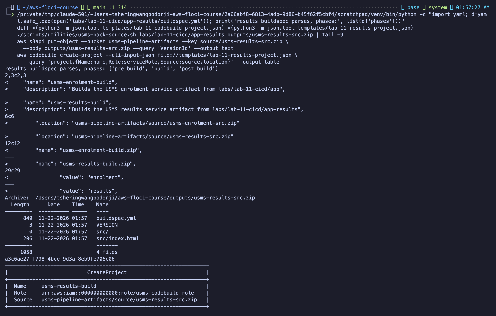
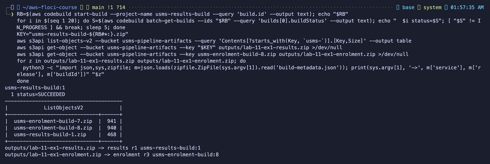
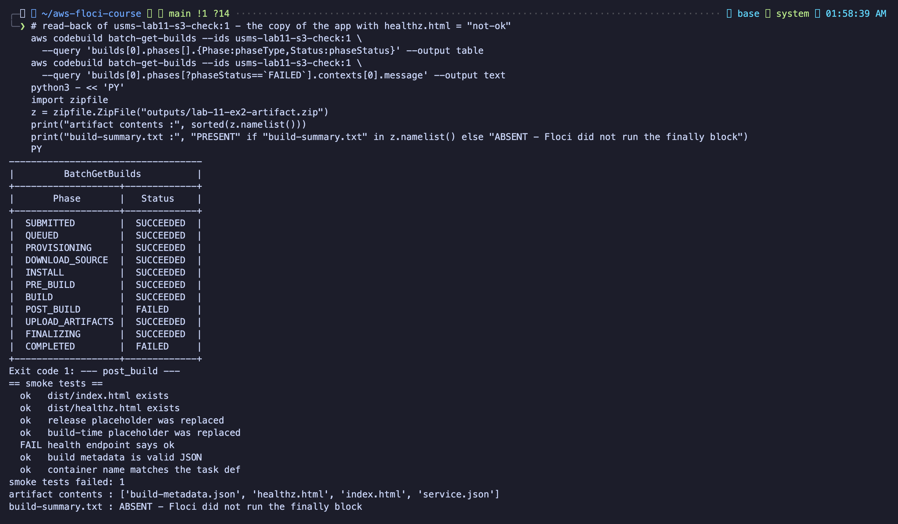
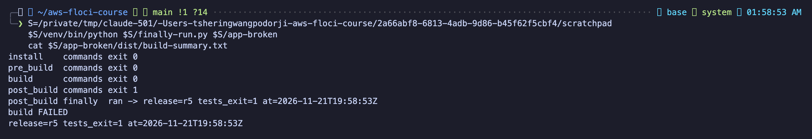
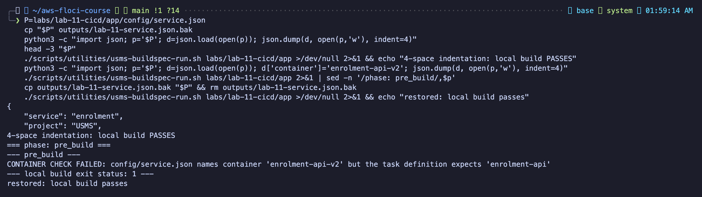
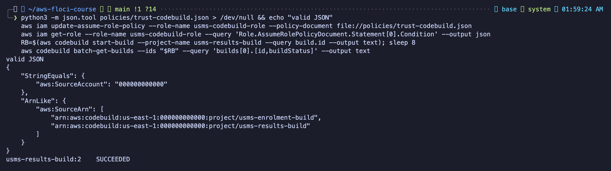
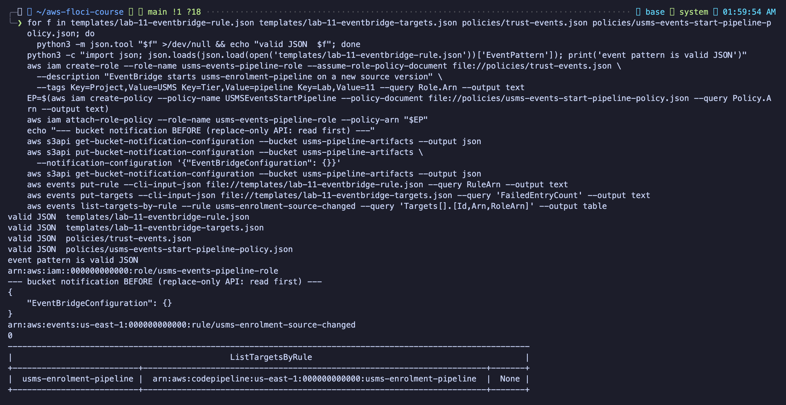
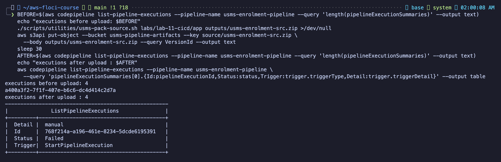
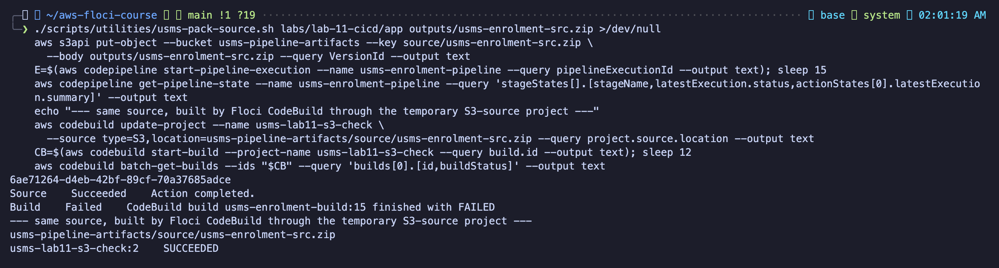
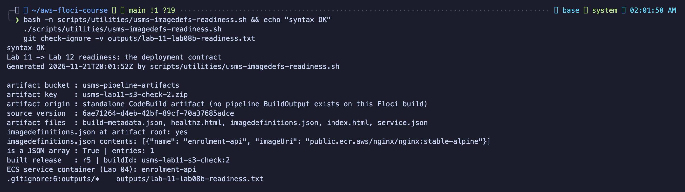

# Lab 11 - Independent Lab Exercises

Floci 2.1.0. The probe said Path A, but the pipeline → CodeBuild handoff behaves like Path B
(README §5.10). Every command was run on 2026-11-22, and each section names its figure in
`screenshots/lab-11/`.

Two temporary resources were used only for evidence and deleted afterwards:
- the CodeBuild project **`usms-lab11-s3-check`**, an S3-source copy of the enrolment project,
  because the real project is CODEPIPELINE and can't be run standalone;
- the object `checks/lab11-ex2-broken-src.zip`, which stays in the artifact bucket as evidence.

---

## Exercise 1 - Basic: a second build project for the results service

**Source tree:** `labs/lab-11-cicd/app-results/`. It holds `VERSION` (r1), one page
`src/index.html` with a `__RELEASE__` placeholder, and a `buildspec.yml`:
- `pre_build` checks `VERSION`,
- `build` substitutes the release and writes `build-metadata.json` with `"service": "results"`,
- `post_build` greps the substituted page,
- `base-directory: dist`.

**Project:** `templates/lab-11-results-project.json` is generated from the enrolment template, so it
also carries the Floci-safe source block with no `buildspec` field. The `diff` in figure ex1a shows
exactly the fields that change: `name`, `description`, `source.location`, `artifacts.name`, and the
`USMS_SERVICE` environment value. The source went to `source/usms-results-src.zip`, and the role is
`usms-codebuild-role`; no new role was made.

**Result** (figure ex1b): build `usms-results-build:1` SUCCEEDED. Reading back both artifacts:

```
outputs/lab-11-ex1-results.zip   -> results   r1 usms-results-build:1
outputs/lab-11-ex1-enrolment.zip -> enrolment r3 usms-enrolment-build:8
```

(Floci wrote it as `usms-results-build-1.zip` at the bucket root, not under `build/`. See README §5.5.)

**Does `USMSCodeBuildBase` already permit this build?** Partly. The S3 statement covers
`usms-pipeline-artifacts/*`, so the results source and artifact are covered. But the log statement
names only `/aws/codebuild/usms-enrolment-build`, so on real AWS the results build couldn't write
its logs to `/aws/codebuild/usms-results-build`. The fix is to add that log group's two ARNs, not
to widen to `/aws/codebuild/*`. Floci doesn't evaluate IAM, so the build succeeded anyway.


*Exercise figure 1a: the results buildspec parses; the template diff; the source zip; the project.*


*Exercise figure 1b: the standalone results build and the two artifacts told apart by build-metadata.json.*

---

## Exercise 2 - Intermediate: a `finally` block and a build report

**Change** (`post_build` in `labs/lab-11-cicd/app/buildspec.yml`):

```yaml
  post_build:
    commands:
      - echo "--- post_build ---"
      - |
        TEST_STATUS=0
        bash tests/smoke.sh || TEST_STATUS=$?
        echo "$TEST_STATUS" > "${TMPDIR:-/tmp}/usms-smoke-status"
        test "$TEST_STATUS" -eq 0
      - ls -l "$ARTIFACT_DIR"
      - cat "$ARTIFACT_DIR/build-metadata.json"
    finally:
      - |
        mkdir -p "$ARTIFACT_DIR"
        echo "release=... tests_exit=$(cat .../usms-smoke-status || echo not-run) at=..." > "$ARTIFACT_DIR/build-summary.txt"
```

**Design choices:**
- **The failure isn't swallowed.** The status is captured, then `test "$TEST_STATUS" -eq 0` still
  fails the phase. `finally` reports the result; it doesn't rescue the build.
- **The status file lives outside the source tree.** My first version wrote `.smoke-status` into the
  app directory, where the packer would have shipped it in the next source zip. I moved it to
  `${TMPDIR:-/tmp}`.

**Test on Floci CodeBuild** (figure ex2): a *copy* of the app with `healthz.html` = `not-ok`, built
by the temporary S3 project:
- POST_BUILD **FAILED**; its context shows the smoke run with `FAIL health endpoint says ok`.
- UPLOAD_ARTIFACTS still SUCCEEDED, and COMPLETED is FAILED.
- The artifact has **no `build-summary.txt`**. **Floci accepts a `finally` block but does not run
  it.**

**The first take of this figure was misleading.** My read-back command ended in
`... && python3 ... || echo "no artifact uploaded"`. The Python raised `KeyError` because
`build-summary.txt` was missing, so the `||` branch printed "no artifact uploaded" even though the
artifact *had* been uploaded. I replaced that figure with a clean read-back of the same build,
`usms-lab11-s3-check:1`; nothing was re-run.

**How I tested `finally` instead** (figure ex2b): neither Floci nor the Step 14 runner executes it.
The runner's minimal parser doesn't know `finally:` at all and folds those lines into `post_build`,
so locally they run only on success. So I used a small scratch harness, with PyYAML in a throwaway
venv, that follows CodeBuild's ordering: each phase's `commands` in one `bash -e` shell, then that
phase's `finally` regardless. On the broken copy:

```
post_build commands exit 1
post_build finally  ran -> release=r5 tests_exit=1 at=2026-11-21T19:58:53Z
build FAILED
```

**The claim this supports:** the `finally` commands are correct, and *under CodeBuild's documented
semantics* the failed build's artifact would carry `release=r5 tests_exit=1`. I have **not**
observed CodeBuild run them. That's recorded, not observed. On real AWS, a failed `post_build` still
proceeds to UPLOAD_ARTIFACTS, which is also what Floci did here.


*Exercise figure 2: the broken copy on Floci CodeBuild - POST_BUILD FAILED, artifact uploaded, build-summary.txt absent.*


*Exercise figure 2b: CodeBuild ordering in a scratch harness - finally runs after the failed commands and records tests_exit=1.*

---

## Exercise 3 - Problem solving: make the configuration check robust

**Change:** the `grep -q '"container": "enrolment-api"'` block in `pre_build` became a standard-library
parse:

```yaml
      - |
        python3 -c '
        import json, sys
        want = "enrolment-api"
        got = json.load(open("config/service.json")).get("container")
        if got != want:
            sys.exit("CONTAINER CHECK FAILED: config/service.json names container %r but the task definition expects %r" % (got, want))
        '
```

**Proof** (figure ex3a):
- `service.json` rewritten with **4-space** indentation → the local build **passes**.
- container `enrolment-api-v2` → `pre_build` fails with *"CONTAINER CHECK FAILED: config/service.json
  names container 'enrolment-api-v2' but the task definition expects 'enrolment-api'"*.
- The original file was restored, and it's byte-identical to before.

Two other checks still match text: Step 8's port check and smoke test 7. Neither breaks under
re-indentation. The port check would break if `port` became the last key (no trailing comma), so it's
the next candidate for the same treatment.

**Trust policy** (figure ex3b): `policies/trust-codebuild.json` now has `ArnLike aws:SourceArn`
naming **both** `project/usms-enrolment-build` and `project/usms-results-build`, beside
`aws:SourceAccount`. Exercise 1's project shares the role, so naming only the enrolment project would
have made the results build unable to assume its role on real AWS. A results build still SUCCEEDED
after `update-assume-role-policy`; on Floci that proves only that nothing *else* broke, because
conditions aren't evaluated.

**What `aws:SourceArn` closes that `aws:SourceAccount` alone doesn't:** see `notes/lab-11-notes.md`.
In short, `SourceAccount` stops another *account's* project from using the role. `SourceArn` stops
**any other project in this account** from using it: a test project, a developer's scratch project,
or a project created by someone who can `codebuild:CreateProject` but should never get this role's
artifact-bucket write access.


*Exercise figure 3a: indifferent to formatting, specific about errors.*


*Exercise figure 3b: the trust policy's two conditions; the results build still runs.*

---

## Exercise 4 - Challenge: trigger the pipeline without polling

**Documents** (all valid JSON):

| File | Content |
|---|---|
| `templates/lab-11-eventbridge-rule.json` | `source: aws.s3`, `detail-type: Object Created`, bucket `usms-pipeline-artifacts`, key **exactly** `source/usms-enrolment-src.zip` |
| `templates/lab-11-eventbridge-targets.json` | target = the pipeline ARN, `RoleArn` = `usms-events-pipeline-role` |
| `policies/trust-events.json` | `events.amazonaws.com`, with `SourceAccount` and `SourceArn` = this rule |
| `policies/usms-events-start-pipeline-policy.json` | `codepipeline:StartPipelineExecution` on **one** pipeline ARN |

**The two ways S3 object events reach EventBridge:**

1. **The bucket's own EventBridge notification** (`put-bucket-notification-configuration` with
   `{"EventBridgeConfiguration": {}}`). S3 then sends every object event to the default bus as
   `source aws.s3`, `detail-type "Object Created"`, with `detail.bucket.name` and `detail.object.key`.
   A `PutObject` on a versioned object produces this event, including the new `version-id`.
   **No CloudTrail is needed.** This is the design I built.
2. **CloudTrail data events.** A trail logging S3 data events for the bucket produces
   `detail-type "AWS API Call via CloudTrail"`, `eventSource s3.amazonaws.com`, `eventName PutObject`,
   with `requestParameters.bucketName` and `.key`. That's the older pattern in CodePipeline's docs. It
   costs per data event, is delivered with more latency, and works only if the trail exists and
   covers the bucket. Mixing the two up is the classic trap: a rule written for one never matches
   events from the other.

**Why the target needs its own role, not the pipeline's:** EventBridge is the caller of
`StartPipelineExecution`, so it needs a role *it* can assume (trusted by `events.amazonaws.com`) that
grants exactly that one action. The pipeline role is trusted only by `codepipeline.amazonaws.com`,
and it can read every artifact and pass the build role. Giving EventBridge that role would hand an
event bus everything the pipeline can do, when all it needs is "start".

**What I built** (figure ex4a):
- the role and policy;
- the bucket notification, **after reading the existing configuration first**, because the API is
  replace-only. It read back as `{}`, so nothing was overwritten;
- `put-rule`, and `put-targets` with `FailedEntryCount 0`.

`list-targets-by-rule` returned the target but **`RoleArn` as `None`**: Floci didn't store it.

**What ran and what didn't** (figure ex4b): there were 4 executions before an upload and **4 after
30 seconds**. The newest is still the manual one. Floci stores the rule, the target and the bucket
setting but **doesn't deliver S3 → EventBridge → CodePipeline**. Nothing about the trigger firing is
observed; only that the documents are valid and accepted. On real AWS I'd prove it the same way:
count executions before and after an upload, and read `trigger.triggerType` (`CloudWatchEvent`) on
the new one.


*Exercise figure 4a: the documents, the role, the bucket setting read before writing, the rule and the target.*


*Exercise figure 4b: an upload with no manual start - execution count unchanged.*

---

## Exercise 5 - Integration: prepare the deployment contract for Lab 12

**Build phase addition:**

```yaml
      - |
        IMAGE_URI="${IMAGE_URI:-public.ecr.aws/nginx/nginx:stable-alpine}" python3 -c '
        import json, os
        container = json.load(open("config/service.json"))["container"]
        out = os.path.join(os.environ["ARTIFACT_DIR"], "imagedefinitions.json")
        json.dump([{"name": container, "imageUri": os.environ["IMAGE_URI"]}], open(out, "w"))
        '
```

- **Container name:** read from `config/service.json`, not hard-coded a second time.
- **Default image:** the Lab 04 placeholder (`public.ecr.aws/nginx/nginx:stable-alpine`, confirmed
  from the live task definition). An exported `IMAGE_URI` wins; locally,
  `IMAGE_URI=…usms-enrolment:r5` produced that URI.
- **Output:** always a **one-element array**.

**8th smoke assertion:** `dist/imagedefinitions.json` must be a list with exactly one entry whose
`name` equals `service.json`'s container and whose `imageUri` is non-empty. 8/8 pass locally.

**Run** (figure ex5a): the pipeline execution failed at Build, for the Floci reason in README §5.10,
so no `BuildOutput` exists to download. The same source version was then built by **real Floci
CodeBuild** through the temporary S3 project, as `usms-lab11-s3-check:2`, which SUCCEEDED.

**Readiness** (figure ex5b): `scripts/utilities/usms-imagedefs-readiness.sh` is re-runnable and
read-only. It prefers the newest `usms-enrolment-pipeline/BuildOutput/` artifact and says plainly
when it has to fall back. It wrote `outputs/lab-11-lab08b-readiness.txt`, which records:
- the key `usms-lab11-s3-check-2.zip` and its origin, *standalone CodeBuild artifact (no pipeline
  BuildOutput exists on this Floci build)*,
- the source version `6ae71264-…`,
- `imagedefinitions.json at artifact root: yes`, the contents
  `[{"name": "enrolment-api", "imageUri": "public.ecr.aws/nginx/nginx:stable-alpine"}]`,
  `is a JSON array: True`, 1 entry,
- release r5 with a CodeBuild build ID,
- the ECS container `enrolment-api` from the live task definition.

`git check-ignore` confirms the readiness file stays in `outputs/`.

**What Lab 12 inherits:** the file is proven at the artifact root of a real CodeBuild artifact, but
not in a pipeline BuildOutput. Lab 12's Deploy stage reads BuildOutput, so on this Floci build it
will meet the same missing handoff.


*Exercise figure 5a: the pipeline fails at Build; the same source builds in Floci CodeBuild.*


*Exercise figure 5b: the readiness file - imagedefinitions.json at the artifact root, a one-entry array naming enrolment-api.*
