# AWS Practical Laboratory Report: Lab 12 - Deploying to Amazon ECS from the Pipeline

## 1. Aim / Objective

To take the enrolment service from source to a running ECS service through a container registry, and
prove each link from what actually runs rather than from a status:

* create a private ECR repository, log Docker in with a token on standard input, push an image, and derive the registry host from the API,
* explain tag versus digest, and derive a new task definition revision by describe → strip → register,
* version both pipeline IAM policies (create **and** set as default) and add an ECS Deploy stage by get → modify → put,
* deploy, prove the service moved, and roll a bad release back by hand,
* specify a blue/green deployment with CodeDeploy, and say honestly that it was not performed.

**Support path: A** by the probe. Docker, ECR, ECS and even CodeDeploy all answer on Floci 2.1.0.
Running the lab added two hard limits:
- **the CodePipeline ECS deploy provider does not exist** ("Provider ECS is not available in Floci
  CodePipeline");
- the pipeline's Build stage still receives no source (Lab 11).

The deploy action's four steps were therefore performed by a stand-in script (§5.10), and the report
says so wherever it matters.

Run date: 2026-11-22 (UTC timestamps in evidence read 2026-11-21T20:1x-20:3x).

> **About the figures.** Every figure in `screenshots/lab-12/` is a command run **as the step ran**,
> rendered with its captured output in my terminal's prompt style. The git counts in the prompt are
> the real working-tree state at that moment. Lines that only saved IDs for my own capture tool were
> removed from the displayed commands, and two long scratchpad paths are shown as `<scratch>`.
> Nothing in any output was edited. Where a capture was flawed, the flaw stays visible and a clean
> read-back follows it (figures 31→32, 35→35b).

---

## 2. Introduction

| Idea | Where it shows up |
|---|---|
| **Tag vs digest** | A tag is a movable name, a digest is the content's identity. Shown three times: Step 14 moved `r6` by accident, and Exercise 5 moved `r7` on purpose |
| **Describe → strip → register** | Revision 3 derived from revision 2, with one field changed (§5.6). The deploy action does exactly this |
| **Policy versions** | `create-policy-version` adds a version; only `--set-as-default` makes it the one evaluated |
| **Replace-only APIs** | `update-pipeline` replaces the whole document. The Deploy stage was added by get → modify → put |
| **Circuit breaker** | Stored on Floci, never fired. Floci's deployment record even reported the failed rollout as COMPLETED (§5.12) |

---

## 3. Architecture (after this lab)

```
labs/lab-11-cicd/app/ (+ Dockerfile, .dockerignore)
   │ docker build / push (buildspec, run on this laptop - Floci CodeBuild has no Docker)
   v
ECR usms-enrolment  (MUTABLE, scanOnPush)   r6 · r7=sha256:c3c1150a… · r7-alt · r7-local-<ts> ×2
   │ pulled by usms-ecs-exec-role (USMSECSTaskExecution)
   v
ECS usms-enrolment-svc ──> usms-enrolment:4  (image …/usms-enrolment:r7)   2/2 RUNNING, serves "release: r7"
   ^                         :3 r6 (by hand) · :4 r7 · :5 r8 never pushed - DEREGISTERED
   │
usms-enrolment-pipeline: Source(S3) ─> Build(CodeBuild) ─> Deploy(ECS, imagedefinitions.json)   ← 3 stages
   Floci: Source works · Build gets no source · Deploy provider absent
   → stand-in: scripts/utilities/usms-ecs-deploy-action.sh performs the action's 4 steps

IAM: USMSCodeBuildBase v2 (ECR push)   USMSCodePipelineBase v3 (Exercise 4; v2 per the lab)
ALB: :80 -> usms-enrolment-tg (blue)   :8080 -> usms-enrolment-tg-green (Exercise 3, test listener)
```

---

## 4. Pre-flight (Steps 1-3) - Checkpoint 1

- **Lab 11's readiness file** was read rather than assumed. Its artifact came from standalone
  CodeBuild, because Floci's pipeline produces no BuildOutput.
- **Baseline:** Lab 04 39/0, Lab 05 47/2 (Lab 05's documented grace-period limitation), Lab 11 46/0.
  Docker is reachable.
- **Probe: PATH A**, and `codedeploy list-applications` answers too. The ECR `repositoryUri` is
  `000000000000.dkr.ecr.us-east-1.localhost:4566/...`, served through the main port.
- **Git state:** I didn't commit Lab 11, as you chose. You committed it yourself (`b5d59cc`, 02:17)
  before my first Lab 12 edit (02:19), so Lab 11's final buildspec, VERSION r5, is in history.
  Lab 12's changes to Lab 11 files show as modifications.

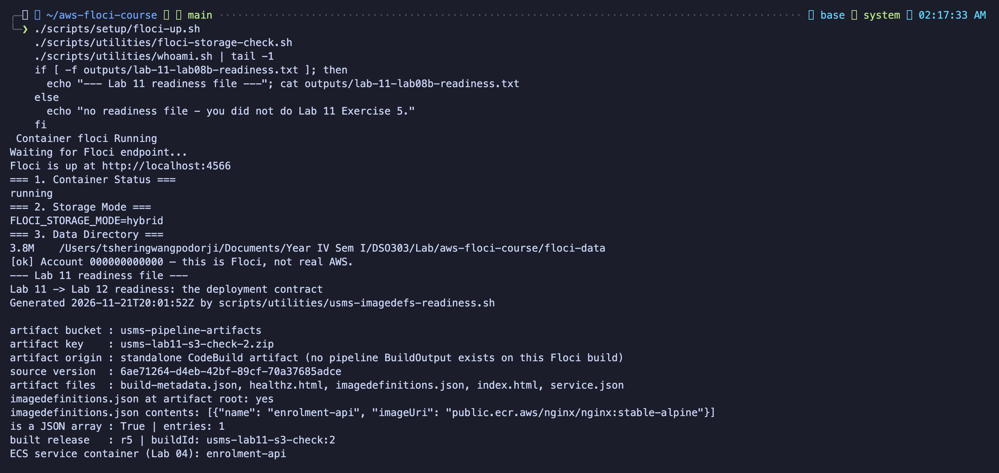
*Figure 1: Floci up, and Lab 11's readiness file read back.*

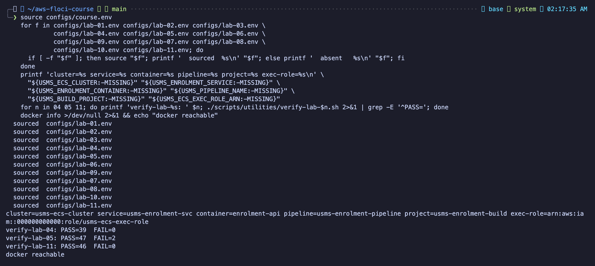
*Figure 2: eleven env files, no MISSING, and the baseline.*

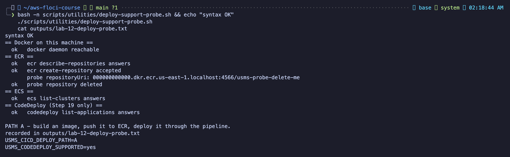
*Figure 3: the deployment probe - Path A, CodeDeploy answers.*

---

## 5. Procedure, Evidence and Observations

### 5.1 The ECR port range (Step 4) - a step that does not apply on this build

`docker-compose.yml` had **no commented `5100-5104` line**, so, as the lab says, I added it by hand
after taking a timestamped backup.

**Result: the recreate failed and Floci went down.** `Bind for 127.0.0.1:5100 failed: port is already
allocated`. Floci 2.1.0 serves ECR from **its own sidecar container**,
`floci-floci-course-ecr-registry`, which already publishes `127.0.0.1:5100`. The step assumes an
older build where the main container serves the registry.

I restored `docker-compose.yml` from the backup: `git diff` is empty, so the file is byte-identical
to HEAD. Floci came back with the service intact (ACTIVE, `usms-enrolment:2`), which doubles as the
step's create → perturb → read-back proof. The backup is ignored by `.gitignore` (Step 21), and the
cleanup script's final note says there is no port range to re-comment.

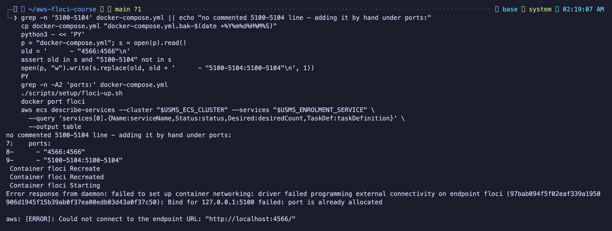
*Figure 4: the range added; the recreate fails on port 5100, and the endpoint stops answering.*

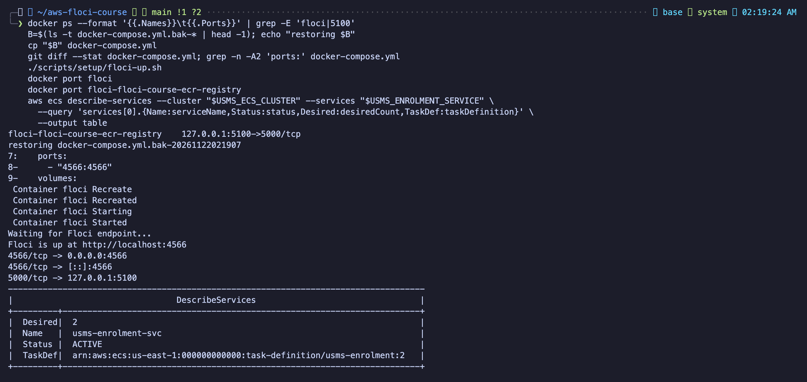
*Figure 5: the registry sidecar owns 5100; the compose file restored; Floci up; the service survived.*

### 5.2 Repository and login (Steps 5-6) - Checkpoint 2

- **Repository:** `usms-enrolment` is MUTABLE, with scanOnPush and AES256.
- **Registry host:** derived with `${ECR_URI%%/*}`, never typed.
- **Login:** `docker login` with the token piped on stdin returned **Login Succeeded**. No insecure
  registry configuration was needed.

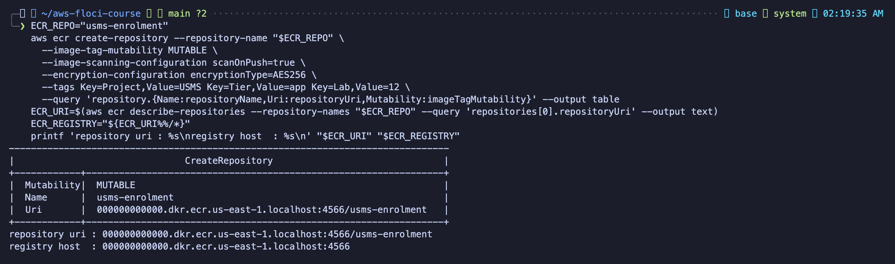
*Figure 6: the repository, and the registry host read from the API.*

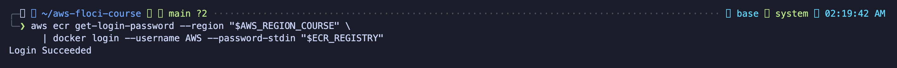
*Figure 7: docker login, token through standard input.*

### 5.3 Dockerfile (Step 7)

The image is `FROM nginx:1.27-alpine`, `COPY dist/ /usr/share/nginx/html/`, `EXPOSE 80`.
`.dockerignore` excludes the source, tests, config and buildspec.

**The `COPY dist/` choice, in one sentence:** the image ships what the build *produced* (placeholders
replaced, metadata stamped, smoke-tested), not what it *consumed*, so the image can only contain
tested output.

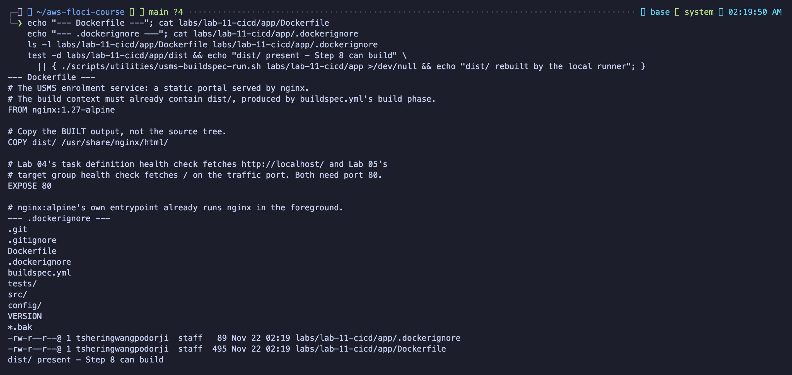
*Figure 8: the Dockerfile and .dockerignore; dist/ present.*

### 5.4 Build, push, read back (Steps 8-9) - Checkpoint 3

- **Build:** `VERSION` set to r6; the local runner gave 8/8 smoke tests. The image was built, tagged
  and pushed, and the manifest digest is **`sha256:67cbaa96…`**. The build's `writing image
  sha256:142a1ab2…` is the *config* digest, a different number.
- **Read-back:** `describe-images` shows `r6` → `67cbaa96…`, 21,820,514 bytes compressed, and the
  ledger line was written to `outputs/lab-12-image-digest.txt`.
- **Proof:** both local names were removed ("no local copy remains"), then the image was **pulled back
  by digest** from the registry.

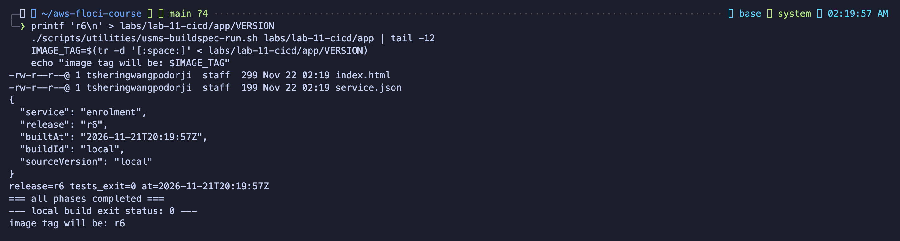
*Figure 9: release r6 built locally; build-metadata says r6.*

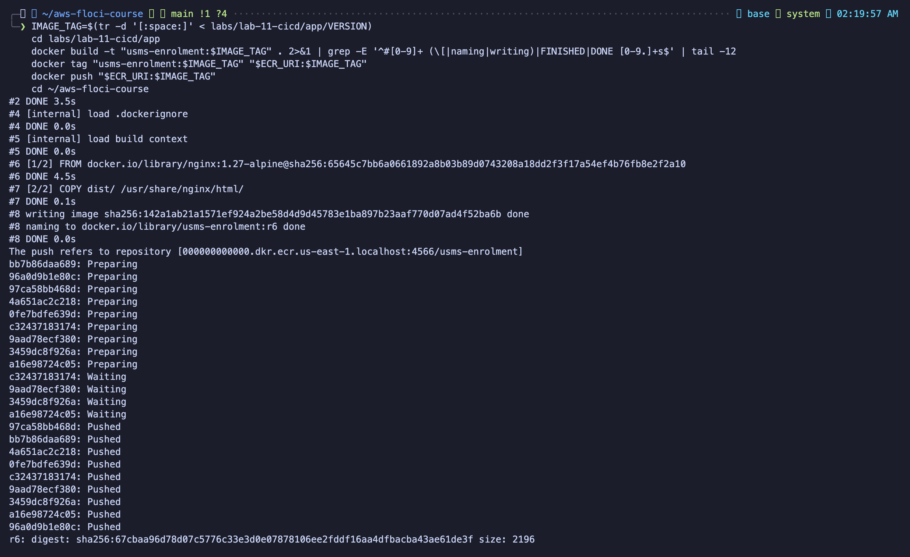
*Figure 10: build, tag, push - the manifest digest on the last line.*

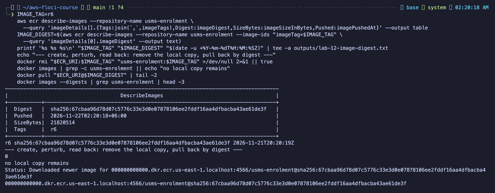
*Figure 11: the registry's read-back, the ledger line, local copy deleted, pulled back by digest.*

### 5.5 Revision 3, derived (Step 10)

- **Derivation:** Revision 2 was described; the eight read-only fields were stripped, the container was
  found **by name**, and one field changed, the image (`public.ecr.aws/nginx/nginx:stable-alpine` →
  `…/usms-enrolment:r6`). Then it was registered. The template has 0 unexpanded `$`.
- **Result:** `usms-enrolment:3`, Cpu 256, Memory 1024.
- **The lab expects** Lab 04's health check to carry over, but `Health` reads `null`. That's because
  **revision 2 never had one**: revisions 1 and 2 are null, and none of Lab 04's task-definition
  templates in this repo defines a `healthCheck`. The derivation kept everything revision 2 had: both
  roles, awslogs, ports and environment.

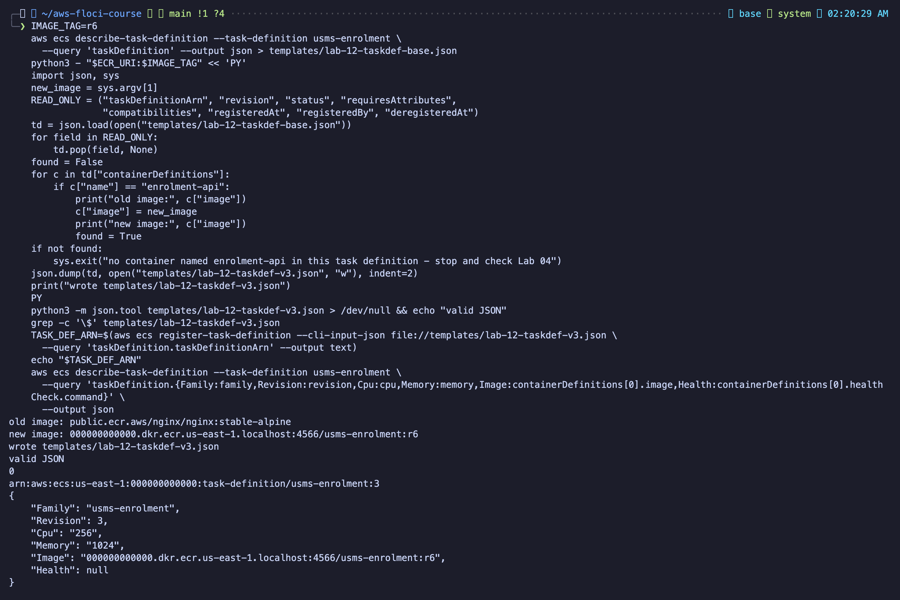
*Figure 12: describe → strip → register; revision 3 names my image.*

### 5.6 Deploy by hand, and what really runs (Step 11) - Checkpoint 4

- **Rollout:** `update-service --task-definition usms-enrolment:3`. The watcher settled on poll 1:
  one PRIMARY deployment, 2/2 running.
- **Unlike Lab 04's warning, tasks really run on this build.** The two revision-2 tasks are STOPPED;
  two revision-3 tasks are RUNNING the image `142a1ab2…` I built, and `docker exec` shows
  `release: r6` and r6's `build-metadata.json`.

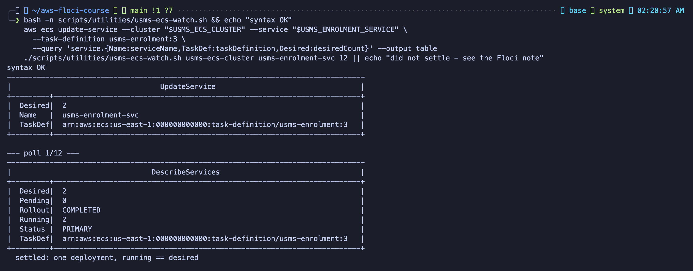
*Figure 13: the manual deploy and the watcher.*

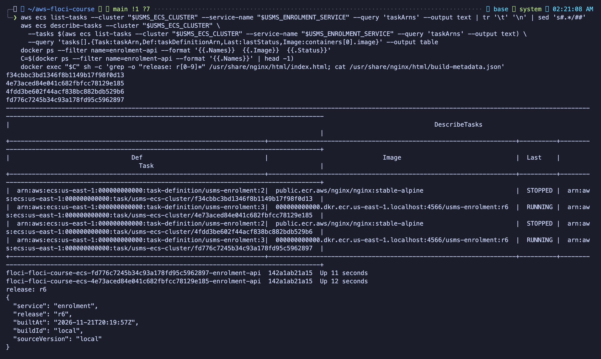
*Figure 14: old tasks STOPPED, new tasks RUNNING my image; the container serves release r6.*

### 5.7 Build identity v2 and privileged builds (Steps 12-13) - Checkpoint 5

- **`USMSCodeBuildBase` v2 is the default**, and v1 is kept. It adds `GetAuthorizationToken` on
  `"*"` (registry-level, nothing to scope) and push/pull on the one repository ARN.
- **One addition beyond the lab:** v2's log statement also covers `/aws/codebuild/usms-results-build`,
  the gap Lab 11 Exercise 1 found.
- **The project:** now `privilegedMode: true` with `IMAGE_REPO_URI` = my repository URI. Source is
  still `CODEPIPELINE`, so Lab 11 Step 18 isn't undone.
- **What privileged mode grants:** a Docker daemon inside the build container, with root-level kernel
  capabilities. Any buildspec in that project can start containers and reach the host's devices,
  which is why who may trigger it matters.

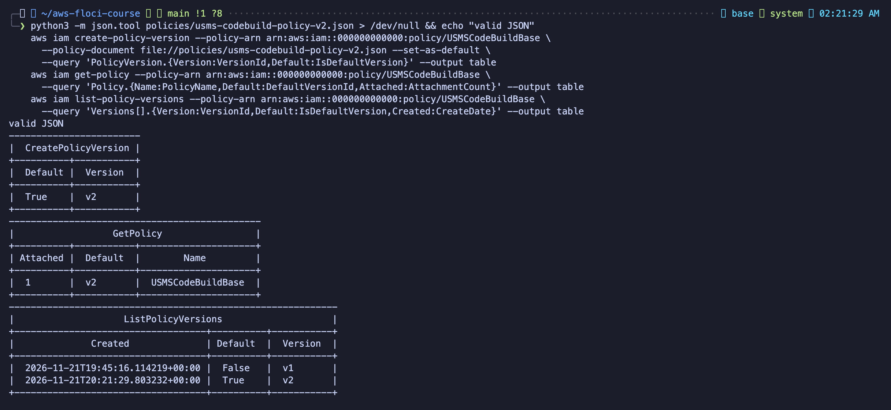
*Figure 15: USMSCodeBuildBase v2 created and set as default.*

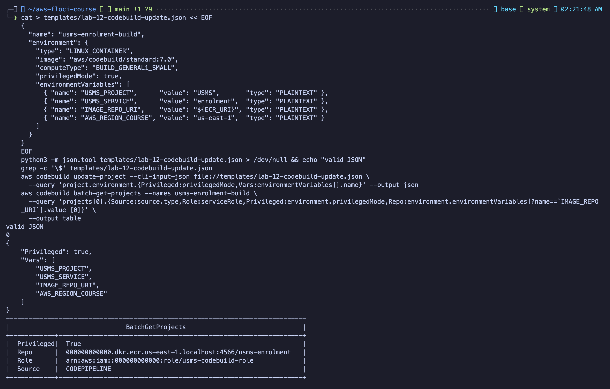
*Figure 16: privilegedMode true, four environment variables, source still CODEPIPELINE.*

### 5.8 The buildspec, extended (Step 14) - Checkpoint 6

**A merge, not the lab's replacement text.** The lab's text would have silently removed four Lab 11
results: the JSON-parse container check (Ex 3), the port check (Step 8), the `finally` summary
(Ex 2) and the `imagedefinitions.json` writer (Ex 5). I kept them and added exactly Lab 12's parts:

- the `IMAGE_REPO_URI` default,
- `docker --version`,
- the guarded registry login,
- the guarded `docker build`/`push`,
- `imagedefinitions.json` naming `${IMAGE_REPO_URI}:<tag>`,
- `imageUri` in the metadata.

`buildspec.yml.lab08a` keeps the Lab 11 version. The eighth smoke test was already present.

**What the local verify caused.** My Mac has Docker, so the guarded block really built and **pushed
`r6` again**. The new build carries a new timestamp, so the **mutable tag moved** from `67cbaa96…` to
`8f8d2e14…`, recorded as a second ledger line. The running tasks kept running the first bytes. That's
the tag-versus-digest lesson, caused by an innocent local test.

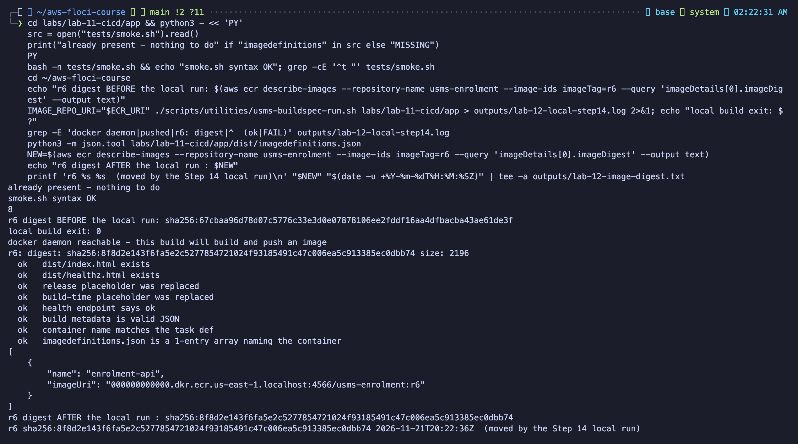
*Figure 17: 8/8 smoke tests, imagedefinitions naming my registry, and r6's digest before and after the local run.*

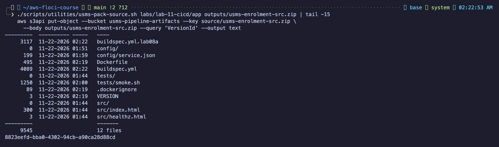
*Figure 18: the source shipped (Dockerfile at the root; the pipeline not started yet).*

### 5.9 Pipeline identity v2 and the Deploy stage (Steps 15-16) - Checkpoint 7

- **`USMSCodePipelineBase` v2:** six Sids, default v2. The second PassRole names exactly the two ECS
  roles, passable only to `ecs-tasks.amazonaws.com`.
- **Step 12 "Your turn":** my design (`notes/lab-12-my-pipeline-policy.json`) matched four
  statements and differed in one (figure 19; discussed in the notes).
- **The surgery:** the current document was read with `--query 'pipeline'`. The script asserts the
  first two stages and refuses a second Deploy, then appends the Deploy stage and puts it back.
- **Result:** **3 stages**, with the artifact chain readable down the Input column:
  None → SourceOutput → BuildOutput.

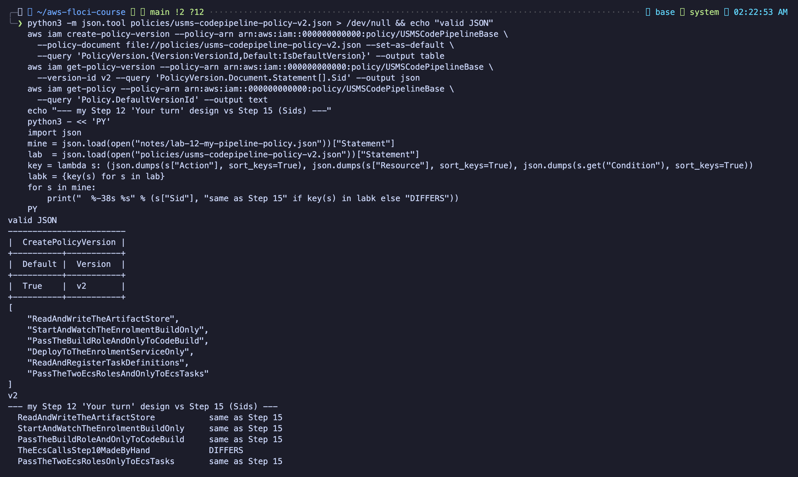
*Figure 19: pipeline policy v2, and my own design compared statement by statement.*

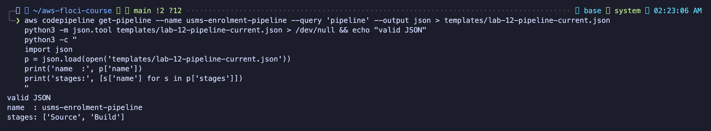
*Figure 20: get - two stages.*

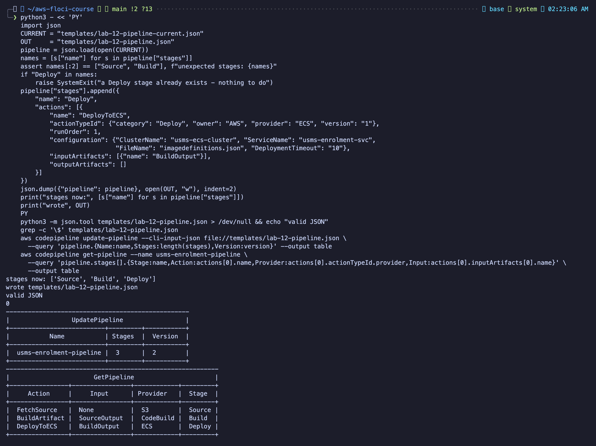
*Figure 21: modify and put - three stages, version 2 of the pipeline.*

### 5.10 End to end (Step 17) - Checkpoint 8

- **Push first:** following the lab's box, I set r7 and ran the buildspec locally with
  `IMAGE_REPO_URI=$ECR_URI`. It built and **pushed `r7` = `sha256:c3c1150a…`**, the same thing
  CodeBuild would do.
- **The pipeline (`035fe20f…`):** Source Succeeded; **Build Failed** (build 16, the Lab 11 handoff
  gap); Deploy never ran.
- **The deploy action itself:** I tested it with a throwaway pipeline whose Source was a zip of the
  r7 build output, with `imagedefinitions.json` at the root. Source Succeeded, and Deploy Failed with
  **"Provider ECS is not available in Floci CodePipeline"**. That's the lab's Floci 2.0.1 known issue,
  still present in 2.1.0. The throwaway pipeline was deleted.
- **The stand-in:** `scripts/utilities/usms-ecs-deploy-action.sh` performs exactly the action's four
  documented steps from that same build-output zip, nothing more. It fails if the file isn't at the
  artifact root, isn't an array, or names a missing container. **It, not CodePipeline, deployed r7.**

**The three proofs** (`outputs/lab-12-deploy-evidence.txt` states who deployed):
1. **The revision increased:** `:3 → :4`, registered by the script, not typed by me.
2. **The image names `r7`.**
3. **Everything else is unchanged:** Cpu 256, Mem 1024, both roles, awslogs.

Figure 26's last line still reads `release: r6`: it caught an old task while it was being replaced.
Figure 27, fifteen seconds later, shows both RUNNING tasks on revision 4, serving `release: r7`.

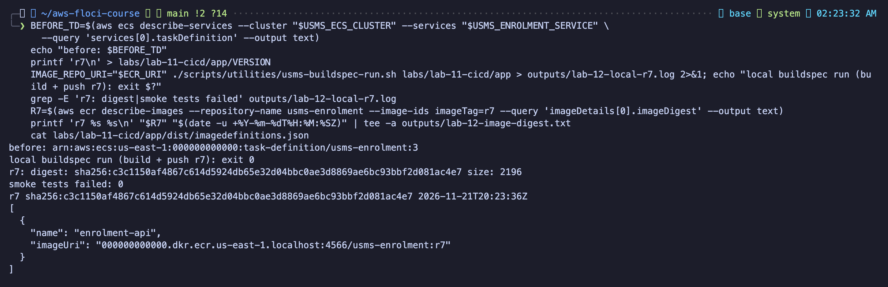
*Figure 22: r7 built and pushed first; its digest in the ledger; imagedefinitions for r7.*

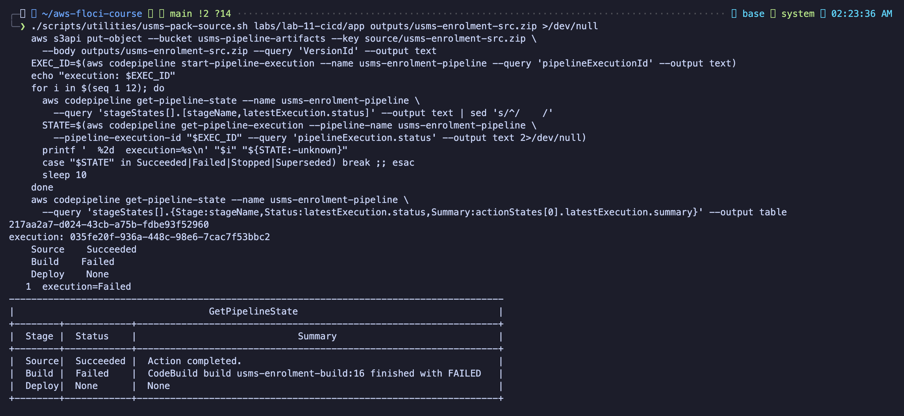
*Figure 23: the pipeline - Build fails, Deploy never runs.*

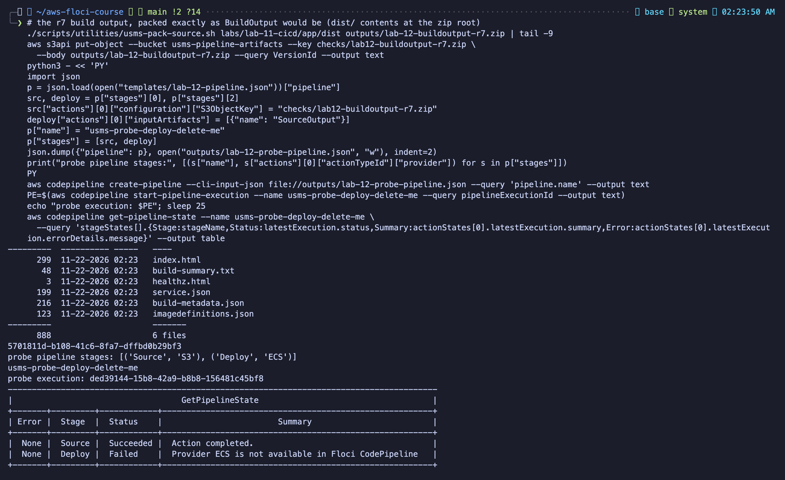
*Figure 24: the deploy action tested on its own - "Provider ECS is not available in Floci CodePipeline".*

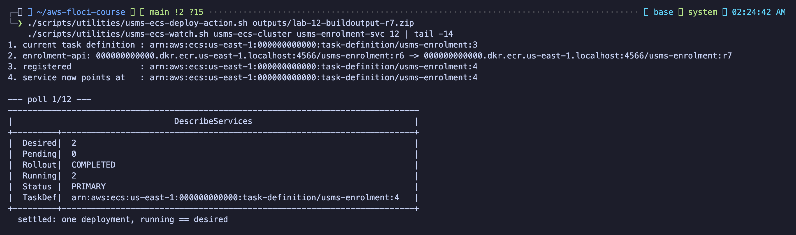
*Figure 25: the stand-in's four steps; the service settles on revision 4.*

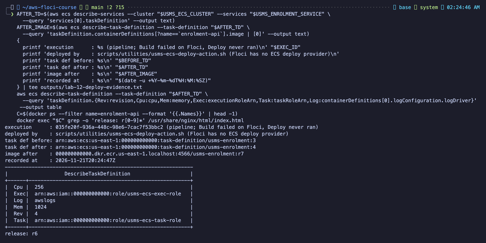
*Figure 26: the three proofs (the last line caught an old r6 task mid-replacement).*

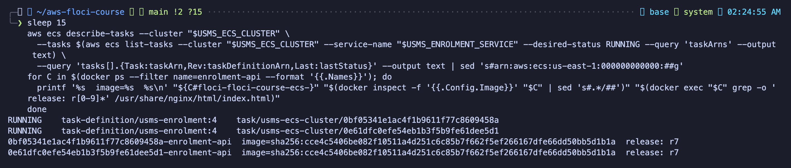
*Figure 27: both running tasks on revision 4, serving release r7.*

### 5.11 The rollback drill (Step 18) - Checkpoint 9

- **An image that was never pushed:** I set `r8` and pointed `DOCKER_HOST` at a socket that doesn't
  exist, so the buildspec's guard took the "no Docker daemon" branch. It skipped the push but still
  wrote `imagedefinitions.json` naming `…:r8`, and the build **passed**. The registry still holds
  only `r6` and `r7`.
- **The deploy:** the pipeline ran and failed at Build as always, and the stand-in registered
  **revision 5** and pointed the service at it.
- **What Floci's deployment record said:** revision 5 **PRIMARY, Running 2, Failed 0, rolloutState
  COMPLETED**. There were no service events, and the circuit breaker didn't fire.
- **What was actually true:** `describe-tasks` shows a stream of revision-5 tasks **STOPPED** with
  `Failed to start: … manifest for …usms-enrolment:r8 not found`, Floci's equivalent of
  `CannotPullContainerError`. The two **old revision-4 tasks kept running**, and the record counted
  them. That's a stronger version of the lab's lesson: here the deployment record didn't just stay
  silent, it reported success.
- **Rollback:** `update-service --task-definition usms-enrolment:4`. The watcher settled, two
  revision-4 tasks are RUNNING and serve `release: r7`, and `VERSION` is back to r7, uploaded.
- **"Your turn", revision 5:** I **deregistered** it (figure 33), justified in the notes. One finding:
  Floci's family lookup **still returns INACTIVE revision 5** (real AWS returns the latest ACTIVE
  revision), so Step 20 derives the CI/CD revision differently.

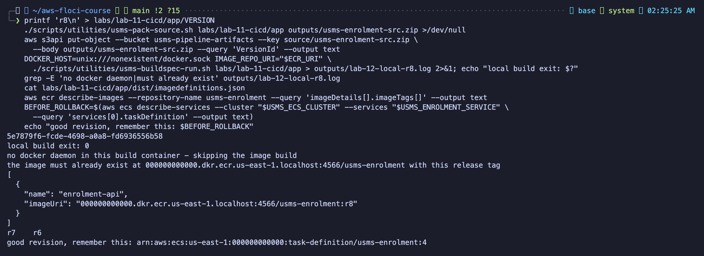
*Figure 28: r8 "built" with no daemon; imagedefinitions names r8; the registry holds r6 and r7 only.*

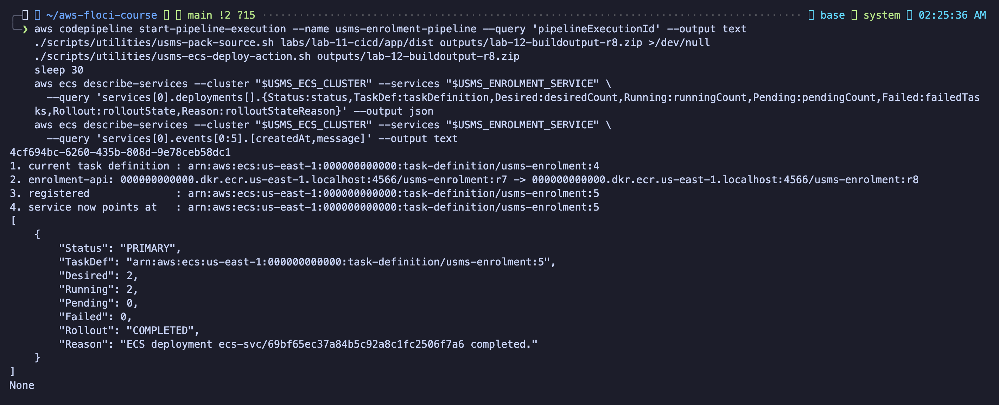
*Figure 29: revision 5 deployed - Floci reports PRIMARY, 2 running, COMPLETED; no events.*

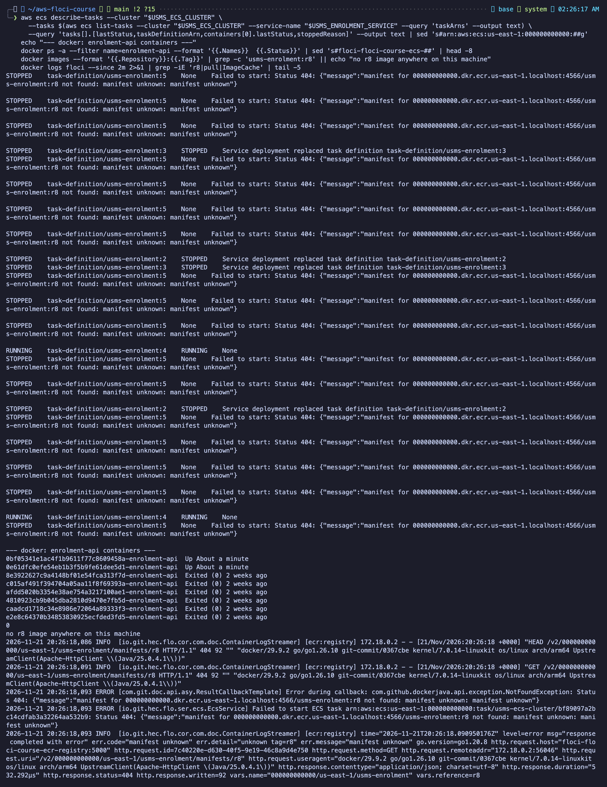
*Figure 30: the truth - every revision-5 task STOPPED with "manifest … r8 not found"; the old revision-4 tasks still running.*

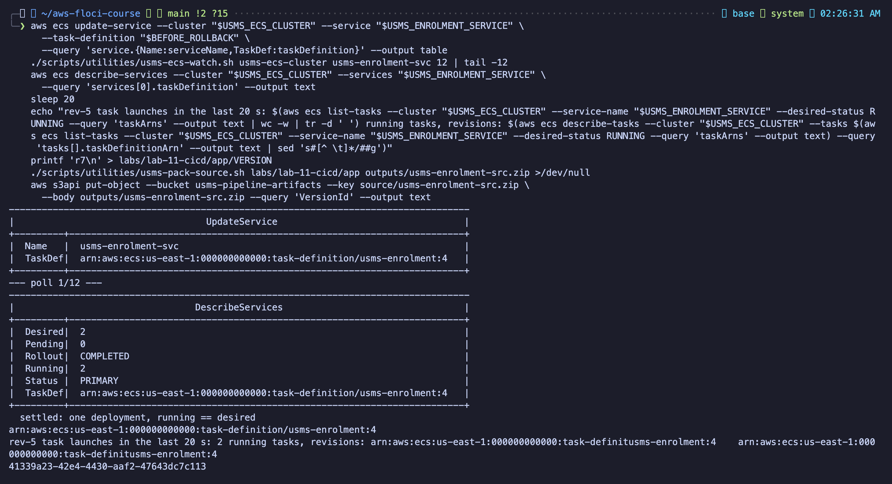
*Figure 31: the manual rollback to revision 4 (the last line is garbled by my sed; see figure 32).*

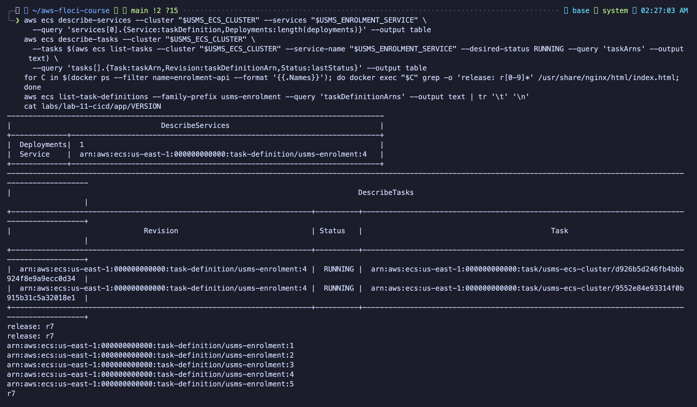
*Figure 32: after the rollback - one deployment, two revision-4 tasks serving r7, the family :1-:5.*

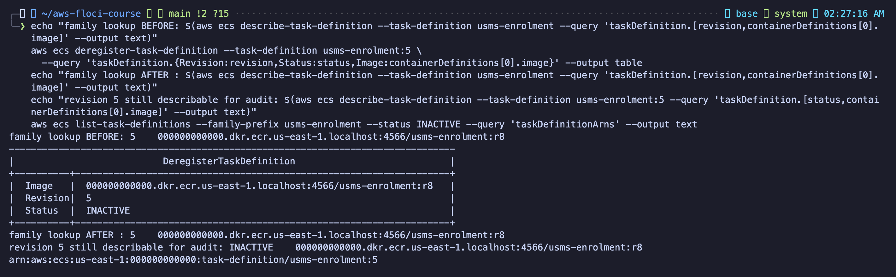
*Figure 33: revision 5 deregistered (INACTIVE, still describable); Floci's family lookup still answers 5.*

### 5.12 Blue/green on paper (Step 19) - Checkpoint 10

- **Documents:** the appspec (`<TASK_DEFINITION>` is a deliberate placeholder) and the deployment
  group (two target groups, two listeners, linear 10% a minute, automatic rollback) were written.
- **Validation:** the deployment group is valid JSON. PyYAML isn't installed system-wide, so the
  lab's parse printed its skip line; the scratch venv parsed the appspec (`enrolment-api`, port 80,
  5 hooks).
- **Controller:** the service's deployment controller is still **`ECS`**, untouched.
- **What I claim:** CodeDeploy *answers* on this build (`applications: []`), but nothing was created
  or executed. **I specified a blue/green deployment; I did not perform one.**

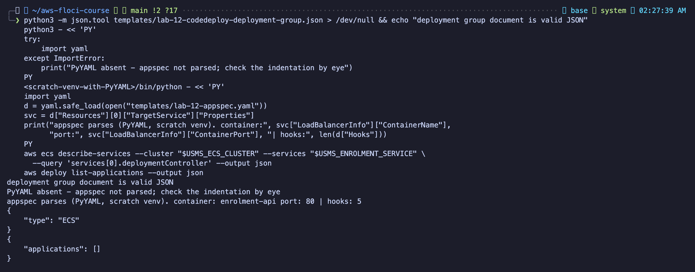
*Figure 34: both documents validated; deployment controller ECS; CodeDeploy answers with no applications.*

### 5.13 Recording (Steps 20-21)

`configs/lab-12.env` has **26 exports, all populated**. Two fixes were needed:

- **The CI/CD revision.** Floci's family lookup returns INACTIVE revision 5, and it **ignores
  `list-task-definitions --sort DESC`**, so my first attempt recorded revision 1 (figure 35). The final
  values sort the ACTIVE list numerically: revision 4 (figure 35b).
- **The pipeline policy version.** `USMS_POLICY_CODEPIPELINE_VERSION` was later updated to `v3`, with
  a comment, after Exercise 4.

**Step 21, no commit, per your choice:**
- `docker-compose.yml.bak-*` is git-ignored (`.gitignore:14`), and `docker-compose.yml` is unchanged
  against HEAD.
- Nothing under `outputs/` is visible to git.
- `templates/lab-12-taskdef-base.json` and `lab-12-pipeline-current.json` are live-state snapshots
  that the lab says **not** to commit.

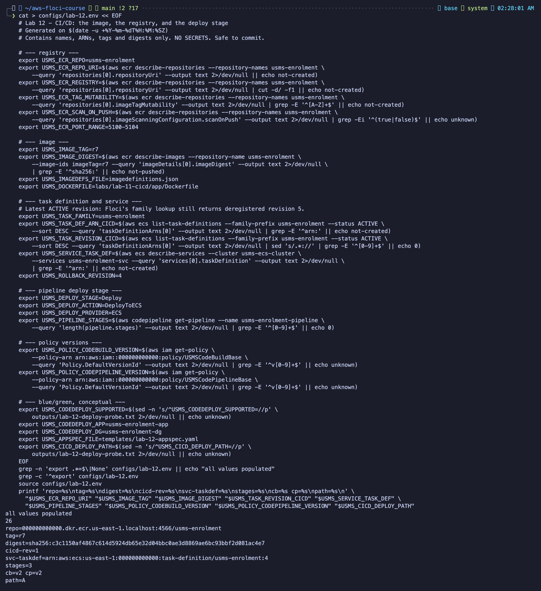
*Figure 35: lab-12.env - 26 values, but cicd-rev=1 (Floci ignores --sort DESC).*

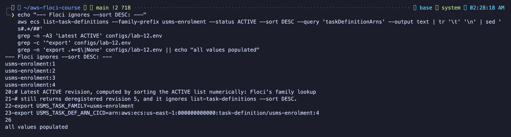
*Figure 35b: the fix - the ACTIVE list sorted numerically, revision 4.*

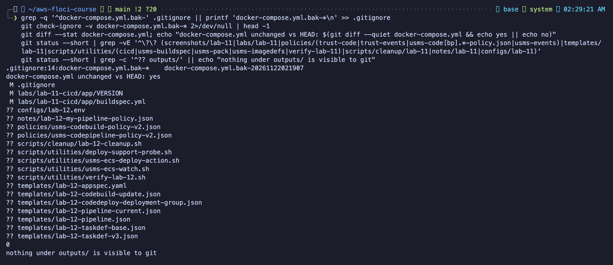
*Figure 38: compose backup ignored, compose file unchanged, nothing from outputs/ visible.*

---

## 6. Verification (Section 8)

**`verify-lab-12.sh` → PASS=45 FAIL=0** at the end of the main lab (figure 36), the Path A target.

One caveat: the task-definition checks use the family lookup, which on Floci returns the INACTIVE
revision 5. They pass because revision 5 also names the repository, uses 256/1024 and is ≥ 3, but
they're reading the failed revision.

The cleanup script was written and syntax-checked, and **not run**. It uses `mktemp` instead of
fixed `/tmp` paths and has a corrected final note.

**After the exercises** (figures 39-40):

| Script | Result | Why |
|---|---|---|
| Lab 04 | 39/0 | unchanged |
| Lab 05 | 47/2 | unchanged (documented grace-period limitation) |
| Lab 10 | 51/0 | unchanged |
| Lab 11 | **45/1** | `pipeline has 2 stages` - Lab 12 added the Deploy stage on purpose; Lab 11's script checks Lab 11's end state |
| Lab 12 | **44/1** | `USMSCodePipelineBase default is v2` - Exercise 4 set **v3** as default. `aws iam set-default-policy-version --policy-arn arn:aws:iam::000000000000:policy/USMSCodePipelineBase --version-id v2` restores 45/0 if the assessment needs the exact count |

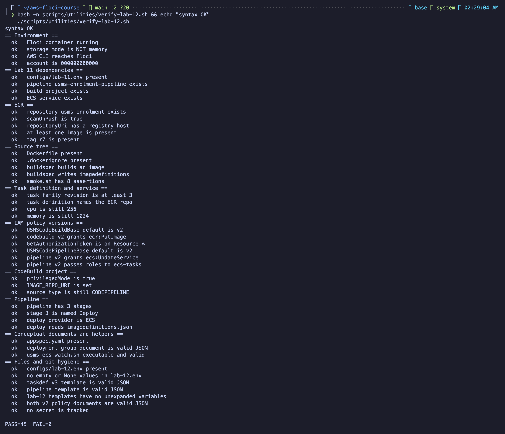
*Figure 36: verify-lab-12.sh - PASS=45 FAIL=0.*

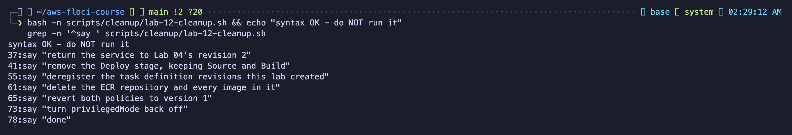
*Figure 37: the cleanup script, syntax-checked, not run.*

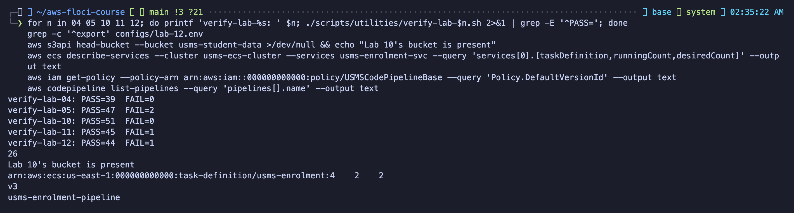
*Figure 39: every verify script after the exercises.*

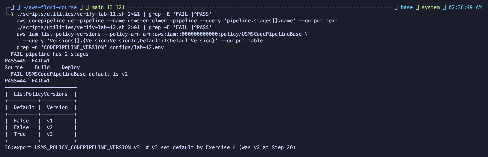
*Figure 40: the two failures named - the Deploy stage, and policy v3 as default.*

---

## 7. Results

| Item | Result |
|---|---|
| Image in ECR | r6, r7 (`c3c1150a…`), r7-alt, two unique-tag builds; pushed, read back, pulled by digest |
| Task definitions | :3 by hand (r6), :4 by the stand-in deploy (r7), :5 r8 (deregistered) |
| Service | revision 4, 2/2 RUNNING, serving `release: r7` - observed in the containers |
| Pipeline | 3 stages; Source observed; Build and Deploy cannot run on Floci |
| Rollback | done by hand; Floci's record claimed success for the failed deploy |
| `verify-lab-12.sh` | 45/0 after the lab; 44/1 after Exercise 4 (explained) |

---

## 8. Floci vs Real AWS (observed on this build)

| Feature | Floci 2.1.0 (observed) | Real AWS |
|---|---|---|
| ECR control plane, `docker login`, push, pull by digest | **Work** (registry is a sidecar on 127.0.0.1:5100, reached through :4566) | Work |
| Tag immutability | **Enforced** (`tag invalid … immutable`) | Enforced |
| `describe-images` of untagged digests | Disappear from the listing | Listed as untagged |
| Publishing 5100-5104 on Floci | Conflicts with the registry sidecar; Floci fails to start | n/a |
| ECS tasks | **Really run** (Docker containers) | Run |
| Unpullable image | Tasks STOPPED with "manifest unknown"; **deployment shown as COMPLETED**, no events, no breaker | `CannotPullContainerError`, breaker trips, automatic rollback |
| Family lookup after deregistering the latest | Returns the INACTIVE revision | Latest ACTIVE |
| `list-task-definitions --sort DESC` | Ignored (ascending) | Honoured |
| CodePipeline ECS deploy provider | **"Provider ECS is not available in Floci CodePipeline"** | Registers a revision and updates the service |
| Pipeline → CodeBuild source handoff | None (Lab 11) | The input artifact |
| CodeDeploy API | Answers (empty) | Full blue/green |
| `simulate-custom-policy` / `simulate-principal-policy` | Unsupported / **works** | Both work |
| IAM enforcement | None | Enforced |

**Observed:**
- an image built, pushed, read back and pulled by digest;
- tag mutability (an accidental move and a deliberate one) and immutability enforced;
- a revision derived with one field changed;
- the service running my image and serving the release I set;
- a three-stage pipeline document;
- a deploy of an unpushed image failing in the tasks while the record said COMPLETED;
- a manual rollback;
- the scoped v3 policy evaluated by the simulator.

**Recorded, not observed:**
- the pipeline's Deploy action (performed by the stand-in), CodeBuild building an image
  (no Docker in its container), the circuit breaker, and every IAM boundary;
- the CodeDeploy documents.

**Not available:** blue/green execution, scan results, lifecycle expiry, cost.

---

## 9. Independent Exercises (summary; full answers in [exercises.md](exercises.md))

| Exercise | Outcome |
|---|---|
| 1. Second base image | `r7-alt` on `public.ecr.aws/nginx/nginx:stable-alpine`: 25,979,820 B in the registry against 21,820,416 B for `r7` (compressed); 61.8 MB against 49.7 MB locally (uncompressed); 9 layers each. The difference is nginx 1.30.5 against 1.27.5 |
| 2. Immutable tags | IMMUTABLE set; re-pushing `r7` **rejected**. The buildspec now tags `<release>-<CODEBUILD_BUILD_NUMBER>`, falling back to `local-<UTC timestamp>`; two builds of r7 pushed two tags. Set back to MUTABLE, with reasons given |
| 3. Blue/green scaffolding | `usms-enrolment-tg-green` (Lab 05's settings, read rather than retyped) and an 8080 test listener; resolved deployment-group document with no placeholders; controller untouched |
| 4. Pipeline policy hole | The attack, a v3 that scopes Register to the family and UpdateService by `ecs:task-definition` (keys checked in AWS's reference), the simulator showing the cross-family path closed, and the argument that the image/task-role hole needs a control outside this policy |
| 5. Evidence for an auditor | `outputs/lab-12-release-evidence.md`; `r7` retagged and restored with four ledger lines; the tag → bytes link shown broken |

---

## 10. Files Produced

| Kind | Files |
|---|---|
| Source | `labs/lab-11-cicd/app/{Dockerfile, .dockerignore, buildspec.yml (merged + Ex 2), buildspec.yml.lab08a, VERSION r7}` |
| Policies | `usms-codebuild-policy-v2.json`, `usms-codepipeline-policy-v2.json`, `usms-codepipeline-policy-v3.json` (Ex 4) |
| Templates | `lab-12-taskdef-v3.json`, `lab-12-codebuild-update.json`, `lab-12-pipeline.json`, `lab-12-appspec.yaml`, `lab-12-codedeploy-deployment-group.json`, `-resolved.json` (Ex 3); snapshots `lab-12-taskdef-base.json`, `lab-12-pipeline-current.json` (not to be committed) |
| Scripts | `deploy-support-probe.sh`, `usms-ecs-watch.sh`, `usms-ecs-deploy-action.sh` (stand-in), `verify-lab-12.sh`; `scripts/cleanup/lab-12-cleanup.sh` (not run) |
| Config | `configs/lab-12.env` (26), `.gitignore` (+ compose backups) |
| Evidence (git-ignored) | `outputs/lab-12-*`: deploy probe, image-digest ledger, deploy evidence, release evidence, local build logs, build-output zips |
| Write-up | this report, [exercises.md](exercises.md), `notes/lab-12-notes.md`, `notes/lab-12-my-pipeline-policy.json`, 53 figures in `screenshots/lab-12/` |

---

## 11. Conclusion

- **The image path is real end to end on this build:** source → image → registry → task definition →
  running container serving the release I set. Each link was read back, not assumed.
- **The pipeline is not:** on Floci it can fetch source but can neither build it nor deploy. The
  deploy was performed by a script doing exactly what the action does, and the report says so on
  every line where it matters.
- **The most useful results were the false reassurances:**
  - a mutable tag moved by an innocent local test;
  - a deployment of a nonexistent image reported as **COMPLETED**;
  - a "latest revision" lookup that returns a deregistered revision.
- **The lab's own rule applied each time:** a green status is a report, not evidence. Every one of
  those was caught by reading what actually ran (the container, its digest, the task's stop reason),
  never by trusting the record.
