# Lab 12 - Independent Lab Exercises

These ran on Floci 2.1.0 with the Path A support path, on 2026-11-22 (UTC timestamps read 2026-11-21T20:2x-20:3x).
Each section names its figure in `screenshots/lab-12/`. The report ([README.md](README.md)) covers the
main lab, including the Floci limits that apply here: the pipeline's Deploy stage has no ECS provider,
and CodeBuild has no Docker.

---

## Exercise 1 - Basic: a second base image

**What I did:** I built the same `dist/` (release r7) on `public.ecr.aws/nginx/nginx:stable-alpine`
instead of `nginx:1.27-alpine`, using a copy of the Dockerfile with only the `FROM` line changed. I
pushed it as **`r7-alt`** and read both images back, from the registry and from the local engine
(figures ex1a, ex1b).

| | `r7` (`nginx:1.27-alpine`) | `r7-alt` (`nginx:stable-alpine`) |
|---|---|---|
| Registry size (`imageSizeInBytes`, compressed) | 21,820,416 B | 25,979,820 B |
| Local size (`docker image inspect`, uncompressed) | 49,710,080 B | 61,779,837 B |
| Layers | 9 | 9 |
| `nginx -v` | 1.27.5 | 1.30.5 |
| Manifest digest | `c3c1150a…` | `f9ff16af…` |

**What the numbers say:**
- **The two sizes measure different things.** The registry stores compressed layers. The engine
  reports the unpacked filesystem. Neither is wrong, but a comparison has to use the same column.
- **Same layer count, different contents.** "stable" is a newer nginx (1.30.5) on a newer Alpine,
  about 4 MB bigger compressed. Layer by layer, the big jump is the base filesystem layer
  (37.4 MB → 48.6 MB uncompressed), plus 4.1 → 4.5 MB and 8.2 → 8.7 MB in two of nginx's layers.
  The small layers, my `dist/` content among them, are within a few dozen bytes, so the difference
  comes from the base image.
- **"stable" is a moving tag in someone else's registry.** The next pull may give different bytes.
  The pinned `1.27-alpine` moves only within a patch line. Either way, the digest is the only fixed
  identity. That point comes back in Exercise 5, where `r7-alt`'s bytes are the ones I retag `r7` to.

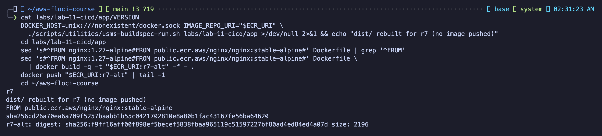
*Figure ex1a: r7-alt built on the alternative base and pushed.*

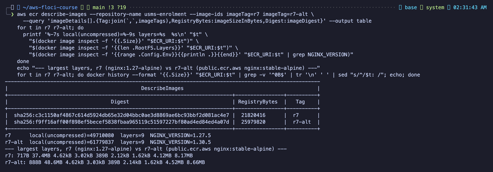
*Figure ex1b: registry and local sizes, layer counts, nginx versions side by side.*

---

## Exercise 2 - Intermediate: immutable tags

**Steps:**
1. `put-image-tag-mutability --image-tag-mutability IMMUTABLE`, then read it back.
2. I re-pushed `r7`. **Rejected**: Floci enforces it (`tag invalid … immutable`). The registry still
   lists `r7` at `c3c1150a…` (figure ex2a).

**The buildspec change** (`labs/lab-11-cicd/app/buildspec.yml`, build phase):

```yaml
- IMAGE_TAG="$USMS_RELEASE-${CODEBUILD_BUILD_NUMBER:-local-$(date -u +%Y%m%d%H%M%S)}"
```

- **`imagedefinitions.json`**, `imageUri` in the metadata, `docker build -t` and `docker push` now use
  `:$IMAGE_TAG` instead of `:$USMS_RELEASE`.
- **In CodeBuild**, the tag is `r7-<build number>`, which is unique per project. Locally, where
  `CODEBUILD_BUILD_NUMBER` doesn't exist, it falls back to a UTC timestamp.
- **Test:** two local runs of r7 under IMMUTABLE both **succeeded**. They pushed
  `r7-local-20261121203505` and `r7-local-20261121203510`, and each run's `imagedefinitions.json`
  names its own tag (figure ex2b).

**My decision: back to MUTABLE.** I did set the repository back, for three reasons:
- Exercise 5 has to retag `r7` on purpose, which IMMUTABLE forbids.
- `configs/lab-12.env` and the report record `MUTABLE` as the lab's end state.
- `verify-lab-12.sh` checks for it.

The buildspec change stays, because unique tags are correct under either setting.

**For a real repository I would keep IMMUTABLE plus unique tags.** The release name (`r7`) then
belongs in metadata or a label, not in the only tag. "Which bytes is r7?" is answered by
`imagedefinitions.json` and the ledger, never by a tag that can move.

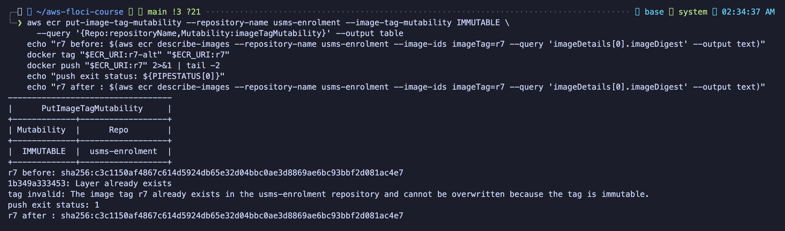
*Figure ex2a: IMMUTABLE set; re-pushing r7 rejected; r7 still at the original digest.*

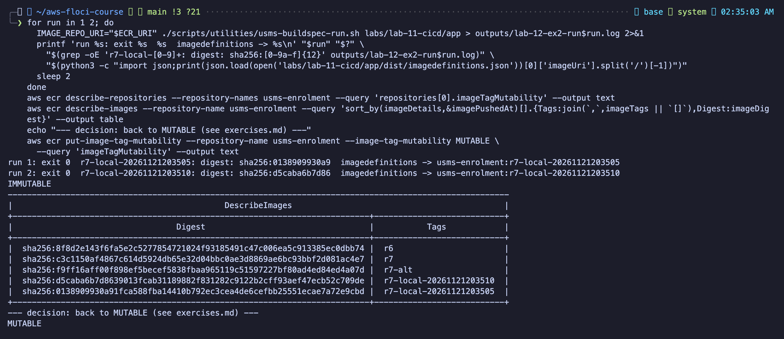
*Figure ex2b: two builds of r7 under IMMUTABLE, two unique tags, both pushed.*

---

## Exercise 3 - Intermediate: blue/green scaffolding

**The green target group.** I created **`usms-enrolment-tg-green`** with every setting read from
Lab 05's blue group (`describe-target-groups`), not retyped:
- protocol, port, VPC and target type `ip`;
- health-check path, interval, thresholds and matcher.

ARN: `…:targetgroup/usms-enrolment-tg-green/4f5cc2845e134205`.

**The test listener.** I added a second listener on **8080** to `usms-enrolment-alb`, forwarding to
green. ARN: `…:listener/app/usms-enrolment-alb/cc9d002d3f6343a2/ac23cfe0dcae4f84`. The production
listener on :80 (`…/27b4ab5fdfb44519`) still forwards to blue.

**The resolved deployment group.**
- **File:** `templates/lab-12-codedeploy-deployment-group-resolved.json`.
- **What it contains:** the Step 19 document with both target-group names and both real listener
  ARNs filled in from the API. It has no placeholders left: a `grep` for `<`/`$` finds nothing, and it
  parses as JSON (figure ex3b).

**Untouched:**
- The ECS service's deployment controller is still **`ECS`**.
- No CodeDeploy application or deployment group was created.

Switching the controller to `CODE_DEPLOY` would need the service to be recreated. That's outside this
exercise, and Floci couldn't execute the deployment anyway. **The scaffolding exists; the blue/green
deployment was not performed.**

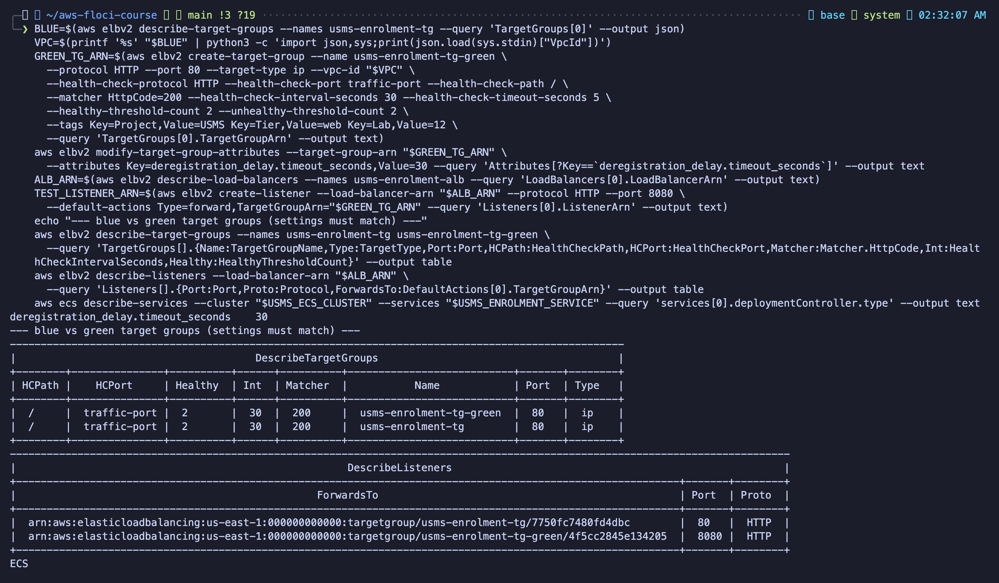
*Figure ex3a: the green target group (settings copied from blue) and the 8080 test listener.*

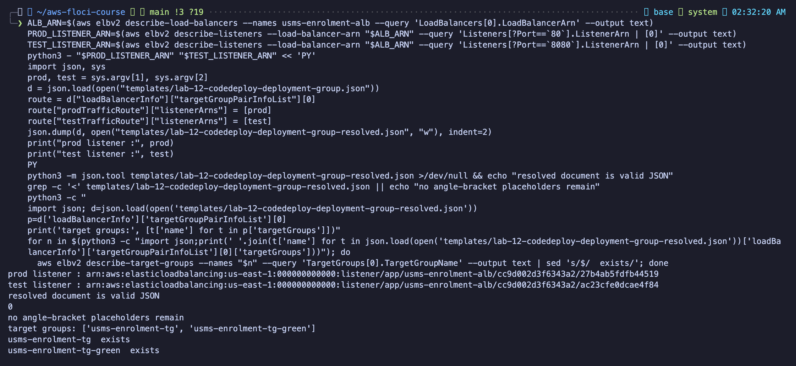
*Figure ex3b: the resolved deployment group - real ARNs, no placeholders; controller still ECS.*

---

## Exercise 4 - Advanced: the hole in the pipeline policy

### The attack against v2

v2's ECS part is:

- `DeployToTheEnrolmentServiceOnly`: `DescribeServices`, `UpdateService` on the one service ARN.
- `ReadAndRegisterTaskDefinitions`: `DescribeTaskDefinition`, `RegisterTaskDefinition`,
  `ListTaskDefinitions` on **`*`**.
- PassRole on the two ECS roles, only to `ecs-tasks.amazonaws.com`.

Each statement looks narrow, and the service ARN does pin *which service* is updated. The attacker
here is anyone who can act as the pipeline role, or who can change what the pipeline deploys. What
the policy doesn't pin is **what the service may be pointed at**:

1. **Register a task definition in any family**, because `RegisterTaskDefinition` is on `*`, for
   example `usms-exfil:1`. It can carry any image (from any registry) and any command, environment,
   port mappings or log configuration.
2. **Give it the real task role.** PassRole allows `usms-ecs-task-role` to ECS tasks, and that role
   carries `USMSStudentDataReadWrite`.
3. **`UpdateService` the enrolment service to `usms-exfil:1`.** v2 only checks the *service* ARN, so
   this is allowed. The production service, behind the production ALB, now runs the attacker's
   container with read/write access to student data.

The service ARN in the policy makes the policy look scoped. But "which service" was never the risk;
"which code, with which role" is.

### v3 - what IAM can close

`policies/usms-codepipeline-policy-v3.json` is **created and set as default** (figure ex4a). I
checked the condition keys against AWS's *Service Authorization Reference* for Amazon ECS rather than
guessing them:

| v3 statement | Effect |
|---|---|
| `RegisterOnlyTheEnrolmentFamily`: Register on `task-definition/usms-enrolment:*` | Register is resource-scoped to a family in the reference (resource type `task-definition`). `usms-exfil:1` is no longer registrable |
| `UpdateTheEnrolmentServiceOnlyToItsOwnFamily`: UpdateService on the service ARN **with `ArnLike ecs:task-definition …/usms-enrolment:*`** | The service can only be pointed at its own family, even if another family exists |
| `DescribeAndListHaveNoResourceType`: Describe/List TaskDefinitions on `*` | The reference lists no resource type for these, so `*` is the only correct value. They are read-only |
| `ReadTheEnrolmentService`, the artifact store, the build and both PassRoles | unchanged |

**Simulator results** (figures ex4b, ex4c):
- `simulate-custom-policy` is **unsupported** on Floci, so I used `simulate-principal-policy` against
  a principal holding v3. That one works.

| Action and resource | v3 |
|---|---|
| `RegisterTaskDefinition` `usms-enrolment:6` | **allowed** |
| `RegisterTaskDefinition` `usms-exfil:1` | **implicitDeny** |
| `UpdateService` with `ecs:task-definition` = `usms-enrolment:6` | **allowed** |
| `UpdateService` with `ecs:task-definition` = `usms-exfil:1` | **implicitDeny** |
| `PassRole usms-ecs-task-role` to ECS tasks | allowed |
| `PassRole` an unrelated role (`usms-ec2-app-role`) | **implicitDeny** |

These are simulator *evaluations*. Floci doesn't enforce IAM, so none of them stopped a real call.

### What v3 cannot close

- **Register has no condition key for content.** The reference lists only tag keys,
  `ecs:compute-compatibility`, `ecs:privileged`, `ecs:task-cpu` and `ecs:task-memory`. There is no key
  for the **image** or the **task role** inside the definition.
- **So the attack still works within the family.** A pipeline identity under v3 can still register
  `usms-enrolment:6` with an attacker's image and the real task role, and point the service at it. v3
  closed the *cross-family* path, not the *malicious-revision* path.

**What that needs is a control outside this policy:**
1. **Narrow the task role.** Make the blast radius small: the enrolment service probably needs
   read/write on its own prefix or table, not all student data. This is the most effective single
   change.
2. **Image provenance.** Deploy only images from the one ECR repository, by digest. Require signed
   images (for example, an admission check or a deploy-time verification step), so a revision naming
   any other image fails before `UpdateService`.
3. **A separate deploy identity.** The role that can *change what runs* should not be reachable from
   whatever *builds the input*. Use a manual approval stage, or a deploy role that only the Deploy
   action assumes.

**State after the exercise:**
- `USMSCodePipelineBase` default is **v3**, recorded in `configs/lab-12.env` with a comment.
- That is why `verify-lab-12.sh` now reports 44/1 ("default is v2"). The README's §6 gives the
  one-line restore.

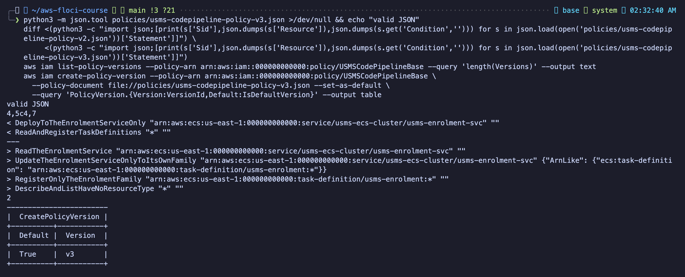
*Figure ex4a: USMSCodePipelineBase v3 created and set as default; its statements.*

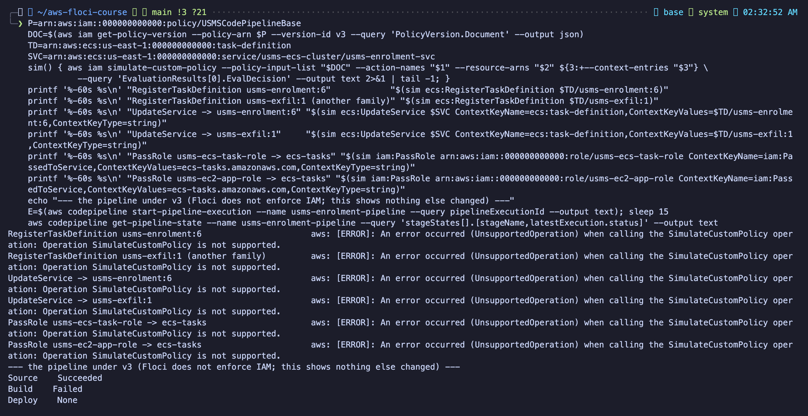
*Figure ex4b: simulate-custom-policy - not supported on Floci.*

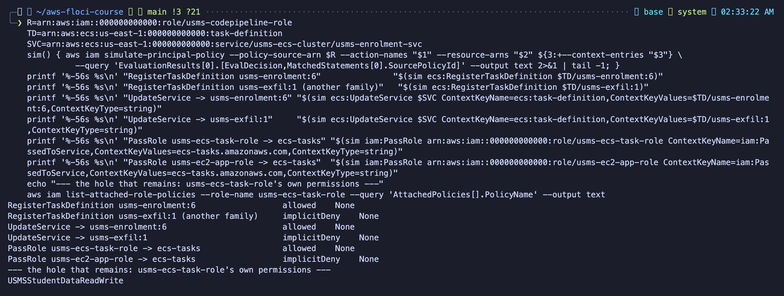
*Figure ex4c: simulate-principal-policy - cross-family register/update and the unrelated PassRole implicitDeny.*

---

## Exercise 5 - Advanced: evidence for an auditor

**The evidence chain.** `outputs/lab-12-release-evidence.md` (git-ignored, generated by reading each
link from the API, figure ex5a) records:

1. the S3 version of the r7 source archive, `217aa2a7…`;
2. the pipeline execution that consumed it, `035fe20f…`;
3. the build ID: the pipeline's build 16 **FAILED** at DOWNLOAD_SOURCE. The r7 image was built and
   pushed by the same buildspec run on my laptop (`buildId: local`);
4. the image digest, `c3c1150a…` (ledger and registry);
5. the task definition revision naming `:r7`, revision 4;
6. the service's current revision and the **`RepoDigests` of the running containers**.

**The deliberate break** (figures ex5b, ex5c):

| Time (UTC) | Action | `describe-images imageTag=r7` |
|---|---|---|
| 20:34:01 | `put-image` with `r7-alt`'s manifest under tag `r7` | **`f9ff16af…`** |
| 20:34:13 | `put-image` with the original manifest under tag `r7` | `c3c1150a…` (restored) |

Both moves are in the ledger, so it now has five lines for two tags. The service stayed on revision 4
throughout, and its running containers kept `c3c1150a…`. **Revision 4 read exactly the same before,
during and after.**

**What the chain proves, and where it breaks** (§8 of the evidence file):

| Link | Holds after a retag? |
|---|---|
| source = S3 version `217aa2a7…` | yes - S3 versions are immutable |
| execution `035fe20f…` consumed it | yes, but that execution **failed** at Build |
| that execution produced the image | **not proved on Floci** - the image came from the local run |
| `r7` → `c3c1150a…` | **no** - the tag answered `f9ff16af…` for twelve seconds |
| revision 4 → `:r7` | **no** - it names a tag, so it can't say which bytes |
| service → revision 4 | yes |
| tasks → `c3c1150a…` | only for tasks already running; a task started in the window would have pulled the alt bytes under the same revision |

**The broken link is tag → bytes.** Every record downstream of it (the task definition, the service,
`deploy-evidence.txt`) names `:r7` and doesn't change when `r7` moves. So none of them can tell an
auditor which bytes ran. Only the ledger written at push time and the runtime digest of a running
container can, and the pipeline produces neither.

**The fix is to deploy by digest.** Write `…/usms-enrolment@sha256:…` into `imagedefinitions.json`
(the build knows it from the push), or use immutable unique tags (Exercise 2). Then the task
definition itself becomes evidence.

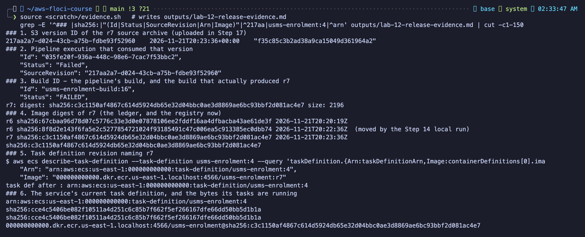
*Figure ex5a: the evidence chain, every link read from the API.*

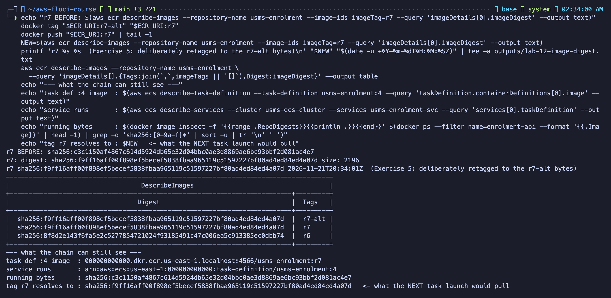
*Figure ex5b: r7 deliberately retagged to the r7-alt bytes; revision 4 unchanged.*

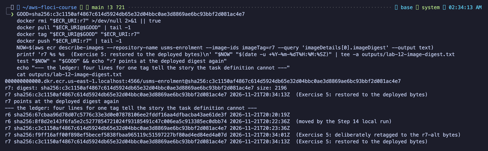
*Figure ex5c: r7 restored to the deployed digest; the ledger shows both moves.*
