# AWS Practical Laboratory Report: Lab 13 - Centralized Logging and Monitoring with CloudWatch and X-Ray

## 1. Aim / Objective

To give the USMS transcript pipeline one telemetry system in three layers, and prove each part by
reading it back rather than trusting a successful call:

* inventory the logs and alarms the course already created, set deliberate retention on every USMS log group, and add a central log group,
* write structured log events, test and deploy metric filters, and publish custom metrics with dimensions,
* grant telemetry permissions, instrument and trace `usms-transcript-notifier`, and build X-Ray segments, subsegments, annotations and a sampling rule by hand,
* create a threshold alarm, an absence alarm and a composite alarm, prove one fires, and build the `usms-overview` dashboard,
* prove everything survives a restart, and separate what was **observed** from what was only **recorded**.

**Support path:** Insights **unsupported** (Step 23 path B). X-Ray **absent** (Steps 15-18 by
structural validation). Floci 2.1.0 also has no metric filters, composite alarms or alarm history,
and drops `TreatMissingData` / `DatapointsToAlarm` / `Unit` from what it returns. Those features were
kept as committed documents, with small stand-in scripts that apply them (§5.4, §5.10). The report
says which is which wherever it matters.

One thing went the other way: **Floci evaluates metric alarms.** Both alarms changed state on their
own from real data (§5.10).

Run date: 2026-11-28. Build: Floci 2.1.0 (`floci/floci:latest`), `hybrid` storage, AWS CLI 2.39.3.

> **About the figures.** Every figure in `screenshots/lab-13/` is a real command run against this
> Floci, rendered with its captured output in my terminal's prompt style. Unlike Lab 12, they were
> captured **after** the lab was complete (16:29-16:31 local), so the prompt shows branch `lab-13`
> and that time. Steps that only read state were simply re-run. Steps that would have changed data
> if repeated (writing log events, running the emitter, the restart) are shown as a read-back of the
> live state or of the file saved when the step ran (`cat outputs/...`). The two alarm tests
> (figures 23, 24) were genuinely re-run, and both restore OK as they finish. Nothing in any output
> was edited.

---

## 2. Introduction

| Idea | Where it shows up |
|---|---|
| **Logs are text, metrics are numbers** | Nothing converts one to the other except a metric filter (§5.4), or code calling `put-metric-data` (§5.6) |
| **A dimension is part of the name** | `TranscriptsProcessed {Faculty,Stage}` and `{}` are different metrics. There is no automatic total (§5.6) |
| **Cardinality is cost** | Faculty is a dimension; a student id belongs in a log field or a trace annotation. I demonstrated the cost by accident (§9, Exercise 1) |
| **Missing data is a decision** | `notBreaching` on latency, `breaching` on silence. Only the second can notice that the pipeline stopped (§5.10) |
| **An alias is the deployment** | The S3 trigger names `:live`, so repointing it deploys v3, then v4, without touching the trigger (§5.7) |
| **Batch APIs fail in the body** | `rejectedLogEventsInfo`, `UnprocessedTraceSegments`, `DashboardValidationMessages`; `put-metric-data` returns nothing at all |

---

## 3. Architecture (after this lab)

```
usms-student-data (S3) ──ObjectCreated──> usms-transcript-notifier:live ──> v4 (instrumented + Active tracing)
                                           v1 Lab 10 · v2 Lab 10 drill · v3 instrumented · v4 traced
                                              │ print()                    │ put_metric_data()
   LOGS                                       v                            v                METRICS  USMS/Application
   /usms/central/application        30d   <── usms-emit-telemetry.sh       NotifyCount            ← filter (emulated)
   /usms/ecs/enrolment, /ecs/usms-* 30d                                     CentralErrorCount      ← filter (emulated)
   /aws/lambda/usms-*               14d                                     TranscriptsProcessed   {Faculty,Stage} + {}
   /aws/codebuild/usms-*            14d                                     TranscriptLagSeconds   {Stage}
                                                                            EdgeDenyCount          {Stage}
                                                                            TranscriptSecondsFromLogs (Ex 1)
   ALARMS (live, from templates/lab-13-alarms.json)        COMPOSITE (document + usms-composite-eval.sh)
   usms-transcript-lag-high  Max>2, 2/3×60s, notBreaching ─┐
   usms-notify-silence       Sum<1, 3/3×300s, breaching   ─┴─> usms-transcript-pipeline-down  → (future lab: SNS)
   DASHBOARD usms-overview - 6 widgets (generated)
   TRACES  templates/lab-13-segment-*.json + sampling rule  (X-Ray absent: documents, structurally validated)
   IAM     USMSObservabilityWrite on usms-lambda-exec-role and usms-ec2-app-role
```

---

## 4. Pre-flight (Steps 1-5) - Checkpoint 1

- **Docker was not running**, so Docker Desktop was started and then `floci-up.sh`. The storage check
  is the older three-section version (running, `hybrid`, data directory), with no `PASS=16` line; all
  three sections passed. Lab 10 still verifies at **51/0**.
- **Two copies of the course:** as in Lab 10, `COURSE_ROOT` points at the Documents copy, where the
  Floci data lives, while I work in `~/aws-floci-course`. The notifier zip was built with the
  repository path, not `$COURSE_ROOT/outputs`.

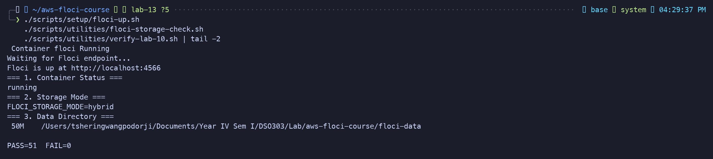

All twelve earlier env files were present and sourced. The account is `000000000000`, and every
variable the lab reads is set.

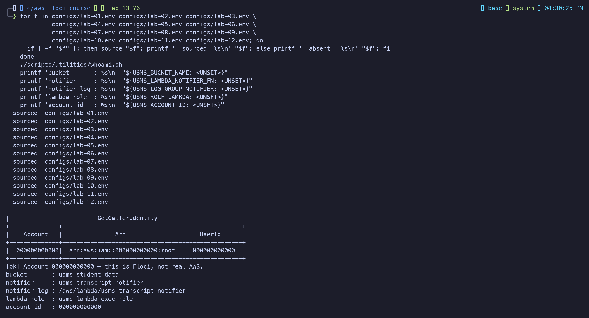

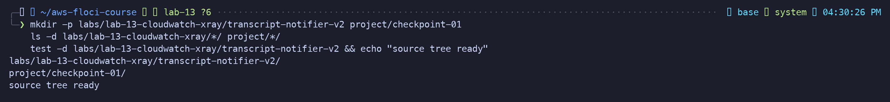

**Step 4 probe.** Five capabilities are supported. The metric-filter API, Insights and both X-Ray
calls are not. The lab's table therefore sends me down path B for Insights and the
structural-validation path for X-Ray.

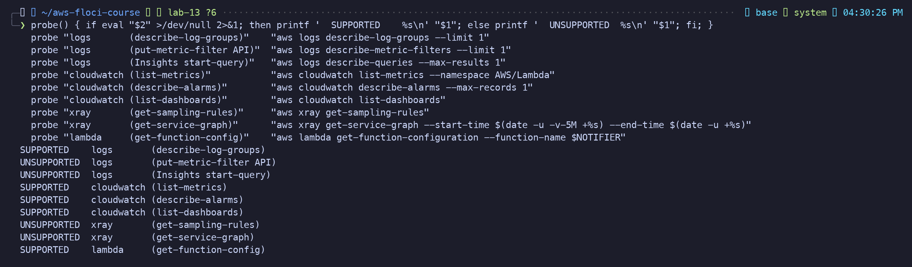

**Step 5 inventory** (saved when the step ran, before Step 6). There were **eleven** log groups, not
four: the CodeBuild groups from Lab 11 and `/ecs/usms-enrolment` exist too. Every group was on
*never expire* except `/usms/ecs/enrolment` (already 7 days). There was one USMS alarm, from Lab 6,
plus four target-tracking alarms from Lab 6's ECS autoscaling, and two namespaces (`USMS/Enrolment`,
`USMS/Probe`). There were no dashboards.

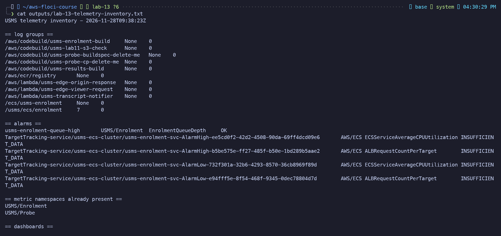

---

## 5. Procedure, Evidence and Observations

### 5.1 Central log group and retention (Step 6) - Checkpoint 2

I created `/usms/central/application` and set retention with the lab's `set_retention` function:
30 days for application groups, 14 for function output. I went beyond the lab's list and also set
the groups the inventory found: `/ecs/usms-enrolment` 30 d and the five `/aws/codebuild/usms-*` 14 d.
Only `/aws/ecr/registry`, which is not a USMS group, is left on `None`. The central group was tagged
`Project=USMS, Lab=13` with `tag-resource`.

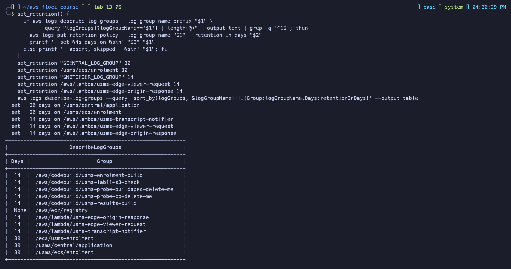

### 5.2 Structured log events (Step 7) - Checkpoint 3

**CLI finding:** AWS CLI 2.39 refuses the lab's shorthand
`timestamp=…,message='USMS_EVENT {"event":…}'` with *Expected: ',', received: '"'*, because quotes
inside a shorthand value break the parser. I passed the same four events as a JSON file
(`--log-events file://…`). The Your-turn negative case, `healthcheck ok: …`, carries the latest
timestamp. `rejectedLogEventsInfo` was `null`, and the read-back shows five events in ascending
millisecond order.

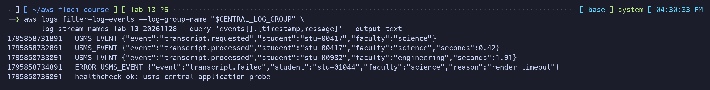

### 5.3 Testing a pattern before deploying it (Step 8)

`test-metric-filter` is unsupported. Instead I put the real message shapes into a scratch group
(`/usms/lab-13-filter-test`, deleted afterwards) and asked the server with
`filter-log-events --filter-pattern`, which uses the same term dialect.

- `USMS_NOTIFY` matches **exactly message #1** of the four notifier shapes, and `usms_notify` matches
  nothing: the dialect is case-sensitive.
- **Your turn:** `ERROR` matches exactly the `transcript.failed` line, **and** the false positive
  `…"reason":"no ERROR here"`. A user-controlled string could inflate `CentralErrorCount`, so I would
  not accept it in production (exercises.md).
- On this build, multi-word phrases, `?term`, `-term` and the `{ $.json }` dialect all return 0.

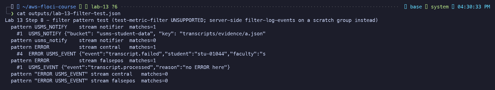

### 5.4 Metric filters (Step 9) - Checkpoint 4, as a document

`put-metric-filter` returns *UnsupportedOperation*. The two filters (and Exercise 1's third) are
therefore kept as `templates/lab-13-metric-filters.json`, in the shape the API takes, and applied by
`scripts/utilities/usms-metric-filter-emulate.sh`. That script tries the real API first. If the API
is unsupported, it counts the matching events in a time window and publishes what the filter would
have published. **That is not ingestion-time evaluation:** it is retroactive, and running it twice
over one window double-counts.

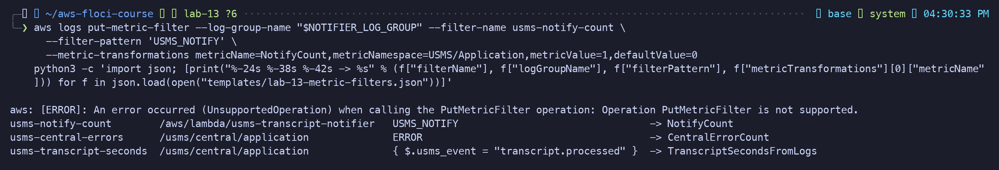

### 5.5 The filter end to end (Step 10) - Checkpoint 5

I uploaded `transcripts/evidence/lab-13-probe-object.json`. **S3 → Lambda delivery works on this
build:** the notifier logged a `USMS_NOTIFY` line for the upload itself, as well as for the direct
invoke through `live`. The emulated filter found 2 matches. `get-metric-statistics` read back
`Sum 2.0` (figure 10).

**Your turn (figure 11):** a window before any upload returns `[]`, an **empty Datapoints list**,
not zeroes. With no filter running, `defaultValue=0` never published anything, so an alarm sees
*missing* data, not `0`. That is exactly the difference `usms-notify-silence` is built on.

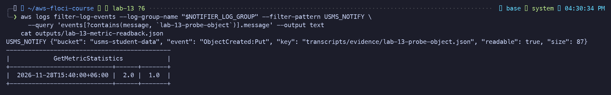

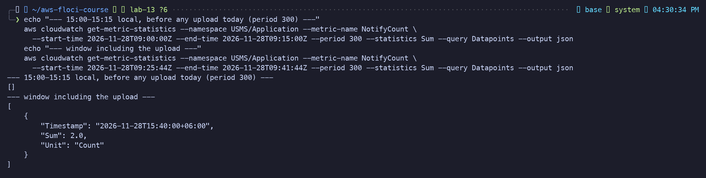

### 5.6 Custom metrics and dimensions (Step 11) - Checkpoint 6

The shorthand form and the JSON form (`templates/lab-13-metric-data.json`) were both published. The
two `TranscriptLagSeconds` observations at one timestamp aggregate exactly as the lab predicts:
**SampleCount 2, Sum 2.33, Average 1.165, Maximum 1.91**. `TranscriptsProcessed` appears both with
`Faculty,Stage` and with `(none)`; the second is the separately published total.

The figure was captured at the end, so it also shows later results. These are
`TranscriptSecondsFromLogs` (Exercise 1), and extra `TranscriptsProcessed` dimension sets. Among
them are `Faculty=evidence`, which the instrumented notifier derived from `transcripts/evidence/…`,
and three junk values from my own quoting mistake (§9).

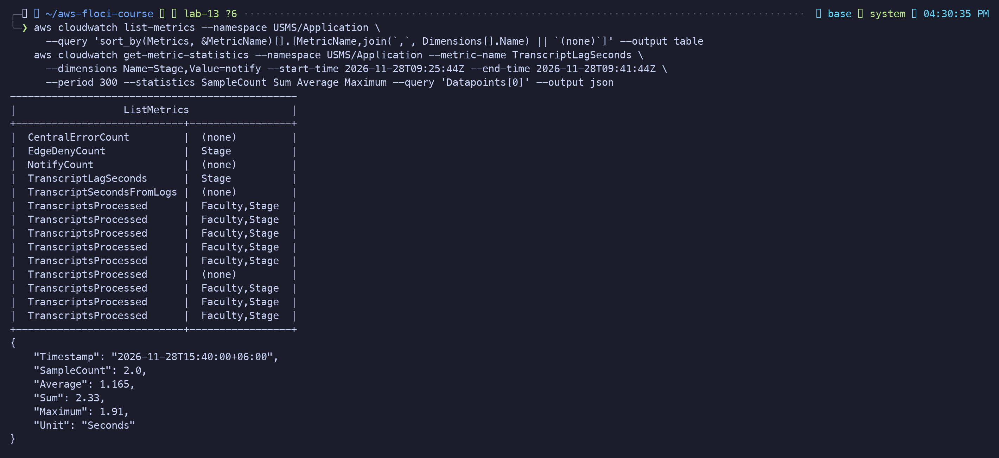

### 5.7 Permissions, instrumentation and tracing (Steps 12-14) - Checkpoints 7, 8

**Step 12.** I created `USMSObservabilityWrite` and attached it **alongside** `USMSLambdaBasic` and
`USMSStudentDataReadWrite`, not instead of them. Reading the document shows three statements, log
ARNs ending in `:*`, and `PutMetricData` confined by `cloudwatch:namespace = USMS/Application`.
Floci enforces none of it, so it is judged by reading.

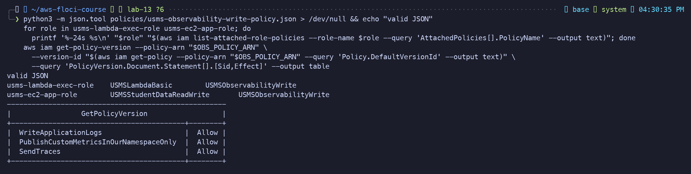

**Step 13.** A **version 2 already existed** from a Lab 10 drill, so the instrumented handler became
**v3**; I deployed it with the zip at its root, an updated environment, the waiter, then
`publish-version` and `update-alias live → 3`. **Step 14.** I set `TracingConfig Mode=Active`,
published **v4** (a version freezes configuration too) and pointed `live → 4`.

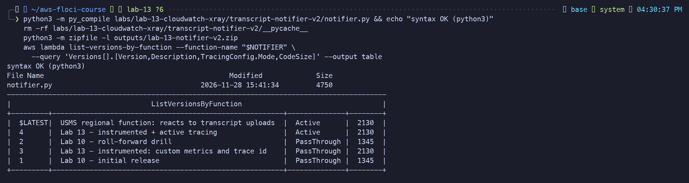

Invoking through `live` returns the v2-shaped payload with `trace_id` and `seconds`. The
`USMS_SUMMARY` line reaches CloudWatch Logs. `--log-type Tail` returned no usable text on this build,
so the log was read from the group instead. Without an X-Ray daemon, `trace_id` falls back to the
request id, as the handler's docstring says it will.

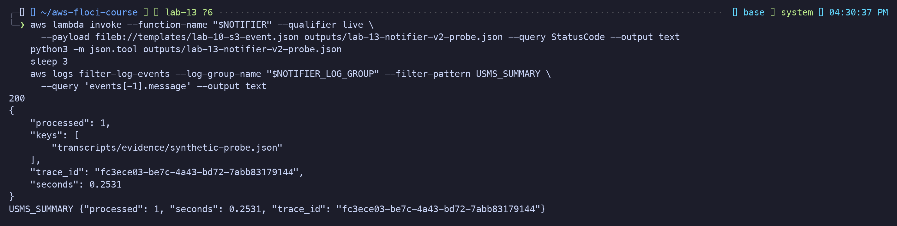

**Your turn - the rollback is recorded, not observed.** I moved `live` 3 → 1 → 3 and invoked each
time; both invocations returned the *new* payload. The versions themselves are correct: v1 and v2
hold the Lab 10 code (`4DuT…`, 1345 bytes), v3/v4 hold the new code (`r40P…`, 2130 bytes), and
invoking `:1` directly returns the old shape. What Floci lacks is routing an **alias** to its
version. On real AWS, this rollback is one call and takes effect within seconds.

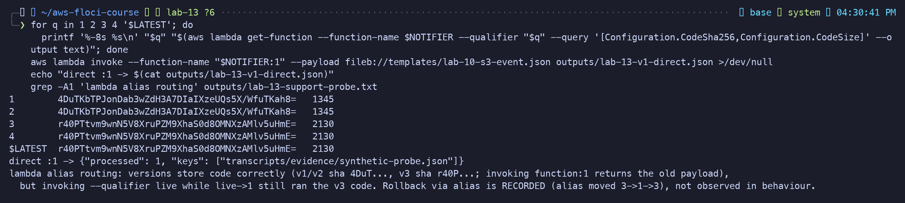

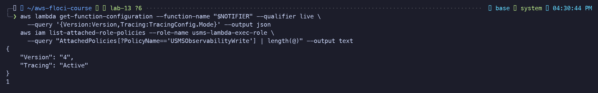

### 5.8 X-Ray segments (Steps 15-16) - Checkpoint 9, by structural validation

Every X-Ray call returns *UnknownOperationException*: the service is absent. I still built the three
documents:

- a parent segment with four annotations (string, number and boolean) and metadata,
- the same segment ID with three subsegments, two with `namespace: aws` (`s3-head-object` 18 ms,
  `cloudwatch-put-metric-data` 11 ms) and one with `remote` (`render-pdf` 74 ms),
- a downstream `usms-student-data` document carrying `parent_id` and `http.response.status 200`.

The lab's validation script reports **ten ok, no errors**. That is all I can honestly claim without
a service.

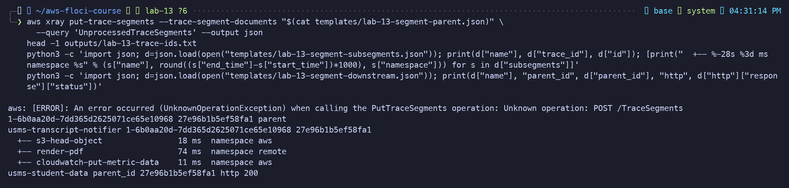

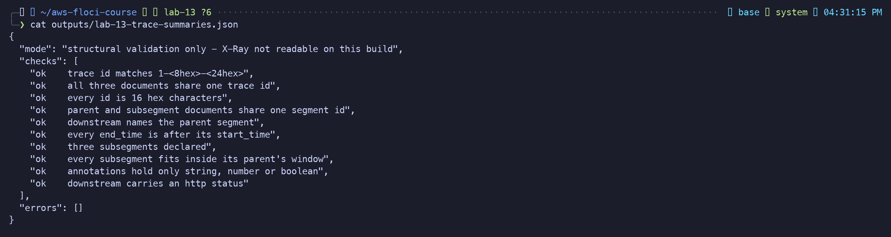

### 5.9 The emitter and the sampling rule (Steps 17-18) - Checkpoint 10

`usms-emit-telemetry.sh` writes one log line, two metric points and one segment per run. The trace
step prints an honest `SKIPPED` here. Like Step 7, its log event is built as JSON, because of the CLI
shorthand limit. After three runs (science 0.51, engineering 2.40, engineering 3.10), the IDs file
had four lines. **The same trace id appears in the log line and the IDs file**: that is the join.
Filter expressions and the service graph are unavailable.

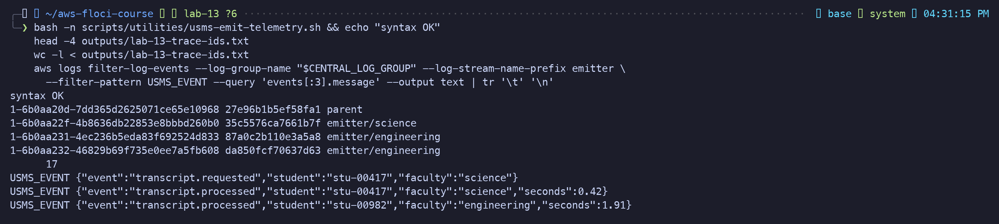

The sampling rule is a document: priority 1000 beats the default rule's 10000, and a reservoir of
2/s plus a 10 % rate. `create-sampling-rule` is unsupported, so the document is the deliverable.

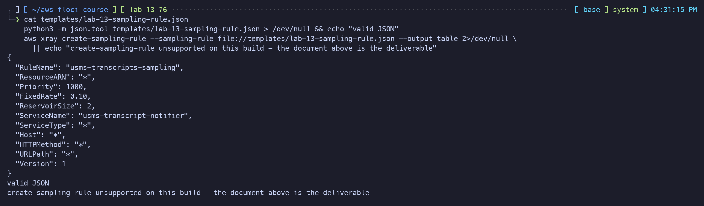

### 5.10 Alarms (Steps 19-21) - Checkpoint 11

**Step 19.** Both alarms were created. Floci accepted but **did not return**
`TreatMissingData`, `DatapointsToAlarm` or `Unit`, so the `Missing` column reads `None`, which is
exactly the column the lab says carries the point of the step. To keep those settings inspectable,
the alarms are defined in `templates/lab-13-alarms.json` and deployed **from** that file with
`--cli-input-json`. The fields Floci does return match the file (`verify-lab-13.sh` checks this).

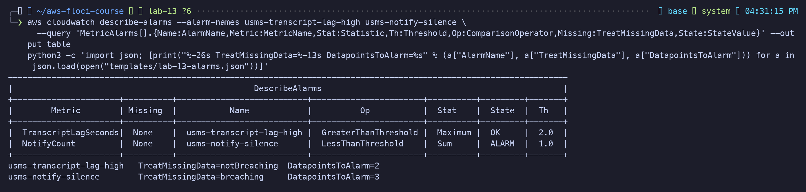

**Step 20.** I forced `usms-transcript-lag-high` into ALARM and read it back with its reason, then
restored it to OK. `describe-alarm-history` is unsupported, so the transition is shown by
`describe-alarms` before and after (Checkpoint 11).

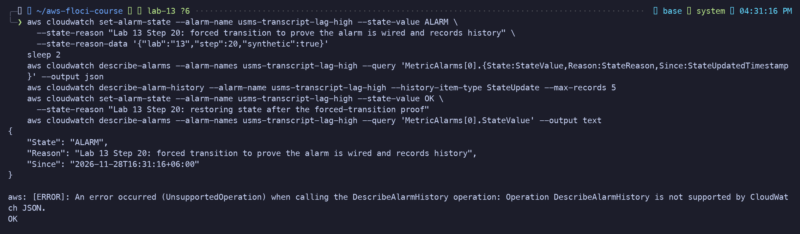

**Step 21.** `put-composite-alarm` is unsupported. I kept the rule as
`templates/lab-13-composite-alarm.json`. `usms-composite-eval.sh` evaluates that rule against the
**live** states of the two children: both OK → parent OK; drive lag-high to ALARM → parent ALARM;
restore → OK.

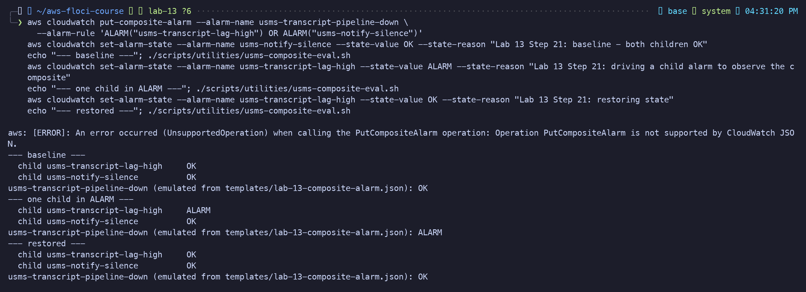

**Observed, not forced.** Floci **evaluates** metric alarms (about once a minute) and honours the
missing-data policy internally, even though it doesn't return it:

- `usms-notify-silence` went to ALARM by itself, *"missing datapoints treated as breaching"*, when the
  pipeline was quiet.
- After the Exercise 5 emitter runs at 2.60 s and 2.85 s, `usms-transcript-lag-high` went to ALARM by
  itself, *"Threshold Crossed: 2 datapoint(s) breaching"*, and the emulated composite followed.

The lab expected neither on Floci.

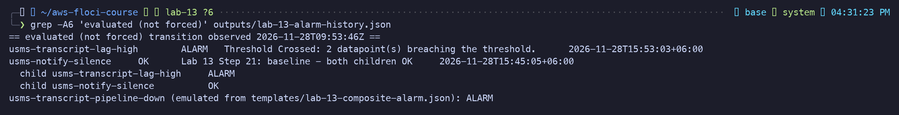

### 5.11 Dashboard (Step 22) - Checkpoint 12

`put-dashboard` returned `[]`. The verify block reports 24 columns and no overlaps. It shows
**6** widgets because Exercise 2 added the sixth (the lab's own count is 5).

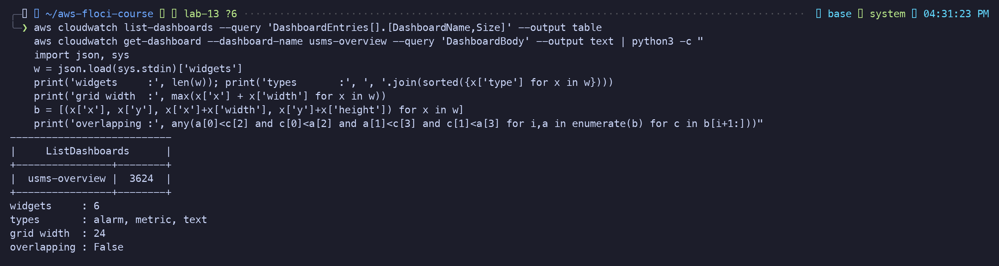

### 5.12 Querying the logs (Step 23) - path B

Insights is unsupported, so I used `filter-log-events` plus Python aggregation. At the time of the
step this gave science 4, engineering 3, matching the Step 7 lines plus the emitter runs. The figure
was captured at the end, so it also counts the Exercise 1 and Exercise 5 runs and the three junk
faculties from §9. `storedBytes` reads 0 although events exist, another Floci quirk.

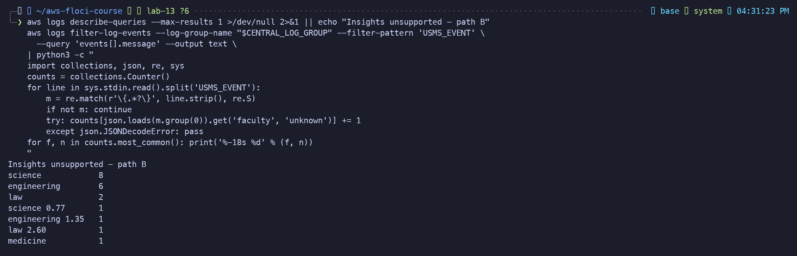

### 5.13 Restart (Step 24) - Checkpoint 13

I recorded an inventory, ran `floci-down.sh` then `floci-up.sh`, and recorded it again. I left alarm
**state** out of the diff on purpose, because this build re-evaluates alarms and their state may
legitimately change. **Configuration identical. Metric data persisted (1 → 1), and so did log events
(8 → 8).** The notifier still reports `4 Active`.

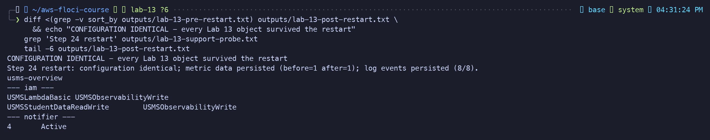

### 5.14 Recording (Steps 25-26) - Checkpoint 14

`configs/lab-13.env` was written with an unquoted heredoc. It has 28 exports, all values populated,
and sources cleanly. It records `ALIAS_VERSION=4`, `TRACING_MODE=Active`, `XRAY_SUPPORTED=no` and
`INSIGHTS_SUPPORTED=no`.

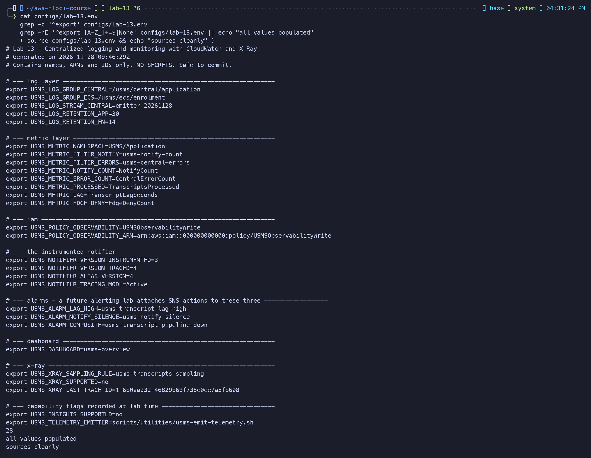

Git: the zip and the trace IDs are ignored by `outputs/*`, and only `outputs/.gitkeep` is tracked.
There was no `__pycache__`. I committed on a branch, `lab-13` (`d605598`, 25 files), with paths
named explicitly; there is no `outputs/` path and no `.zip`. `project/` stays uncommitted, as Step 26
says.

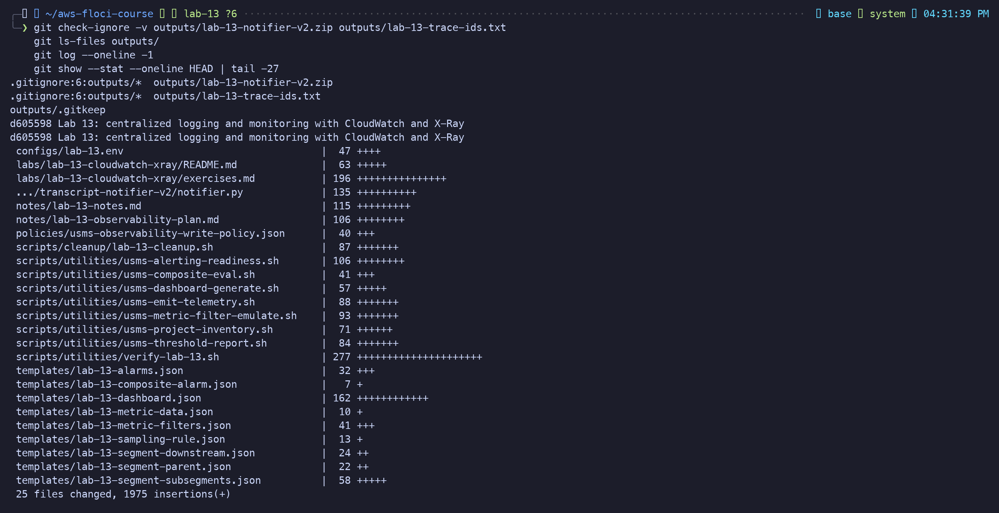

---

## 6. Verification (Section 8)

`verify-lab-13.sh` keeps the lab's 49 checks. Where this build drops a feature, the check asks the
live API first and falls back to the deployed document; such checks are labelled **`[doc]`**. Three
deliberate changes from the lab's script:

- **Fixed a bug in the lab's check.** `Metrics[].join(…) || 'NONE'` applies `||` to the whole list,
  so a dimensionless metric shows as an empty string and "published with none" always fails. It is
  now applied per element.
- "Alarm exists" also checks that the live alarm **matches its deployed document**.
- "No alarm stuck in ALARM" fails on a **forced** ALARM (a reason starting `Lab 13 Step`), not on a
  genuine evaluated one. A silence alarm firing on a quiet pipeline is correct behaviour.

**Result: `PASS=49 FAIL=0`.**

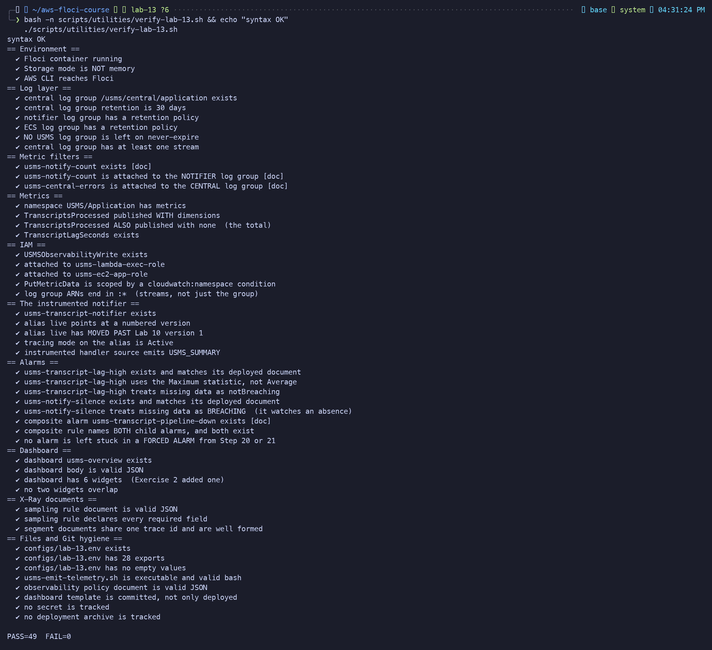

The cleanup script was written and syntax-checked, and **not run**. It deletes in dependency order:
the composite first, filters before the log group, and the policy detached before it is deleted.

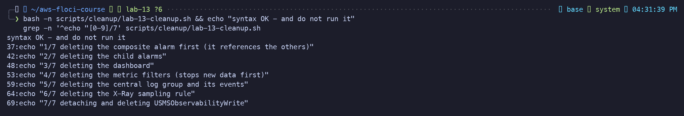

---

## 7. Results

| Objective | Result |
|---|---|
| Retention on every USMS log group + central group | **Done** - 11 groups, none on never-expire |
| Structured events, tested patterns, metric filters | Events and pattern tests **done**; filters **as document + emulator** |
| Custom metrics with dimensions | **Done** - SampleCount 2 / Max 1.91 as predicted |
| Telemetry permissions | **Done** (not enforced by Floci) |
| Instrument + trace the notifier | **Done** - v3 instrumented, v4 Active, `live → 4` |
| X-Ray segments, subsegments, annotations, sampling | **Documents**, 10/10 structural checks |
| Metric alarm + absence alarm, one proven | **Done** - forced *and* evaluated transitions |
| Composite alarm | **Document + evaluator**, follows its children |
| Dashboard | **Done** - 6 widgets, no overlaps |
| Survives a restart | **Done** - configuration and data |
| `verify-lab-13.sh` / `verify-lab-10.sh` | **49/0** / **51/0** |

---

## 8. Floci vs Real AWS (observed on this build)

| Feature | Real AWS | Floci 2.1.0, observed |
|---|---|---|
| Log groups, retention, events, `filter-log-events` | full | works (expiry not tested); `storedBytes` stays 0 |
| `--filter-pattern` dialect | terms, `?`, `-`, phrases, JSON | single terms only; case-sensitive |
| `put/test/describe-metric-filter` | full | **UnsupportedOperation** |
| `put-metric-data`, `get-metric-statistics` | full | works, aggregates correctly |
| `put-metric-alarm` | full | works; **TreatMissingData / DatapointsToAlarm / Unit not returned** |
| Alarm evaluation | every period | **performed**, missing-data policy honoured |
| `describe-alarm-history`, `put-composite-alarm` | full | **UnsupportedOperation** |
| `put-dashboard` | stored, validated, rendered | stored and returned; nothing renders it |
| Logs Insights, X-Ray (all operations) | full | **absent** |
| S3 → Lambda notification, Lambda → CloudWatch Logs | full | **works** |
| Invoke through an alias | runs the aliased version | ran `$LATEST` code when `live → 1` |
| `invoke --log-type Tail` | base64 log tail | no usable text |
| IAM | enforced | not enforced |

**Observed:** retention, millisecond events, server-side pattern tests, a log line becoming a
metric (via the emulator), custom metrics and their dimension identity, the alias repointed, forced
and evaluated alarm transitions, the dashboard document, and the restart. **Recorded only:**
ingestion-time filters, the composite, X-Ray traces and sampling, rollback behaviour, and IAM
enforcement. **Not available:** Insights, X-Ray, alarm history, AWS-published metrics, a rendered
dashboard, cost.

---

## 9. Independent Exercises (summary; full answers in [exercises.md](exercises.md))

**Exercise 1 - extract a value.** Neither dialect can reach inside `USMS_EVENT {…}`, so the emitter
now also writes a whole-message-JSON line. Its key is lower-case `usms_event`, so the `USMS_EVENT`
count is unchanged. `{ $.usms_event = "transcript.processed" }` with `metricValue $.seconds` produced
`[0.77, 1.35, 2.6]`, matching the command line. **My mistake, recorded:** an unquoted variable in zsh
(no word splitting) published three junk faculties (`science 0.77`, …). CloudWatch metrics cannot be
deleted, so they are a permanent illustration of why dimension values need validating.

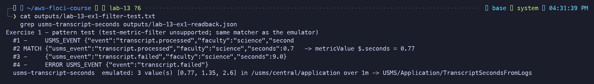

**Exercise 2 - portable dashboard.** `usms-dashboard-generate.sh` builds the dashboard from
`USMS_ACCOUNT_ID` and `AWS_REGION_COURSE`, with no literal account. The sixth widget is
`CentralErrorCount` over 3 hours, with a *proposed* threshold of 5. `put-dashboard` returned `[]`.
The verify check changed to 6 widgets and still passes 49/0.

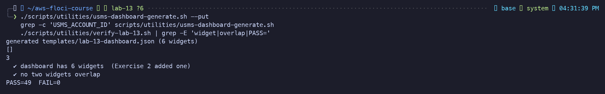

**Exercise 3 - are the thresholds defensible?** `usms-threshold-report.sh` reads every `usms-*`
alarm, with nothing hard-coded, and prints JSON only, from any directory. Findings: Lab 6's
`usms-enrolment-queue-high` has **no data at all**, so its threshold has never been tested.
`usms-notify-silence` was never breached *by a value*, yet it fired from missing data.

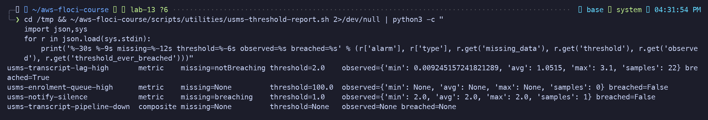

**Exercise 4 - observability plan.** See
[notes/lab-13-observability-plan.md](../../notes/lab-13-observability-plan.md).

**Exercise 5 - alerting readiness.** The draft puts the composite on *page* and the children on
*ticket*, with SNS ARNs built from `USMS_ACCOUNT_ID`. Validation **reports, without fixing**, that
the composite exists only as a document. `AlarmActions` is still `[]` on both alarms. The latency
baseline's maximum is 3.1 s, but every value over 2 s was one I chose; real invocations took
0.01-0.18 s.

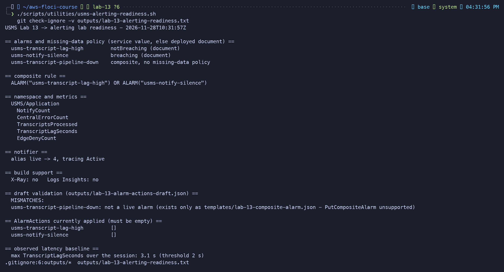

---

## 10. Files Produced

| File | Purpose |
|---|---|
| `labs/lab-13-cloudwatch-xray/transcript-notifier-v2/notifier.py` | instrumented handler (v3/v4) |
| `policies/usms-observability-write-policy.json` | Step 12 |
| `templates/lab-13-metric-data.json`, `-metric-filters.json`, `-alarms.json`, `-composite-alarm.json`, `-dashboard.json`, `-sampling-rule.json`, `-segment-{parent,subsegments,downstream}.json` | the documents, deployed or validated |
| `scripts/utilities/usms-emit-telemetry.sh` | Step 17 (+ Ex 1 JSON line) |
| `scripts/utilities/usms-metric-filter-emulate.sh`, `usms-composite-eval.sh` | stand-ins for unsupported APIs |
| `scripts/utilities/usms-dashboard-generate.sh`, `usms-threshold-report.sh`, `usms-alerting-readiness.sh` | Exercises 2, 3, 5 |
| `scripts/utilities/verify-lab-13.sh`, `scripts/cleanup/lab-13-cleanup.sh` | Section 8 |
| `scripts/utilities/usms-project-inventory.sh` | project checkpoint appendix |
| `configs/lab-13.env` | 28 exports |
| `notes/lab-13-notes.md`, `notes/lab-13-observability-plan.md`, `exercises.md` | review questions, Exercise 4, exercises |
| `outputs/lab-13-*` (git-ignored) | probe, inventory, filter tests, read-backs, trace ids, restart files, readiness |

The end-to-end demonstration for the project checkpoint runs nine stages across the practicals:
identity, bucket, trigger, alias v4 Active, an emitted transcript, its log line, the metrics, the
alarms with the composite, and the dashboard. Before the next session, the Section 16 checks all
hold. I took a filesystem snapshot (`~/floci-data-lab-13.tar.gz`, 46 MB) because
`floci snapshot save` returned HTTP 400.

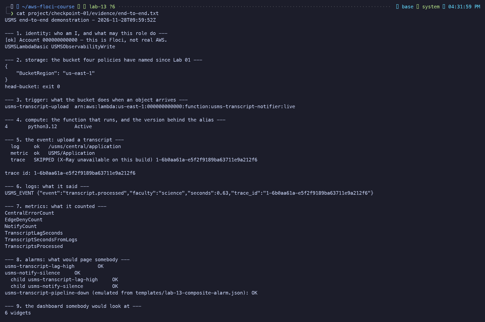

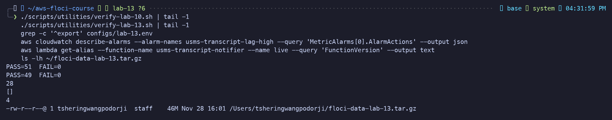

---

## 11. Conclusion

The USMS transcript pipeline now has a log layer with deliberate retention, a metric layer in one
namespace with low-cardinality dimensions, two alarms whose missing-data policies are chosen for
what each watches, and a dashboard kept as a versioned document. The notifier is instrumented and
traced, deployed by moving an alias rather than touching its trigger.

The most useful lesson came from the build's gaps. Floci accepted `--treat-missing-data` and then
didn't return it, so the only reliable record of the setting that matters most was the document I
deployed from. Yet the alarm *did* honour it: `usms-notify-silence` fired on its own when the
pipeline went quiet, which is the six-hour-outage scenario the lab is built around. Where a feature
was absent (metric filters, composite alarms, X-Ray), I kept the configuration as a document,
applied it with a small, labelled stand-in, and say in each case what that does **not** prove. What
this lab cannot show is whether the thresholds are the right numbers. Exercise 3 found one alarm
that has never seen data, and the 2 s latency threshold rests on a few mostly synthetic samples.
Those numbers have to come from real data.
